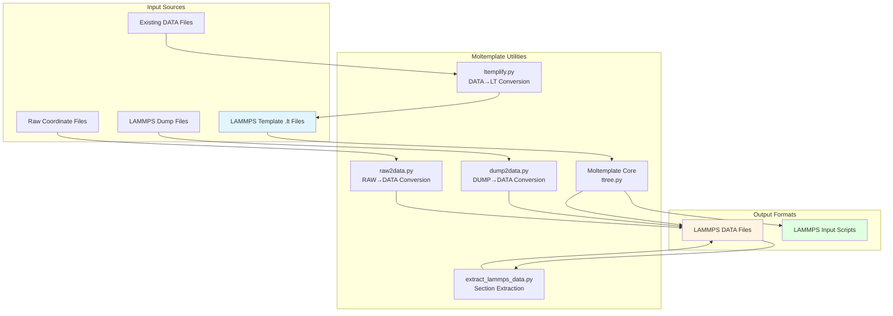
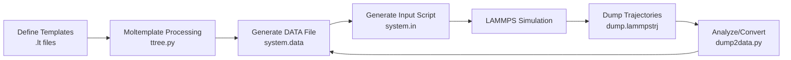

The LAMMPS data file format serves as the primary data exchange format between moltemplate and LAMMPS simulations. This format encapsulates atomic coordinates, molecular topology, force field parameters, and simulation box specifications in a structured text format that moltemplate can generate, read, and manipulate through various conversion utilities.

## Data File Architecture

Moltemplate implements a comprehensive parser and generator for LAMMPS data files through multiple specialized tools that work in concert to handle different aspects of data file processing. The architecture follows a modular design where each utility addresses specific data transformation needs while maintaining compatibility with the standard LAMMPS read_data command.



The processing pipeline demonstrates how moltemplate can generate DATA files from templates, convert between various formats, and extract specific sections for analysis or manipulation. Each tool serves a specific purpose in the molecular simulation workflow, enabling users to move data between different representations seamlessly.

## Standard Data File Structure

A LAMMPS data file consists of distinct sections, each containing specific information about the simulation system. Moltemplate recognizes and generates 25+ standard sections through the `data_file_header_names` set defined in the core configuration [lttree_styles.py](/moltemplate/lttree_styles.py#L66-L87).

### Header Section

The header section begins with the descriptive line "LAMMPS Description" followed by counts of various entities and simulation box dimensions:

```
LAMMPS Description

     6  atoms
     5  bonds
     6  angles
     4  dihedrals
     6  impropers

     2  atom types
     3  bond types
     3  angle types
     2  dihedral types
     2  improper types

  -8.0 8.0 xlo xhi
  -8.0 8.0 ylo yhi
  -8.0 8.0 zlo zhi
```

Sources: [input_data_w_coeffs.data](/tests/test_ltemplify_files/input_data_w_coeffs.data#L1-L18)

The header serves dual purposes: it provides LAMMPS with metadata about system composition and defines the simulation boundaries. Moltemplate processes this section to understand the system scale and allocate appropriate memory during simulation setup.

### Section Organization

The complete set of recognized LAMMPS data file sections includes:

| Section Category | Section Names | Description |
|-----------------|--------------|-------------|
| **Atomic Data** | Atoms, Masses, Velocities | Atom coordinates, masses, and initial velocities |
| **Bonded Interactions** | Bonds, Angles, Dihedrals, Impropers | Molecular topology connectivity |
| **Force Field Coeffs** | Pair Coeffs, Bond Coeffs, Angle Coeffs, Dihedral Coeffs, Improper Coeffs | Standard force field parameters |
| **Mixed Pair Coeffs** | PairIJ Coeffs | Cross-interaction parameters between atom types |
| **Class2 Force Fields** | BondBond Coeffs, BondAngle Coeffs, MiddleBondTorsion Coeffs, EndBondTorsion Coeffs, AngleTorsion Coeffs, AngleAngleTorsion Coeffs, BondBond13 Coeffs, AngleAngle Coeffs | Advanced class2 force field terms |
| **Non-point Particles** | Ellipsoids, Lines, Triangles | Oriented particle properties |
| **Special Sections** | CMAP, Angles By Type, Dihedrals By Type, Impropers By Type | Specialized interaction definitions |

Sources: [extract_lammps_data.py](/moltemplate/extract_lammps_data.py#L26-L46), [lttree_styles.py](/moltemplate/lttree_styles.py#L66-L87)

Moltemplate extends the standard LAMMPS format with three moltemplate-specific sections ("Angles By Type", "Dihedrals By Type", "Impropers By Type") that enable defining interactions by atom type rather than explicit atom IDs, facilitating automatic interaction generation [extract_lammps_data.py](/moltemplate/extract_lammps_data.py#L38-L41).

## Atom Styles and Column Organization

LAMMPS supports 20+ atom styles, each defining a different column arrangement in the Atoms section. Moltemplate maintains a comprehensive mapping of these styles to their column definitions, enabling proper parsing and generation regardless of the chosen style [lttree_styles.py](/moltemplate/lttree_styles.py#L98-L123).

### Common Atom Styles

| Atom Style | Columns (in order) | Typical Use Case |
|------------|-------------------|------------------|
| **atomic** | atom-ID, atom-type, x, y, z | Simple atomic systems |
| **full** | atom-ID, molecule-ID, atom-type, q, x, y, z | Molecular systems with charges |
| **charge** | atom-ID, atom-type, q, x, y, z | Charged atomic systems |
| **molecular** | atom-ID, molecule-ID, atom-type, x, y, z | Neutral molecular systems |
| **angle** | atom-ID, molecule-ID, atom-type, x, y, z | Systems with angular potentials |
| **bond** | atom-ID, molecule-ID, atom-type, x, y, z | Systems with bond potentials |
| **dipole** | atom-ID, atom-type, q, x, y, z, mux, muy, muz | Systems with dipole moments |
| **sphere** | atom-ID, atom-type, diameter, density, x, y, z | Granular particles |
| **ellipsoid** | atom-ID, atom-type, ellipsoidflag, density, x, y, z | Anisotropic particles |
| **hybrid** | atom-ID, atom-type, x, y, z | Multiple styles combined |

Sources: [dump2data.py](/moltemplate/dump2data.py#L97-L124), [lttree_styles.py](/moltemplate/lttree_styles.py#L98-L123)

The **full** atom style represents the most common choice for biomolecular simulations, providing molecule identification and atomic charge information essential for force field calculations. Moltemplate defaults to this style when no specific style is indicated, though users can specify alternative styles through command-line arguments or file comments.

### Coordinate Handling

Moltemplate implements sophisticated coordinate transformation logic that distinguishes between different types of vector data:

- **Translation-invariant vectors**: Coordinates (x, y, z) undergo both rotation and translation during rigid-body transformations
- **Rotation-only vectors**: Dipole moments (mux, muy, muz), ellipsoid orientations experience only rotation
- **Fixed properties**: Atom types, molecule IDs, and other scalar quantities remain unchanged

This distinction is encoded in the `ColNames2Coords` and `ColNames2Vects` functions [dump2data.py](/moltemplate/dump2data.py#L231-L262), enabling proper handling of complex particle representations during coordinate transformations.

## Force Field Parameter Sections

Force field parameters reside in dedicated coefficient sections that define the mathematical relationships governing atomic interactions. Moltemplate generates these sections automatically from template definitions or preserves them when converting existing LAMMPS files.

### Standard Coefficient Sections

**Pair Coeffs**: Define non-bonded interactions (Lennard-Jones, Coulombic):
```
Pair Coeffs

1 0.076 3.55  # epsilon, sigma for atom type 1
2 0.03 2.42   # epsilon, sigma for atom type 2
```

**PairIJ Coeffs**: Define cross-interactions between different atom types:
```
PairIJ Coeffs

1 2 0.05 2.90  # epsilon, sigma for type 1-2 interactions
```

**Bond Coeffs**: Define bonded two-body interactions:
```
Bond Coeffs

1 340.0 1.08  # spring constant, equilibrium distance for bond type 1
2 549.0 1.34  # spring constant, equilibrium distance for bond type 2
```

**Angle Coeffs**: Define three-body angular interactions:
```
Angle Coeffs

1 35.0 117.0  # spring constant, equilibrium angle for angle type 1
2 35.0 120.0  # spring constant, equilibrium angle for angle type 2
```

Sources: [input_data_w_coeffs.data](/tests/test_ltemplify_files/input_data_w_coeffs.data#L29-L45)

**Dihedral Coeffs**: Define four-body torsional interactions with up to four cosine terms:
```
Dihedral Coeffs

1 0.0 14.0 0.0 0.0  # four cosine terms for dihedral type 1
```

**Improper Coeffs**: Define out-of-plane bending restraints:
```
Improper Coeffs

1 15.0 180.0  # spring constant, equilibrium improper angle
```

Sources: [input_data_w_coeffs.data](/tests/test_ltemplify_files/input_data_w_coeffs.data#L46-L51)

> [!TIP]
> Moltemplate automatically manages the remapping of atom, bond, angle, dihedral, and improper type numbers during template instantiation, ensuring that merged systems maintain correct type assignments despite having different original type numbering schemes. This enables seamless combination of molecules from different sources.

### Class2 Force Field Sections

Class2 force fields extend the standard harmonic representations with cross-coupling terms that capture more complex interactions. Moltemplate supports all class2 coefficient sections [extract_lammps_data.py](/moltemplate/extract_lammps_data.py#L31-L38):

| Section | Physical Meaning |
|---------|------------------|
| BondBond Coeffs | Bond-bond cross-coupling in angles |
| BondAngle Coeffs | Bond-angle cross-coupling in angles |
| MiddleBondTorsion Coeffs | Central bond-torsion coupling in dihedrals |
| EndBondTorsion Coeffs | Terminal bond-torsion coupling in dihedrals |
| AngleTorsion Coeffs | Angle-torsion coupling in dihedrals |
| AngleAngleTorsion Coeffs | Angle-angle-torsion coupling in dihedrals |
| BondBond13 Coeffs | 1-3 bond coupling in dihedrals |
| AngleAngle Coeffs | Angle-angle coupling in impropers |

## Data File Processing Tools

Moltemplate provides four primary utilities for working with LAMMPS data files, each optimized for specific transformation tasks.

### ltemplify.py: DATA to LT Conversion

The `ltemplify.py` utility converts existing LAMMPS data files and input scripts into moltemplate format, extracting molecular building blocks for reuse in larger systems. This tool implements a sophisticated three-pass parsing strategy that captures all relevant information [ltemplify.py](/moltemplate/ltemplify.py#L1181-L1250):

- **Pass 1**: Determines atom style and atom type names from data and input script files
- **Pass 2**: Parses atomic coordinates, molecular topology, masses, and force field coefficients
- **Post-Processing**: Remaps type numbers, resolves dependencies, and formats output

> [!TIP]
> When using ltemplify.py with the `-mol` argument to extract specific molecules, the utility automatically filters all bonded interactions, force field parameters, and relevant LAMMPS commands to include only those affecting the selected molecule, creating self-contained template definitions.

### dump2data.py: DUMP to DATA Conversion

The `dump2data.py` tool extracts instantaneous atomic configurations from LAMMPS dump files and updates existing DATA files with new coordinates. This capability enables restarting simulations with refined structures or analyzing trajectories at specific frames [dump2data.py](/moltemplate/dump2data.py#L664-L687).

The processing flow reads both the reference DATA file and the dump file, then replaces coordinate information while preserving all other system parameters. It handles triclinic boxes, multiple atom styles, and optional scaling/centering operations.

### raw2data.py: RAW Coordinate to DATA Conversion

The `raw2data.py` utility converts simple three-column coordinate files (x, y, z) into complete LAMMPS DATA files by combining them with a reference template. This tool is particularly useful for importing coordinates from external sources while maintaining existing force field parameters and topology [raw2data.py](/moltemplate/raw2data.py#L23-L50).

### extract_lammps_data.py: Section Extraction

The `extract_lammps_data.py` script provides precise control over data file content by extracting specific sections or excluding unwanted ones. This utility supports complex selection patterns through command-line arguments [extract_lammps_data.py](/moltemplate/extract_lammps_data.py#L65-L116):

```bash
# Extract only bonded topology
extract_lammps_data.py "Bonds" "Angles" "Dihedrals" "Impropers" < system.data > topology.txt

# Extract everything except the header
extract_lammps_data.py -n "Header" < system.data > data_no_header.txt

# Extract force field parameters
extract_lammps_data.py "Pair Coeffs" "Bond Coeffs" "Angle Coeffs" \
                       "Dihedral Coeffs" "Improper Coeffs" \
                       < system.data > forcefield.txt
```

Sources: [doc_extract_lammps_data.md](/doc/doc_extract_lammps_data.md#L10-L70)

The section extraction logic identifies section boundaries through the `lammps_data_sections` set and handles edge cases such as blank lines, comment preservation, and the special "Header" pseudo-section that encompasses all content before the first named section.

## Topology Representation

Molecular topology defines how atoms connect to form molecules through bonds, angles, dihedrals, and impropers. Moltemplate processes these sections to maintain connectivity information during template instantiation.

### Bonded Interaction Format

All bonded interactions follow a consistent format with the first column representing the interaction type and subsequent columns containing atom IDs:

**Bonds** (4 columns):
```
Bonds

1 2 1 2   # bond-ID bond-type atom1-ID atom2-ID
2 1 1 3
3 1 1 4
4 1 2 5
5 1 2 6
```

**Angles** (5 columns):
```
Angles

1 1 3 1 4   # angle-ID angle-type atom1-ID atom2-ID atom3-ID
2 1 5 2 6
...
```

**Dihedrals** (6 columns):
```
Dihedrals

1 1 3 1 2 5   # dihedral-ID dihedral-type atom1-ID atom2-ID atom3-ID atom4-ID
2 1 3 1 2 6
...
```

**Impropers** (6 columns):
```
Impropers

1 1 1 2 5 6   # improper-ID improper-type atom1-ID atom2-ID atom3-ID atom4-ID
2 1 1 2 6 5
...
```

Sources: [input_data_w_coeffs.data](/tests/test_ltemplify_files/input_data_w_coeffs.data#L52-L103)

The atom ordering conventions differ between LAMMPS interaction styles. For example, improper interactions may use the central atom as atom 2 or atom 3 depending on the potential function. Moltemplate's nbody generation utilities handle these conventions automatically when creating interactions from atom type definitions.

## Box Boundary Specification

The simulation box boundaries appear in the header section using keywords that define both orthogonal and triclinic geometries:

**Orthogonal Box**:
```
  -8.0 8.0 xlo xhi
  -8.0 8.0 ylo yhi
  -8.0 8.0 zlo zhi
```

**Triclinic Box** (with tilt factors):
```
  -8.0 8.0 xlo xhi
  -8.0 8.0 ylo yhi
  -8.0 8.0 zlo zhi
   0.0 0.0 0.0 xy xz yz
```

Moltemplate's coordinate transformation utilities parse these specifications to implement periodic boundary conditions correctly during rigid-body transformations [dump2data.py](/moltemplate/dump2data.py#L684-L718).

## Comments and Metadata

LAMMPS data files support inline comments beginning with the `#` character, which moltemplate preserves during processing to maintain human readability and documentation. Comments can appear:

- At the end of data lines: `1 12.011  # Carbon atom mass`
- On separate lines: `# 1 C_H bonds`
- Throughout coefficient sections to document force field assignments

The `extract_lammps_data.py` utility includes comment handling logic that strips comments during parsing while preserving them in the output [extract_lammps_data.py](/moltemplate/extract_lammps_data.py#L49-L52).

## Integration with Moltemplate Workflow

The LAMMPS data file format serves as the bridge between moltemplate's template-based system generation and LAMMPS simulation execution. The workflow typically follows these stages:



Moltemplate's `write_once()` commands control which sections appear in the generated DATA file, with section names prefixed by "Data " matching the standard LAMMPS section names exactly [lttree_styles.py](/moltemplate/lttree_styles.py#L19-L37). This mapping ensures seamless integration with LAMMPS's `read_data` command.

The comprehensive support for LAMMPS data file formats enables moltemplate to handle diverse simulation scenarios from simple atomic systems to complex biomolecular assemblies with class2 force fields, anisotropic particles, and advanced interaction types.

## Next Steps

Understanding the LAMMPS data file format provides the foundation for exploring more advanced features:

- **Atom Styles and Coordinate Systems**: Learn about specific atom style implementations and coordinate transformations in [Atom Styles and Coordinate Systems](13-atom-styles-and-coordinate-systems)
- **Rigid-Body Transformations**: Discover how moltemplate handles molecular rotations and translations in [Rigid-Body Transformations and Rotations](14-rigid-body-transformations-and-rotations)
- **Force Field Management**: Explore parameter organization and type mapping in [Force Field Parameter Management](15-force-field-parameter-management)
- **Conversion Tools**: Dive deeper into LAMMPS-to-moltemplate conversion in [ltemplify.py: LAMMPS to LT Conversion](25-ltemplify-py-lammps-to-lt-conversion)