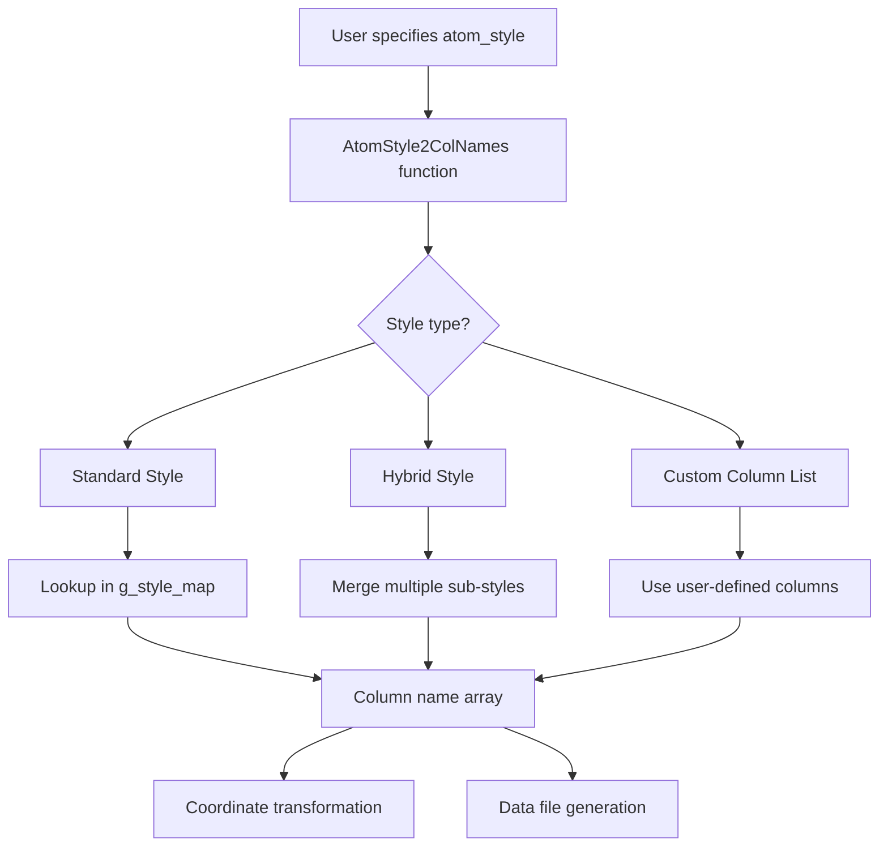
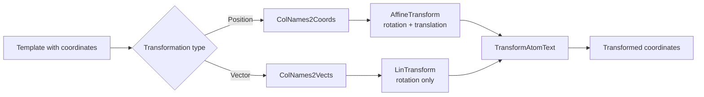

This page explores how moltemplate manages LAMMPS atom styles and coordinate transformations, bridging the gap between molecular template definitions and simulation-ready atomic data. Understanding these systems is essential for building complex molecular structures with proper spatial arrangements and handling diverse particle representations from point atoms to anisotropic objects.

## Atom Style Architecture

Moltemplate implements a comprehensive atom style system that maps LAMMPS atom style specifications to column data structures. The core architecture relies on a style registry maintained in `lttree_styles.py` that defines 20+ supported atom styles, each with their unique column configurations. This registry enables moltemplate to parse, validate, and transform atomic coordinates according to the specific atom style requirements of your simulation.

The atom style system is accessed through the `AtomStyle2ColNames()` function which interprets atom style strings and returns corresponding column name arrays. When you specify an atom style in your force field definition, moltemplate uses this mapping to understand which columns contain coordinates, charges, molecule IDs, and other particle properties.



**Sources**: [moltemplate/lttree_styles.py](moltemplate/lttree_styles.py#L96-L118), [moltemplate/lttree_styles.py](moltemplate/lttree_styles.py#L121-L156)

## Comprehensive Atom Style Reference

Moltemplate supports the complete spectrum of LAMMPS atom styles, ranging from simple point particles to complex anisotropic objects. Each atom style defines a specific column layout that dictates how atomic data is organized in the LAMMPS data file.

The style registry includes fundamental styles for different simulation paradigms:

| Atom Style | Columns | Use Case |
|------------|---------|----------|
| `atomic` | atom-ID, atom-type, x, y, z | Simple non-charged particles |
| `full` | atom-ID, molecule-ID, atom-type, q, x, y, z | Standard molecular systems with charges |
| `charge` | atom-ID, atom-type, q, x, y, z | Charged particles without molecule tracking |
| `bond` | atom-ID, molecule-ID, atom-type, x, y, z | Bonded systems without charges |
| `angle` | atom-ID, molecule-ID, atom-type, x, y, z | Systems with angular constraints |
| `dipole` | atom-ID, atom-type, q, x, y, z, mux, muy, muz | Particles with dipole moments |
| `ellipsoid` | atom-ID, atom-type, ellipsoidflag, density, x, y, z | Anisotropic ellipsoidal particles |
| `sphere` | atom-ID, atom-type, diameter, density, x, y, z | Spherical particles with size |
| `template` | atom-ID, molecule-ID, template-index, template-atom, atom-type, x, y, z | Template-based coarse-graining |
| `hybrid` | atom-ID, atom-type, x, y, z + sub-style columns | Mixed particle types |

**Sources**: [moltemplate/lttree_styles.py](moltemplate/lttree_styles.py#L96-L118)

## Coordinate Systems and Transformations

Moltemplate implements a sophisticated coordinate transformation system that applies rigid-body movements (rotations and translations) to atomic positions while preserving molecular structure integrity. This system distinguishes between two fundamental transformation types: **affine transformations** for position coordinates and **linear transformations** for vector quantities.

The coordinate system architecture centers on two column identification functions that enable selective transformation of different data types:

**Affine Transformations** (rotation + translation) apply to atomic coordinates (x, y, z) using the `ColNames2Coords()` function. These transformations preserve the geometric relationships within molecules while allowing arbitrary repositioning and reorientation in 3D space.

**Linear Transformations** (rotation only) apply to vector quantities like dipole moments (mux, muy, muz) using the `ColNames2Vects()` function. These transformations reorient vector properties without translating their positions, maintaining physical consistency during molecular rotations.



> [!TIP]
> The critical distinction between affine and linear transformations ensures that dipole moments and other vector properties rotate correctly with their parent atoms without being inadvertently translated, which would be physically incorrect.

**Sources**: [moltemplate/lttree_styles.py](moltemplate/lttree_styles.py#L221-L243), [moltemplate/lttree_styles.py](moltemplate/lttree_styles.py#L245-L272)

## Implementing Atom Styles in Force Fields

When creating force field definitions in moltemplate, you specify the atom style through the `write_once("In Init")` block. This declaration establishes the coordinate system framework for all subsequent atomic data. The atom style selection directly impacts which properties must be defined in your templates and how moltemplate processes coordinate transformations.

Here's an example from a coarse-grained polymer system using the `full` atom style:

```lt
write_once("In Init") {
  units           real
  atom_style      full      # Includes atom-ID, mol-ID, type, charge, coords
  bond_style      harmonic
  angle_style     harmonic
  pair_style      lj/cut 11.0
}
```

The `full` atom style requires atom data to include five columns beyond the coordinate position: atom ID, molecule ID, atom type, charge, and spatial coordinates (x, y, z). This style supports complete molecular systems where charge distribution and molecule membership tracking are essential.

**Sources**: [examples/coarse_grained/simple_examples/2bead_polymer/moltemplate_files/forcefield.lt](examples/coarse_grained/simple_examples/2bead_polymer/moltemplate_files/forcefield.lt#L19-L24)

## Coordinate Data in Molecular Templates

Molecular templates define atomic positions within the context of the selected atom style's column structure. The coordinate data must match the expected column order and types to ensure proper data file generation.

In a monomer template, you specify atom data with columns aligned to your atom style:

```lt
Monomer inherits ForceField {

  write("Data Atoms") {
    # atomId molId   atomType   charge   x      y        z      
    $atom:ca $mol:... @atom:CA   0.0   0.000  1.0000   0.0000000
    $atom:r  $mol:... @atom:R    0.0   0.000  4.4000   0.0000000
  }
  write("Data Bonds") {
    # bond-id   bond-type        atom-id1  atom-id2
    $bond:cr    @bond:Sidechain  $atom:ca  $atom:r
  }
}
```

The `Data Atoms` section follows the `full` atom style convention with six columns. The `$mol:...` syntax indicates that these atoms belong to a parent molecule, sharing the same molecule ID. This hierarchical structure enables complex multi-molecule systems while maintaining proper atom tracking.

**Sources**: [examples/coarse_grained/simple_examples/2bead_polymer/moltemplate_files/monomer.lt](examples/coarse_grained/simple_examples/2bead_polymer/moltemplate_files/monomer.lt#L1-L21)

## Rigid-Body Coordinate Transformations

Moltemplate's transformation commands enable precise positioning and orientation of molecular templates. These transformations operate on the coordinate system defined by your atom style, applying mathematical operations to the spatial data.

The transformation system supports chained operations that combine rotations and translations in sequence:

```lt
Polymer inherits ForceField {

  # Now create some monomers with transformations
  mon1 = new Monomer
  mon2 = new Monomer.rot(180.0, 1,0,0).move(3.2,0,0)
  mon3 = new Monomer.move(6.4,0,0)
  mon4 = new Monomer.rot(180.0, 1,0,0).move(9.6,0,0)
  # ... additional monomers
}
```

The `.rot(angle, axis_x, axis_y, axis_z)` command applies rotation around a specified axis, while `.move(dx, dy, dz)` applies translation. These operations are stored in transformation matrices and applied during template rendering through the `TransformAtomText()` function, which processes each atom line according to the coordinate system rules.

> [!TIP]
> Transformations are applied left-to-right in the command chain, so `rot().move()` rotates first then translates, while `move().rot()` would translate then rotate about the origin, producing different final positions.

**Sources**: [examples/coarse_grained/simple_examples/2bead_polymer/moltemplate_files/polymer.lt](examples/coarse_grained/simple_examples/2bead_polymer/moltemplate_files/polymer.lt#L1-L28), [moltemplate/lttree.py](moltemplate/lttree.py#L307-L368)

## Ellipsoid and Anisotropic Particle Transformations

For atom styles that represent anisotropic particles like ellipsoids, moltemplate implements specialized transformation handling. The `ellipsoid` atom style includes an ellipsoidflag and density parameter alongside coordinates, with orientation data stored separately in quaternions.

Ellipsoid orientations are transformed using quaternion mathematics rather than direct matrix multiplication on coordinates. The `TransformEllipsoidText()` function extracts the four quaternion components from each ellipsoid line, converts the transformation matrix's rotational component to a quaternion, multiplies the quaternions, and updates the orientation:

```python
def TransformEllipsoidText(text, matrix, settings):
    """ Apply the transformation matrix to the quaternions represented
    by the last four numbers on each line.
    """
    # Extract original quaternion
    q_orig = [float(columns[-4]), float(columns[-3]), 
              float(columns[-2]), float(columns[-1])]
    
    # Convert matrix to rotation quaternion
    qRot = [0.0, 0.0, 0.0, 0.0]
    Matrix2Quaternion(matrix, qRot)
    
    # Multiply quaternions to get new orientation
    q_new = [0.0, 0.0, 0.0, 0.0]
    MultQuat(q_new, qRot, q_orig)
    
    # Update columns with new quaternion
```

This quaternion-based approach ensures smooth and mathematically correct rotation of anisotropic particles without gimbal lock or orientation singularities.

**Sources**: [moltemplate/lttree.py](moltemplate/lttree.py#L371-L423), [moltemplate/lttree_styles.py](moltemplate/lttree_styles.py#L104-L104)

## Hybrid Atom Style Configuration

The hybrid atom style enables mixing multiple particle types within a single simulation, providing flexibility for complex systems that require different representations for different components. Moltemplate supports hybrid styles through column merging logic that combines sub-style properties.

When using `atom_style hybrid`, moltemplate interprets the sub-style arguments and merges their column definitions:

```lt
write_once("In Init") {
  atom_style hybrid dipole charge
}
```

This hybrid style would include columns from both the `dipole` and `charge` styles: atom-ID, atom-type, q, x, y, z (from charge) plus mux, muy, muz (from dipole). The `AtomStyle2ColNames()` function handles this merging, ensuring unique column names and proper ordering.

The hybrid system is particularly valuable for simulations combining explicit electrons with standard molecular species, or when implementing mixed-resolution models where different regions require different particle representations.

**Sources**: [moltemplate/lttree_styles.py](moltemplate/lttree_styles.py#L140-L156)

## Custom Atom Style Definitions

For specialized simulations requiring non-standard column arrangements, moltemplate supports custom atom style definitions through direct column specification. When an atom style string includes multiple words or isn't recognized in the standard registry, moltemplate interprets the entire string as a column name list.

This capability enables integration with custom LAMMPS packages or experimental atom styles:

```lt
write_once("In Init") {
  atom_style atom-ID molecule-ID atom-type custom-prop x y z
}
```

Custom definitions must include at minimum the `x`, `y`, and `z` coordinate columns. The `ColNames2Coords()` function validates coordinate presence and identifies column indices for transformation operations. Similarly, custom vector columns (like dipole moments) are identified through `ColNames2Vects()` for rotational transformations.

**Sources**: [moltemplate/lttree_styles.py](moltemplate/lttree_styles.py#L130-L156)

## Transformation Implementation Details

The coordinate transformation system operates on text-based atomic data through the `TransformAtomText()` function, which processes each line of the `Data Atoms` section according to transformation rules:

1. **Line parsing**: Split each line into columns, handling comments and quoted strings
2. **Coordinate transformation**: Apply affine transformations to x,y,z columns identified by `ColNames2Coords()`
3. **Vector transformation**: Apply linear transformations to vector columns identified by `ColNames2Vects()`
4. **Reassembly**: Join transformed columns back into formatted text

The transformation matrices are maintained through `MultiAffineStack` from the matrix stack module, which supports hierarchical transformation composition. This enables complex transformation chains where individual components (monomers, side chains, functional groups) can be transformed independently and then composed into final molecular orientations.

```python
# Atomic coordinates transform using "affine" transformations
# (translations plus rotations [or other linear transformations])
for cxcycz in settings.ii_coords:
    for d in range(0, 3):
        x0[d] = float(columns[cxcycz[d]])
        AffineTransform(x, matrix, x0)  # x = matrix * x0 + b
    for d in range(0, 3):  # ("b" is part of "matrix")
        columns[cxcycz[d]] = str(x[d])

# Dipole moments and other direction-vectors
# are not effected by translational movement
for cxcycz in settings.ii_vects:
    for d in range(0, 3):
        x0[d] = float(columns[cxcycz[d]])
        LinTransform(x, matrix, x0)  # x = matrix * x0
    for d in range(0, 3):
        columns[cxcycz[d]] = str(x[d])
```

**Sources**: [moltemplate/lttree.py](moltemplate/lttree.py#L307-L368), [moltemplate/ttree_matrix_stack.py](moltemplate/ttree_matrix_stack.py#L75-L84)

## Best Practices and Common Patterns

Effective use of atom styles and coordinate systems in moltemplate follows several established patterns:

**Match atom style to simulation requirements**: Choose the simplest style that provides all necessary properties. For non-charged coarse-grained systems, `atomic` or `bond` styles are sufficient. For all-atom molecular systems with electrostatics, `full` style is typically required.

**Maintain column consistency**: Ensure all atom data sections match the expected column order and types. The coordinate column positions are critical for proper transformation application.

**Leverage hierarchical transformations**: Build complex structures from simpler components with appropriate transformations at each level. This approach maintains template reusability and simplifies coordinate management.

**Validate transformation order**: Remember that transformations are applied left-to-right. Test transformation chains on simple structures to verify expected behavior before applying to complex molecules.

**Handle special particles appropriately**: For ellipsoids, lines, triangles, or other anisotropic particles, ensure corresponding data sections (`Data Ellipsoids`, `Data Lines`, `Data Triangles`) include proper orientation data and that transformations account for orientation changes.

**Sources**: [examples/coarse_grained/simple_examples/2bead_polymer/moltemplate_files/polymer.lt](examples/coarse_grained/simple_examples/2bead_polymer/moltemplate_files/polymer.lt#L1-L28)

## Integration with LAMMPS Data Files

The atom style system directly maps to LAMMPS data file structure, which moltemplate generates through the `write("Data ...")` commands. Understanding this mapping helps debug coordinate-related issues:

- `Data Atoms`: Contains atom positions and properties according to atom style columns
- `Data Masses`: Maps atom types to masses (independent of atom style)
- `Data Velocities`: Initial velocities (x, y, z components)
- `Data Ellipsoids`/`Data Lines`/`Data Triangles`: Orientation data for anisotropic particles

When moltemplate processes templates, it validates column counts against the atom style definition and ensures coordinate transformation targets exist. This validation prevents generation of incompatible data files that would cause LAMMPS errors.

**Sources**: [moltemplate/lttree_styles.py](moltemplate/lttree_styles.py#L17-L64)

## Advanced Topics: Quaternion Mathematics

Ellipsoid and other orientation-based atom styles rely on quaternion representations for rotational transformations. Moltemplate implements complete quaternion-to-matrix and matrix-to-quaternion conversion routines to support these transformations:

- **Matrix2Quaternion()**: Converts 3x3 rotation matrices to normalized quaternions
- **MultQuat()**: Multiplies quaternions using Hamilton product for composition
- **Quaternion2Matrix()**: Converts quaternions back to rotation matrices

The quaternion representation avoids gimbal lock and provides smooth interpolation for continuous rotation sequences. This mathematical foundation enables accurate orientation tracking for anisotropic particles through arbitrary transformation chains.

**Sources**: [moltemplate/ttree_matrix_stack.py](moltemplate/ttree_matrix_stack.py#L916-L978)

---

Understanding atom styles and coordinate systems in moltemplate provides the foundation for building complex molecular simulations with proper spatial arrangement. The system's flexibility supports everything from simple atomic systems to mixed-resolution models with anisotropic particles. For deeper exploration of transformation mathematics and matrix operations, see [Affine Transformation Matrices](30-affine-transformation-matrices). To learn how molecular templates utilize these coordinate systems, refer to [Static Objects and Class Definitions](8-static-objects-and-class-definitions).