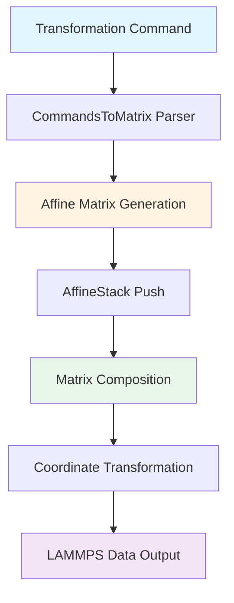

Moltemplate provides a comprehensive transformation framework for applying rigid-body movements to molecular structures during template instantiation. This system enables precise spatial manipulation of molecules through affine transformations, supporting translation, rotation, and composition of complex transformations.

## Transformation Architecture

The transformation system is built around 3×4 affine matrices that encode both rotational and translational components. The mathematical foundation implements the transformation equation:

```
x' = R·x + t
```

Where R is the 3×3 rotation matrix and t is the 3×1 translation vector stored in the final column of the affine matrix.

**Core transformation classes** reside in `ttree_matrix_stack.py` and provide a stack-based architecture for composing and managing transformation sequences. The `AffineStack` class maintains a transformation history, enabling hierarchical transformations through push/pop operations that follow strict ordering constraints [ttree_matrix_stack.py](moltemplate/ttree_matrix_stack.py#L129-L248).



## Matrix Operations and Transformations

The transformation framework implements three fundamental matrix operations that form the building blocks for all rigid-body manipulations.

**Linear Transformation** (`LinTransform()`) applies pure rotations or scaling without translation components, suitable for transforming directional vectors like dipole moments [ttree_matrix_stack.py](moltemplate/ttree_matrix_stack.py#L60-L72). This operation preserves the origin point and modifies only the directional aspects of vectors.

**Affine Transformation** (`AffineTransform()`) implements the complete rigid-body transformation including both rotational and translational components [ttree_matrix_stack.py](moltemplate/ttree_matrix_stack.py#L75-L90). The algorithm multiplies the 3D input vector by the first three columns of the matrix (rotation/scale), then adds the final column (translation offset):

```python
dest[i] = Σ(M[i][j] * x[j]) + M[i][D]
```

**Transformation Composition** (`AffineCompose()`) enables chaining of multiple transformations into a single equivalent transformation [ttree_matrix_stack.py](moltemplate/ttree_matrix_stack.py#L93-L120). When composing transformations M2 and M1, the resulting matrix represents applying M1 first, then M2: `M_result = M2 × M1`. This composition is non-commutative, so order critically affects the final result.

> [!TIP]
> The order of transformation composition matters fundamentally. When using push operations on the stack, later transformations are applied after earlier ones. Think of each transformation as operating on the coordinate system rather than the object itself to avoid confusion about direction.

## Rotation Representations

Moltemplate supports multiple rotation representations to accommodate different use cases and mathematical preferences.

### Axis-Angle Rotations

The `RotMatAXYZ()` function generates rotation matrices from axis-angle specifications using the Rodrigues rotation formula [ttree_matrix_stack.py](moltemplate/ttree_matrix_stack.py#L874-L914). Given a rotation angle θ and a normalized axis vector (X, Y, Z), the rotation matrix elements are computed as:

```
R[0][0] = X²(1-c) + c
R[0][1] = XY(1-c) - Zs
R[0][2] = XZ(1-c) + Ys
...
```

Where c = cos(θ) and s = sin(θ). The implementation automatically normalizes the axis vector and handles degenerate cases (zero-length axis) gracefully.

### Vector-to-Vector Rotation

The `RotMatXYZXYZ()` function creates a rotation matrix that aligns one vector direction with another [ttree_matrix_stack.py](moltemplate/ttree_matrix_stack.py#L1012-L1031). This is particularly useful for orienting molecular bonds or aligning structural elements without explicit axis specification. The algorithm computes the rotation axis as the cross product of the two vectors and determines the rotation angle from their dot product.

### Quaternion Rotations

Moltemplate provides full quaternion support for rotation representation and composition, which offers advantages for smooth interpolation and avoids gimbal lock issues.

**Quaternion to Matrix Conversion** (`Quaternion2Matrix()`) converts normalized quaternions (qw, qx, qy, qz) to 3×3 rotation matrices [ttree_matrix_stack.py](moltemplate/ttree_matrix_stack.py#L916-L928). The conversion uses standard formulas derived from the relationship between quaternion algebra and rotation matrices.

**Matrix to Quaternion Conversion** (`Matrix2Quaternion()`) performs the inverse operation with numerical stability considerations [ttree_matrix_stack.py](moltemplate/ttree_matrix_stack.py#L931-L967). The algorithm examines the trace of the rotation matrix to determine the optimal computational path and normalizes the resulting quaternion to ensure numerical precision.

**Quaternion Multiplication** (`MultQuat()`) implements Hamilton product for composing rotations [ttree_matrix_stack.py](moltemplate/ttree_matrix_stack.py#L971-L981). This operation is essential for sequential rotation applications in quaternion space.

## Transformation Commands

Moltemplate parses text-based transformation commands through the `CommandsToMatrix()` method, which converts human-readable specifications into affine matrices [ttree_matrix_stack.py](moltemplate/ttree_matrix_stack.py#L250-L500). Commands can be chained using dot notation, enabling compact specification of complex transformation sequences.

### Translation Commands

**move(x, y, z)** - Applies pure translation along the Cartesian axes [ttree_matrix_stack.py](moltemplate/ttree_matrix_stack.py#L262-L276). Generates a translation matrix:

```
[[1, 0, 0, x],
 [0, 1, 0, y],
 [0, 0, 1, z]]
```

**move_rand(...)** - Applies random translations with various distribution options [ttree_matrix_stack.py](moltemplate/ttree_matrix_stack.py#L295-L362). Supports Gaussian and uniform distributions:

- `move_rand(sigma)` - Gaussian with equal sigma in all directions
- `move_rand(seed, sigma)` - Gaussian with specified random seed
- `move_rand(sigma_x, sigma_y, sigma_z)` - Anisotropic Gaussian
- `move_rand(x_min, x_max, y_min, y_max, z_min, z_max)` - Uniform distribution
- All forms accept optional seed parameter for reproducibility

### Rotation Commands

**rot(angle, axisX, axisY, axisZ)** - Rotates about the specified axis by the given angle (degrees) [ttree_matrix_stack.py](moltemplate/ttree_matrix_stack.py#L364-L405). When angle is specified without center parameters, rotation occurs about the coordinate origin.

**rot(angle, axisX, axisY, axisZ, centerX, centerY, centerZ)** - Rotation about an arbitrary point in space [ttree_matrix_stack.py](moltemplate/ttree_matrix_stack.py#L391-L405). This form implements a three-step transformation:

1. Translate center point to origin
2. Apply rotation about axis
3. Translate origin back to center point

**quat(qw, qx, qy, qz)** - Rotation using quaternion representation [ttree_matrix_stack.py](moltemplate/ttree_matrix_stack.py#L423-L467). Accepts normalized quaternions and converts them to rotation matrices. Supports optional center point specification for rotation about arbitrary axes.

**quatT(qw, qx, qy, qz)** - Quaternion rotation with transpose operation [ttree_matrix_stack.py](moltemplate/ttree_matrix_stack.py#L447-L448). Equivalent to applying the inverse rotation represented by the conjugate quaternion.

### Matrix Commands

**matrix(m00, m01, m02, m10, m11, m12, m20, m21, m22)** - Direct specification of a 3×3 rotation matrix [ttree_matrix_stack.py](moltemplate/ttree_matrix_stack.py#L407-L421). Provides maximum flexibility for custom transformations not covered by standard rotation operations.

## Stack-Based Transformation Management

The `AffineStack` class implements a LIFO stack for managing transformation sequences, enabling hierarchical transformations common in molecular building [ttree_matrix_stack.py](moltemplate/ttree_matrix_stack.py#L129-L248).

**Push Operations**: Both `PushRight()` and `PushLeft()` add transformation matrices to the stack, though the implementation notes that no distinction is made between "right" and "left" multiplications [ttree_matrix_stack.py](moltemplate/ttree_matrix_stack.py#L163-L197). All transformations are composed by multiplying on the right, requiring that matrices be popped in reverse order.

**Pop Operations**: `Pop()`, `PopRight()`, and `PopLeft()` remove the most recent transformation from the stack [ttree_matrix_stack.py](moltemplate/ttree_matrix_stack.py#L211-L221). This enables returning to previous transformation states, essential for building hierarchical molecular structures.

**Command Integration**: `PushCommandsRight()` and `PushCommandsLeft()` provide convenient interfaces for parsing and applying transformation commands directly to the stack [ttree_matrix_stack.py](moltemplate/ttree_matrix_stack.py#L223-L245).

> [!TIP]
> When building complex hierarchical structures, always pair push and pop operations symmetrically. Each push should have a corresponding pop at the appropriate scope level to prevent transformation state leakage between molecular components.

## Multi-Stack Architecture

The `MultiAffineStack` class extends the basic stack to manage multiple independent transformation stacks simultaneously [ttree_matrix_stack.py](moltemplate/ttree_matrix_stack.py#L713-L859). This is particularly useful for scenarios requiring different transformation contexts, such as:

- Managing separate transformation states for different molecular components
- Maintaining independent coordinate frames for hierarchical assemblies
- Applying different transformations to parallel processing branches

The class provides methods for pushing, popping, and querying specific stacks by identifier, enabling precise control over which transformation context is active.

## LAMMPS Integration

The transformation system integrates deeply with LAMMPS data file generation through functions in `lttree.py`.

### Atomic Coordinate Transformation

`TransformAtomText()` applies accumulated transformations to the "Data Atoms" section of LAMMPS data files [lttree.py](moltemplate/lttree.py#L307-L367). The function processes atom coordinates according to the selected atom style:

- **Coordinates** (`ii_coords`): Transformed using `AffineTransform()` for full rigid-body movement including rotation and translation
- **Vectors** (`ii_vects`): Transformed using `LinTransform()` for directional quantities like dipole moments, which should rotate but not translate

The transformation accounts for different column positions in various atom styles (full, molecular, charge, etc.) by referencing the `settings.column_names` configuration.

### Ellipsoid Orientation Transformation

`TransformEllipsoidText()` handles orientation transformations for ellipsoidal particles represented by quaternions [lttree.py](moltemplate/lttree.py#L371-L423). The algorithm:

1. Extracts the original orientation quaternion from the last four columns
2. Converts the transformation matrix to a rotation quaternion using `Matrix2Quaternion()`
3. Multiplies the rotation quaternion with the original quaternion using `MultQuat()`
4. Updates the ellipsoid data with the new orientation quaternion

This ensures that ellipsoidal particles maintain proper orientation relationships when their containing molecules undergo rigid-body transformations.

### Center of Mass Calculation

`CalcCM()` computes the center of mass for groups of atoms, enabling rotation about the molecular center of mass rather than the coordinate origin [lttree.py](moltemplate/lttree.py#L427-L507). The function supports optional mass specification and works with various atom coordinate formats.

## Practical Transformation Patterns

### Chain Transformations

Transformations can be chained using dot notation in command strings:

```
rot(90, 0, 0, 1).move(0, 5.0, 0).rot(45, 1, 0, 0)
```

This sequence rotates about Z-axis 90°, translates 5 units in Y, then rotates about X-axis 45°. The transformations are applied in order from left to right.

### Relative vs Absolute Transformations

**Absolute Transformations**: Apply transformations relative to the global coordinate system. This is the default behavior when using `rot()` and `move()` without center point specification.

**Relative Transformations**: Apply transformations about the object's center or other specified point. Use the 7-argument form of `rot()` with center coordinates to achieve this:

```
rot(90, 0, 0, 1, 2.5, 3.0, 1.5)  # Rotate about point (2.5, 3.0, 1.5)
```

### Random Orientation Generation

For generating random molecular orientations, combine `move_rand()` with random rotations:

```
move_rand(0, 10.0, 10.0, 10.0).rot(rand()*360, rand(), rand(), rand())
```

This places the molecule randomly within a 20×20×20 Å box and applies a random orientation. The seed parameter ensures reproducibility when needed.

## Performance Considerations

The transformation system is optimized for the typical use case of applying many identical transformations to large molecular systems. Key performance characteristics:

- **Matrix Composition**: Transformation composition is O(1) regardless of stack depth, as only the aggregate transformation is stored
- **Coordinate Transformation**: Each atom requires only one matrix-vector multiplication, making the overall cost O(N) for N atoms
- **Stack Operations**: Push and pop operations are O(1) and do not involve matrix recomputation

The separation between transformation composition (during template processing) and coordinate application (during output generation) enables efficient batch processing of large systems.

## Integration with Template System

Transformations integrate seamlessly with the template instantiation system through the `PushRightCommand` and `PushLeftCommand` classes [ttree.py](moltemplate/ttree.py#L309-L338). These commands carry transformation context through the command processing pipeline, ensuring that each molecule instance receives the appropriate transformations.

The command processor maintains transformation stacks during instantiation, enabling different transformation contexts for nested template instantiations. This allows, for example, creating a polymer where each monomer is transformed relative to the previous one while the entire polymer undergoes global transformation.

## Error Handling and Validation

The transformation system includes comprehensive error checking:

- **Argument Validation**: All commands validate argument count and type before processing [ttree_matrix_stack.py](moltemplate/ttree_matrix_stack.py#L268-L276)
- **Numerical Stability**: Quaternion operations include normalization to prevent drift from accumulated floating-point errors [ttree_matrix_stack.py](moltemplate/ttree_matrix_stack.py#L964-L967)
- **Degenerate Case Handling**: Axis-angle rotations handle zero-length axis vectors gracefully by setting rotation to zero [ttree_matrix_stack.py](moltemplate/ttree_matrix_stack.py#L881-L886)
- **Source Location Tracking**: Error messages include file and line information for debugging transformation command issues

## Next Steps

After mastering rigid-body transformations, explore related transformation and coordinate manipulation features:

- **[Affine Transformation Matrices](30-affine-transformation-matrices)** - Advanced matrix operations and mathematical foundations
- **[Atom Styles and Coordinate Systems](13-atom-styles-and-coordinate-systems)** - Understanding how different atom styles interact with transformations
- **[Force Field Parameter Management](15-force-field-parameter-management)** - How transformations affect force field parameter assignment
- **[Custom Force Field Development](23-custom-force-field-development)** - Building custom force fields that work with transformed structures

The transformation system provides a powerful foundation for building complex molecular structures from template definitions. Understanding these concepts is essential for effective use of moltemplate for generating realistic initial configurations for molecular simulations.