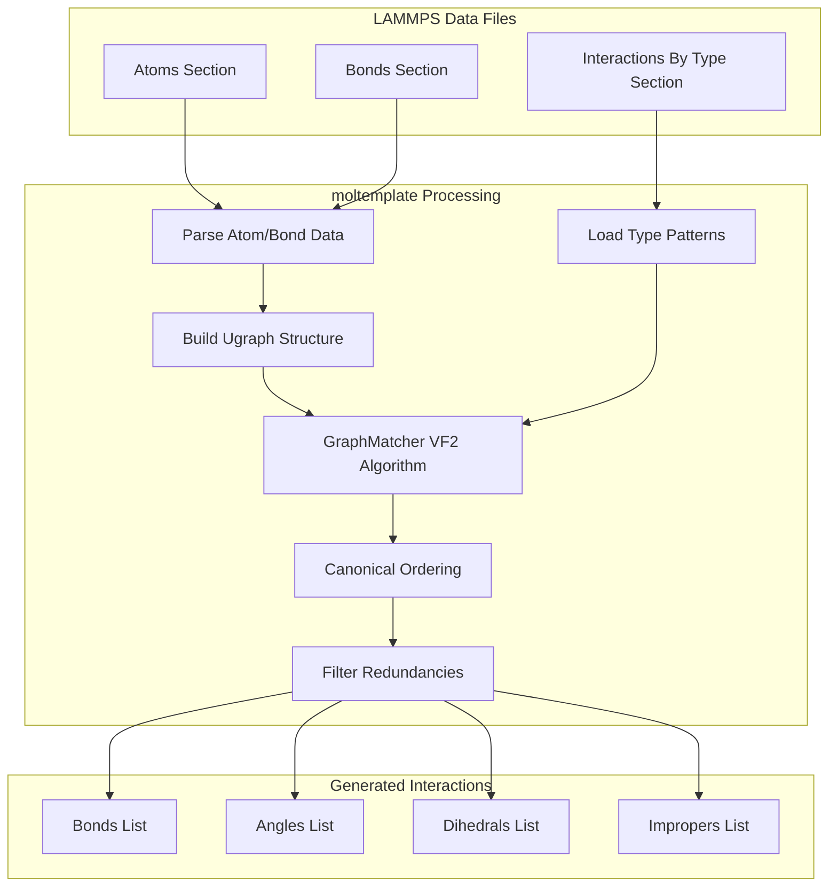

Moltemplate's bond detection system automates the generation of bonded interactions (bonds, angles, dihedrals, impropers) by matching atom type patterns against topological bond networks. This system leverages graph theory to identify interaction patterns in molecular structures, eliminating the need for manually specifying every interaction. The architecture consists of three core components: type pattern specification, subgraph matching algorithms, and canonical ordering for redundancy elimination.

## System Architecture

The bond detection system operates through a pipeline that transforms molecular connectivity data into a structured interaction list. At its foundation lies an undirected graph representation where atoms become vertices and bonds become edges, enabling the application of graph isomorphism algorithms to locate interaction patterns.

The architecture integrates multiple specialized modules:

- **Pattern Definition** (`nbody_Bonds.py`, `nbody_Angles.py`): Defines bond topology patterns for different interaction types using Ugraph data structures
- **Graph Search Engine** (`nbody_graph_search.py`): Implements a VF2-algorithm variant optimized for finding small subgraphs within larger molecular graphs
- **Type Pattern Matching** (`nbody_by_type_lib.py`): Handles the interpretation of atom/bond type patterns including wildcards and regular expressions
- **Orchestration Layer** (`nbody_by_type.py`): Coordinates the workflow from file parsing to interaction generation



The `Ugraph` class from `nbody_graph_search.py` provides the fundamental data structure for representing molecular topology [nbody_graph_search.py#L391-L438]. Vertices store atom type attributes while edges store bond type attributes, enabling the graph search algorithm to consider both connectivity and type compatibility during pattern matching.

## Bond Pattern Specification

Bond patterns define the topological requirements for N-body interactions. These patterns are encoded as undirected graphs where vertices represent atom positions and edges represent bond connections.

The simplest bond pattern is defined in `nbody_Bonds.py`:

```python
bond_pattern = Ugraph([(0, 1)])
```

This pattern represents a two-body bond interaction connecting atoms 0 and 1 [nbody_Bonds.py#L14]. Similarly, three-body angle patterns in `nbody_Angles.py` specify a linear chain of three atoms:

```python
bond_pattern = Ugraph([(0, 1), (1, 2)])
```

This pattern represents atoms 0-1-2 with bonds connecting atom 0 to 1, and atom 1 to 2 [nbody_Angles.py#L23].

> [!TIP]
> Bond patterns are defined using zero-based indexing within the Ugraph constructor, but the resulting atom IDs in output use LAMMPS's one-based indexing convention. This dual indexing system is handled automatically by the conversion functions in `nbody_by_type_lib.py`.

The pattern matching system supports any N-body interaction topology by defining appropriate Ugraph structures. Four-body dihedral patterns, for example, would use `Ugraph([(0, 1), (1, 2), (2, 3)])` to represent the backbone connectivity required for torsional interactions.

## Type Pattern Matching Syntax

Type patterns specify which atom and bond types should trigger interaction creation. These patterns use a flexible syntax supporting exact matches, wildcards, and regular expressions.

The fundamental structure of a type pattern entry in LAMMPS data files follows this format:

```
interaction_type  atomType1  atomType2  [atomType3 ...]  bondType1  [bondType2 ...]
```

For example, the 2-bead polymer force field defines angle patterns as:

```
@angle:Backbone  @atom:CA  @atom:CA  @atom:CA   @bond:*   @bond:*
@angle:Sidechain @atom:CA  @atom:CA  @atom:R    @bond:*   @bond:*
```

These patterns appear in the `Data Angles By Type` section [examples/coarse_grained/simple_examples/2bead_polymer/moltemplate_files/forcefield.lt#L60-L63]. The `*` wildcard matches any bond type, while the `@atom:` and `@angle:` prefixes reference moltemplate variable definitions.

The pattern parsing logic in `nbody_by_type.py` handles type pattern interpretation:

```python
if HasRE(typestr):
    regex_str = VarNameToRegex(typestr)
    typepattern.append(re.compile(regex_str))
else:
    typepattern.append(EscCharStrToChar(typestr))
```

This code processes each type token, checking for regular expression syntax and compiling patterns accordingly [nbody_by_type.py#L240-L246].

| Pattern Type | Syntax | Example | Matches |
|--------------|--------|---------|---------|
| Exact Match | `@atom:CA` | `@atom:CA` | Only atom type "CA" |
| Wildcard | `*` | `@bond:*` | Any bond type |
| Regex | `/CA.*/` | `/C.*/` | Atom types starting with "C" |
| Moltemplate Variable | `@var:name` | `@atom:CA` | Resolves to variable value |

> [!TIP]
> When bond types are omitted from type patterns, the system automatically defaults to `*` wildcards. This is handled by the pattern parsing code which pads the pattern list when insufficient columns are provided [nbody_by_type.py#L248-L250].

## Graph Matching Algorithm

The core of bond detection is the `GraphMatcher` class in `nbody_graph_search.py`, which implements a modified VF2 algorithm optimized for finding small subgraphs within much larger graphs [nbody_graph_search.py#L715-L814].

The algorithm proceeds through several stages:

1. **Graph Preparation**: Both the system graph (G) and pattern graph (g) are re-ordered using depth-first search traversal order, which optimizes the subsequent matching process:

```python
subgraph_searcher = DFS(self.g)
self.vorder_g, self.eorder_g = subgraph_searcher.Order()
self.g.ReorderVerts(self.vorder_g, invert=True)
self.g.ReorderEdges(self.eorder_g, invert=True)
```

This code reorders vertices and edges to match DFS visitation order, improving matching efficiency [nbody_graph_search.py#L778-L784].

2. **Iterative Matching**: The `Matches()` iterator attempts to match the pattern starting from each vertex in the system graph:

```python
for Iv in range(0, self.G.nv):
    self.iv_to_Iv[0] = Iv
    self.voccupiedG[Iv] = True
```

This ensures all possible subgraph locations are considered by initiating matches from each vertex [nbody_graph_search.py#L829-L832].

3. **Recursive Search**: The core `Match()` function recursively extends partial matches by adding compatible vertices and edges:

```python
def Match(self):
    # self.se represents how many vertices have been matched so far
    # We are done searching if all of the edges from 0 to self.se-1
    # from graph g have been selected (matched with edges from graph G).
```

This recursive backtracking algorithm explores the search space efficiently, pruning branches where compatibility constraints fail [nbody_graph_search.py#L858-L863].

The algorithm's optimization stems from its independence from the large graph's size during each matching step. Unlike the original VF2 algorithm where computation time is proportional to the number of vertices in the larger graph, this variant uses local compatibility checks that scale based on the pattern graph size only [nbody_graph_search.py#L720-L730].

## Canonical Ordering and Redundancy Elimination

Graph isomorphism matching inherently produces redundant results because symmetric molecular patterns can be matched in multiple equivalent ways. For example, a bond between atoms 1 and 2 is equivalent to a bond between atoms 2 and 1.

The `canonical_order` function eliminates this redundancy by enforcing a consistent ordering convention. For bonds, the convention is straightforward:

```python
def canonical_order(match):
    atom0 = match[0][0]
    atom1 = match[0][1]
    bond0 = match[1][0]
    if atom0 < atom1:
        return match
    else:
        return ((atom1, atom0), (bond0))
```

This ensures that atom IDs are always stored in ascending order, so (1,2) and (2,1) both normalize to (1,2) [nbody_Bonds.py#L19-L36].

For three-body angles, the canonical ordering is more nuanced:

```python
def canonical_order(match):
    atom0 = match[0][0]
    atom1 = match[0][1]
    atom2 = match[0][2]
    bond0 = match[1][0]
    bond1 = match[1][1]
    if atom0 < atom2:
        return match
    else:
        return ((atom2, atom1, atom0), (bond1, bond0))
```

This preserves the central atom (atom1) while ensuring the end atoms are ordered with the smaller ID first, reflecting the physical symmetry of angle interactions where swapping the end atoms doesn't change the angle value [nbody_Angles.py#L28-L57].

The elimination logic in `GenInteractions_int()` uses these canonicalized representations to filter duplicates:

```python
for atombondtypes, abidslist in interactions_by_type.items():
    for abids in abidslist:
        abids = canonical_order(abids)
        atomids_int = tuple(abids[0])
        # Check if this canonicalized tuple already exists
```

This prevents duplicate interactions from being generated for symmetrically equivalent atom arrangements [nbody_by_type_lib.py#L195-L209].

## Integration Pipeline

The complete bond detection workflow integrates multiple components through the `GenInteractions_str()` function in `nbody_by_type_lib.py`:

1. **Data Parsing**: Atom and bond data are extracted from LAMMPS data file sections and converted to string representations:

```python
atomids_str = []
atomtypes_str = []
for iv in range(0, len(lines_atoms)):
    line = lines_atoms[iv].strip()
    tokens = SplitQuotedString(line)
    atomids_str.append(EscCharStrToChar(tokens[i_atomid]))
    atomtypes_str.append(EscCharStrToChar(tokens[i_atomtype]))
```

This parsing handles various atom styles and extracts the relevant columns for atom IDs and types [nbody_by_type_lib.py#L398-L410].

2. **Graph Construction**: The parsed data is transformed into a Ugraph structure:

```python
G_system = Ugraph()
for iv in range(0, len(atomtypes_str)):
    G_system.AddVertex(iv, atomtypes_str2int[atomtypes_str[iv]])
for ie in range(0, len(bond_pairs)):
    G_system.AddEdge(atomids_str2int[atomid1_str],
                     atomids_str2int[atomid2_str],
                     bondtypes_str2int[bondtypes_str[ie]])
```

String identifiers are converted to integer indices for efficient graph operations [nbody_by_type_lib.py#L422-L434].

3. **Type Pattern Loading**: Type patterns from the "By Type" sections are parsed into a structured format:

```python
typepattern_to_coefftypes = []
for line in lines_nbodybytype:
    tokens = SplitQuotedString(line)
    coefftype = EscCharStrToChar(tokens[0])
    typepattern = []
    for typestr in tokens[1:]:
        if HasRE(typestr):
            regex_str = VarNameToRegex(typestr)
            typepattern.append(re.compile(regex_str))
        else:
            typepattern.append(EscCharStrToChar(typestr))
    typepattern_to_coefftypes.append([typepattern, coefftype])
```

Each pattern is compiled into a list of type matchers (either exact strings or compiled regex) associated with a coefficient type [nbody_by_type.py#L227-L247].

4. **Interaction Generation**: The core matching algorithm processes the graph:

```python
coefftype_to_atomids_int = GenInteractions_int(G_system,
                                               g_bond_pattern,
                                               typepattern_to_coefftypes,
                                               canonical_order,
                                               atomtypes_int2str,
                                               bondtypes_int2str,
                                               report_progress,
                                               check_undefined)
```

This call invokes the graph matching engine and returns interactions organized by coefficient type [nbody_by_type_lib.py#L435-L443].

5. **Output Generation**: Results are formatted back into LAMMPS data file format:

```python
lines_nbody_new = []
for coefftype, atomids_list in coefftype_to_atomids_str.items():
    for atomids_found in atomids_list:
        n = len(lines_nbody) + len(lines_nbody_new) + 1
        line = prefix + str(n) + suffix + ' ' + \
            coefftype + ' ' + (' '.join(atomids_found)) + '\n'
        lines_nbody_new.append(line)
```

Generated interaction IDs are numbered sequentially, avoiding conflicts with existing interactions [nbody_by_type.py#L252-L259].

## Practical Example: 2-Bead Polymer

The 2-bead polymer example demonstrates the complete bond detection workflow in practice. The force field defines angle interactions using type patterns:

```
write_once("Data Angles By Type") {
  @angle:Backbone  @atom:CA  @atom:CA  @atom:CA   @bond:*   @bond:*
  @angle:Sidechain @atom:CA  @atom:CA  @atom:R    @bond:*   @bond:*
}
```

These patterns specify two angle types: backbone angles between three CA atoms, and sidechain angles involving CA-CA-R sequences [examples/coarse_grained/simple_examples/2bead_polymer/moltemplate_files/forcefield.lt#L60-L63].

The corresponding force field parameters are defined separately:

```
write_once("In Settings") {
  angle_coeff @angle:Backbone   30.00  114
  angle_coeff @angle:Sidechain  30.00  132
}
```

The harmonic angle parameters specify equilibrium angles of 114° for backbone and 132° for sidechain configurations [examples/coarse_grained/simple_examples/2bead_polymer/moltemplate_files/forcefield.lt#L71-L74].

During moltemplate processing, the system:
1. Reads the `Data Angles By Type` section and compiles the type patterns
2. Parses the molecule structure from monomer definitions
3. Constructs the bond graph from `Data Bonds` sections
4. Applies the graph matcher to find all triads matching the angle patterns
5. Generates `Data Angles` entries with appropriate angle types

The resulting angle interactions automatically connect polymer segments based on their atom types rather than requiring manual specification of every angle.

## Specialized Tools

Moltemplate provides specialized tools for different aspects of bond detection:

**bonds_by_type.py**: A dedicated tool for looking up bond types based on atom type patterns:

```bash
bonds_by_type.py -atoms atoms.data \
                 -bonds bonds.data \
                 -bondsbytype bonds_by_type.data \
                 > new_bonds.data
```

This tool assigns bond types to existing bonds based on `Data Bonds By Type` patterns, useful for post-processing systems where connectivity is known but bond types need assignment [bonds_by_type.py#L7-L18].

**nbody_by_type.py**: The general-purpose tool for N-body interaction generation:

```bash
nbody_by_type.py Angles < old.data > new.data
```

This single command processes entire LAMMPS data files, extracting relevant sections and generating interactions based on type patterns [nbody_by_type.py#L9-L165].

The modular architecture allows users to extend the system for custom interaction types by creating new bond pattern modules following the pattern established in `nbody_Bonds.py`, `nbody_Angles.py`, `nbody_Dihedrals.py`, and `nbody_Impropers.py`.

## Performance Considerations

The graph matching algorithm's efficiency stems from several optimizations:

1. **DFS-based Reordering**: Vertices and edges are re-ordered according to depth-first search traversal, which often produces favorable matching patterns for molecular structures [nbody_graph_search.py#L778-L784].

2. **Local Compatibility Checks**: The VF2 variant used here performs compatibility checks using only local vertex/edge information, avoiding dependence on the large graph's size [nbody_graph_search.py#L720-L730].

3. **Early Pruning**: The recursive search prunes incompatible branches early, reducing the search space significantly compared to brute-force approaches [nbody_graph_search.py#L858-L938].

4. **Type-Based Indexing**: Found interactions are indexed by atom/bond type combinations, allowing efficient lookup during pattern matching [nbody_by_type_lib.py#L129-L134].

For large systems (10,000+ atoms), progress reporting provides feedback on matching completion:

```python
if report_progress:
    percent_complete = (100 * startatomid) // G_system.GetNumVerts()
    if percent_complete > old_pc:
        sys.stderr.write('  ' + str(percent_complete) + '%')
```

This incremental reporting helps users monitor long-running computations [nbody_by_type_lib.py#L154-L164].

## Next Steps

Understanding bond detection by atom type provides the foundation for working with higher-order interactions:

- **[Angle, Dihedral, and Improper Generation](17-angle-dihedral-and-improper-generation)**: Explores the specific patterns and algorithms for 3-body and 4-body interactions in greater detail
- **[N-Body Interaction Graph Search](18-n-body-interaction-graph-search)**: Provides a deeper technical examination of the VF2 algorithm implementation and optimization strategies
- **[Force Field Parameter Management](15-force-field-parameter-management)**: Covers how detected interactions integrate with force field coefficient definitions and parameter assignment

The bond detection system represents a powerful abstraction that separates molecular topology from force field specification, enabling more maintainable and portable molecular simulations.