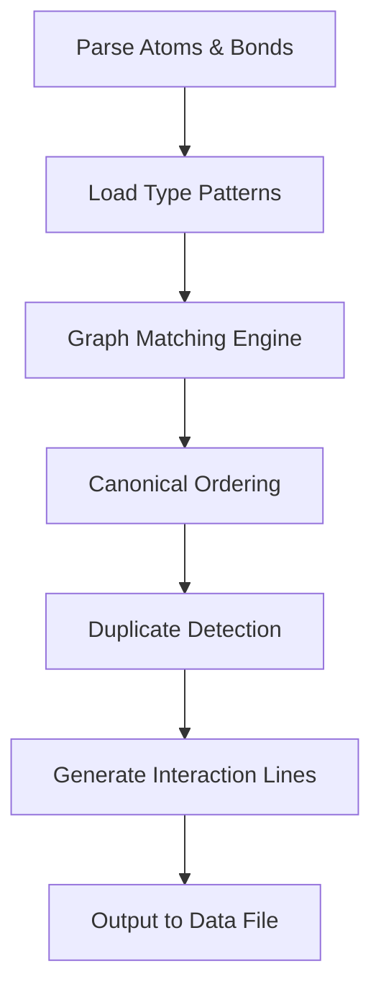

Moltemplate employs a sophisticated graph-based pattern matching system to automatically generate angle, dihedral, and improper interactions from molecular topology and force field parameter specifications. This architecture eliminates the need for manual interaction specification while supporting multiple force field conventions through modular pattern definitions.

## Core Graph-Based Pattern Matching Architecture

The interaction generation system operates on subgraph isomorphism principles, treating molecular topology as graphs where atoms are vertices and bonds are edges. Each interaction type defines a small pattern graph that the system searches for within the larger molecular graph. The implementation uses an optimized VF2 algorithm variant specialized for finding small connected subgraphs within much larger graphs.

The GraphMatcher class from `nbody_graph_search.py` performs depth-first searches to identify all occurrences of interaction patterns. This approach is particularly efficient for molecular systems where interaction patterns involve 2-4 atoms compared to systems containing thousands of atoms. The algorithm reorders vertices and edges based on DFS visitation order to optimize search performance, then iterates over all possible starting vertices in the large graph to ensure complete coverage of potential matches.

Sources: [nbody_graph_search.py](moltemplate/nbody_graph_search.py#L715-L860)

## Angle Generation

Angles represent three-atom interactions defined by the bond pattern `Ugraph([(0, 1), (1, 2)])`, corresponding to three consecutively bonded atoms. The pattern matching identifies all paths of length two in the molecular graph, where each edge represents a bond. This captures the chemical reality that angle interactions occur when three atoms are bonded in sequence: atom0 bonded to atom1, which is bonded to atom2.

The canonical ordering function for angles eliminates redundancy by enforcing `atom0 < atom2`. This recognizes that the angle between atoms 0-1-2 is mathematically equivalent to the angle between 2-1-0, so only one representation is needed. The system swaps atoms and bonds accordingly, then checks against previously generated interactions to prevent duplicates that would slow down LAMMPS simulations.

Sources: [nbody_Angles.py](moltemplate/nbody_Angles.py#L23-L63)

## Dihedral Generation

Dihedrals represent four-atom torsional interactions defined by the bond pattern `Ugraph([(0, 1), (1, 2), (2, 3)])`. This pattern represents a chain of three consecutive bonds connecting four atoms. Dihedral angles depend on the relative orientation of two planes: one formed by atoms 0-1-2 and the other by atoms 1-2-3. The energy function depends on the dihedral angle between these planes.

The canonical ordering for dihedrals ensures `atom0 < atom3`, recognizing that reversing the atom order produces the same dihedral angle (the angle between planes doesn't change when traversing in opposite directions). This symmetry reduction prevents redundant dihedral definitions between the same set of atoms while preserving the physically relevant conformational degrees of freedom.

Sources: [nbody_Dihedrals.py](moltemplate/nbody_Dihedrals.py#L22-L64)

## Improper Generation

Improper interactions maintain planarity or chiral centers and are defined by the bond pattern `Ugraph([(0, 1), (0, 2), (0, 3)])`, representing a central atom (atom 0) connected to three peripheral atoms. Unlike angles and dihedrals which are linear chains, improper interactions form a star topology. The default canonical ordering enforces `atom1 < atom2`, recognizing that swapping the middle two peripheral atoms produces an equivalent improper interaction.

> [!TIP]
> Force field conventions vary significantly for improper interactions. AMBER/GAFF uses a different central atom position (atom 2 as the central atom) compared to the default moltemplate convention, requiring specialized pattern modules for accurate parameterization.

Sources: [nbody_Impropers.py](moltemplate/nbody_Impropers.py#L25-L71)

## Force Field-Specific Pattern Variants

Moltemplate's modular architecture supports multiple improper interaction conventions through alternative symmetry modules in the `nbody_alt_symmetry/` directory. The `gaff_imp.py` module implements AMBER/GAFF's improper convention where atom 2 serves as the central atom, using the pattern `Ugraph([(2,0), (2,1), (2,3)])`. This module applies a more complex canonical ordering that sorts the three outer atoms while preserving the central atom position, addressing AMBER's specific definition of improper angles.

Other variants include `cenIsortJKL.py` which treats atom 1 as the central atom and sorts the remaining three atoms arbitrarily, and `cenIswapJK.py`, `cenJsortIKL.py`, `cenJswapIL.py`, `cenKswapIL.py` which provide alternative symmetry handling for different force field requirements. This flexibility allows users to match the exact conventions of their chosen force field without modifying core moltemplate code.

Sources: [gaff_imp.py](moltemplate/nbody_alt_symmetry/gaff_imp.py#L1-L95), [cenIsortJKL.py](moltemplate/nbody_alt_symmetry/cenIsortJKL.py#L1-L45)

## Type-Based Interaction Generation Pipeline

The `GenInteractions_lines()` function in `nbody_by_type.py` implements the complete generation pipeline, processing atoms, bonds, and n-body-by-type specifications to produce fully resolved interactions. The function first parses atom and bond information from LAMMPS data file sections, extracting atom IDs, types, and bond connectivity. It then reads type-based interaction rules which specify patterns of atom types (using wildcards or regular expressions) that map to specific coefficient types.

For each type pattern, the system uses the graph matching engine to find all matching atom quadruples, applies canonical ordering to eliminate redundancy, and generates the corresponding interaction lines with appropriate coefficient types and atom IDs. The `check_undefined` option enables validation that all defined interactions match their type patterns, catching errors before simulation.



Sources: [nbody_by_type.py](moltemplate/nbody_by_type.py#L181-L290)

## Integration with Moltemplate Template System

The interaction generation integrates seamlessly with moltemplate's template system through the "By Type" sections. Users specify interaction rules like:

```
write_once("Data Angles By Type") {
  @atomtypes:c1 @atomtypes:c2 @atomtypes:h1 *
  @atomtypes:c1 @atomtypes:c1 @atomtypes:c1 *
}
```

The first line defines a pattern where angle interactions between c1-c2-h1 atoms use coefficient type `*` (wildcard). The second line defines c1-c1-c1 interactions. Moltemplate expands these type patterns using the graph matching engine, generating individual angle entries in the LAMMPS data file with the correct coefficient types matching the atom types in the instantiated molecules.

This declarative approach separates the chemical logic (which atom types participate in which interactions) from the mechanical process of finding and instantiating those interactions, enabling force fields to be expressed concisely while automatically adapting to arbitrary molecular topologies.

Sources: [nbody_by_type.py](moltemplate/nbody_by_type.py#L181-L290)

## Interaction Pattern Summary

| Interaction | Pattern Graph | Symmetry Constraint | Canonical Order | Force Field Variants |
|------------|---------------|---------------------|-----------------|---------------------|
| Angle | Linear chain (3 atoms) | 0-1-2 ≡ 2-1-0 | atom0 < atom2 | Standard only |
| Dihedral | Linear chain (4 atoms) | 0-1-2-3 ≡ 3-2-1-0 | atom0 < atom3 | Standard only |
| Improper | Star topology (4 atoms) | Multiple conventions | atom1 < atom2 (default) | GAFF, OPLS variants |

The pattern-based architecture enables moltemplate to handle diverse force field requirements while maintaining a clean separation between topological pattern matching and force field parameter application. Users can extend the system by creating new pattern modules in `nbody_alt_symmetry/` when encountering force fields with unique symmetry conventions.

Sources: [nbody_Angles.py](moltemplate/nbody_Angles.py#L23-L63), [nbody_Dihedrals.py](moltemplate/nbody_Dihedrals.py#L22-L64), [nbody_Impropers.py](moltemplate/nbody_Impropers.py#L25-L71)

## Next Steps

For understanding how these generated interactions integrate with force field parameters, see [Force Field Parameter Management](15-force-field-parameter-management). To explore the graph search algorithms in detail, consult [N-Body Interaction Graph Search](18-n-body-interaction-graph-search). For information on customizing interaction patterns for novel force fields, refer to [Canonical Ordering and Symmetry Handling](19-canonical-ordering-and-symmetry-handling).