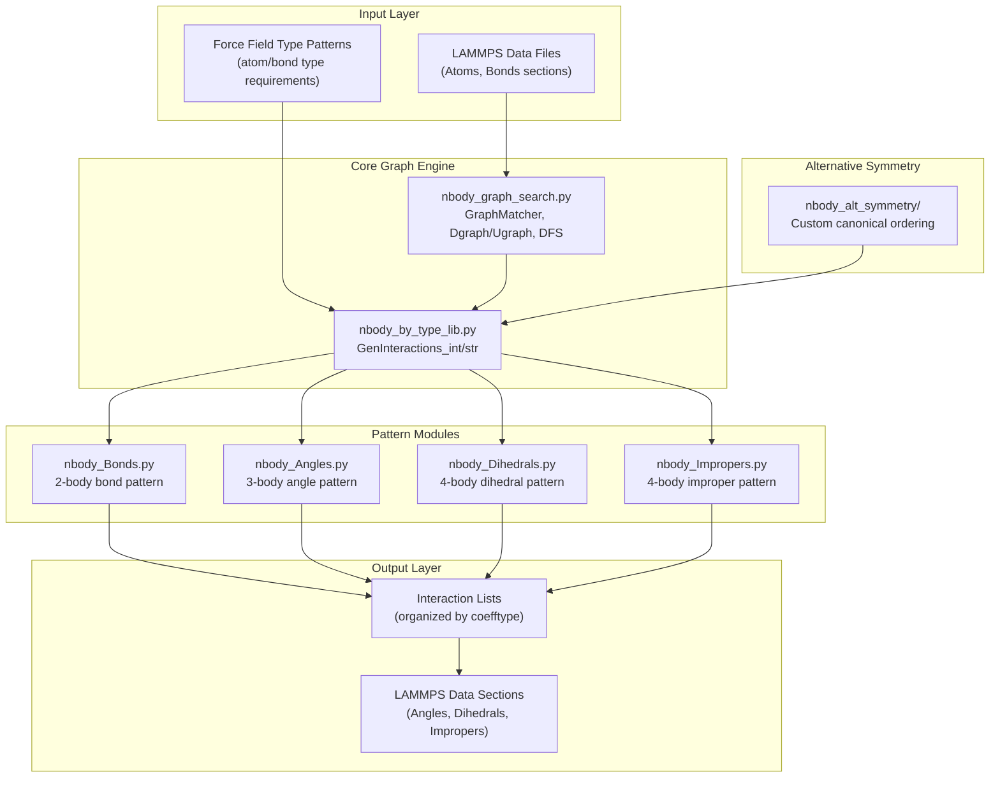

The N-Body Interaction Graph Search system is moltemplate's sophisticated engine for automatically detecting and generating bonded interactions (bonds, angles, dihedrals, impropers) from molecular structures. This system leverages graph theory to identify subgraph isomorphisms—finding small connected patterns (bonded interaction topologies) within larger molecular graphs—while handling atom type constraints and eliminating redundant matches through canonical ordering.

## Core Architecture

The graph search system consists of three architectural layers: the graph matching infrastructure, the interaction generation framework, and interaction-specific pattern modules. The matching engine operates on molecular structures represented as graphs where atoms are vertices (with type attributes) and bonds are edges (with type attributes). When searching for interactions, the system matches small template graphs (like a three-atom angle topology) against the larger molecular graph, filtering results by atom and bond type specifications from force field definitions.

## Graph Matching Infrastructure

The foundation of the system resides in `nbody_graph_search.py`, which implements a variant of the VF2 algorithm optimized for detecting subgraph isomorphisms between graphs of highly unequal size. The `GraphMatcher` class searches for small connected subgraphs within larger graphs, with computational cost per step independent of the larger graph's vertex count—a critical optimization for molecular systems where interaction patterns involve 2-4 atoms while the complete system may contain thousands of atoms.

Sources: [nbody_graph_search.py](/moltemplate/nbody_graph_search.py#L715-L780)

### Graph Data Structures

The system provides two graph implementations: `Dgraph` for directed graphs and `Ugraph` for undirected graphs. `Ugraph` extends `Dgraph` by automatically creating bidirectional edges for each undirected connection. Both structures store vertices and edges with optional `attr` attributes used for atom and bond types, and access elements by integer index starting from 0. The internal representation uses adjacency lists through the `neighbors` array for efficient traversal.

Sources: [nbody_graph_search.py](/moltemplate/nbody_graph_search.py#L103-L115), [nbody_graph_search.py](/moltemplate/nbody_graph_search.py#L391-L432)

### Matching Algorithm

The `GraphMatcher` class initialization performs a depth-first search (DFS) on the small pattern graph to determine vertex and edge visitation order, then reorders the pattern graph's vertices and edges to match this traversal sequence. This pre-ordering optimizes the subsequent recursive matching process. The `Matches()` method iterates through all possible starting vertices in the large graph, matching each with the pattern's first vertex, and yields all complete subgraph isomorphisms through the recursive `Match()` method.

Sources: [nbody_graph_search.py](/moltemplate/nbody_graph_search.py#L736-L793), [nbody_graph_search.py](/moltemplate/nbody_graph_search.py#L815-L860)

The recursive matching handles two cases at each step: **closed loops** where the next edge connects two already-matched vertices, and **extensions** where the edge connects to a new unmatched vertex. This ensures all possible subgraph isomorphisms are found while avoiding redundant exploration paths.

Sources: [nbody_graph_search.py](/moltemplate/nbody_graph_search.py#L862-L920)

> [!TIP]
> The matching algorithm assumes the pattern graph is connected. Disconnected patterns will fail to find matches because the DFS-based search cannot reach orphaned vertices from the starting node.

## Interaction Generation Framework

The `nbody_by_type_lib.py` module provides the primary interface `GenInteractions_int()`, which orchestrates the entire interaction detection process. This function accepts a molecular structure graph (`G_system`), a bonding pattern graph (`g_bond_pattern`), type pattern specifications, and a canonical ordering function. It returns a dictionary mapping coefficient type identifiers to lists of atom IDs participating in each interaction.

Sources: [nbody_by_type_lib.py](/moltemplate/nbody_by_type_lib.py#L41-L150)

### Type Pattern Matching

The `typepattern_to_coefftypes` parameter contains tuples of `(typepattern, coefftype)` where typepattern specifies required atom and bond types. The system first uses `GraphMatcher.Matches()` to find all topologically matching subgraphs, organizing them by atom/bond type combinations into the `interactions_by_type` dictionary. This grouping accelerates subsequent type pattern checking since multiple matches share the same type signatures.

Sources: [nbody_by_type_lib.py](/moltemplate/nbody_graph_search.py#L150-L240)

After collecting all topological matches, the system iterates through user-specified type patterns, converting integer type IDs to string representations, and uses `MatchesAll()` to test compatibility. Each matching interaction undergoes canonical ordering before being added to results, with redundancy checking preventing duplicate entries.

Sources: [nbody_by_type_lib.py](/moltemplate/nbody_by_type_lib.py#L240-L290)

### Progress Reporting and Error Checking

The framework includes optional progress reporting that displays completion percentages during graph searching, plus detailed status messages when checking type pattern requirements. The `check_undefined_atomids_str` parameter enables validation mode that identifies bonded interactions lacking force field parameter definitions, raising errors for undefined atom type combinations.

Sources: [nbody_by_type_lib.py](/moltemplate/nbody_by_type_lib.py#L290-L360)

## Interaction Pattern Modules

Each interaction type has a dedicated module defining its bonding topology and canonical ordering logic:

| Module | Pattern | Atoms | Canonical Rule |
|--------|---------|-------|----------------|
| `nbody_Bonds.py` | Linear 2-atom | 2 | Ensure atom0 < atom1 |
| `nbody_Angles.py` | 3-atom chain | 3 | Ensure atom0 < atom2 |
| `nbody_Dihedrals.py` | 4-atom chain | 4 | Ensure atom0 < atom3 |
| `nbody_Impropers.py` | Central + 3 neighbors | 4 | Ensure atom1 ≤ atom2 |

Sources: [nbody_Bonds.py](/moltemplate/nbody_Bonds.py#L14-L26), [nbody_Angles.py](/moltemplate/nbody_Angles.py#L23-L63), [nbody_Dihedrals.py](/moltemplate/nbody_Dihedrals.py#L22-L64), [nbody_Impropers.py](/moltemplate/nbody_Impropers.py#L25-L71)

### Bond Patterns

Each module defines a `bond_pattern` variable as a `Ugraph` instance specifying the topology. For example, angles use `Ugraph([(0, 1), (1, 2)])` representing a three-atom chain with bonds between atoms 0-1 and 1-2. The `canonical_order` function eliminates redundant matches by sorting atoms according to interaction-specific symmetry rules—angles are symmetric about the central atom, so angle 0-1-2 is equivalent to 2-1-0.

Sources: [nbody_Angles.py](/moltemplate/nbody_Angles.py#L23-L28), [nbody_Angles.py](/moltemplate/nbody_Angles.py#L27-L63)

### Dihedral Symmetry

Dihedral canonical ordering ensures atom0 < atom3 to eliminate the redundancy between 0-1-2-3 and 3-2-1-0, since dihedral angles depend on the angle between planes formed by atoms (0,1,2) and (1,2,3), which remains unchanged when reversing atom order.

Sources: [nbody_Dihedrals.py](/moltemplate/nbody_Dihedrals.py#L26-L38)

### Improper Symmetry

Improper interactions sort atoms 1 and 2 such that atom1 ≤ atom2, preserving the central atom (atom0) as the reference point. This handles the symmetry of improper angles defined by planes (0,1,2) and atom3, where swapping atoms 1 and 2 produces equivalent interactions.

Sources: [nbody_Impropers.py](/moltemplate/nbody_Impropers.py#L29-L47)

## Alternative Symmetry Handling

The `nbody_alt_symmetry/` directory provides modules for force fields requiring different symmetry treatments. The `dihedrals_nosym.py` module, for instance, implements a canonical ordering function that returns matches unmodified, suitable for force fields like `dihedral_style class2` where different atom orderings represent distinct interactions rather than redundant equivalents.

Sources: [nbody_alt_symmetry/dihedrals_nosym.py](/moltemplate/nbody_alt_symmetry/dihedrals_nosym.py#L1-L38)

> [!TIP]
> Select the appropriate symmetry module based on your force field's conventions. Most classical force fields (OPLSAA, AMBER, CHARMM) use symmetric dihedrals, while some specialized styles require no-symmetry handling.

## Depth-First Search Traversal

The `DFS` class in `nbody_graph_search.py` implements graph traversal algorithms essential for both pattern graph reordering and connectivity validation. The `Order()` method performs depth-first traversal from a specified starting node, generating vertex and edge visitation sequences used to reorder pattern graphs for optimal matching performance.

Sources: [nbody_graph_search.py](/moltemplate/nbody_graph_search.py#L578-L648)

The class also provides `IsConnected()` and `IsCyclic()` methods for graph validation. For undirected graphs, `_IsCyclicUgraph()` handles the special case where Ugraphs use bidirectional edge pairs that create trivial loops, counting only cycles between non-adjacent vertices.

Sources: [nbody_graph_search.py](/moltemplate/nbody_graph_search.py#L648-L714)

## File-Level Processing

The `nbody_by_type.py` module provides high-level functions `GenInteractions_lines()` and `GenInteractions_files()` that integrate the graph matching system with LAMMPS data file parsing. These functions handle atom styles, section extraction, and coordinate with the type pattern matching system to generate complete interaction lists ready for LAMMPS input files.

Sources: [nbody_by_type.py](/moltemplate/nbody_by_type.py#L181-L290), [nbody_by_type.py](/moltemplate/nbody_by_type.py#L290-L398)

## Usage Pattern

The typical workflow for generating N-body interactions follows this sequence:

1. **Parse molecular structure**: Read atoms and bonds from LAMMPS data file sections
2. **Construct system graph**: Build `Ugraph` with atoms as vertices and bonds as edges, storing type attributes
3. **Select interaction pattern**: Import appropriate pattern module (e.g., `nbody_Angles`) for desired interaction type
4. **Define type patterns**: Create `typepattern_to_coefftypes` list mapping atom/bond type combinations to coefficient identifiers
5. **Generate interactions**: Call `GenInteractions_int()` with system graph, pattern, type patterns, and canonical ordering function
6. **Output results**: Write returned atom ID lists to appropriate LAMMPS data sections (Angles, Dihedrals, etc.)

Sources: [nbody_by_type_lib.py](/moltemplate/nbody_by_type_lib.py#L41-L150)

## Performance Considerations

The graph matching system's efficiency derives from several optimizations: the DFS-based vertex reordering reduces branching in the recursive matcher, grouping matches by atom/bond types accelerates pattern validation, and canonical ordering with redundancy checking eliminates unnecessary interaction definitions. For large systems, the optional progress reporting helps monitor search completion, which scales with the number of atoms in the system graph.

Sources: [nbody_graph_search.py](/moltemplate/nbody_graph_search.py#L715-L780), [nbody_by_type_lib.py](/moltemplate/nbody_by_type_lib.py#L150-L240)

## Next Steps

Understanding the N-Body Interaction Graph Search system provides the foundation for exploring how moltemplate handles symmetry constraints and canonical ordering conventions across different force field implementations. Continue to [Canonical Ordering and Symmetry Handling](19-canonical-ordering-and-symmetry-handling) to examine the mathematical foundations of eliminating redundant interactions and the specific symmetry rules applied to each interaction type.