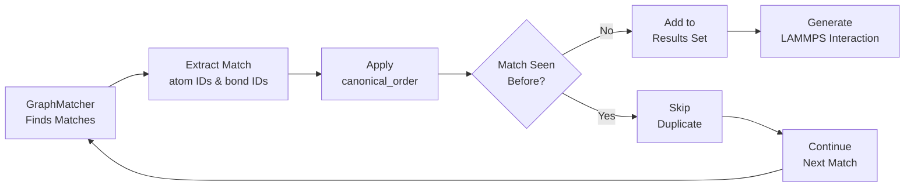

Canonical ordering and symmetry handling represent a critical optimization layer in moltemplate's N-body interaction generation system. When the graph matching algorithm identifies candidate interactions from molecular topology, it often produces redundant matches—physically equivalent interactions represented with different atom orderings. Without canonical ordering, these duplicates would proliferate, creating unnecessarily large LAMMPS data files that significantly slow down simulations. The canonical ordering framework solves this by enforcing a deterministic transformation on each match, ensuring that physically identical interactions map to identical representations that can be deduplicated efficiently.

Sources: [moltemplate/nbody_Bonds.py](moltemplate/nbody_Bonds.py#L19-L35), [moltemplate/nbody_by_type.py](moltemplate/nbody_by_type.py#L187-L188)

## Canonical Ordering Architecture

The canonical ordering architecture integrates seamlessly with moltemplate's graph-based interaction search pipeline. When the GraphMatcher identifies subgraph isomorphisms corresponding to potential N-body interactions, each match undergoes transformation through a canonical ordering function before being added to the results set. The canonical ordering function implements the symmetry properties specific to each interaction type—bonds, angles, dihedrals, or impropers—and forces matches into a standard form based on atom ID comparisons. The system then performs deduplication by comparing canonicalized matches, storing only unique tuples in the final interaction list. This architecture supports pluggable canonical ordering strategies, allowing force-field developers to override default behavior with custom implementations that match the specific symmetry properties of their potential energy functions.

Sources: [moltemplate/nbody_graph_search.py](moltemplate/nbody_graph_search.py#L715-L970), [moltemplate/nbody_by_type.py](moltemplate/nbody_by_type.py#L181-L289)

## Symmetric vs. Asymmetric Interactions

Moltemplate distinguishes between symmetric and asymmetric N-body interactions through different canonical ordering implementations. Symmetric interactions—most bonds, angles, dihedrals, and many impropers—have energy functions that remain invariant under certain atom order permutations. These interactions benefit from reordering-based deduplication, where the canonical ordering function sorts atoms to ensure a unique representation. Asymmetric interactions, typically associated with complex force-field styles like `class2`, have energy formulas that change with atom ordering. For these cases, moltemplate provides "nosym" (no symmetry) modules that return matches unmodified, preserving the exact atom ordering specified by the force field. The choice between symmetric and asymmetric handling significantly impacts both the correctness of interaction generation and the efficiency of the resulting simulation.

Sources: [moltemplate/nbody_Angles.py](moltemplate/nbody_Angles.py#L28-L52), [moltemplate/nbody_alt_symmetry/angles_nosym.py](moltemplate/nbody_alt_symmetry/angles_nosym.py#L23-L41)

## Bond Interaction Canonical Ordering

Bond interactions represent the simplest case of canonical ordering, addressing the fundamental symmetry that a bond between atoms i and j is identical to a bond between atoms j and i. The bond canonical ordering function compares the two atom IDs in a match and swaps them if necessary to ensure the first atom always has a smaller ID than the second. This simple transformation eliminates the 2× redundancy that would otherwise occur for every bond in the system. The bond ordering preserves the original bond ID, which remains attached to whichever bond entry is selected as canonical. This implementation assumes all bond types follow standard harmonic or Morse potential forms with full symmetry between the two endpoints—a valid assumption for nearly all standard LAMMPS bond styles.

Sources: [moltemplate/nbody_Bonds.py](moltemplate/nbody_Bonds.py#L19-L35), [moltemplate/nbody_alt_symmetry/bonds_nosym.py](moltemplate/nbody_alt_symmetry/bonds_nosym.py#L20-L30)

## Angle Interaction Canonical Ordering

Angle interactions involve three atoms connected in a linear chain: atom 0, atom 1 (the central vertex), and atom 2. The angle energy depends only on the geometric angle formed by these three atoms, which remains unchanged when swapping the two outer atoms (0 and 2). Consequently, the canonical ordering for angles compares the IDs of atoms 0 and 2, swapping their positions along with their associated bond IDs if atom 0's ID exceeds atom 2's ID. The central atom (1) always remains in the middle position, and the two bonds (connecting 0-1 and 1-2) are reordered to maintain correspondence with their atoms. This transformation reduces potential 2× redundancy for each angle. For force fields using asymmetric angle styles like `class2`, where the parameter assignments differ for the i-j-k versus k-j-i orientations, the `angles_nosym.py` module preserves the original match without reordering.

Sources: [moltemplate/nbody_Angles.py](moltemplate/nbody_Angles.py#L28-L63), [moltemplate/nbody_alt_symmetry/angles_nosym.py](moltemplate/nbody_alt_symmetry/angles_nosym.py#L23-L42)

## Dihedral Interaction Canonical Ordering

Dihedral interactions involve four atoms connected sequentially: atoms 0, 1, 2, and 3, forming the backbone for torsional rotation. The dihedral angle energy depends on the angle between planes formed by atoms (0,1,2) and (1,2,3), which is invariant under complete reversal of the atom sequence. The canonical ordering function implements this symmetry by comparing atom 0 and atom 3—if atom 0 has a larger ID than atom 3, the entire sequence is reversed along with all three bond IDs. This reversal transforms (0,1,2,3) into (3,2,1,0) and the bonds (b01,b12,b23) into (b23,b12,b01). The central bond (connecting atoms 1 and 2) remains in the middle position. This approach eliminates the 2× redundancy inherent in dihedral definitions while maintaining consistency with LAMMPS dihedral style conventions.

Sources: [moltemplate/nbody_Dihedrals.py](moltemplate/nbody_Dihedrals.py#L26-L64), [moltemplate/nbody_alt_symmetry/dihedrals_nosym.py](moltemplate/nbody_alt_symmetry/dihedrals_nosym.py#L19-L37)

## Improper Interaction Canonical Ordering

Improper interactions present the most complex canonical ordering challenges due to diverse force field conventions for defining the central atom and handling symmetry. The standard implementation assumes atom 0 serves as the central hub connected to atoms 1, 2, and 3 in a star topology. For this configuration, the improper angle remains invariant when swapping the outer pair of atoms (1 and 2), so the canonical ordering function compares their IDs and swaps them if atom 1's ID exceeds atom 2's ID, simultaneously reordering their corresponding bonds (b01 and b02) while leaving the third atom (3) and its bond unchanged. This 2× redundancy reduction represents the minimal approach suitable for most harmonic improper styles.

Sources: [moltemplate/nbody_Impropers.py](moltemplate/nbody_Impropers.py#L29-L71)

## Force Field-Specific Improper Canonical Ordering

Different force fields adopt varying conventions for improper interaction topology, requiring specialized canonical ordering implementations. OPLS force fields place the central atom at position 1 or 2 (depending on the specific OPLS version) rather than position 0, which changes the symmetry analysis. The `cenJswapIL.py` and `cenKswapIL.py` modules handle these cases by comparing and swapping the outer atoms (0 and 3) while keeping the central atom fixed. AMBER/GAFF force fields use the third atom (position 2) as the central atom and implement additional sorting logic—the `gaff_imp.py` module performs a complete three-way sort of the outer atoms (0, 1, and 3) into ascending order, reflecting the full 3! = 6-fold symmetry of the GAFF improper definition. These force-field-specific modules are activated by appending their filenames to the section header in LT files (e.g., `write_once("Data Impropers By Type (gaff_imp.py)")`).

Sources: [moltemplate/nbody_alt_symmetry/cenJswapIL.py](moltemplate/nbody_alt_symmetry/cenJswapIL.py#L27-L68), [moltemplate/nbody_alt_symmetry/cenKswapIL.py](moltemplate/nbody_alt_symmetry/cenKswapIL.py#L35-L76), [moltemplate/nbody_alt_symmetry/gaff_imp.py](moltemplate/nbody_alt_symmetry/gaff_imp.py#L47-L95)

## Bond Pattern Definitions

Each canonical ordering module includes a corresponding bond pattern definition that specifies the subgraph topology for interaction matching. These patterns use moltemplate's Ugraph (undirected graph) representation with edges defined as tuples of vertex indices. For bonds, the pattern is `Ugraph([(0, 1)])`; for angles, `Ugraph([(0, 1), (1, 2)])`; for dihedrals, `Ugraph([(0, 1), (1, 2), (2, 3)])`; and for the standard improper topology, `Ugraph([(0, 1), (0, 2), (0, 3)])`. Force-field specific improper modules use alternative edge lists reflecting their central atom placement—OPLS variants use `Ugraph([(1, 0), (1, 2), (1, 3)])` or `Ugraph([(2, 0), (2, 1), (2, 3)])`. These bond patterns serve as templates for the graph matching algorithm, which searches the molecular topology for subgraphs isomorphic to these patterns and passes each found match to the canonical ordering function for deduplication.

Sources: [moltemplate/nbody_Bonds.py](moltemplate/nbody_Bonds.py#L14-L15), [moltemplate/nbody_Angles.py](moltemplate/nbody_Angles.py#L23-L24), [moltemplate/nbody_Dihedrals.py](moltemplate/nbody_Dihedrals.py#L22-L23), [moltemplate/nbody_Impropers.py](moltemplate/nbody_Impropers.py#L25-L26)

## Custom Canonical Ordering Implementation

Developers creating custom force fields can implement their own canonical ordering functions by creating Python modules with two required components: a `bond_pattern` variable defining the subgraph as a Ugraph object, and a `canonical_order(match)` function that accepts and returns match tuples. The match tuple structure contains two elements: `match[0]` is a tuple of atom IDs and `match[1] is a tuple of bond IDs. The canonical ordering function should analyze the symmetry properties of the interaction's energy function and return a deterministic permutation of the input that represents all equivalent configurations. For symmetric interactions, this typically involves sorting or swapping atoms based on ID comparisons; for asymmetric interactions, the function should return the match unchanged. These custom modules are placed in the appropriate directory and referenced in LT files using the parenthetical syntax in section headers.

Sources: [moltemplate/nbody_alt_symmetry/gaff_imp.py](moltemplate/nbody_alt_symmetry/gaff_imp.py#L10-L20), [moltemplate/nbody_by_type.py](moltemplate/nbody_by_type.py#L148-L149)

## Performance Impact and Validation

Canonical ordering provides substantial performance benefits by reducing redundant interaction definitions in LAMMPS data files. In systems with high connectivity or periodic boundary conditions, the graph matching algorithm may identify the same physical interaction multiple times from different starting points. Without deduplication, a typical system could generate 2× to 6× more interaction entries than necessary, increasing memory usage and force computation time proportionally. The canonical ordering approach eliminates these duplicates at the generation stage, producing minimal, optimally-ordered interaction lists. Validation involves verifying that the canonical ordering function correctly identifies all permutations of atom order that produce identical energies, and that the resulting interaction sets produce physically equivalent simulation trajectories compared to unsuppressed duplicates.

Sources: [moltemplate/nbody_by_type.py](moltemplate/nbody_by_type.py#L269-L289), [moltemplate/nbody_Angles.py](moltemplate/nbody_Angles.py#L29-L52)

## Interaction Symmetry Reference

The following table summarizes the symmetry properties and canonical ordering strategies for different interaction types and force field variants:

| Interaction Type | Standard Symmetry | Central Atom | Canonical Order Strategy | Redundancy Eliminated |
|------------------|-------------------|--------------|--------------------------|----------------------|
| Bonds | 2× (i-j = j-i) | N/A | Ensure atom0 < atom1 | 2× |
| Angles (harmonic) | 2× (0-1-2 = 2-1-0) | 1 | Ensure atom0 < atom2 | 2× |
| Angles (class2) | None | 1 | No reordering (nosym) | 1× |
| Dihedrals (standard) | 2× (0-1-2-3 = 3-2-1-0) | N/A | Ensure atom0 < atom3 | 2× |
| Dihedrals (class2) | None | N/A | No reordering (nosym) | 1× |
| Impropers (harmonic) | 2× (swap atoms 1,2) | 0 | Ensure atom1 ≤ atom2 | 2× |
| Impropers (OPLS) | 2× (swap atoms 0,3) | 1 or 2 | Ensure atom0 ≤ atom3 | 2× |
| Impropers (GAFF) | 6× (full S3 symmetry) | 2 | Sort atoms 0,1,3 | 6× |
| Impropers (class2) | None | 0 | No reordering (nosym) | 1× |

Sources: [moltemplate/nbody_Bonds.py](moltemplate/nbody_Bonds.py#L19-L35), [moltemplate/nbody_Angles.py](moltemplate/nbody_Angles.py#L28-L63), [moltemplate/nbody_Dihedrals.py](moltemplate/nbody_Dihedrals.py#L26-L64), [moltemplate/nbody_Impropers.py](moltemplate/nbody_Impropers.py#L29-L71), [moltemplate/nbody_alt_symmetry/gaff_imp.py](moltemplate/nbody_alt_symmetry/gaff_imp.py#L47-L95)

> [!TIP]
> When implementing custom canonical ordering functions for force fields with unusual symmetry properties, carefully analyze whether the energy function is truly symmetric under the assumed permutations. Some ostensibly symmetric force fields may have sign-dependent terms or direction-sensitive parameters that break apparent symmetries. Test implementations on small, symmetric molecules to verify that different atom orderings produce identical forces and energies after canonical ordering.

## Integration with N-Body Generation Pipeline

The canonical ordering mechanism operates within moltemplate's `nbody_by_type.py` module, which orchestrates the complete interaction generation process. The `GenInteractions_lines` function accepts a `canonical_order` parameter that provides the ordering function for the current interaction type. After matching atom type patterns against the topology using graph search, each candidate match passes through the canonical ordering function before being checked against the set of previously found interactions. The deduplication check uses Python's tuple hashing—canonicalized matches become immutable tuples that can be stored in a set or dictionary keys for O(1) duplicate detection. This pipeline design cleanly separates the topology matching logic from the symmetry handling logic, allowing developers to customize either component independently.

Sources: [moltemplate/nbody_by_type.py](moltemplate/nbody_by_type.py#L181-L289)

## Next Steps

Understanding canonical ordering and symmetry handling provides essential context for exploring moltemplate's force field support. To see how these canonical ordering strategies are applied in specific force field implementations, continue to [OPLSAA Force Field Integration](20-oplsaa-force-field-integration) and [AMBER/GAFF Force Field Integration](21-amber-gaff-force-field-integration). For deeper understanding of the graph matching algorithms that generate the candidate interactions requiring canonical ordering, review [N-Body Interaction Graph Search](18-n-body-interaction-graph-search).