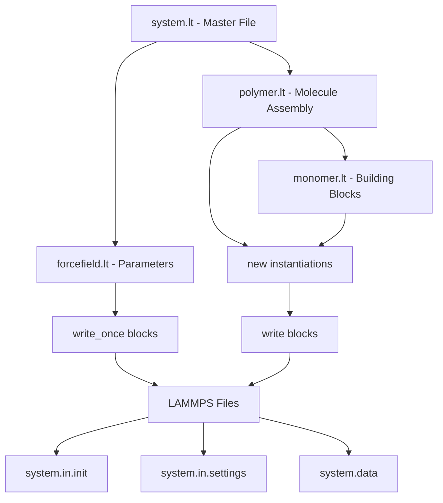

Get up and running with moltemplate in under 15 minutes. This guide walks you through installation, your first simulation setup, and the basic moltemplate workflow so you can start building molecular systems for LAMMPS immediately.

## Understanding Moltemplate's Role

Moltemplate serves as a cross-platform text-based molecule builder specifically designed for LAMMPS molecular dynamics simulations. Rather than manually writing complex LAMMPS data files with hundreds or thousands of atom coordinates and interaction parameters, moltemplate provides a template-based system that allows you to define molecules hierarchically and instantiate them programmatically. The tool supports multiple force fields including OPLSAA, AMBER/GAFF, DREIDING, and COMPASS, making it suitable for both all-atom and coarse-grained simulations. Think of moltemplate as a domain-specific compiler that translates your intuitive molecular descriptions into the precise LAMMPS input format required for simulation.

Sources: [README.md](README.md#L1-L30), [README.md](README.md#L110-L120)

## Installation Workflow

Moltemplate requires Python 3.4+ and BASH shell environment before installation. Choose one of two installation methods based on your environment and needs.

> [!TIP]
> Use pip installation if you plan to integrate moltemplate with other Python tools like Vipster or CellPack, as these require Python module access. Use the PATH method if you prefer manual control or encounter permission issues.

### Prerequisites Check

Before installing, verify your environment meets these requirements:

| Requirement | Purpose | Check Command |
|------------|---------|---------------|
| BASH shell | Script execution | `which bash` |
| Python 3.4+ | Core functionality | `python3 --version` |
| pip/pip3 | Package installation | `which pip3` or `which pip` |

On Windows, install WSL2 or a Linux VM first, as moltemplate requires a Unix-style environment. MacOS users should install BASH via Homebrew or XCODE if not present.

Sources: [INSTALL.md](INSTALL.md#L54-L70), [INSTALL.md](INSTALL.md#L160-L200)

### Installation Method 1: Using pip (Recommended)

The pip method is straightforward and provides clean integration with your Python environment:

```bash
# Clone the repository
git clone https://github.com/jewettaij/moltemplate DESTINATION_DIRECTORY
cd DESTINATION_DIRECTORY

# Install using pip
pip3 install .              # Use "pip" if "pip3" fails

# For user-only installation (if system-wide fails)
pip3 install . --user       # Use "pip" if "pip3" fails

# For system-wide installation (requires sudo)
sudo pip3 install .         # Use "pip" if "pip3" fails
```

To uninstall later: `pip3 uninstall moltemplate`

Sources: [INSTALL.md](INSTALL.md#L1-L25), [README.md](README.md#L115-L135)

### Installation Method 2: Manual PATH Configuration

If pip installation fails or you prefer manual setup, add moltemplate to your PATH by editing your shell configuration:

For BASH users (`~/.bashrc`):
```bash
export PATH="$PATH:$HOME/moltemplate/moltemplate"
export PATH="$PATH:$HOME/moltemplate/moltemplate/scripts"
```

For TCSH users (`~/.cshrc` or `~/.tcshrc`):
```bash
setenv PATH "$PATH:$HOME/moltemplate/moltemplate"
setenv PATH "$PATH:$HOME/moltemplate/moltemplate/scripts"
```

Remember to start a new terminal for changes to take effect.

Sources: [INSTALL.md](INSTALL.md#L80-L110)

## Verification Test

After installation, verify moltemplate works by checking the version:

```bash
moltemplate.sh
```

This should display version information like: `moltemplate.sh v2.22.4 2025-8-21` followed by usage instructions. If you see "command not found", ensure your PATH is configured correctly or that pip installation completed successfully.

Sources: [moltemplate/scripts/moltemplate.sh](moltemplate/scripts/moltemplate.sh#L7-L13)

## Your First Moltemplate Project

Let's walk through building a simple coarse-grained polymer system using the provided 2-bead polymer example. This demonstrates the complete moltemplate workflow in under 10 minutes.


### Step 1: Navigate to the Example

The 2-bead polymer example demonstrates a coarse-grained heteropolymer with 14 residues, each containing a backbone bead (CA) and a residue bead (R). Navigate to the example directory:

```bash
cd examples/coarse_grained/simple_examples/2bead_polymer
```

This example includes visualizations of the monomer, polymer chain, 3×3×3 array, and final simulation trajectory, making it easy to understand what you're building.

Sources: [examples/coarse_grained/simple_examples/2bead_polymer/README.md](examples/coarse_grained/simple_examples/2bead_polymer/README.md#L1-L31)

### Step 2: Build LAMMPS Files with Moltemplate

Enter the moltemplate files directory and run moltemplate:

```bash
cd moltemplate_files
moltemplate.sh system.lt
```

This command processes your template files and generates:
- `system.in.init` - LAMMPS initialization commands
- `system.in.settings` - Force field parameters and interaction settings
- `system.data` - Atom coordinates, bonds, angles, dihedrals, and system topology

Move these files to the parent directory:

```bash
mv -f system.in* system.data ../
cd ../
```

Clean up temporary files if desired:
```bash
rm -rf moltemplate_files/output_ttree/
```

Sources: [examples/coarse_grained/simple_examples/2bead_polymer/README_setup.sh](examples/coarse_grained/simple_examples/2bead_polymer/README_setup.sh#L1-L24)

### Step 3: Understanding the Template Files

Moltemplate's power comes from its hierarchical template system. Let's examine the files you just processed:


The key files demonstrate moltemplate's architecture:

**system.lt** - The master file that imports components and defines the simulation:
```lt
import "polymer.lt"

write_once("Data Boundary") {
  0 90.0 xlo xhi
  0 90.0 ylo yhi
  0 90.0 zlo zhi
}

# Create 27 polymers in a 3x3x3 grid
polymers = new Polymer [3].move(0, 0, 30.0)
                       [3].move(0, 30.0, 0)
                       [3].move(30.0, 0, 0)
```

**forcefield.lt** - Defines interaction parameters and atom types with LAMMPS commands embedded:
```lt
ForceField {
  write_once("In Init") {
    units           real
    atom_style      full
    bond_style      harmonic
    pair_style      lj/cut 11.0
  }
  
  write_once("Data Masses") {
    @atom:CA    13.0
    @atom:R     50.0
  }
  
  write_once("In Settings") {
    pair_coeff   @atom:CA @atom:CA       0.10 2.0
    bond_coeff  @bond:Backbone    15.0   3.7
  }
}
```

**monomer.lt** - Defines a reusable monomer template:
```lt
Monomer inherits ForceField {
  write("Data Atoms") {
    $atom:ca $mol:... @atom:CA   0.0   0.000  1.0000   0.0000000
    $atom:r  $mol:... @atom:R    0.0   0.000  4.4000   0.0000000
  }
  write("Data Bonds") {
    $bond:cr    @bond:Sidechain  $atom:ca  $atom:r
  }
}
```

**polymer.lt** - Instantiates monomers and connects them:
```lt
Polymer inherits ForceField {
  create_var {$mol}  # Force all monomers to share molecule-ID
  
  mon1 = new Monomer
  mon2 = new Monomer.rot(180.0, 1,0,0).move(3.2,0,0)
  # ... more monomers ...
  
  write("Data Bonds") {
    $bond:backbone1  @bond:Backbone  $atom:mon1/ca  $atom:mon2/ca
  }
}
```

Sources: [examples/coarse_grained/simple_examples/2bead_polymer/moltemplate_files/system.lt](examples/coarse_grained/simple_examples/2bead_polymer/moltemplate_files/system.lt#L1-L30), [examples/coarse_grained/simple_examples/2bead_polymer/moltemplate_files/forcefield.lt](examples/coarse_grained/simple_examples/2bead_polymer/moltemplate_files/forcefield.lt#L1-L50), [examples/coarse_grained/simple_examples/2bead_polymer/moltemplate_files/monomer.lt](examples/coarse_grained/simple_examples/2bead_polymer/moltemplate_files/monomer.lt#L1-L21), [examples/coarse_grained/simple_examples/2bead_polymer/moltemplate_files/polymer.lt](examples/coarse_grained/simple_examples/2bead_polymer/moltemplate_files/polymer.lt#L1-L28)

### Step 4: Run the LAMMPS Simulation

With the generated files, run the simulation using LAMMPS:

```bash
lmp_mpi -i run.in.nvt
```

The `run.in.nvt` script uses standard LAMMPS commands to:
1. Include initialization and settings files generated by moltemplate
2. Read the system data
3. Apply Langevin dynamics for temperature control
4. Run 40 million timesteps (80,000 ps with 2.0 fs timestep)
5. Output trajectory and thermodynamic data

The example produces visualization files showing the 3×3×3 polymer array and its evolution over time.

Sources: [examples/coarse_grained/simple_examples/2bead_polymer/run.in.nvt](examples/coarse_grained/simple_examples/2bead_polymer/run.in.nvt#L1-L33), [examples/README.md](examples/README.md#L15-L37)

## Moltemplate Architecture Overview

Understanding moltemplate's core architecture helps you build more complex systems efficiently:



### Key Moltemplate Concepts

| Concept | Purpose | Example |
|---------|---------|---------|
| **Template Definition** | Reusable molecular building blocks | `Monomer` class with atoms and bonds |
| **Inheritance** | Share parameters across objects | `Polymer inherits ForceField` |
| **Instantiation** | Create specific instances with transformations | `mon1 = new Monomer.move(3.2,0,0)` |
| **Array Creation** | Generate multiple copies efficiently | `new Polymer [3][3][3]` |
| **write() vs write_once()** | Control command duplication | Bonds use `write()`, masses use `write_once()` |

Moltemplate uses a preprocessing approach where it:
1. Parses all `.lt` template files
2. Builds a tree of instantiated objects
3. Applies transformations (rotations, translations)
4. Generates LAMMPS-specific commands based on atom types and interactions
5. Outputs ready-to-use LAMMPS input files

Sources: [README.md](README.md#L80-L100), [examples/coarse_grained/simple_examples/2bead_polymer/moltemplate_files/forcefield.lt](examples/coarse_grained/simple_examples/2bead_polymer/moltemplate_files/forcefield.lt#L1-L15)

> [!TIP]
> The `@atom:CA` syntax creates named atom types that moltemplate resolves to specific integer values during processing. This makes your templates readable and maintainable while generating efficient LAMMPS input.

## Common First-Time Projects

Based on your research goals, choose an appropriate starting example:

| Research Area | Recommended Example | Location |
|---------------|-------------------|----------|
| **Coarse-grained polymers** | 2-bead polymer | `examples/coarse_grained/simple_examples/2bead_polymer/` |
| **Heteropolymers** | Random heteropolymer | `examples/coarse_grained/simple_examples/random_heteropolymer/` |
| **Membrane systems** | Lipid bilayer | `examples/coarse_grained/membrane_examples/` |
| **All-atom simulations** | AMBER force field | `examples/all_atom/force_field_AMBER/` |
| **File conversion** | PDB to LAMMPS | `examples/file_conversion_examples/read_PDB_file_examples/` |

The repository contains approximately 50 examples covering various molecular systems and force fields. Each example includes `README_setup.sh` (how to build files) and `README_run.sh` (how to run simulations).

Sources: [README.md](README.md#L40-L50), [get_repo_structure examples/](get_repo_structure_examples/)

## Troubleshooting Common Issues

| Issue | Symptom | Solution |
|-------|---------|----------|
| **Python version too old** | Deprecation warnings | Install Python 3.4+ via Anaconda or system package manager |
| **Command not found** | `moltemplate.sh: command not found` | Verify PATH configuration or reinstall with pip |
| **Permission denied** | Cannot install system-wide | Use `--user` flag or virtual environment |
| **Import errors** | Python module not found | Use pip installation method instead of PATH configuration |
| **WSL file issues** | Files corrupted | Edit files within WSL environment, not Windows applications |

If installation fails despite troubleshooting, check that you're using consistent Python/pip versions by running `which python3` and `which pip3` to ensure they reference compatible installations.

Sources: [INSTALL.md](INSTALL.md#L60-L95), [moltemplate/scripts/moltemplate.sh](moltemplate/scripts/moltemplate.sh#L14-L45)

## Next Steps

You've successfully completed the Quick Start guide. To deepen your understanding and tackle more complex systems:

1. **Complete Installation** - If you skipped details, review the full [Installation Guide](3-installation-guide) for platform-specific nuances
2. **Build Your First Simulation** - Walk through the end-to-end process in [Your First Moltemplate Simulation](5-your-first-moltemplate-simulation)
3. **Master the Syntax** - Learn the complete LT file syntax in [Moltemplate LT File Syntax](6-moltemplate-lt-file-syntax)
4. **Understand the Engine** - Dive into template processing with [Core Template System Architecture](7-core-template-system-architecture)

For detailed questions, consult the reference manual (Chapter 4 is particularly important) or explore additional examples that match your research area. The moltemplate community regularly contributes new examples and force field conversions, so check the repository for updates.
