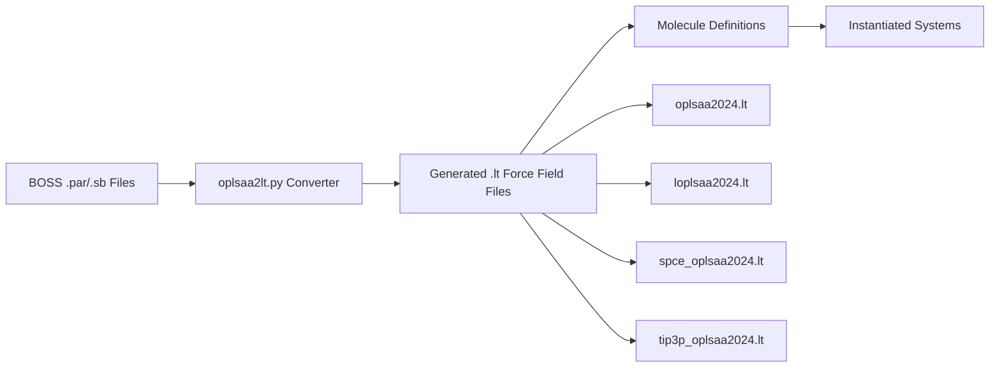
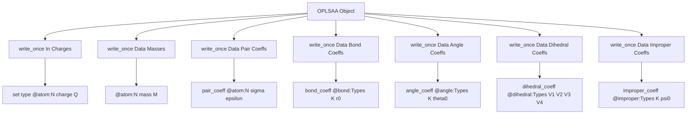

The OPLS-AA (Optimized Potentials for Liquid Simulations - All Atom) force field represents a comprehensive all-atom force field widely used for simulating organic liquids, crystals, and biomolecules. This documentation explains how moltemplate integrates OPLS-AA, provides guidance on using pre-generated force field files, and demonstrates practical implementation patterns for molecular systems.

## Architecture Overview

Moltemplate's OPLS-AA integration follows a conversion pipeline architecture where original BOSS format files are transformed into moltemplate-compatible LT files. The system supports multiple OPLS-AA versions with specialized extensions for long-chain polymers and water models.



The conversion pipeline preserves the original OPLS-AA parameter semantics while adapting atom type naming conventions to moltemplate's syntax requirements. The converter handles problematic characters in original BOSS type names (such as `C:`, `C$`, `N*`) by substituting them with moltemplate-safe alternatives.

Sources: [oplsaa2lt.py](/moltemplate/force_fields/convert_OPLSAA_to_LT/oplsaa2lt.py#L32-L48)

## Available OPLS-AA Force Field Variants

Moltemplate provides multiple OPLS-AA force field files to accommodate different simulation requirements and parameter sets from various literature sources.

| Force Field File | Description | Publication Year | Special Features |
|-----------------|-------------|------------------|------------------|
| `oplsaa.lt` | Legacy OPLS-AA implementation | 1996 | Original Jorgensen parameters |
| `oplsaa2008.lt` | Updated OPLS-AA parameters | 2008 | Extended parameter coverage |
| `oplsaa2024.lt` | Current recommended version | 2024 | Latest JPCB parameters |
| `loplsaa2024.lt` | LOPLS extended parameters | 2012/2015 | Long alkane chain enhancements |
| `spce_oplsaa2024.lt` | SPC/E water + OPLS-AA | 2024 | Rigid water model integration |
| `tip3p_oplsaa2024.lt` | TIP3P water + OPLS-AA | 2024 | Compatible water model |

The `oplsaa2024.lt` file represents the current standard, incorporating parameters from the 2024 Journal of Physical Chemistry B publication. For long-chain polymers (particularly alkanes with 16+ carbons), the `loplsaa2024.lt` extension provides optimized dihedral parameters from LOPLS2012 and LOPLS2015 studies.

Sources: [oplsaa.lt](/moltemplate/force_fields/oplsaa.lt#L1-L22), [loplsaa2024.lt](/moltemplate/force_fields/loplsaa2024.lt#L1-L17)

## Force Field File Structure

Each OPLS-AA LT file contains a single `OPLSAA` object that encapsulates all force field parameters. The structure follows a standardized format with atomic charges defined via LAMMPS `set` commands and interaction parameters organized by type.



The `In Charges` section uses LAMMPS `set` commands to assign partial charges based on atom type identifiers (`@atom:N`). This approach allows charges to be applied uniformly across all atoms of a given type, consistent with the OPLS-AA force field philosophy. Any charges specified in molecule definitions are overridden by these type-based assignments.

Sources: [oplsaa.lt](/moltemplate/force_fields/oplsaa.lt#L45-L100)

## Defining OPLS-AA Molecules

Creating molecules with OPLS-AA requires selecting appropriate atom types and defining connectivity. The atom type selection is critical—you must match the chemical environment of each atom to the corresponding type description in the force field file.

### Basic Molecule Definition Pattern

```lt
import "oplsaa2024.lt"

Benzene inherits OPLSAA {

  # atom-id  mol-id  atom-type  charge  X      Y      Z
  write("Data Atoms") {
    $atom:c1  $mol  @atom:145  0.00 -0.739  1.189 -0.00733  # CA - Benzene C
    $atom:c2  $mol  @atom:145  0.00  0.614  1.208  0.35167  # CA - Benzene C
    $atom:h1  $mol  @atom:146  0.00 -1.309  2.106 -0.01233  # HA - Benzene H
    :
  }

  write("Data Bond List") {
    $bond:c12  $atom:c1 $atom:c2
    $bond:c1h1 $atom:c1 $atom:h1
    :
  }

  # Angles, dihedrals, impropers are auto-generated
}
```

**Key implementation requirements:**

1. **Atom Type Selection**: Use `@atom:145` for aromatic carbons (`CA`), `@atom:146` for aromatic hydrogens (`HA`). Consult the `In Charges` section of the force field file for type descriptions.

2. **Charge Assignment**: Set all charges to `0.00` in your definition. The `In Charges` section from the force field will override these values with OPLS-AA standard charges.

3. **Bond Specification**: Explicitly list all bonds. Moltemplate uses these bonds to automatically generate angles, dihedrals, and impropers based on atom types.

Sources: [benzene.lt](/examples/all_atom/force_field_OPLSAA/ethylene+benzene/moltemplate_files/benzene.lt#L1-L35)

### Polymer Construction Pattern

Building polymers with OPLS-AA typically follows a modular approach where monomer subunits are defined separately and then assembled into chains. The alkane examples demonstrate this pattern clearly.

```lt
import "ch2.lt"  # Defines CH2 monomer
import "ch3.lt"  # Defines CH3 monomer

Butane inherits OPLSAA {

  create_var {$mol}  # Share molecule ID across monomers

  # Position monomers with proper geometry
  monomer1 = new CH3
  monomer2 = new CH2.rot(180,1,0,0).move(1.2533223,0,0)
  monomer3 = new CH2.move(2.5066446,0,0)
  monomer4 = new CH3.rot(180,0,0,1).move(3.7599669,0,0)

  # Explicit inter-monomer bonds
  write('Data Bond List') {
    $bond:b1  $atom:monomer1/c $atom:monomer2/c
    $bond:b2  $atom:monomer2/c $atom:monomer3/c
    $bond:b3  $atom:monomer3/c $atom:monomer4/c
  }
}
```

> [!TIP]
> The `create_var {$mol}` directive ensures all monomers share the same molecule ID number, which is essential for proper interaction generation in LAMMPS. Without this, each monomer would be treated as a separate molecule, potentially disrupting bonded interactions across monomer boundaries.

Sources: [butane.lt](/examples/all_atom/force_field_OPLSAA/butane/moltemplate_files/butane.lt#L1-L35)

## Interaction Parameter Resolution

Moltemplate automatically generates angles, dihedrals, and impropers based on the connectivity defined in `Data Bond List`. The parameter selection follows these rules:

1. **Pattern Matching**: For each generated interaction, moltemplate searches the force field file for parameter sets matching the atom type sequence (with appropriate symmetry considerations).

2. **Priority Resolution**: When multiple parameter sets match (common for dihedrals), moltemplate selects the first match found. This default selection may not always be optimal for specific molecules.

3. **Ambiguity Detection**: Run moltemplate with `-report-duplicates bytype __` to generate warning files (`warning_duplicate_dihedrals.txt`, `warning_duplicate_angles.txt`) indicating where multiple parameter sets match.

### Customizing Dihedral Parameters

For critical systems where the default dihedral selection is suboptimal, explicitly specify the best parameters:

```lt
Butane inherits OPLSAA {
  :
  write("Data Dihedrals") {
    # Override default dihedral for CT-CT-CT-CT
    # Type __2 is specific to butane (stiffer than generic __1)
    $dihedral:c1_c2_c3_c4 @dihedral:CT_CT_CT_CT__2 
        $atom:monomer1/c $atom:monomer2/c 
        $atom:monomer3/c $atom:monomer4/c
  }
}
```

The comment in the force field file (`oplsaa2024.lt`) indicates the intended usage context for each dihedral variant. For example, `@dihedral:CT_CT_CT_CT__2` is marked as "butane only OPLS/2020" while `@dihedral:CT_CT_CT_CT__1` represents generic alkane parameters.

Sources: [butane.lt](/examples/all_atom/force_field_OPLSAA/butane/moltemplate_files/butane.lt#L40-L90), [oplsaa.lt](/moltemplate/force_fields/oplsaa.lt#L8000-L8050)

## Water Model Integration

OPLS-AA provides several water model variants that maintain compatibility with the organic molecule parameters while using established water potentials.

### SPC/E Water Model

```lt
import "oplsaa2024.lt"

SPCE inherits OPLSAA {

  write("Data Atoms") {
    $atom:o  $mol:. @atom:9989 -0.8476  0.0 0.0 0.0
    $atom:h1 $mol:. @atom:9988  0.4238  0.8164904 0.0  0.5773590
    $atom:h2 $mol:. @atom:9988  0.4238 -0.8164904 0.0  0.5773590
  }

  write("Data Bond List") {
    $bond:OH1 $atom:o $atom:h1
    $bond:OH2 $atom:o $atom:h2
  }

  write_once("In Settings") {
    group spce type @atom:9989 @atom:9988
    fix fShakeSPCE spce shake 0.0001 10 100 
        b @bond:spcO_spcH a @angle:spcH_spcO_spcH
  }
}
```

The water model files (`spce_oplsaa2024.lt`, `tip3p_oplsaa2024.lt`, `tip5p_oplsaa2024.lt`) integrate rigid water constraints using LAMMPS `fix shake` with bond and angle parameters defined in the main OPLS-AA force field. This allows mixing water with organic molecules without force field incompatibility issues.

Sources: [spce_oplsaa2024.lt](/moltemplate/force_fields/spce_oplsaa2024.lt#L1-L55)

## Customizing Atomic Charges

OPLS-AA uses type-based charge assignment, but you may need to override charges for specific atoms based on quantum mechanical calculations or experimental data.

### Method 1: Override Selected Charges

Add an `In Charges` section to your molecule file to modify specific atoms:

```lt
Graphene_NH2 inherits OPLSAA {
  :
  write_once("In Charges") {
    set atom $atom:carbon_adjacent_to_NH2 charge -0.12
  }
}
```

This approach preserves the `system.in.charges` file generation while overriding charges for specific atom instances. The LAMMPS `set` commands allow precise charge targeting without modifying the force field file.

### Method 2: Full Charge Control

To take complete control over charges, specify them in `Data Atoms` and remove the `include system.in.charges` line from your LAMMPS input script:

```lt
Molecule inherits OPLSAA {
  write("Data Atoms") {
    $atom:c1 $mol @atom:145  -0.115  0.0 0.0 0.0  # Custom charge
    $atom:h1 $mol @atom:146   0.115  1.0 0.0 0.0  # Custom charge
  }
}
```

Then in `run.in.npt` or similar LAMMPS scripts, remove or comment out the `include system.in.charges` line to prevent the OPLS-AA type-based charges from overriding your custom values.

Sources: [README.md](/examples/all_atom/force_field_OPLSAA/README.md#L10-L80)

## System Assembly Patterns

### Simple Lattice Arrangements

For creating periodic boxes with molecules arranged on regular lattices, use moltemplate's array creation syntax:

```lt
import "ethylene.lt"
import "benzene.lt"

# Periodic boundary conditions
write_once("Data Boundary") {
   0.0  48.00  xlo xhi
   0.0  48.00  ylo yhi
   0.0  48.00  zlo zhi
}

# 216 ethylene molecules in 6×6×6 lattice
ethylenes = new Ethylene[6].move(8.0, 0, 0)
                        [6].move(0, 8.0, 0)
                        [6].move(0, 0, 8.0)

# 108 benzene molecules in 6×6×3 lattice
benzenes = new Benzene[6].move(8.0, 0, 0)
                      [6].move(0, 8.0, 0)
                      [3].move(0, 0, 16.0)

# Shift to reduce overlap
benzenes[*][*][*].move(4.0, 4.0, 4.0)
```

### Mixed Systems with Ions

Complex systems containing polymers, water, and ions demonstrate advanced assembly capabilities:

```lt
NIPAM_polymer_10mer inherits OPLSAA {
  create_var {$mol}
  
  # Create 10 monomers with rotation
  monomers[0] = new NIPAM_begin.rot(0,1,0,0).move(0,0,0)
  monomers[1] = new NIPAM_monomer.rot(45,1,0,0).move(2.5066446,0,0)
  :
  monomers[9] = new NIPAM_end.rot(405,1,0,0).move(22.5598014,0,0)

  # Inter-monomer bonds
  write('Data Bond List') {
    $bond:b1 $atom:monomers[0]/c2 $atom:monomers[1]/c1
    :
  }
}
```

For systems requiring precise molecular packing (such as complex mixtures or irregular compositions), integrate PACKMOL with moltemplate. The PACKMOL-generated coordinates can be imported using `.move()` commands, allowing arbitrary molecule placement while retaining moltemplate's force field integration.

Sources: [system.lt](/examples/all_atom/force_field_OPLSAA/ethylene+benzene/moltemplate_files/system.lt#L1-L41), [NIPAM_polymer_10mer.lt](/examples/all_atom/force_field_OPLSAA/NIPAM_polymer+water+ions/moltemplate_files/NIPAM_polymer_10mer.lt#L1-L58)

## Force Field Conversion Pipeline

The `oplsaa2lt.py` script provides the infrastructure for converting new OPLS-AA parameter sets to moltemplate format. This conversion pipeline maintains parameter fidelity while adapting to moltemplate's architectural requirements.

### Conversion Command

```bash
./oplsaa2lt.py --name OPLSAA \
    --out oplsaa2024.lt \
    --par oplsaa2024_original_format/Jorgensen_et_al-2024-The_Journal_of_Physical_Chemistry_B.sup-2.par \
    --sb  oplsaa2024_original_format/Jorgensen_et_al-2024-The_Journal_of_Physical_Chemistry_B.sup-3.sb
```

**Input files:**

- `.par` file: Contains atom definitions (mass, charge, Lennard-Jones parameters) and dihedral/improper torsional parameters
- `.sb` file: Contains bond and angle harmonic parameters

**Key transformations performed:**

1. **Atom type renaming**: Special characters are substituted to avoid moltemplate syntax conflicts (e.g., `C:` → `C°`, `N*` → `N§`)

2. **Wildcard handling**: BOSS wildcards (`X`, `Y`, `Z`) are converted to moltemplate wildcards (`??`)

3. **Length normalization**: Single-character atom types are extended to two characters by appending `~` to maintain consistent type string formatting

4. **Water parameter extraction**: Water-specific parameters are removed from general force field definitions and placed in dedicated water model files

Sources: [oplsaa2lt.py](/moltemplate/force_fields/convert_OPLSAA_to_LT/oplsaa2lt.py#L1-L100), [README.md](/moltemplate/force_fields/convert_OPLSAA_to_LT/README.md#L1-L54)

## Optimization Considerations

### Long Alkane Chains

For polymers exceeding 16 carbons, consider using the LOPLS extension (`loplsaa2024.lt`) which provides optimized dihedral parameters specifically parameterized for long-chain behavior:

```lt
import "loplsaa2024.lt"  # Instead of "oplsaa2024.lt"

CH3 inherits OPLSAA {
  write("Data Atoms") {
    $atom:c  $mol:... @atom:54L    0.0  0.0 0.0 0.0  # LOPLS CH3 carbon
    $atom:H1 $mol:... @atom:60LCH3 0.0  0.0 0.631044 0.892431  # LOPLS CH3 hydrogen
  }
}
```

The LOPLS extension includes specialized atom types (`@atom:54L`, `@atom:57L`, `@atom:60LCH3`) with modified charges and dihedral parameters optimized for reproducing long-chain properties such as persistence length and glass transition temperature.

### Input Script Optimization

By default, LAMMPS input scripts generated from OPLS-AA systems include the complete force field parameter set, even when simulating small systems with few atom types. This creates unnecessarily large input files but is functionally correct. To reduce file size, follow the cleanup procedures in example README files, which demonstrate removing unused coefficients.

Sources: [loplsaa2024.lt](/moltemplate/force_fields/loplsaa2024.lt#L44-L65), [ch3.lt](/examples/all_atom/force_field_OPLSAA/alkane_chain_single/moltemplate_files/ch3.lt#L1-L40)

## Verification and Validation

Always verify OPLS-AA simulation setups through these checkpoints:

1. **Parameter Coverage Check**: Confirm all bonds, angles, dihedrals, and impropers have matching parameters by checking for warning files generated with `-report-duplicates bytype __`

2. **Charge Neutrality**: Verify total system charge is zero (or matches your intended counterion configuration)

3. **Energy Minimization**: Run energy minimization before production dynamics to eliminate any high-energy contacts from initial placement

4. **Property Validation**: Compare basic properties (density, heat of vaporization) against literature values for validation

The test suite includes OPLS-AA verification that specifically checks improper interaction generation and type count accuracy:

```bash
# From test_oplsaa.sh
NUM_IMPROPERS=`grep impropers system.data | awk '{print $1}'`
NUM_IMPROPER_TYPES=`grep "improper types" system.data | awk '{print $1}'`
```

Sources: [test_oplsaa.sh](/tests/test_oplsaa.sh#L1-L23)

## Next Steps

For comprehensive understanding of moltemplate's architecture, explore [Force Field Parameter Management](15-force-field-parameter-management). When working with other force fields, compare implementation approaches in [AMBER/GAFF Force Field Integration](21-amber-gaff-force-field-integration) and [DREIDING Force Field Integration](22-dreiding-force-field-integration). For advanced interaction generation patterns, see [N-Body Interaction Graph Search](18-n-body-interaction-graph-search).

To understand the underlying template mechanics that make force field inheritance possible, review [Static Objects and Class Definitions](8-static-objects-and-class-definitions) and [Instance Objects and Instantiation](9-instance-objects-and-instantiation).