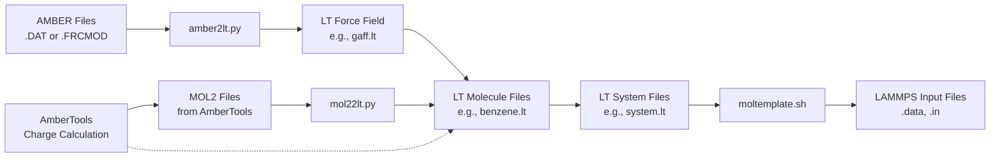

This page documents how to integrate AMBER (General Amber Force Field - GAFF) force fields with moltemplate for molecular dynamics simulations in LAMMPS. The AMBER/GAFF integration provides a comprehensive framework for all-atom simulations using the widely-adopted AMBER force field parameters, with automated conversion tools and pre-built force field definitions.

## AMBER Integration Architecture

The AMBER/GAFF integration in moltemplate follows a three-tier architecture that bridges AMBER force field format to moltemplate's template system, then to LAMMPS input files. The core conversion pipeline transforms AMBER DAT/FRCMOD files into moltemplate LT format, which can then be instantiated to build molecular systems.



The architecture relies on three key components:

1. **Conversion Tools**: `amber2lt.py` converts AMBER force field files to moltemplate format, while `mol22lt.py` handles molecular structure conversion from MOL2 format
2. **Pre-converted Force Fields**: Ready-to-use `gaff.lt` and `gaff2.lt` files containing complete GAFF parameter definitions
3. **Custom Force Field Builder**: Ability to build custom force fields incrementally by appending converted molecule parameters

Sources: [amber2lt.py](moltemplate/amber2lt.py#L7-L11), [doc/doc_amber2lt.md](doc/doc_amber2lt.md#L1-L30), [gaff.lt](moltemplate/force_fields/gaff.lt#L1-L50)

## Core Conversion Tool: amber2lt.py

The `amber2lt.py` script serves as the primary bridge between AMBER force field formats and moltemplate's LT format. This tool parses AMBER DAT and FRCMOD files containing force field parameters and converts them into moltemplate's template-based syntax.

### Basic Usage

The simplest invocation converts an AMBER force field file to moltemplate format:

```bash
amber2lt.py --in gaff.dat --out gaff.lt --name GAFF
```

This command generates a moltemplate LT file where:
- `--in` specifies the AMBER force field source file (e.g., `gaff.dat` or `benzene.frcmod`)
- `--out` defines the output LT filename
- `--name` sets the force field object name used in inheritance statements

Sources: [doc/doc_amber2lt.md](doc/doc_amber2lt.md#L20-L35), [amber2lt.py](moltemplate/amber2lt.py#L800-L820)

### File Format Handling

AMBER force field files are organized into sections containing different interaction types. The `amber2lt.py` converter automatically detects and processes these sections:

| Section | Content | LT Output |
|---------|---------|-----------|
| MASS/MASSES | Atomic masses | `write_once("Data Masses")` |
| BOND | Bond parameters | `write_once("In Settings")` + `write_once("Data Bonds By Type")` |
| ANGLE | Angle parameters | `write_once("In Settings")` + `write_once("Data Angles By Type")` |
| DIHEDRAL | Torsion parameters | `write_once("In Settings")` + `write_once("Data Dihedrals By Type")` |
| IMPROPER | Improper dihedrals | `write_once("In Settings")` + `write_once("Data Impropers By Type")` |
| NONBOND/PAIR | Lennard-Jones parameters | `write_once("In Settings")` |

The converter uses pattern matching to identify section boundaries based on blank line delimiters and section headers. When automatic detection fails, users can provide pre-split sections using optional arguments:

```bash
amber2lt.py --mass mass.txt --bond bond.txt --angle angle.txt \
           --dihedral dihedral.txt --improper improper.txt --pair pair.txt \
           --name FORCE_FIELD_NAME --out output.lt
```

Sources: [amber2lt.py](moltemplate/amber2lt.py#L105-L185), [amber2lt.py](moltemplate/amber2lt.py#L169-L184), [doc/doc_amber2lt.md](doc/doc_amber2lt.md#L80-L115)

### Python API Integration

For programmatic use, `amber2lt.py` exposes conversion functions that can be imported as a Python module:

```python
import moltemplate

# Convert from complete AMBER file
with open('gaff.dat', 'r') as file_in:
    lines_in = file_in.readlines()

lines_out = moltemplate.amber2lt.ConvertAmber2Lt('GAFF', lines_in)

with open('gaff.lt', 'w') as file_out:
    file_out.write(''.join(lines_out))

# Alternative: Convert from pre-extracted sections
lines_out = moltemplate.amber2lt.ConvertAmberSections2Lt(
    'GAFF', lines_mass, lines_bond, lines_angle,
    lines_dihedral, lines_improper, lines_pair
)
```

Sources: [amber2lt.py](moltemplate/amber2lt.py#L767-L800), [doc/doc_amber2lt.md](doc/doc_amber2lt.md#L120-L169)

## Specialized Conversion Features

### Wildcard Atom Type Handling

AMBER force fields use wildcard atom types (denoted as "X") to define generic interaction rules. The `amber2lt.py` converter handles these wildcards by:

1. **Sorting Priorities**: Entries with wildcards appear before specific entries in LT files, enabling moltemplate to override generic rules when more specific matches are found later
2. **Pattern Translation**: Wildcard "X" is converted to moltemplate's "*" wildcard syntax for type matching
3. **Comment Generation**: Preserves original comments indicating which parameters apply to wildcard cases

For example, a dihedral rule "X-X-C-O" becomes `@dihedral:*-*-c-o` in moltemplate format, matching any dihedral where the central two atoms are carbon and oxygen.

Sources: [amber2lt.py](moltemplate/amber2lt.py#L189-L233), [gaff.lt](moltemplate/force_fields/gaff.lt#L18-L50)

### Fourier Series Dihedral Conversion

AMBER uses a Fourier series representation for dihedral angle potentials, with multi-term series indicated by negative periodicity values. The converter processes these as follows:

1. **Multi-term Detection**: Negative PN values signal additional Fourier terms follow
2. **Parameter Accumulation**: Terms are accumulated until a positive PN is encountered
3. **LAMMPS Translation**: Converted to `dihedral_style fourier` format with consolidated coefficient lists

The resulting LT format uses the syntax:
```
dihedral_coeff @dihedral:type1-type2-type3-type4 fourier NUM_TERMS K1/d1 n1 φ1 K2/d2 n2 φ2 ...
```

Where K is barrier height, n is periodicity, φ is phase angle, and d is the division factor from AMBER's IDIVF parameter.

Sources: [amber2lt.py](moltemplate/amber2lt.py#L388-L535), [amber2lt.py](moltemplate/amber2lt.py#L450-L480)

### GAFF-Specific Improper Handling

AMBER/GAFF uses a distinct improper interaction convention where the **central atom is the third atom** in the four-atom tuple, differing from other force fields. This is implemented through `nbody_alt_symmetry/gaff_imp.py`:

```python
# Bond pattern defines central atom as position 2
bond_pattern = Ugraph([(2,0), (2,1), (2,3)])

# Canonical ordering prevents duplicate improper definitions
# when atoms 0 and 3 are symmetric
def canonical_order(match):
    # Sorts atoms to avoid duplicate interactions
    # Ensures atom0 ≤ atom3 for proper symmetry handling
    ...
```

This module is referenced in LT files using:
```
write_once("Data Impropers By Type (gaff_imp.py)") {
  ...
}
```

Sources: [gaff_imp.py](moltemplate/nbody_alt_symmetry/gaff_imp.py#L1-L95), [README.md](examples/all_atom/force_field_AMBER/README.md#L85-L90)

## Pre-converted Force Fields

Moltemplate provides ready-to-use conversions of standard AMBER force fields:

| Force Field | File | Atom Types | Status |
|-------------|------|------------|--------|
| GAFF | `force_fields/gaff.lt` | ~150 types | Generated from gaff.dat |
| GAFF2 | `force_fields/gaff2.lt` | ~180 types | Generated from gaff2.dat |

Both files include comprehensive atom type definitions for organic molecules, including:

- **Carbon types**: Sp2 aromatic (`ca`, `cc`, `cd`), Sp3 aliphatic (`c3`), carbonyl (`c`), conjugated systems (`ce`, `cf`)
- **Hydrogen types**: Aromatic (`ha`), aliphatic (`h1`, `h2`, `h3`), polar (`ho`, `hn`)
- **Heteroatoms**: Nitrogen (`n`, `na`, `nb`), oxygen (`o`, `oh`), halogens (`f`, `cl`, `br`, `i`)

> [!TIP]
> GAFF and GAFF2 require LAMMPS compiled with the EXTRA-MOLECULE package due to the use of `dihedral_style fourier`. Compile with "make yes-EXTRA-MOLECULE" or enable in CMake.

Sources: [gaff.lt](moltemplate/force_fields/gaff.lt#L30-L60), [README.md](examples/all_atom/force_field_AMBER/README.md#L60-L70)

## Molecule Definition Workflow

Creating molecules with AMBER/GAFF parameters involves two complementary approaches:

### Approach 1: Using Conversion Tools (Recommended)

The automated workflow leverages AmberTools and moltemplate converters:

```bash
# Step 1: Use AmberTools to generate MOL2 and FRCMOD files
# (AmberTools outputs: benzene.mol2, benzene.frcmod)

# Step 2: Convert FRCMOD to LT force field (append if file exists)
amber2lt.py --in benzene.frcmod --name MyForceField >> my_force_field.lt

# Step 3: Convert MOL2 to LT molecule definition
mol22lt.py --in benzene.mol2 \
           --out benzene.lt \
           --name Benzene \
           --ff MyForceField \
           --ff-file my_force_field.lt
```

This generates `benzene.lt` with the structure:
```python
import "my_force_field.lt"

Benzene inherits MyForceField {
  write('Data Atoms') {
    $atom:c1  $mol  @atom:ca  -0.112739   -0.739   1.189  -0.00733
    ...
  }
  write("Data Bond List") {
    $bond:b1  $atom:c1  $atom:c2
    ...
  }
}
```

Sources: [doc/doc_amber2lt.md](doc/doc_amber2lt.md#L38-L77), [README.md](examples/all_atom/force_field_AMBER/README.md#L15-L45)

### Approach 2: Manual Definition

For manual molecule creation, the structure is:

```python
import "gaff.lt"  # or "gaff2.lt"

Benzene inherits GAFF {
  write('Data Atoms') {
    $atom:c1  $mol  @atom:ca  -0.115   -0.739   1.189  -0.00733
    $atom:c2  $mol  @atom:ca  -0.115    0.614   1.208   0.35167
    ...
  }

  write("Data Bond List") {
    $bond:c12  $atom:c1 $atom:c2
    $bond:c23  $atom:c2 $atom:c3
    ...
  }
}
```

The manual approach requires:
1. Correct atom type assignment (`@atom:ca` for aromatic carbon, etc.)
2. Accurate partial charges (must be obtained from external calculations)
3. Proper bond connectivity definitions

Sources: [benzene.lt](examples/all_atom/force_field_AMBER/benzene/moltemplate_files/benzene.lt#L1-L57)

## Charge Assignment: Critical Consideration

**AMBER force field files do not include partial charges.** This is by design in the AMBER force field philosophy—charges are calculated separately for each molecule using quantum mechanical methods.

### Recommended Charge Calculation Methods

| Method | Description | Typical Usage |
|--------|-------------|---------------|
| HF/6-31G* RESP | AmberTools standard | Small molecules, high accuracy |
| AM1-BCC | Semi-empirical | Large systems, moderate accuracy |
| ESP charges | Electrostatic potential | General purpose |
| OpenForceField | OpenMM toolkit | Python-integrated workflows |

> [!TIP]
> Do not borrow charges from other force fields (e.g., OPLSAA). This produces incorrect electrostatic behavior inconsistent with AMBER parameters. Current moltemplate examples have placeholder charges for demonstration only.

### Charge Calculation Workflow

1. **Generate MOL2 file with AmberTools** (includes charges from calculation):
```bash
antechamber -i benzene.pdb -fi pdb -o benzene.mol2 -fo mol2 \
            -c bcc -s 2 -nc 0
```

2. **Use mol22lt.py** to preserve charges during conversion:
```bash
mol22lt.py --in benzene.mol2 --out benzene.lt --name Benzene
```

3. **Verify charges** in generated LT file against original MOL2.

Sources: [README.md](examples/all_atom/force_field_AMBER/README.md#L60-L85), [benzene.lt](examples/all_atom/force_field_AMBER/benzene/moltemplate_files/benzene.lt#L12-L16)

## Complete Example: Benzene Simulation

The benzene example demonstrates a complete AMBER/GAFF simulation setup:

### System Definition

```python
# system.lt
import "benzene.lt"

write_once("Data Boundary") {
   0.0  64.00  xlo xhi
   0.0  64.00  ylo yhi
   0.0  64.00  zlo zhi
}

benzenes = new Benzene [8].move(8,0,0)
                       [8].move(0,8,0)
                       [8].move(0,0,8)
```

This creates a 8×8×8 array (512 benzene molecules) in a 64Å cubic box.

### Molecule Definition

```python
# benzene.lt
import "gaff2.lt"

Benzene inherits GAFF2 {
  write('Data Atoms') {
    $atom:c1  $mol @atom:ca  -0.115   -0.739   1.189  -0.00733
    $atom:c2  $mol @atom:ca  -0.115    0.614   1.208   0.35167
    ...
    $atom:h11 $mol @atom:ha   0.115   -1.309   2.106  -0.01233
    ...
  }

  write('Data Bond List') {
    $bond:c12  $atom:c1 $atom:c2
    $bond:c23  $atom:c2 $atom:c3
    ...
  }
}
```

### Build and Run

```bash
# Build LAMMPS files
moltemplate.sh system.lt

# Run simulation (LAMMPS compiled with EXTRA-MOLECULE)
lmp -in run.in.npt
```


Sources: [system.lt](examples/all_atom/force_field_AMBER/benzene/moltemplate_files/system.lt#L1-L15), [benzene.lt](examples/all_atom/force_field_AMBER/benzene/moltemplate_files/benzene.lt#L1-L57), [README.md](examples/all_atom/force_field_AMBER/benzene/README.md#L1-L30)

## AMBER-Compatible Water Models

Specialized water models compatible with AMBER force fields are provided:

### SPC/E Water

```python
# spce_amber.lt
SPCE {
  write("Data Atoms") {
    $atom:O  $mol:. @atom:O -0.8476  0.0000000 0.00000 0.000000
    $atom:H1 $mol:. @atom:H  0.4238  0.8164904 0.00000  0.5773590
    $atom:H2 $mol:. @atom:H  0.4238  -0.8164904 0.00000 0.5773590
  }

  write_once("Data Masses") {
    @atom:O 15.9994
    @atom:H 1.008
  }

  write("Data Bonds") {
    $bond:OH1 @bond:OH $atom:O $atom:H1
    $bond:OH2 @bond:OH $atom:O $atom:H2
  }

  write("Data Angles") {
    $angle:HOH @angle:HOH $atom:H1 $atom:O $atom:H2
  }

  write_once("In Settings") {
    bond_coeff   @bond:OH         600.0   1.0 
    angle_coeff  @angle:HOH       75.0    109.47
    pair_coeff   @atom:O @atom:O  0.1553  3.166 
    pair_coeff   @atom:H @atom:H  0.0     0.0
    group spce type  @atom:O  @atom:H
    fix fShakeSPCE spce shake 0.0001 10 100 b @bond:OH a @angle:HOH
  }
}
```

The SPC/E model includes:
- **SHAKE constraint** for rigid water geometry
- **Lennard-Jones parameters** compatible with AMBER force fields
- **Standard AMBER water atom types** (`@atom:O`, `@atom:H`)

Sources: [spce_amber.lt](moltemplate/force_fields/spce_amber.lt#L1-L62)

## Limitations and Known Issues

### Experimental Status

As of 2022-08-24, AMBER/GAFF integration remains in experimental status:

- **Charge generation**: Users must correctly calculate partial charges using AmberTools or similar quantum mechanical methods
- **Parameter validation**: No guarantee that moltemplate-generated simulations exactly reproduce AmberTools/AMBER behavior
- **Force field completeness**: Pre-converted GAFF files may not cover all atom types needed for specialized molecules

### Improper Interaction Ambiguity

When multiple atoms have identical types around a central atom, atom ordering for improper interactions may be ambiguous. Moltemplate may select different ordering than AmberTools, potentially causing small deviations in improper potential calculations.

### Input Script Bloat

By default, moltemplate includes the entire GAFF/GAFF2 force field in generated LAMMPS input scripts, even for small systems using only a few atom types. While harmless, this can be remedied using the `README_remove_irrelevant_info.sh` instructions provided with examples.

Sources: [README.md](examples/all_atom/force_field_AMBER/README.md#L1-L15), [README.md](examples/all_atom/force_field_AMBER/README.md#L85-L90), [README.md](examples/all_atom/force_field_AMBER/README.md#L100-L116)

## Advanced Topics

### Custom Force Field Construction

For non-standard molecules, build custom force fields incrementally:

```bash
# Start with base force field
cp gaff.lt my_custom_force_field.lt

# Add molecule-specific parameters
amber2lt.py --in specialty.frcmod --name MyCustomFF >> my_custom_force_field.lt

# Use custom force field
mol22lt.py --in specialty.mol2 --out specialty.lt \
           --name Specialty --ff MyCustomFF \
           --ff-file my_custom_force_field.lt
```

This approach allows progressive force field building for complex systems like proteins, polymers, or mixed-material systems.

### Multi-Molecule Systems

Combine multiple AMBER-based molecules in a single system:

```python
# multi_molecule_system.lt
import "benzene.lt"
import "isobutane.lt"

write_once("Data Boundary") {
   0.0  60.00  xlo xhi
   0.0  60.00  ylo yhi
   0.0  60.00  zlo zhi
}

benzenes = new Benzene [32].move(6,0,0)
isobutanes = new Isobutane [32].move(0,6,0)
```

Moltemplate automatically merges force field parameters from all imported molecule definitions, handling type compatibility and parameter resolution.

Sources: [README.md](doc/doc_amber2lt.md#L38-L77), [README.md](examples/all_atom/force_field_AMBER/README.md#L15-L45)

## Next Steps

For comprehensive AMBER/GAFF integration:
- Review [Moltemplate LT File Syntax](6-moltemplate-lt-file-syntax) for template definition patterns
- Study [Core Template System Architecture](7-core-template-system-architecture) to understand inheritance mechanisms
- Explore [Force Field Parameter Management](15-force-field-parameter-management) for parameter optimization strategies
- Examine [mol22lt.py: MOL2 to LT Conversion](26-mol22lt-py-mol2-to-lt-conversion) for automated molecule generation
- Compare with [OPLSAA Force Field Integration](20-oplsaa-force-field-integration) for alternative all-atom approaches
- Review [Custom Force Field Development](23-custom-force-field-development) for advanced parameterization techniques