The DREIDING force field integration provides a comprehensive, all-atom force field implementation for molecular dynamics simulations in LAMMPS through moltemplate. Originally developed by Mayo et al. (1990), this implementation offers a generic force field designed for main-group elements including organic molecules, polymers, and inorganic materials. The integration provides automated parameter management, extensive atom type coverage, and seamless LAMMPS workflow integration.

## Architecture Overview

The DREIDING force field integration follows a systematic architecture that separates force field definitions from molecular system specification. The core force field is encapsulated in a single, comprehensive LT file (`moltemplate/force_fields/dreiding.lt`) that contains all parameters and interaction rules, while system-specific files define molecular geometry and charge assignments.

    

Sources: [dreiding.lt](moltemplate/force_fields/dreiding.lt#L1-L38315), [furan example](examples/all_atom/force_field_DREIDING/furan/README.md#L1-L43)

```mermaid
flowchart TD
    A[DREIDING Force Field] --> B[LAMMPS Initialization]
    A --> C[Atom Type Definitions]
    A --> D[Bonded Interactions]
    A --> E[Non-bonded Interactions]
    A --> F[Molecular Systems]
    
    B --> B1[units: real]
    B --> B2[atom_style: full]
    B --> B3[bond/angle_style: harmonic]
    B --> B4[dihedral_style: charmm]
    B --> B5[improper_style: umbrella]
    B --> B6[kspace_style: ewald]
    
    C --> C1[100+ Atom Types]
    C --> C2[Mass Definitions]
    C --> C3[Type-specific Coefficients]
    
    D --> D1[Bond Types]
    D --> D2[Angle Parameters]
    D --> D3[Dihedral Coefficients]
    D --> D4[Improper Parameters]
    
    E --> E1[LJ Pair Coefficients]
    E --> E2[Hydrogen Bonding]
    E --> E3[Coulombic Interactions]
    
    F --> F1[Molecule Definition]
    F --> F2[Charge Assignment]
    F --> F3[System Assembly]
```



## Force Field Implementation

### LAMMPS Configuration

The DREIDING force field requires specific LAMMPS settings configured through the `write_once("In Init")` block. These settings establish the fundamental simulation environment optimized for DREIDING's parameter set. The configuration uses real units (kcal/mol, Angstroms, fs) and harmonic potentials for bonds and angles. The force field employs CHARMM-style dihedrals with periodic boundaries and umbrella-style improper angles to maintain planarity and chirality. Long-range electrostatics are handled via Ewald summation with a tolerance of 0.0001.

Sources: [dreiding.lt](moltemplate/force_fields/dreiding.lt#L17-L32)

| Setting | Value | Purpose |
|---------|-------|---------|
| units | real | kcal/mol, Å, fs units |
| atom_style | full | Molecular atoms with charge |
| bond_style | harmonic | Harmonic bond potential |
| angle_style | harmonic | Harmonic angle potential |
| dihedral_style | charmm | CHARMM periodic dihedrals |
| improper_style | umbrella | Umbrella improper potential |
| special_bonds | dreiding | 1-2, 1-3, 1-4 scaling factors |
| pair_style | hybrid/overlay hbond/dreiding/lj 4 6 6.5 90 lj/cut/coul/long 10.0 | LJ + hydrogen bonding |
| kspace_style | ewald 0.0001 | Long-range electrostatics |
| dielectric | 1.0 | Vacuum permittivity |

### Atom Type System

DREIDING employs a systematic atom type encoding scheme that captures element identity, hybridization, coordination, and hydrogen bonding capability. The naming convention follows the pattern `[Element]_[coordination][modifiers]`, where modifiers include resonance indicators (`R`), bond order specifications (`b1`, `b2`), and hydrogen bonding designators (`_hd` for donor, `_ha` for acceptor). This scheme enables precise specification of chemical environments across organic and inorganic molecules.

Sources: [dreiding.lt](moltemplate/force_fields/dreiding.lt#L34-L122), [DREIDING_Label_Manual.pdf](doc/DREIDING_Label_Manual.pdf#L1-L200)

> [!TIP]
> The atom type encoding is systematic: element symbol + coordination number + optional modifiers. For example, `C_R_b1` indicates a carbon atom with resonance characteristics and a specific bond order variant, while `N_3_hd` represents a 3-coordinate nitrogen that can donate hydrogen bonds.

**Common Atom Type Examples:**

| Atom Type | Element | Coordination | Special Features |
|-----------|---------|--------------|------------------|
| H | Hydrogen | 1 | Standard hydrogen |
| H_HB | Hydrogen | 1 | Hydrogen bond participant |
| C_3 | Carbon | 3 | sp² hybridized |
| C_R | Carbon | Resonant | Aromatic/conjugated |
| C_2 | Carbon | 2 | sp hybridized |
| N_3 | Nitrogen | 3 | Standard 3-coordinate |
| N_R_d2 | Nitrogen | Resonant, double | Conjugated with double bond |
| O_R | Oxygen | Resonant | Aromatic/conjugated |
| O_3_hd | Oxygen | 3, H-bond donor | Can donate H-bonds |
| B_3 | Boron | 3 | Standard boron |

### Mass Definitions

The force field includes mass definitions for all 100+ atom types, with values drawn from standard atomic weights. These masses are automatically applied when atom types are assigned in molecular definitions. The mass table spans the periodic table from hydrogen (1.008 amu) through heavy elements like iodine (126.904 amu) and transition metals including iron (55.845 amu) and zinc (65.38 amu).

Sources: [dreiding.lt](moltemplate/force_fields/dreiding.lt#L34-L122)

## Interaction Parameters

### Non-Bonded Interactions

Non-bonded interactions in DREIDING use a hybrid approach combining Lennard-Jones potentials with a specialized hydrogen bonding model. The pair style employs `hybrid/overlay` to simultaneously apply `lj/cut/coul/long` for van der Waals and Coulombic interactions and `hbond/dreiding/lj` for directional hydrogen bonding. This hybrid approach enables accurate modeling of both generic non-specific interactions and specific hydrogen bond geometries.

Sources: [dreiding.lt](moltemplate/force_fields/dreiding.lt#L124-L699)

**Hydrogen Bonding Configuration:**
- H-bond cutoff: 4.0 Å
- Angle parameter: 2.75
- Well depth: 4.0 kcal/mol
- Exponent: 6
- Donor atom type: `*_hd`
- Acceptor atom type: `*_ha`

The Lennard-Jones parameters follow geometric combination rules derived from element-specific van der Waals radii. The force field includes explicit pair coefficients for all atom type combinations, covering interactions across the entire periodic table supported by DREIDING.

> [!TIP]
> DREIDING uses geometric combination rules for LJ parameters: ε<sub>ij</sub> = √(ε<sub>i</sub>ε<sub>j</sub>) and σ<sub>ij</sub> = (σ<sub>i</sub> + σ<sub>j</sub>)/2. All pair coefficients are explicitly defined in the force field file, eliminating the need for combination rules during simulation.

### Bonded Interactions

Bonded interactions include bonds, angles, dihedrals, and improper torsions, each defined with appropriate functional forms parameterized for the DREIDING force field. Bond types are defined systematically for all possible atom type combinations, enabling automatic bond coefficient assignment during system construction.

Sources: [dreiding.lt](moltemplate/force_fields/dreiding.lt#L700-L1500)

**Bonded Interaction Summary:**

| Interaction | Style | Parameter Count | Coverage |
|-------------|-------|-----------------|----------|
| Bonds | Harmonic | 500+ types | All atom type combinations |
| Angles | Harmonic | Parameterized | Defined by central atom types |
| Dihedrals | CHARMM | Periodic | Based on atom type sequences |
| Impropers | Umbrella | Angle-dependent | Maintains planarity/chirality |

## Implementation Workflow

### Step 1: Import Force Field

Begin by importing the DREIDING force field definition in your LT file. The force field is automatically located by moltemplate if placed in the standard `force_fields` directory or available in the current working directory.

```lt
import "dreiding.lt"
```

Sources: [furan.lt](examples/all_atom/force_field_DREIDING/furan/moltemplate_files/furan.lt#L1-L7)

### Step 2: Define Molecular Structure

Define your molecule by inheriting from the DREIDING base class and specifying atomic coordinates, types, and connectivity. Atom types must follow the DREIDING naming convention as documented in `DREIDING_Label_Manual.pdf`.

```lt
Furan inherits DREIDING {
  write("Data Atoms") {
    $atom:O0  $mol  @atom:O_R  -0.19    -0.790540 0.744310 -0.000000
    $atom:C0  $mol  @atom:C_R  -0.019   -1.909550 0.055400 0.000000
    $atom:C1  $mol  @atom:C_R  -0.019    0.227280 -0.086850 -0.000000
    # ... additional atoms
  }
  write("Data Bond List") {
    $bond:0	$atom:O0	$atom:C0
    $bond:1	$atom:O0	$atom:C1
    # ... additional bonds
  }
}
```

Sources: [furan.lt](examples/all_atom/force_field_DREIDING/furan/moltemplate_files/furan.lt#L11-L44)

### Step 3: Assemble System

Create molecular arrays and define simulation boundaries. The example demonstrates creating a 5×5×10 lattice of furan molecules with appropriate periodic boundary conditions.

```lt
import "furan.lt"

molecule = new Furan [5].move(6.6,0,0)
                     [5].move(0,6.6,0)
                    [10].move(0,0,3.3)

write_once("Data Boundary") {
   0.0    33.0     xlo xhi
   0.0    33.0     ylo yhi
   0.0    33.0     zlo zhi
}
```

Sources: [system.lt](examples/all_atom/force_field_DREIDING/furan/moltemplate_files/system.lt#L1-L19)


## Critical Implementation Considerations

### Partial Charge Assignment

**The most critical limitation of DREIDING in moltemplate is the lack of built-in partial charge assignment.** The DREIDING force field, as originally published, does not include rules or parameters for calculating atomic partial charges. Users must obtain charges through external methods.

**Recommended approaches:**

1. **QEq (Charge Equilibration)**: Use LAMMPS `fix qeq/point` to dynamically assign charges based on electronegativity equalization. This method is computationally efficient when run infrequently.

2. **Gasteiger Method**: An empirical approach suggested in the original DREIDING paper that estimates charges based on atomic connectivity and electronegativity differences.

3. **Quantum Chemistry Calculations**: Perform DFT or semi-empirical calculations to obtain electrostatic potential (ESP) charges.

4. **Charges from Other Force Fields**: **NOT RECOMMENDED** - Using charges from OPLSAA or AMBER parameters (as shown in the examples) may produce unphysical results because charge sets are force field-specific.

Sources: [README.md](examples/all_atom/force_field_DREIDING/README.md#L17-L31)

> [!TIP]
> The example charges in the repository are intentionally incorrect as they were borrowed from OPLSAA parameters for demonstration purposes only. Do not use these charges for production simulations. Implement a proper charge calculation workflow using QEq, Gasteiger, or quantum chemistry methods.

### Improper Angle Symmetry

Improper angles in DREIDING depend on atom ordering around a central atom. When multiple atoms have identical types, moltemplate cannot guarantee consistent ordering, which may lead to different improper angle assignments across identical molecules. This ambiguity stems from the force field's reliance on specific atom sequences rather than purely topological definitions.

Sources: [README.md](examples/all_atom/force_field_DREIDING/README.md#L25-L31)

### Experimental Status

The DREIDING force field integration in moltemplate is **experimental and not fully validated**. Testing has been limited to simple molecules (butane and ethylene) for consistency with Materials Studio. Users should verify their simulation results against independent calculations or experimental data and report any bugs encountered.

Sources: [README.md](examples/all_atom/force_field_DREIDING/README.md#L4-L11)

## File Structure and Organization

```
moltemplate/
├── force_fields/
│   ├── dreiding.lt              # Main force field definition (38,315 lines)
│   └── README.txt               # Force field directory documentation
├── doc/
│   └── DREIDING_Label_Manual.pdf # Atom type naming convention reference
└── examples/
    └── all_atom/
        └── force_field_DREIDING/
            ├── README.md       # Integration overview and warnings
            └── furan/          # Complete working example
                ├── README.md   # Example-specific instructions
                ├── moltemplate_files/
                │   ├── furan.lt    # Furan molecule definition
                │   └── system.lt   # System assembly
                ├── run.in.npt   # LAMMPS NPT input script
                └── images/      # Visualization output
```

## Troubleshooting

| Issue | Cause | Solution |
|-------|-------|----------|
| Incorrect physical behavior | Wrong partial charges | Use QEq or proper quantum chemistry calculations |
| Missing atom types | Non-DREIDING elements | Extend force field or use different force field |
| Improper angle errors | Symmetric atom ordering | Manually verify improper definitions |
| Large output files | All parameters included | Use cleanup scripts to remove unused types |
| Simulation crashes | Missing pair coefficients | Verify all atom type combinations have defined LJ parameters |

## Advanced Usage and Customization

For researchers requiring modifications to the DREIDING force field, the modular structure enables custom parameter additions. Atom types, pair coefficients, and bonded parameters can be extended by adding entries following the existing naming conventions and parameter formats. Users should refer to the original DREIDING publication (Mayo et al., J. Phys. Chem. 1990, 94, 8897-8909) for parameter calculation methodologies.

Sources: [dreiding.lt](moltemplate/force_fields/dreiding.lt#L1-L38315)

## Next Steps

After understanding the DREIDING force field integration, you may want to explore:

- [AMBER/GAFF Force Field Integration](21-amber-gaff-force-field-integration) for organic and biomolecular simulations
- [OPLSAA Force Field Integration](20-oplsaa-force-field-integration) for liquid and polymer applications
- [Custom Force Field Development](23-custom-force-field-development) to create specialized parameter sets
- [Force Field Conversion Tools](24-force-field-conversion-tools) for importing parameters from other MD codes