Custom force field development in moltemplate enables researchers to create, modify, and extend molecular mechanics force fields for specialized simulation needs. This capability bridges the gap between published force field parameters and LAMMPS implementation, providing both manual construction and automated conversion pathways. Understanding the force field architecture and available conversion tools empowers developers to work with specialized chemical systems that fall outside standard force field coverage.

## Force Field Architecture Overview

A moltemplate force field file follows a structured object-oriented design pattern where all parameters are encapsulated within a single object that can be inherited by molecular definitions. This architecture separates concerns between parameter definition and molecular instantiation, promoting code reuse and maintainability across complex simulation systems.

```mermaid
graph TB
    A["Force Field Object"] --> B["Atom Definitions"]
    A --> C["Equivalence Categories"]
    A --> D["Non-bonded Parameters"]
    A --> E["Bonded Parameters"]
    A --> F["Interaction Type Rules"]
    
    B --> B1["Atomic Charges"]
    B --> B2["Atomic Masses"]
    
    C --> C1["Bond Types"]
    C --> C2["Angle Types"]
    C --> C3["Dihedral Types"]
    C --> C4["Improper Types"]
    
    D --> D1["LJ σ/ε"]
    D --> D2["Coulombic"]
    
    E --> E1["Bond Coefficients"]
    E --> E2["Angle Coefficients"]
    E --> E3["Dihedral Coefficients"]
    E --> E4["Improper Coefficients"]
    
    F --> F1["Bonds By Type"]
    F --> F2["Angles By Type"]
    F --> F3["Dihedrals By Type"]
    F --> F4["Impropers By Type"]
    
    style A fill:#e1f5fe
    style B fill:#fff9c4
    style C fill:#fff9c4
    style D fill:#c8e6c9
    style E fill:#c8e6c9
    style F fill:#f8bbd9
```



The force field object serves as a parameter repository that defines all atom types, interaction coefficients, and mapping rules. When a molecule inherits from this object, it gains access to these parameters without needing to redefine them. The `oplsaa_simple.lt` file provides a pedagogical example demonstrating this structure with minimal atom types for simple alkanes and alkenes.
Sources: [oplsaa_simple.lt](moltemplate/force_fields/build_your_own_force_field/oplsaa_simple.lt#L1-L50)

## Atom Type Definition and Assignment

Atom types form the foundation of any force field, determining both non-bonded interactions and bonded interaction parameters. In moltemplate, atom types use the `@atom:` namespace prefix and can optionally include multiple identifiers for different interaction categories using the equivalence category system.

**Charge Assignment Methods**: Moltemplate supports two primary approaches for assigning partial charges: type-based assignment and bond-increment assignment. Type-based assignment uses the LAMMPS `set type` command to assign fixed charges to all atoms of a given type, while bond-increment assignment allows charge values to depend on the chemical environment through additive contributions from bonded neighbors.
Sources: [oplsaa_simple.lt](moltemplate/force_fields/build_your_own_force_field/oplsaa_simple.lt#L31-L42)

```lt
write_once("In Charges") {
    set type @atom:CT3H        charge -0.18
    set type @atom:CT2H        charge -0.12
    set type @atom:HCan        charge  0.06
}
```

For bond-increment charges, you define pairs of atom types with incremental charge contributions that are summed for each atom based on its bonded neighbors:

```lt
write_once("Data Charge By Bond") {
    @atom:C_sp3 @atom:H 0.05 -0.05
}
```

**Equivalence Categories**: One of moltemplate's most powerful features is the ability to assign separate type identifiers for different interaction types within a single atom type. This enables fine-grained control over interaction parameters while maintaining a single user-facing atom type. The `replace` command establishes these mappings: Sources: [oplsaa_simple.lt](moltemplate/force_fields/build_your_own_force_field/oplsaa_simple.lt#L68-L75)

```lt
replace{ @atom:CT3H @atom:CT3H_bCT_aCT_dCT_iCT }
```

In this example, `bCT` identifies the atom for bond parameter lookup, `aCT` for angles, `dCT` for dihedrals, and `iCT` for impropers. This separation allows the same atom type to participate in different interaction classes with appropriate parameters.

## Non-Bonded Interaction Parameters

Non-bonded interactions define van der Waals and electrostatic forces between atoms. These are specified using `pair_coeff` directives within the `write_once("In Settings")` block. The syntax follows LAMMPS conventions where the first two arguments specify atom types and remaining arguments depend on the pair style being used.
Sources: [oplsaa_simple.lt](moltemplate/force_fields/build_your_own_force_field/oplsaa_simple.lt#L85-L94)

```lt
write_once("In Settings") {
    pair_coeff @atom:CT3H_bCT_aCT_dCT_iCT  @atom:CT3H_bCT_aCT_dCT_iCT  0.066 3.5
    pair_coeff @atom:HCan_bHC_aHC_dHC_iHC  @atom:HCan_bHC_aHC_dHC_iHC  0.03 2.5
}
```

For cross-interactions between different atom types, you can either specify explicit coefficients or rely on mixing rules. When using mixing rules, you only need to define same-type coefficients, and LAMMPS automatically computes cross-interaction parameters.

> [!TIP]
> **Critical Parameter Selection**: When developing custom force fields, ensure that your σ (sigma) and ε (epsilon) parameters are consistent with the Lennard-Jones potential form used by your LAMMPS pair style. Different pair styles (lj/cut, lj/charmm, lj/cut/coul/long, etc.) may interpret these parameters differently, particularly regarding the energy and length unit conventions.

## Bonded Interaction Parameters

Bonded interactions include bonds (2-body), angles (3-body), dihedrals (4-body), and impropers (4-body). Each interaction type requires coefficient definitions and type assignment rules.

**Bond Coefficients**: Bonds use harmonic potentials by default, requiring force constant and equilibrium bond length parameters: Sources: [oplsaa_simple.lt](moltemplate/force_fields/build_your_own_force_field/oplsaa_simple.lt#L101-L110)

```lt
write_once("In Settings") {
    bond_coeff @bond:CT_CT   268.0 1.529
    bond_coeff @bond:CT_HC  340.0 1.09
}
```

**Angle Coefficients**: Angles define three-atom interactions and are specified similarly with force constant and equilibrium angle: Sources: [oplsaa_simple.lt](moltemplate/force_fields/build_your_own_force_field/oplsaa_simple.lt#L125-L138)

```lt
write_once("In Settings") {
    angle_coeff @angle:CT_CT_CT   58.35 112.7
    angle_coeff @angle:HC_CT_HC  33.0 107.8
}
```

**Dihedral Coefficients**: Dihedrals define four-atom torsional interactions. Multiple functional forms exist (OPLS, CHARMM, harmonic), with the OPLS style being common for all-atom force fields: Sources: [oplsaa_simple.lt](moltemplate/force_fields/build_your_own_force_field/oplsaa_simple.lt#L147-L172)

```lt
write_once("In Settings") {
    dihedral_coeff @dihedral:X_CT_CT_CT  1.711 -0.5 0.663 0.0
    dihedral_coeff @dihedral:CT_CT_CT_CT  1.3 -0.05 0.2 0.0
}
```

The OPLS dihedral style uses Fourier series coefficients (K₁, K₂, K₃, K₄) representing different periodicity terms. General dihedral types with wildcards allow fallback behavior, while specific types override general rules.

## Automated Interaction Type Assignment

Instead of manually specifying bond, angle, dihedral, and improper types for each interaction in your molecular definitions, moltemplate can automatically generate these interactions based on atom type patterns using the "By Type" sections. This dramatically reduces the complexity of molecular definition files and ensures consistency.
Sources: [oplsaa_simple.lt](moltemplate/force_fields/build_your_own_force_field/oplsaa_simple.lt#L113-L119)

**Bond Type Assignment Rules**: The `Data Bonds By Type` section defines mapping rules from atom types to bond types:

```lt
write_once("Data Bonds By Type") {
    @bond:CT_CT @atom:*_bCT_a*_d*_i* @atom:*_bCT_a*_d*_i*
    @bond:CT_HC @atom:*_bCT_a*_d*_i* @atom:*_bHC_a*_d*_i*
}
```

The wildcard character `*` matches any value in that position. This rule states that whenever two atoms both have bond type identifiers ending in `_bCT`, create a bond interaction of type `@bond:CT_CT` between them.

**Angle Type Assignment Rules**: Angles follow a similar pattern but involve three atoms:

```lt
write_once("Data Angles By Type") {
    @angle:CT_CT_CT @atom:*_b*_aCT_d*_i* @atom:*_b*_aCT_d*_i* @atom:*_b*_aCT_d*_i*
}
```

Here, the middle atom's angle type identifier (`aCT`) is used for matching, while bond and dihedral identifiers can be anything.

**Dihedral Type Assignment Rules**: Dihedrals involve four atoms with more complex matching patterns:

```lt
write_once("Data Dihedrals By Type") {
    @dihedral:X_CT_CT_CT @atom:*_b*_a*_dCT_i* @atom:*_b*_a*_dCT_i* @atom:*_b*_a*_dCT_i* @atom:*_b*_a*_dCT_i*
}
```

The central bond's dihedral type identifier (`dCT`) determines the dihedral type. Wildcards allow general rules that match many different atom combinations.

The `nbody_by_type.py` utility processes these rules during moltemplate execution, automatically generating the appropriate bond, angle, dihedral, and improper interactions based on the actual connectivity in your molecular system. This enables the "write once, apply everywhere" paradigm where force field rules are defined once and automatically applied to all molecules that use the force field.
Sources: [nbody_by_type.py](moltemplate/nbody_by_type.py#L1-L100)

## Force Field Conversion Tools

Moltemplate provides several conversion utilities that automate the process of creating custom force fields from existing parameter files in various formats. These tools handle the complex task of parsing proprietary formats and generating properly structured moltemplate files.

### OPLSAA Force Field Conversion

The `oplsaa2lt.py` script converts BOSS input files (`.par` and `.sb`) into moltemplate format. BOSS (Biochemical and Organic Simulation System) is a popular molecular simulation package that distributes OPLS-AA parameters in a specialized format.
Sources: [oplsaa2lt.py](moltemplate/force_fields/convert_OPLSAA_to_LT/oplsaa2lt.py#L1-L50)

```bash
./oplsaa2lt.py --name OPLSAA --out oplsaa2024.lt \
  --par oplsaa.par \
  --sb  oplsaa.sb
```

The conversion process handles atom type renaming to avoid conflicts with moltemplate syntax (characters like `:`, `$`, `#`, `*` are replaced with safer alternatives). The script creates a comprehensive force field object with all atom types, masses, charges, pair coefficients, bonded parameters, and interaction type rules.
Sources: [oplsaa2lt.py](moltemplate/force_fields/convert_OPLSAA_to_LT/oplsaa2lt.py#L30-L50)

**Type Name Cleaning**: The conversion includes automatic sanitization of atom type names:

```python
TYPE_CONVERSION_TUPLES = (
    ('C:', "C°"),
    ("C$", "C^"),
    ("N$", "N^"),
    ("O$", "O^"),
    ("C#", "C|"),
    ("N*", "N§"),
    ("C(O)", "C⟮"),
)
```

This ensures compatibility with moltemplate's parser while preserving the semantic meaning of the original type names.

### TINKER Parameter File Conversion

The `tinkerparm2lt.py` script converts TINKER parameter files (`.prm`) into moltemplate format. TINKER is another molecular modeling package that distributes several force fields including OPLS-AA variants.
Sources: [tinkerparm2lt.py](moltemplate/force_fields/convert_TINKER_files_to_LT_files/tinkerparm2lt.py#L1-L50)

```bash
tinkerparm2lt.py -name OPLS < oplsaa.prm > oplsaa2008.lt
```

This script has been tested primarily with OPLS-AA force fields but may work with other TINKER-compatible force fields. Note that some force fields requiring advanced features like point-dipole polarizability may not be fully convertible due to LAMMPS feature limitations as of 2017.
Sources: [tinkerparm2lt.py](moltemplate/force_fields/convert_TINKER_files_to_LT_files/tinkerparm2lt.py#L12-L25)

### AMBER Force Field Conversion

The `amber2lt.py` script converts AMBER FRCMOD and DAT files into moltemplate format. This is particularly useful for working with GAFF (General AMBER Force Field) and custom AMBER-style force fields.
Sources: [doc_amber2lt.md](doc/doc_amber2lt.md#L1-L50)

```bash
amber2lt.py --in gaff.dat --name GAFF --out gaff.lt
```

The generated force field file includes all standard AMBER atom types and parameters. Combined with `mol22lt.py` for MOL2 file conversion, this provides a complete workflow for AMBER-based simulations in LAMMPS: Sources: [gaff.lt](moltemplate/force_fields/gaff.lt#L1-L50)

```bash
amber2lt.py --in benzene.frcmod --name MyForceField >> my_force_field.lt
mol22lt.py --in benzene.mol2 --out benzene.lt --name Benzene \
           --ff MyForceField --ff-file my_force_field.lt
```

### MOL2 File Conversion

The `mol22lt.py` script converts MOL2 molecular structure files into moltemplate molecule definitions. This tool extracts atomic charges, coordinates, atom types, and connectivity from MOL2 files and generates properly formatted molecule objects.
Sources: [doc_mol22lt.md](doc/doc_mol22lt.md#L1-L50)

```bash
mol22lt.py \
   --in PPS_5mer.mol2 \
   --out PPS_5mer.lt \
   --name PPS5 \
   --ff GAFF2 \
   --ff-file "gaff2.lt"
```

**Important Limitations**: The current version (beta as of 2024-12-05) does not support MOL2 files with multiple chains. The script extracts charge, atom names, coordinates, atom types, subunit information, and bonds from the ATOM and BOND sections, ignoring chain information and other metadata.
Sources: [doc_mol22lt.md](doc/doc_mol22lt.md#L54-L100)

## Building Custom Molecules with Force Fields

Once a force field is defined or converted, you can create molecular definitions that inherit from it. The `ch3.lt` and `ch2.lt` files in the usage examples demonstrate this pattern for simple alkane building blocks.
Sources: [ch3.lt](moltemplate/force_fields/build_your_own_force_field/usage_example/ch3.lt#L1-L40)

```lt
import "oplsaa_simple.lt"

CH3 inherits OPLSAA {
  write("Data Atoms") {
    $atom:C  $mol:... @atom:CT3H   0.0  0.000000     0.000000      0.000000
    $atom:H1 $mol:... @atom:HCan  0.0  0.000000     0.631044      0.892431
    $atom:H2 $mol:... @atom:HCan  0.0  0.000000     0.631044     -0.892431
    $atom:H3 $mol:... @atom:HCan  0.0 -0.892431    -0.631044      0.000000
  }
  write('Data Bond List') {
    $bond:CH1 $atom:C $atom:H1
    $bond:CH2 $atom:C $atom:H2
    $bond:CH3 $atom:C $atom:H3
  }
}
```

Note that atomic charges can be set to 0.0 in the molecule definition if the force field uses type-based charge assignment. The `$mol:...` syntax indicates that this molecule may be part of a larger molecular structure and should use the parent object's molecule ID.
Sources: [ch3.lt](moltemplate/force_fields/build_your_own_force_field/usage_example/ch3.lt#L15-L33)

**Polymer Construction**: The `alkane50.lt` example demonstrates building long-chain polymers by combining smaller monomer units. This approach enables efficient construction of large molecules with consistent parameters: Sources: [alkane50.lt](moltemplate/force_fields/build_your_own_force_field/usage_example/alkane50.lt#L1-L50)

```lt
import "ch2.lt"
import "ch3.lt"

Alkane50 inherits OPLSAA {
  create_var {$mol}
  
  monomers = new CH2 [50].rot(180,1,0,0).move(1.2533223,0,0)
  
  delete monomers[0]
  delete monomers[49]
  monomers[0] = new CH3
  monomers[49] = new CH3.rot(180.0,0,0,1).move(61.4127927,0,0)
}
```

The array creation syntax with transformations allows rapid construction of repetitive structures while the bond list section defines inter-monomer connectivity. Angles, dihedrals, and impropers are automatically generated by the type assignment rules defined in the force field.
Sources: [alkane50.lt](moltemplate/force_fields/build_your_own_force_field/usage_example/alkane50.lt#L55-L95)

> [!TIP]
> **Validation Strategy**: When developing custom force fields, validate each component incrementally. Start with a small test molecule containing all relevant atom types. Verify that charges are correctly assigned, then check non-bonded interactions through a simple energy minimization. Finally, validate bonded interactions by comparing structural properties (bond lengths, angles, dihedral distributions) against experimental or quantum chemical data.

## Best Practices for Force Field Development

**Modular Design**: Organize your force field into logical sections with clear comments documenting the source and validity of parameters. Include citations for published parameters and notes for any custom modifications. The `oplsaa.lt` file demonstrates good documentation practice with header comments indicating generation method and parameter sources.
Sources: [oplsaa.lt](moltemplate/force_fields/oplsaa.lt#L1-L30)

**Naming Conventions**: Establish consistent naming conventions for atom types and interaction types. Use descriptive names that reflect chemical environment (e.g., `CT3H` for CH₃ carbon with three hydrogens). The OPLS-AA force field uses systematic two-letter type identifiers that encode hybridization and connectivity information.
Sources: [oplsaa.lt](moltemplate/force_fields/oplsaa.lt#L31-L60)

**Testing Incrementally**: Build and test your force field progressively. Start with a minimal subset of atom types and parameters, validate against reference data, then expand systematically. The `build_your_own_force_field/oplsaa_simple.lt` example provides a template for this approach, containing only the minimal types needed for simple alkanes.
Sources: [oplsaa_simple.lt](moltemplate/force_fields/build_your_own_force_field/oplsaa_simple.lt#L1-L20)

**Leverage Conversion Tools**: When working with existing force fields, prefer conversion tools over manual parameter entry to avoid transcription errors. The `oplsaa2lt.py`, `tinkerparm2lt.py`, and `amber2lt.py` scripts have been tested with standard parameter files and handle edge cases properly.
Sources: [convert_OPLSAA_to_LT/README.md](moltemplate/force_fields/convert_OPLSAA_to_LT/README.md#L1-L30)

## Integration with LAMMPS Simulation Pipeline

Once your custom force field and molecular definitions are complete, moltemplate generates the necessary LAMMPS input files through the standard moltemplate.sh workflow. The force field parameters appear in the generated data file's appropriate sections and the input script contains necessary pair_style, bond_style, and other style specifications.

The generated force field includes all `write_once("In Settings")` directives, which are emitted exactly once to the LAMMPS input script regardless of how many molecules inherit from the force field. This prevents parameter duplication and ensures consistent application across the entire system.

For complex force fields requiring specialized LAMMPS features (e.g., tabulated potentials, many-body interactions, polarizable force fields), you may need to add custom `write_once("In Settings")` blocks with the appropriate LAMMPS commands. Moltemplate's flexibility allows integration of any LAMMPS-supported interaction style through these custom blocks.

## Next Steps

After creating your custom force field, you can:

- **Expand to complex systems**: Combine multiple custom force fields using LAMMPS hybrid pair styles for multi-component simulations
- **Validate performance**: Benchmark your force field against experimental data or higher-level calculations using the examples in [examples/all_atom/](examples/all_atom/) and [examples/coarse_grained/](examples/coarse_grained/)
- **Optimize parameters**: Use LAMMPS simulation tools for parameter refinement through iterative testing and validation
- **Distribute your force field**: Share your custom force field as an `.lt` file with the community, following the pattern of existing force fields in [moltemplate/force_fields/](moltemplate/force_fields/)

For deeper understanding of the template system that powers force field inheritance and parameter application, explore [Core Template System Architecture](7-core-template-system-architecture). To understand how bonded interactions are automatically generated from type assignment rules, see [Bond Detection by Atom Type](16-bond-detection-by-atom-type) and [Angle, Dihedral, and Improper Generation](17-angle-dihedral-and-improper-generation).