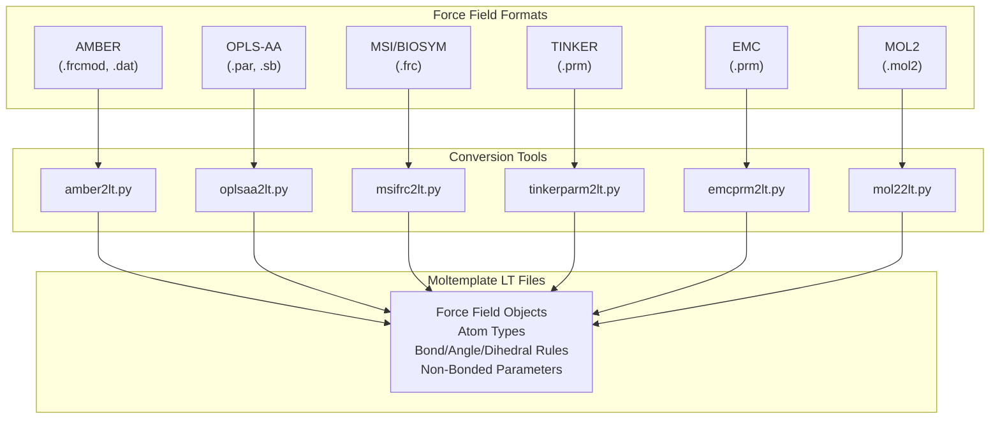

Moltemplate provides a comprehensive suite of conversion tools that translate force field parameters from multiple molecular simulation packages into moltemplate's LT (LAMMPS Template) format. These tools enable researchers to leverage existing force field libraries—including AMBER, OPLS-AA, COMPASS, TINKER, and EMC formats—within moltemplate's template-based simulation framework. The conversion architecture handles bonded parameters, non-bonded interactions, equivalences, and wildcard patterns while preserving the hierarchical parameter selection rules that characterize each force field's design philosophy.

## Conversion Architecture Overview

The force field conversion infrastructure is organized around format-specific converters located in `moltemplate/force_fields/convert_*` directories. Each converter implements a three-stage pipeline: parsing force-field specific input files, transforming parameter definitions into moltemplate syntax, and generating structured LT files that can be imported directly into moltemplate simulations. The conversion process automatically handles complex aspects such as wildcard atom types ("X" or "*"), parameter equivalences across atom types, duplicate parameter resolution, and unit conversions where required.



The converters share common architectural patterns while handling format-specific nuances. Each converter reads parameter tables, processes wildcard and equivalence rules, sorts interaction definitions to ensure proper priority (generic before specific), and outputs moltemplate-compatible syntax using the `write_once()` and `write()` directives. The resulting LT files define force field objects that can be inherited by molecule definitions, enabling consistent parameter application across simulation systems.

Sources: [moltemplate/force_fields/README.txt](moltemplate/force_fields/README.txt#L1-L14), [moltemplate/amber2lt.py](moltemplate/amber2lt.py#L7-L11), [moltemplate/force_fields/convert_OPLSAA_to_LT/README.md](moltemplate/force_fields/convert_OPLSAA_to_LT/README.md#L1-L18)

## AMBER Force Field Conversion

The `amber2lt.py` converter transforms AMBER force field files (FRCMOD and DAT formats) into moltemplate LT format. AMBER force fields utilize wildcard atom types ("X") to define generic parameters that apply when specific parameters are not available—a pattern that requires careful handling during conversion to maintain the hierarchical parameter lookup strategy.

The conversion process extracts parameter sections for masses, bonds, angles, dihedrals, impropers, and pair (non-bonded) interactions. A critical sorting operation ensures wildcard-containing interactions appear before specific interactions in the output LT file, as moltemplate processes "By Type" rules sequentially and gives priority to the last matching rule [moltemplate/amber2lt.py#L189-L200]. This inversion of the AMBER convention (where specific rules are searched first) enables moltemplate's pattern matching to correctly select the most specific parameter.

The converter transforms AMBER atom type naming by replacing "*" with "star" to avoid moltemplate syntax conflicts while preserving the wildcard functionality through pattern matching [moltemplate/amber2lt.py#L234-L290]. Bond parameters are converted to harmonic style, angles to harmonic style, dihedrals to Fourier series representation, and pair interactions to Lennard-Jones with Coulombic long-range corrections.

**Command-line interface example:**
```bash
moltemplate/amber2lt.py --in gaff.dat --out gaff.lt --name GAFF
```

**Python API usage:**
```python
from moltemplate.amber2lt import ConvertAmber2Lt
with open('gaff.dat', 'r') as f:
    lines = f.readlines()
lt_content = ConvertAmber2Lt('GAFF', lines)
```

The conversion supports optional separation of parameter types via command-line arguments (`--mass`, `--bond`, `--angle`, etc.) when force field parameters are distributed across multiple files. The resulting LT file defines a force field object containing atom type definitions with comments, mass tables, and interaction rules organized by moltemplate's data structure conventions.

Sources: [doc/doc_amber2lt.md](doc/doc_amber2lt.md#L10-L20), [moltemplate/amber2lt.py](moltemplate/amber2lt.py#L7-L11), [moltemplate/amber2lt.py](moltemplate/amber2lt.py#L189-L200), [moltemplate/amber2lt.py](moltemplate/amber2lt.py#L234-L290), [moltemplate/amber2lt.py](moltemplate/amber2lt.py#L767-L800)

## MOL2 to Moltemplate Conversion

The `mol22lt.py` converter serves a distinct purpose from the other force field converters: it translates MOL2 molecular structure files into moltemplate format, creating molecule definitions with explicit coordinates and bond connectivity. This tool is designed for importing pre-parametrized molecules from external databases or quantum chemistry packages, allowing researchers to quickly integrate experimentally or computationally derived structures into moltemplate workflows.

The MOL2 converter extracts atom information (IDs, names, coordinates, types, charges), bond definitions, and molecular subunits from the TRIPOS-formatted MOL2 file [moltemplate/mol22lt.py#L76-L140]. When converting multi-chain systems or multiple molecules in a single file, the tool can merge molecule IDs when a single object name is specified via the `--name` argument, or preserve separate subunit definitions for independent manipulation.

**Key features include:**
- External charge file support via `--charges` argument
- Atom type capitalization control (`--upper-case-types`, `--lower-case-types`)
- Atom name capitalization control (`--upper-case-names`, `--lower-case-names`)
- Optional force field association via `--ff` and `--ff-file` arguments
- Bond type inclusion option for parameterized bond definitions

**Command-line usage:**
```bash
moltemplate/mol22lt.py --in molecule.mol2 --out molecule.lt --name MOLECULE
```

The converter generates LT files with structured molecule definitions including atom coordinate tables (`write('Data Atoms')`), bond lists (`write('Data Bond List')` or `write('Data Bonds')` depending on parameter availability), and usage instructions. Importantly, mol22lt does **not** automatically assign force field parameters—it relies on external force field files (such as those generated by amber2lt.py or oplsaa2lt.py) to provide interaction parameters. The tool focuses on structural representation, leaving parameter assignment to the force field inheritance mechanism.

A significant limitation is the current handling of multiple chains in a single file. The tool can either merge all chains into a single molecule object or preserve them as separate subunits, but complex chain connectivity and hierarchical relationships may require manual post-processing [doc/doc_mol22lt.md#L60-L102].

Sources: [doc/doc_mol22lt.md](doc/doc_mol22lt.md#L10-L22), [doc/doc_mol22lt.md](doc/doc_mol22lt.md#L60-L102), [moltemplate/mol22lt.py](moltemplate/mol22lt.py#L76-L140), [moltemplate/mol22lt.py](moltemplate/mol22lt.py#L400-L480)

## OPLS-AA Force Field Conversion

The OPLS-AA converter (`oplsaa2lt.py`) handles the unique two-file format used by BOSS (Biochemical and Organic Simulation System): a `.par` file containing atom type definitions and torsion/improper parameters, and a `.sb` file containing bond and angle parameters [moltemplate/force_fields/convert_OPLSAA_to_LT/oplsaa2lt.py#L320-L380]. This separation reflects the modular structure of OPLS-AA force fields, which have evolved through multiple versions (OPLS-AA 2008, OPLS-AA 2024) with increasing parameter coverage.

The conversion process involves parsing both files, extracting interaction definitions, then performing duplicate removal and sorting operations. OPLS-AA files contain extensive redundant parameter definitions for the same atom type combinations, requiring sophisticated duplicate resolution logic [moltemplate/force_fields/convert_OPLSAA_to_LT/oplsaa2lt.py#L171-L275]. The converter implements William Jorgensen's recommended strategy: when duplicate interactions exist for identical atom types, the most general interaction (as indicated by duplicate count and position in the original PAR file) should be sorted to appear last in the LT file, allowing moltemplate to select it only when more specific parameters don't match.

The converter also handles OPLS-AA's distinctive type naming conventions, which use numeric codes (e.g., "143" for alkene carbon) rather than descriptive names. A type conversion system maintains cross-references between numeric codes and chemical descriptions [moltemplate/force_fields/convert_OPLSAA_to_LT/oplsaa2lt.py#L26-L37], preserving documentation while generating numeric type identifiers suitable for moltemplate.

**Command-line usage:**
```bash
./oplsaa2lt.py --name OPLSAA --out oplsaa2024.lt \
  --par oplsaa.par \
  --sb  oplsaa.sb
```

The resulting LT file defines an OPLSAA force field object with complete parameter tables, suitable for use in molecule definitions through inheritance:

```lt
import "oplsaa2024.lt"

Ethylene inherits OPLSAA {
  write('Data Atoms') {
    $atom:c1  $mol @atom:143  0.00 -0.6695   0.00000  0.000
    $atom:h11 $mol @atom:144  0.00 -1.23422 -0.85446  0.000
  }
  write('Data Bond List') {
    $bond:c1h1 $atom:c1 $atom:h11
  }
}
```

Sources: [moltemplate/force_fields/convert_OPLSAA_to_LT/README.md](moltemplate/force_fields/convert_OPLSAA_to_LT/README.md#L1-L54), [moltemplate/force_fields/convert_OPLSAA_to_LT/oplsaa2lt.py](moltemplate/force_fields/convert_OPLSAA_to_LT/oplsaa2lt.py#L320-L380), [moltemplate/force_fields/convert_OPLSAA_to_LT/oplsaa2lt.py](moltemplate/force_fields/convert_OPLSAA_to_LT/oplsaa2lt.py#L171-L275)

## MSI/BIOSYM Force Field Conversion

The `msifrc2lt.py` converter processes MSI-format force field files (also known as BIOSYM, Accelrys, or DISCOVERY formats), which are historically significant in molecular simulation but use complex parameter matching strategies. These files define atom type equivalences and "auto-equivalences" that enable sophisticated wildcard pattern matching beyond the simple "X" wildcard used in AMBER.

The conversion architecture implements a multi-stage equivalence processing system [moltemplate/force_fields/convert_MSI_files_to_LT_files/msifrc2lt.py#L662-L720]. For each atom type, the converter generates a comprehensive force field identifier string (ffid) that concatenates the original atom type with equivalence markers for pair interactions, bonds, angles, dihedrals, and impropers. When moltemplate searches for interaction parameters, it pattern-matches against these extended strings, enabling the complex inheritance hierarchies that characterize MSI force fields.

The converter handles several MSI-specific features:
- Priority-based atom matching where wildcard atoms are followed by integer priority numbers
- Auto-equivalence systems that determine atom type compatibility based on local chemical context
- Version-based parameter prioritization when multiple parameter sets exist
- Out-of-plane (OOP) and Class-2 improper style definitions with distinct atom ordering conventions

A significant limitation is the current disregard of "template" information contained in MSI files. These templates typically define rules for automatic atom type assignment based on local bonding patterns, but msifrc2lt.py requires users to manually select appropriate atom types when defining molecules [moltemplate/force_fields/convert_MSI_files_to_LT_files/msifrc2lt.py#L6-L32]. This limitation means the converter is best suited for force field translation rather than automated molecule parameterization.

> [!TIP]
> The MSI converter's equivalence system is powerful but complex. When debugging parameter assignment issues, examine the generated "force field identifier" strings in the LT file—they contain the concatenation of atom types with ~p, ~b, ~a, ~d, and ~i suffixes representing pair, bond, angle, dihedral, and improper equivalences respectively.

Sources: [moltemplate/force_fields/convert_MSI_files_to_LT_files/msifrc2lt.py](moltemplate/force_fields/convert_MSI_files_to_LT_files/msifrc2lt.py#L6-L32), [moltemplate/force_fields/convert_MSI_files_to_LT_files/msifrc2lt.py](moltemplate/force_fields/convert_MSI_files_to_LT_files/msifrc2lt.py#L662-L720)

## TINKER and EMC Force Field Conversion

The TINKER (`tinkerparm2lt.py`) and EMC (`emcprm2lt.py`) converters provide access to additional force field ecosystems. The TINKER converter handles `.prm` files containing the complete force field parameterization, with specific support for the OPLS-AA parameter set distributed with TINKER [moltemplate/force_fields/convert_TINKER_files_to_LT_files/tinkerparm2lt.py#L9-L21]. The converter supports multiple interaction styles through command-line flags, enabling adaptation to various LAMMPS pair, bond, angle, dihedral, and improper styles.

**TINKER converter features:**
- Atom type subset selection via `-atoms` argument
- Customizable LAMMPS interaction styles (`-dihedral-style`, `-pair-style`, etc.)
- Support for both local files and URL-based parameter files
- Zero-padding options for force field IDs
- Hybrid/overlay style selection for complex potential functions

**TINKER command-line usage:**
```bash
./tinkerparm2lt.py -file oplsaa.prm -name OPLSAA -dihedral-style opls
```

The EMC converter specializes in EMC-format parameter files, which are characterized by explicit unit definitions and modular organization of potential functions [moltemplate/force_fields/convert_EMC_files_to_LT_files/emcprm2lt.py#L22-L80]. The converter automatically detects units (length, energy, density) and performs conversions to LAMMPS "real" units when necessary. It includes customizable potential style support and generates initialization scripts (`write_once("In Init")`) with appropriate LAMMPS commands for the selected potential functions.

**EMC converter features:**
- Automatic unit conversion from non-LAMMPS units
- Customizable potential styles for all interaction types
- Support for multi-file input (concatenated parameter files)
- Generic initialization script generation
- Special bonds handling for 1-4 interactions

**EMC command-line usage:**
```bash
./emcprm2lt.py file1.prm file2.prm --bond-style=harmonic --angle-style=harmonic --name=FF_NAME
```

Both converters include warning systems for untested parameter combinations and recommend manual verification of generated LT files, particularly for complex potential styles or unusual unit systems.

Sources: [moltemplate/force_fields/convert_TINKER_files_to_LT_files/tinkerparm2lt.py](moltemplate/force_fields/convert_TINKER_files_to_LT_files/tinkerparm2lt.py#L9-L21), [moltemplate/force_fields/convert_TINKER_files_to_LT_files/tinkerparm2lt.py](moltemplate/force_fields/convert_TINKER_files_to_LT_files/tinkerparm2lt.py#L117-L250), [moltemplate/force_fields/convert_EMC_files_to_LT_files/emcprm2lt.py](moltemplate/force_fields/convert_EMC_files_to_LT_files/emcprm2lt.py#L22-L80)

## Conversion Tool Comparison and Selection

The force field conversion tools exhibit both shared patterns and format-specific specializations. Understanding these characteristics helps researchers select the appropriate tool for their workflow and interpret the resulting LT files correctly.

| **Converter** | **Input Format** | **Output Focus** | **Wildcards** | **Equivalences** | **Unit Conversion** |
|---------------|-----------------|------------------|---------------|------------------|---------------------|
| `amber2lt.py` | FRCMOD/DAT | Force field parameters | Simple ("X") | Basic | No |
| `mol22lt.py` | MOL2 | Molecule structure | N/A | N/A | N/A |
| `oplsaa2lt.py` | .par + .sb | Force field parameters | None | Duplicate handling | No |
| `msifrc2lt.py` | .FRC | Force field parameters | Complex (priority) | Advanced | No |
| `tinkerparm2lt.py` | .prm | Force field parameters | None | Basic | No |
| `emcprm2lt.py` | .prm | Force field parameters | None | Basic | Yes |

> [!TIP]
> When troubleshooting parameter assignment issues, remember that moltemplate processes "By Type" interaction rules in the order they appear in the LT file, applying the **last** matching rule. Converters that use wildcards deliberately sort generic rules before specific rules to ensure specific parameters override generic ones—the reverse of how some source formats organize their parameter tables.

**Selection guidelines:**

- **Use `amber2lt.py`** when working with AMBER force fields (GAFF, GAFF2, AMBER biomolecular force fields) that use the standard AMBER parameter format with wildcard support.

- **Use `mol22lt.py`** when you have MOL2 files from databases (PubChem, ZINC) or quantum chemistry packages and need to create molecule definitions with explicit coordinates. Remember to pair with an appropriate force field file.

- **Use `oplsaa2lt.py`** for the latest OPLS-AA force fields (particularly the 2024 update) which are distributed as BOSS .par and .sb file pairs.

- **Use `msifrc2lt.py`** for COMPASS and other MSI-format force fields, but be prepared for manual atom type selection when defining molecules.

- **Use `tinkerparm2lt.py`** when accessing force fields from the TINKER ecosystem, particularly if you need OPLS-AA parameters with customized LAMMPS interaction styles.

- **Use `emcprm2lt.py`** for EMC force fields with non-standard units, taking advantage of the automatic unit conversion capabilities.

All converters generate LT files that follow moltemplate's conventions for force field definitions, enabling integration with the broader moltemplate ecosystem. The converted files can be imported into molecule definitions using the `import` command, and atom types can be referenced using the `@atom:` syntax for type-based interaction generation.

Sources: [moltemplate/amber2lt.py](moltemplate/amber2lt.py#L189-L200), [moltemplate/force_fields/convert_OPLSAA_to_LT/oplsaa2lt.py](moltemplate/force_fields/convert_OPLSAA_to_LT/oplsaa2lt.py#L171-L275)

## Best Practices and Workflow Integration

Effective use of force field conversion tools requires understanding both the technical conversion process and the broader simulation workflow in which converted LT files operate. A typical workflow involves converting the base force field, importing it into molecule definitions, and then instantiating molecular systems using moltemplate's template instantiation commands.

**Recommended conversion workflow:**

1. **Convert base force field** using the appropriate converter, generating a comprehensive LT file (e.g., `gaff.lt`, `oplsaa2024.lt`). This file defines the complete force field object with atom types, interaction rules, and parameter tables.

2. **Create molecule definitions** that inherit from the converted force field. These can be created manually using moltemplate syntax, or semi-automatically using `mol22lt.py` for MOL2 files. Manual molecule definition allows precise control over atom type assignment:

   ```lt
   import "gaff.lt"
   
   Ethane inherits GAFF {
     write('Data Atoms') {
       $atom:c1  $mol @atom:CT  -0.120  0.000  0.000  0.000
       $atom:c2  $mol @atom:CT  -0.120  1.529  0.000  0.000
       $atom:h1  $mol @atom:HC   0.030 -0.389  0.000  0.895
     }
     write('Data Bond List') {
       $bond:c1c2 $atom:c1 $atom:c2
       $bond:c1h1 $atom:c1 $atom:h1
     }
   }
   ```

3. **Build systems** by instantiating molecule templates with moltemplate's `new` command, applying spatial transformations:

   ```lt
   system.inherits GAFF {
     ethane1 = new Ethane
     ethane2 = new Ethane.move(3.0, 0, 0)
     ethane3 = new Ethane.move(6.0, 0, 0).rot(180, 0, 0, 1)
   }
   ```

4. **Verify parameter assignment** by examining the generated LAMMPS data file. Check that atom type IDs correspond correctly to the expected force field types and that all bonds, angles, dihedrals, and impropers are generated with appropriate parameter IDs.

**Validation checklist:**

- Confirm the converter version matches the force field source version (e.g., OPLS-AA 2024 requires the corresponding .par and .sb files)
- Verify that LAMMPS interaction styles specified in the converted LT file are supported by your LAMMPS build
- Check unit consistency between the converted force field and your simulation settings (EMC conversions may require particular attention)
- For molecules with unusual chemistry or non-standard atom types, manually verify that the assigned atom types match the intended chemical environment
- Test converted force fields on simple systems (single molecule, small clusters) before scaling to large simulations

**Common pitfalls and resolutions:**

| **Issue** | **Cause** | **Resolution** |
|-----------|-----------|----------------|
| Missing parameters for specific interactions | Wildcard patterns not matching or missing from source | Add manual parameter rules to the LT file or modify the source force field |
| Incorrect atom type assignment | Incomplete understanding of force field type conventions | Consult force field documentation; use molecular visualization to verify atom environments |
| Unit mismatches in simulations | EMC conversion with incorrect unit flags | Verify length, energy, and density settings; add manual `units real` command if needed |
| Parameter priority issues | Wildcard rules ordered incorrectly | Review the SortLines function output; manually reorder rules in the LT file if necessary |
| Molecule connectivity errors | MOL2 file with incomplete bond definitions | Verify bond table in source file; manually add missing bonds to the LT molecule definition |

The force field conversion tools provide powerful capabilities for integrating diverse force field ecosystems into moltemplate workflows, but they require careful validation and understanding of each force field's design philosophy. By following these best practices and leveraging moltemplate's template-based architecture, researchers can efficiently construct complex molecular systems while maintaining parameter accuracy and consistency.
