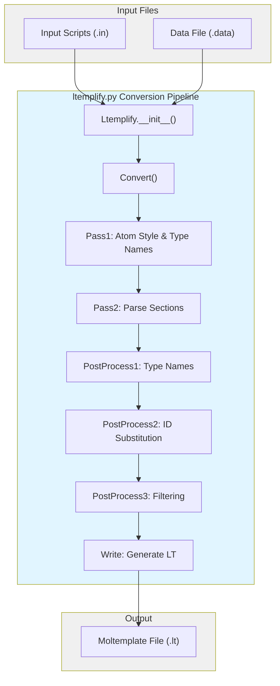

The ltemplify.py script provides a bridge between existing LAMMPS simulation files and the moltemplate ecosystem. This utility converts LAMMPS data files and input scripts into moltemplate (.lt) format, enabling you to extract molecules from existing simulations and use them as reusable building blocks for new simulations. The conversion process preserves atom types, coordinates, topology, force field parameters, and relevant LAMMPS commands while transforming them into moltemplate's declarative syntax.

Sources: [ltemplify.py](moltemplate/ltemplify.py#L8-L26), [doc_ltemplify.md](doc/doc_ltemplify.md#L1-L23)

## Architecture Overview

ltemplify.py implements a multi-pass conversion pipeline that progressively transforms LAMMPS data structures into moltemplate's template system. The architecture follows a systematic pattern: read input files → parse LAMMPS syntax → build internal representations → post-process and refine → generate LT output.



The Ltemplify class maintains extensive internal state including atom style specifications, selection criteria (by molecule-ID, atom-ID, or atom-type), and numerous list structures for storing parsed content from different LAMMPS file sections. This state enables the script to track which atoms, bonds, angles, dihedrals, and impropers are needed based on user selection criteria.

Sources: [ltemplify.py](moltemplate/ltemplify.py#L383-L550), [ltemplify.py](moltemplate/ltemplify.py#L849-L960)

## Command-Line Usage

### Basic Syntax

The fundamental command structure requires specifying input files and optional selection arguments:

```
ltemplify.py [OPTIONS] INPUT_SCRIPTS DATA_FILE > output.lt
```

Where INPUT_SCRIPTS (optional) are LAMMPS input script files that must appear before the DATA_FILE in the argument list. If no selection arguments are provided, ltemplify.py will convert all atoms in the data file—which is typically not useful for creating reusable molecule templates.

Sources: [doc_ltemplify.md](doc/doc_ltemplify.md#L70-L95)

### Selection Arguments

Selection criteria determine which atoms and interactions get included in the output LT file. These are mutually exclusive approaches for targeting specific molecules:

| Argument | Purpose | Example |
|----------|---------|---------|
| `-name NAME` | Specify molecule name for the LT file | `-name Ethane` |
| `-mol "MOLID_LIST"` | Select atoms by molecule-ID numbers | `-mol "1"` or `-mol "1 3 5"` |
| `-id "ID_LIST"` | Select atoms by atom-ID numbers | `-id "13 14 15 61*69"` |
| `-type "TYPE_LIST"` | Select atoms by atom-type numbers | `-type "1 2 3"` |

The `-mol` argument works only with molecular atom styles like `atom_style full`. For other atom styles, use `-id` or `-type` for selection.

Sources: [doc_ltemplify.md](doc/doc_ltemplify.md#L70-L130), [ltemplify.py](moltemplate/ltemplify.py#L849-L860)

### Atom Style Configuration

Atom style specification controls how ltemplify.py interprets the Atoms section of the data file:

| Argument | Purpose | Example |
|----------|---------|---------|
| `-atomstyle "STYLE"` | Specify LAMMPS atom_style explicitly | `-atomstyle "hybrid bond ellipsoid"` |
| `-columns "COLUMN_LIST"` | Manually specify column names | `-columns "id mol type charge x y z"` |

If not specified, ltemplify.py attempts to determine the atom style from comments following the "Atoms" line in the data file, defaulting to `full` style if unable.

Sources: [doc_ltemplify.md](doc/doc_ltemplify.md#L130-L145), [ltemplify.py](moltemplate/ltemplify.py#L960-L1000)

### Type Naming Options

ltemplify.py provides multiple strategies for naming atom types and interaction types in the output:

| Argument | Purpose | Default |
|----------|---------|---------|
| `-infer-comments` | Use comments in data file for type names | Enabled |
| `-ignore-comments` | Use numeric type names (type1, type2, etc.) | Disabled |
| `-atom-type-map FILE` | Use external mapping file for atom type names | None |
| `-prepend-atom-type STR` | Prepend string to all atom type names | Empty |
| `-preamble STR` | Add text at beginning of output file | None |

The comment inference mechanism parses comments in the Masses section and coefficient section headers to extract meaningful type names. For example, `1 12.01 # c3` creates `@atom:c3` type names.

Sources: [doc_ltemplify.md](doc/doc_ltemplify.md#L220-L280), [ltemplify.py](moltemplate/ltemplify.py#L2960-L3100)

### Force Field Integration

When working with external force fields, several arguments control which information gets excluded:

| Argument | Purpose |
|----------|---------|
| `-ignore-coeffs` | Omit all force field parameters (coeffs) |
| `-ignore-angles` | Omit angles, dihedrals, and impropers |
| `-ignore-bond-types` | Omit bond type information (keeps bond list) |
| `-ignore-masses` | Omit mass information |
| `-datacoeffs` | Put coefficients in data file instead of settings |

The `inherits` keyword in the `-name` argument enables force field specification: `-name "MoleculeName inherits ForceFieldName"`. This allows moltemplate to use force field rules for generating missing interactions.

Sources: [doc_ltemplify.md](doc/doc_ltemplify.md#L280-L370)

## Processing Pipeline

### Pass 1: Atom Style and Type Names

The first pass (Pass1) examines input files to determine the atom style and extract atom type names. It uses the LineLex class to parse LAMMPS syntax while preserving comments, which is essential for type name inference. This pass identifies critical information including:

- Atom style specification from input scripts or data file headers
- Atom type names from Masses section comments
- Bond, angle, dihedral, and improper type names from coefficient section headers
- Initial mapping between integer types and descriptive names

Sources: [ltemplify.py](moltemplate/ltemplify.py#L960-L1000), [ltemplify.py](moltemplate/ltemplify.py#L1180-L1200)

### Pass 2: Section Parsing

Pass2 parses the substantive sections of LAMMPS files, extracting:

- **Atoms section**: atom IDs, molecule IDs, types, charges, coordinates
- **Velocities section**: atomic velocities
- **Bonded interactions**: Bonds, Angles, Dihedrals, Impropers
- **Masses**: atomic masses with potential type name comments
- **Coefficients**: pair, bond, angle, dihedral, improper coefficients
- **Group commands**: simple static group definitions
- **Fix commands**: fix shake, fix rattle, fix rigid, fix poems
- **Set commands**: property assignment commands

The script maintains separate list structures for each section, with different lists for input script commands versus data file content.

Sources: [ltemplify.py](moltemplate/ltemplify.py#L1180-L1182), [ltemplify.py](moltemplate/ltemplify.py#L500-L600)

### PostProcess1: Type Name Generation

PostProcess1 implements intelligent naming strategies for atoms and interactions:

1. **Atom ID naming**: If an atom type appears multiple times, atoms get numbered suffixes (e.g., `CA_1`, `CA_2`, `CA_3`). If a type appears only once, the atom ID equals the type name.
2. **Type name mapping**: Applies any user-specified atom type mappings from the `-atom-type-map` argument
3. **String handling**: Handles atom type names containing spaces by wrapping them in curly braces (e.g., `@{atom:H spaces}`)

This step populates `self.atomids_int2name` and `self.atomtypes_int2name` dictionaries with final naming decisions.

Sources: [ltemplify.py](moltemplate/ltemplify.py#L2961-L3070)

### PostProcess2: Variable Substitution

PostProcess2 updates all parsed sections to use moltemplate's variable syntax:

- Atom IDs become `$atom:NAME` or `${atom:NAME}` (for names with spaces)
- Atom types become `@atom:NAME` or `@{atom:NAME}`
- Similar substitutions for bond, angle, dihedral, and improper types
- Updates atoms, velocities, ellipsoids, lines, and triangles sections

This transformation replaces integer references with symbolic names, making the output more readable and maintainable.

Sources: [ltemplify.py](moltemplate/ltemplify.py#L3060-L3172)

### PostProcess3: Filtering and Cleanup

PostProcess3 removes unnecessary information based on selection criteria:

- Filters out atoms not selected by `-mol`, `-id`, or `-type` arguments
- Removes bonded interactions involving unselected atoms
- Deletes fix and group commands that reference only unselected atoms
- Consolidates coefficient lists to include only needed types
- Updates atom ID references in remaining bonded interactions

This step ensures the output LT file contains only relevant information for the selected molecule or atom set.

Sources: [doc_ltemplify.md](doc/doc_ltemplify.md#L150-L170)

## Python API Usage

ltemplify.py can be used programmatically from Python without spawning subprocesses:

```python
import io
from moltemplate.ltemplify import Ltemplify

# Create StringIO objects for input content
data_file = io.StringIO(data_file_contents)
input_script_file = io.StringIO(input_script_contents)

# Configure conversion
args = ['-name', 'MyMolecule', 
        '-mol', '1',
        '-ignore-angles']
ltmp = Ltemplify(args)

# Perform conversion
output_file = io.StringIO()
ltmp.Convert(output_file, 
             input_data_file=data_file,
             input_script_files=[input_script_file])

# Access result
output_file.seek(0)
lt_content = output_file.read()
```

The `Convert` method accepts either filenames or StringIO objects for both input and output. The input scripts must be provided as a list.

Sources: [doc_ltemplify.md](doc/doc_ltemplify.md#L500-L664), [ltemplify.py](moltemplate/ltemplify.py#L5380-L5415)

## Practical Examples

### Example 1: Extract Single Molecule by ID

Extract molecule with molecule-ID 1 from a LAMMPS simulation:

```
ltemplify.py -name Ethane -molid "1" simulation.in simulation.data > ethane.lt
```

This creates `ethane.lt` containing all atoms belonging to the first molecule. The resulting file can be imported into a moltemplate system definition:

```lt
import "ethane.lt"

ethanes = new Ethane.move(-13.2,5.1,3.7) [4].move(0.0,0.0,4.1) [4].move(0.0,4.1,0.0)
```

Sources: [doc_ltemplify.md](doc/doc_ltemplify.md#L380-L410), [cnad-cnt example](examples/file_conversion_examples/convert_LAMMPS_to_LT_examples/cnad-cnt/README_step1_run_ltemplify.sh)

### Example 2: CNAD-CNT Molecule Extraction

This example from the repository demonstrates extracting two distinct molecules:

```
# Extract CNAD molecule (molecule-id 1)
ltemplify.py -name CNAD -molid "1" cnad-cnt.in cnad-cnt.data > cnad.lt

# Extract CNT molecule (molecule-id 2)
ltemplify.py -name CNT -molid "2" cnad-cnt.in cnad-cnt.data > cnt.lt
```

The extracted molecules can then be combined in new arrangements using moltemplate's transformation syntax.

Sources: [cnad-cnt example](examples/file_conversion_examples/convert_LAMMPS_to_LT_examples/cnad-cnt/README.md#L1-L14)

### Example 3: Force Field Integration

Create a molecule using the GAFF2 force field by excluding coefficient information:

```
echo "import gaff2.lt" > ethane.lt

ltemplify.py -name "Ethane inherits GAFF2" \
             -molid "1" \
             -ignore-angles \
             -ignore-bond-types \
             -ignore-coeffs \
             simulation.in simulation.data >> ethane.lt
```

The `inherits GAFF2` syntax tells moltemplate to use GAFF2's rules for generating angles, dihedrals, and impropers based on atom type names.

Sources: [doc_ltemplify.md](doc/doc_ltemplify.md#L430-L460)

## Known Limitations

### Unsupported Pair Styles

ltemplify.py does not understand exotic many-body pair styles such as tersoff, sw, meam, reax, dpd, edip, dipole, lubricate, or hbond/dreiding. These require special syntax with wildcard characters that ltemplify.py attempts to expand, which must be manually corrected. Users must:

1. Remove extra lines generated by wildcard expansion
2. Restore wildcard characters (e.g., `pair_coeff * * ...`)
3. Use moltemplate's `-a` argument to ensure correct atom type numbering

Sources: [doc_ltemplify.md](doc/doc_ltemplify.md#L470-L500)

### Command Coverage

The script has limited support for LAMMPS commands:

**Supported**: Simple group commands (id, molecule, type styles), fix shake, fix rattle, fix rigid, fix poems, set commands

**Not Supported**: Most other fixes (restrain, bond/create, bond/break, bond/react, ttm), complex group definitions, and many specialized pair styles

Users should review generated LT files and add missing commands manually.

Sources: [doc_ltemplify.md](doc/doc_ltemplify.md#L170-L190)

### Wildcard Expansion

Moltemplate struggles with wildcard characters in coeff commands. ltemplify.py removes wildcards and expands commands explicitly, which may not be appropriate for many-body pair styles that require wildcard syntax.

Sources: [doc_ltemplify.md](doc/doc_ltemplify.md#L490-L500)

## Testing and Validation

The repository includes comprehensive tests that verify:

- Basic ltemplify functionality with real molecular systems
- Type name inference from comments in data files
- Processing of group, shake, rattle, and set commands
- Force field coefficient handling
- Data coefficient placement (`-datacoeffs` flag)

Test files include both input files with and without embedded coefficients, covering various scenarios that users encounter in practice.

Sources: [test_ltemplify.sh](tests/test_ltemplify.sh#L1-L126)

## Next Steps

After converting your LAMMPS files with ltemplify.py, you can:

- **Build systems**: Use your converted molecule definitions with moltemplate's instance syntax to construct larger systems
- **Apply force fields**: Integrate your molecules with [Force Field Support](20-oplsaa-force-field-integration) for parameter generation
- **Customize templates**: Modify the generated LT files to add additional constraints or specialized interactions
- **Generate LAMMPS input**: Run moltemplate.sh to produce final LAMMPS data and input files for simulation

For more complex conversion scenarios, consider exploring [amber2lt.py](27-amber2lt-py-amber-to-lt-conversion) for AMBER files or [mol22lt.py](26-mol22lt-py-mol2-to-lt-conversion) for MOL2 format files.