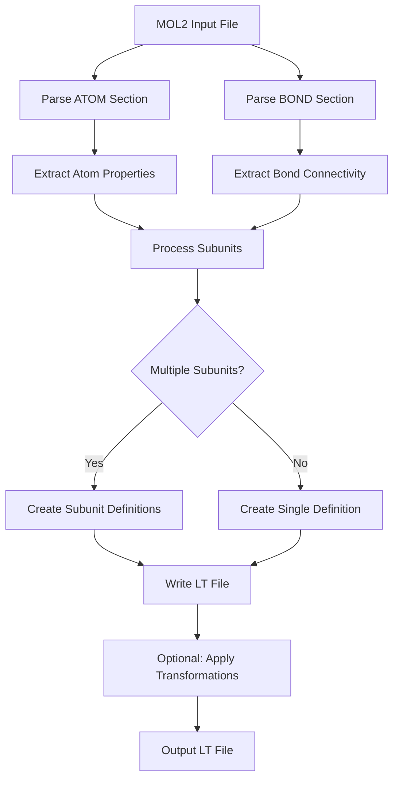

mol22lt.py is a specialized conversion tool that transforms MOL2 molecular structure files into moltemplate (LT) format, enabling seamless integration of molecular structures from various molecular simulation packages into the moltemplate workflow for LAMMPS simulations.

**Status**: Experimental/Beta software as of 2024-12-05. While functional for many use cases, users should be aware of limitations and verify results carefully.

Sources: [doc/doc_mol22lt.md](doc/doc_mol22lt.md#L1-L8), [moltemplate/mol22lt.py](moltemplate/mol22lt.py#L19-L20)

## Architecture Overview

The conversion process follows a structured pipeline that parses MOL2 file sections, extracts molecular topology information, and generates moltemplate-compatible definitions. The tool handles both single-molecule and multi-subunit structures, with special handling for bonds that connect different subunits.



The tool's core logic is encapsulated in the `ConvertMol22Lt()` function, which orchestrates the entire conversion process with configurable options for force field integration, naming conventions, and molecular organization.

Sources: [moltemplate/mol22lt.py](moltemplate/mol22lt.py#L76-L87)

## Core Conversion Logic

### MOL2 File Parsing

The parser reads the MOL2 file section by section, focusing on two critical sections:

- **ATOM section**: Extracts atom names, coordinates (x, y, z), atom types, charges, subunit IDs, and subunit names. Each atom must have a unique ID and atom names must be unique within each subunit.
- **BOND section**: Captures connectivity information between atoms, including bond types when present.

The parser maintains multiple data structures for efficient lookup and organization:

- `id2name`, `id2type`, `id2charge`, `id2coords`: Direct mappings from atom IDs to properties
- `subId2atomNames`: Dictionary organizing atoms by their subunit membership
- `subId2bonds`: Bonds classified by subunit for grouped output
- `global_bonds`: Bonds connecting atoms across different subunits

Sources: [moltemplate/mol22lt.py](moltemplate/mol22lt.py#L97-L176)

### Subunit Handling Strategy

MOL2 files often contain multiple molecular subunits (substructures). mol22lt.py handles these through several strategies:

1. **Unique naming**: If multiple subunits share the same name in the MOL2 file, the tool automatically generates unique names by appending underscores and subunit IDs (e.g., `monomer__1`, `monomer__2`).
2. **Bond classification**: Bonds are classified as either internal (within a subunit) or global (between subunits), enabling proper LT file structure.
3. **Optional grouping**: The `--name` argument can encapsulate all subunits into a single molecular object with a unified molecule ID.

Sources: [moltemplate/mol22lt.py](moltemplate/mol22lt.py#L203-L260)

### LT File Generation

The output LT file structure follows moltemplate conventions with sections for:

- **Data Atoms**: Lists all atoms with IDs, molecule IDs, types, charges, and coordinates using the `write("Data Atoms"){}` block
- **Data Bonds**: Captures connectivity information, optionally including bond types
- **Molecule definitions**: Each subunit becomes a reusable moltemplate object that can be instantiated multiple times

The tool generates both the definitions and usage instructions, making it easy for users to understand how to incorporate the generated files into their simulations.

Sources: [moltemplate/mol22lt.py](moltemplate/mol22lt.py#L298-L350)

## Command-Line Usage

### Basic Conversion Pattern

The standard conversion workflow follows this pattern:

```bash
mol22lt.py \
  --in INPUT_FILE.mol2 \
  --out OUTPUT_FILE.lt \
  --name MOLECULE_NAME \
  --ff FORCE_FIELD_NAME \
  --ff-file FORCE_FIELD_FILE.lt
```

Example: Converting a polyphenylene sulfide (PPS) 5-mer polymer:

```bash
mol22lt.py \
  --in PPS_5mer.mol2 \
  --out PPS_5mer.lt \
  --name PPS5 \
  --ff GAFF2 \
  --ff-file "gaff2.lt"
```

Sources: [doc/doc_mol22lt.md](doc/doc_mol22lt.md#L10-L28)

### Integration with Moltemplate

After generating the LT file, integrate it into a system configuration:

```lt
import "PPS_5mer.lt"

# Instantiate a single copy
pps5_copy = new PPS5

# Create multiple copies with transformations
pps5_copy1 = new PPS5.move(-24.7, -3.9, -4.3)
pps5_copy2 = new PPS5.move(-21.3, 1.9, 0.7)
pps5_copy3 = new PPS5.move(-17.9, 7.7, 5.7).rot(180, 1, 0, 0)
```

Generate the LAMMPS data file:

```bash
moltemplate.sh system.lt
```

Sources: [doc/doc_mol22lt.md](doc/doc_mol22lt.md#L30-L49)

## Configuration Options

### Required Arguments

| Argument | Description | Notes |
|----------|-------------|-------|
| `--in FILE.mol2` | Input MOL2 file path | If omitted, reads from stdin |
| `--out FILE.lt` | Output LT file path | If omitted, writes to stdout |

Sources: [doc/doc_mol22lt.md](doc/doc_mol22lt.md#L172-L187)

### Optional Arguments

| Argument | Description | Use Case |
|----------|-------------|----------|
| `--charges FILE.txt` | External charge file | Override MOL2 charges or supply missing charges |
| `--name MOLECULE_NAME` | Unified molecule object name | For multi-subunit molecules requiring single entity |
| `--ff FORCE_FIELD` | Force field name (e.g., GAFF2) | Enables force field parameter lookup |
| `--ff-file FILE.lt` | Force field definition file | Imports atom type definitions and parameters |
| `--upper-case-types` | Convert atom types to uppercase | Fix force-field specific format errors |
| `--lower-case-types` | Convert atom types to lowercase | Fix force-field specific format errors |
| `--upper-case-names` | Convert atom names to uppercase | Standardize naming conventions |
| `--lower-case-names` | Convert atom names to lowercase | Standardize naming conventions |

Sources: [doc/doc_mol22lt.md](doc/doc_mol22lt.md#L187-L272)

## Data Extraction and Limitations

### Extracted Information

The tool extracts the following from MOL2 files:

- **Charge** (column 9 of ATOM section): Atomic charges for electrostatic interactions
- **Atom names** (column 2): Unique identifiers for atoms within subunits
- **XYZ coordinates** (columns 3, 4, 5): Spatial positions in angstroms
- **Atom types** (column 6): Force field type identifiers
- **Subunit ID** (column 7): Numerical identifier for molecular substructures
- **Subunit name** (column 8): String name for substructures
- **Bonds** (columns 2 and 3 of BOND section): Connectivity information

Sources: [doc/doc_mol22lt.md](doc/doc_mol22lt.md#L68-L91)

### Ignored Information

The tool deliberately ignores certain MOL2 data:

- Atom IDs (remapped internally for LT format)
- Bond IDs (generated automatically in LT format)
- Bond types (optional; can be included if specified)
- Chain information (subunit/substructure IDs are used instead)
- Status bits from ATOM and BOND sections

Sources: [doc/doc_mol22lt.md](doc/doc_mol22lt.md#L92-L99)

### Format Requirements

For successful conversion, MOL2 files must meet these requirements:

1. **Unique atom names**: Atom names (column 2) must be unique within each subunit
2. **Sequential numbering**: All atom-ID and subunit-ID numbers must be unique and start at 1
3. **Valid sections**: ATOM and BOND sections must be properly formatted

Sources: [doc/doc_mol22lt.md](doc/doc_mol22lt.md#L102-L112)

## Advanced Usage Patterns

### Force Field Integration

When working with specific force fields like GAFF2, OPLS-AA, or AMBER, specify both the force field name and its parameter file:

```bash
mol22lt.py \
  --in molecule.mol2 \
  --out molecule.lt \
  --ff GAFF2 \
  --ff-file "moltemplate/force_fields/gaff2.lt"
```

This adds an import statement at the beginning of the generated LT file, enabling moltemplate to automatically lookup force field parameters by atom type.

Sources: [doc/doc_mol22lt.md](doc/doc_mol22lt.md#L112-L123)

### Custom Charge Assignment

Override MOL2 charges with a separate text file (one charge per line, same order as atoms):

```bash
mol22lt.py \
  --in molecule.mol2 \
  --out molecule.lt \
  --charges custom_charges.txt
```

The charges file format supports comments after `#` characters for documentation.

Sources: [doc/doc_mol22lt.md](doc/doc_mol22lt.md#L189-L201)

### Multi-Subunit Molecules

For molecules with multiple subunits (like polymers), use the `--name` argument to create a unified molecular object:

```bash
mol22lt.py \
  --in polymer_5mer.mol2 \
  --out polymer.lt \
  --name Polymer5mer \
  --ff GAFF2 \
  --ff-file "gaff2.lt"
```

This ensures all subunits share the same molecule ID and can be instantiated as a single unit. Without this argument, each subunit becomes a separate molecule definition.

Sources: [doc/doc_mol22lt.md](doc/doc_mol22lt.md#L201-L227)

### Molecular Transformation

After conversion, manually apply transformations to center or reorient molecules by editing the LT file:

```lt
# After the molecule definition, append transformations
PPS5.move(-24.7, -3.9, -4.3)  # Center the molecule at origin
```

> [!TIP]
> Apply transformations to the definition (before `new` commands) to affect all instances, or to individual instances for different positions/orientations.

Sources: [doc/doc_mol22lt.md](doc/doc_mol22lt.md#L152-L172)

## Python API Integration

The tool can be invoked programmatically from Python scripts, enabling automated conversion workflows:

```python
import moltemplate

# Open input and output files
fMol2 = open('molecule.mol2', 'r')
fLT = open('molecule.lt', 'w')

# Perform conversion
moltemplate.ConvertMol22Lt(
    fMol2, 
    fLT,
    ff_name='GAFF2',         # Force field name
    ff_filename='gaff2.lt',  # Force field file
    object_name='Molecule',  # Unified molecule name
    atom_type_capitalization='upper',  # Optional: uppercase atom types
    atom_name_capitalization='lower'   # Optional: lowercase atom names
)

# Close files
fMol2.close()
fLT.close()
```

Sources: [moltemplate/mol22lt.py](moltemplate/mol22lt.py#L76-L84), [doc/doc_mol22lt.md](doc/doc_mol22lt.md#L305-L323)

## Limitations and Workarounds

### Multiple Chain Limitation

The tool does not support MOL2 files with multiple chains (found in the SUBSTRUCTURE section). For multi-chain systems like proteins with quaternary structure, use this workaround:

1. **Split the MOL2 file** into separate files, one per chain
2. **Convert each chain** individually
3. **Create a composite** LT file combining the chain definitions

Example workflow:

```bash
# Step 1: Convert each chain
mol22lt.py --in chainA.mol2 --out chainA.lt --name ChainA --ff GAFF2 --ff-file "gaff2.lt"
mol22lt.py --in chainB.mol2 --out chainB.lt --name ChainB --ff GAFF2 --ff-file "gaff2.lt"
```

Create a composite definition:

```lt
# protein_with_2_chains.lt
import "chainA.lt"
import "chainB.lt"

ProteinWith2Chains {
  a = ChainA
  b = ChainB
}
```

Instantiate the complex:

```lt
# system.lt
import "protein_with_2_chains.lt"
protein1 = new ProteinWith2Chains
```

Sources: [doc/doc_mol22lt.md](doc/doc_mol22lt.md#L60-L67), [doc/doc_mol22lt.md](doc/doc_mol22lt.md#L272-L305)

### Redundant Subunits

If a MOL2 file contains identical subunits (multiple copies of the same molecule), the generated LT file will have redundant definitions. To avoid this:

1. Supply a MOL2 file with only one copy of the subunit
2. Convert it with `--name` to create a reusable definition
3. Use moltemplate's `new`, `.move()`, and `.rot()` commands to create multiple instances at desired positions

Sources: [doc/doc_mol22lt.md](doc/doc_mol22lt.md#L134-L152)

### Center of Mass Handling

The tool ignores CENTROID and CENTER_OF_MASS sections in MOL2 files. Molecular centering must be performed manually using LT transformations or preprocessing tools.

Sources: [doc/doc_mol22lt.md](doc/doc_mol22lt.md#L152-L172)

## Error Handling and Validation

The tool performs several validation checks during conversion:

1. **Atom ID uniqueness**: Ensures no duplicate atom IDs in the ATOM section
2. **Atom name uniqueness**: Verifies atom names are unique within each subunit
3. **Sequential IDs**: Checks for missing atom IDs (must be consecutive starting from 1)
4. **Charge file matching**: Validates that external charge files match the number of atoms

Errors are reported with descriptive messages indicating the specific problem and its location in the input file.

Sources: [moltemplate/mol22lt.py](moltemplate/mol22lt.py#L149-L155), [moltemplate/mol22lt.py](moltemplate/mol22lt.py#L269-L275)

> [!TIP]
> Always validate the generated LT file by running `moltemplate.sh -check system.lt` before attempting full simulation runs to catch parameter or formatting issues early.

## Next Steps

- Explore [ltemplify.py: LAMMPS to LT Conversion](25-ltemplify-py-lammps-to-lt-conversion) for converting existing LAMMPS data files
- Review [Force Field Integration](21-amber-gaff-force-field-integration) for deeper understanding of force field parameters
- Study [Core Template System Architecture](7-core-template-system-architecture) to understand LT file internals
- Examine [LAMMPS Data File Format](12-lammps-data-file-format) for output structure details