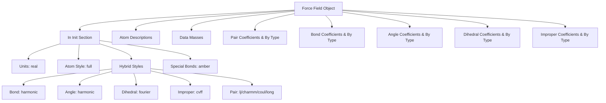

The `amber2lt.py` tool bridges AMBER force field formats with moltemplate's template system, enabling seamless conversion of AMBER FRCMOD and DAT files into moltemplate LT files. This conversion is essential for researchers transitioning from AMBER to LAMMPS while preserving force field parameters and molecular definitions. As experimental software (version 0.2.1, 2022-9-09), it provides automated parsing of complex AMBER file formats with wildcard support for generic interaction rules.

## Architecture Overview

The conversion pipeline follows a structured transformation process that parses AMBER file sections, converts them to moltemplate syntax, and generates appropriate coefficient and interaction definitions. The architecture consists of three main phases: extraction, transformation, and generation.

```mermaid
flowchart TB
    subgraph Input[AMBER Force Field File]
        A[FRCMOD/DAT File]
    end
    
    subgraph Extraction[Phase 1: Section Extraction]
        B[Mass Section]
        C[Bond Section]
        D[Angle Section]
        E[Dihedral Section]
        F[Improper Section]
        G[Pair Section]
    end
    
    subgraph Transformation[Phase 2: Data Transformation]
        H[SortLines<br/>Wildcard Prioritization]
        I[Atom Type Conversion<br/>(*→star, X→*)]
        J[Parameter Mapping<br/>AMBER → LAMMPS]
    end
    
    subgraph Generation[Phase 3: LT Generation]
        K[In Settings<br/>Coefficient Definitions]
        L[Data By Type<br/>Interaction Templates]
        M[In Init<br/>Force Field Settings]
    end
    
    subgraph Output[Moltemplate LT File]
        N[LT Output]
    end
    
    A --> B
    A --> C
    A --> D
    A --> E
    A --> F
    A --> G
    B --> H
    C --> H
    D --> H
    E --> H
    F --> H
    G --> H
    H --> I
    I --> J
    J --> K
    J --> L
    J --> M
    K --> N
    L --> N
    M --> N
```

The tool processes each interaction type through specialized converter functions: `ConvertBond2Lt()`, `ConvertAngle2Lt()`, `ConvertDihedral2Lt()`, `ConvertImproper2Lt()`, and `ConvertPair2Lt()`. A critical design element is the `SortLines()` function, which ensures wildcard rules appear before specific rules, enabling proper parameter override behavior in moltemplate's pattern matching system.
Sources: [moltemplate/amber2lt.py](moltemplate/amber2lt.py#L105-L169), [moltemplate/amber2lt.py](moltemplate/amber2lt.py#L189-L231)

## Core Conversion Mechanics

### Wildcard Pattern Handling

AMBER force fields use wildcard characters ("X") to define generic interaction rules that apply to multiple atom type combinations. The `SortLines()` function implements sophisticated logic to ensure proper rule precedence: entries with wildcards appear before specific atom type combinations, allowing moltemplate to match specific rules before falling back to generic ones.

For example, in a dihedral parameter table, the entry "X-O2-CO-O2" (generic) will be sorted before "CO-O2-CO-O2" (specific). This ordering ensures that when moltemplate processes the LT file, it first attempts to match specific atom type combinations, and only when no match is found does it use the wildcard rule.
Sources: [moltemplate/amber2lt.py](moltemplate/amber2lt.py#L189-L231)

### Section Extraction Algorithm

The `ExtractFFTableAB()` function identifies force field sections by scanning for blank lines and parsing patterns based on the number of atom types expected. It validates lines against specific criteria: each line must contain hyphen-separated atom type codes followed by numeric parameters. The function handles optional section headers and can skip a specified number of initial lines, providing flexibility for different AMBER file variants.
Sources: [moltemplate/amber2lt.py](moltemplate/amber2lt.py#L105-L169)

### Parameter Mapping Transformations

Each interaction type undergoes specific transformations during conversion:

| Interaction Type | AMBER Format | LAMMPS Style | Key Transformations |
|-----------------|--------------|--------------|-------------------|
| Bonds | K<sub>eq</sub>, R<sub>eq</sub> | harmonic | K<sub>eq</sub> (kcal/mol/Ų), R<sub>eq</sub> (Å) |
| Angles | K<sub>θ</sub>, θ<sub>eq</sub> | harmonic | K<sub>θ</sub> (kcal/mol/rad²), θ<sub>eq</sub> (degrees) |
| Dihedrals | V<sub>n</sub>, γ, n, divf | fourier | V<sub>n</sub>/divf per term, multi-term support |
| Impropers | V<sub>n</sub>, γ, n | cvff | γ restricted to 0° or 180° for LAMMPS compatibility |
| Pair | ε, R<sub>min</sub>/2 | lj/charmm/coul/long | ε (kcal/mol), R<sub>min</sub>/2 (Å) |

The dihedral conversion handles AMBER's complex multi-term Fourier series representation, where negative `n` values indicate continuation terms. The tool accumulates these terms into a single LAMMPS `dihedral_coeff` command with multiple terms.
Sources: [moltemplate/amber2lt.py](moltemplate/amber2lt.py#L388-L533), [moltemplate/amber2lt.py](moltemplate/amber2lt.py#L535-L632)

## Command-Line Interface

### Basic Usage Pattern

The fundamental invocation converts a complete AMBER force field file in a single operation:

```bash
amber2lt.py --in gaff.dat --out gaff.lt --name GAFF
```

This command reads the AMBER file (`gaff.dat`), generates a moltemplate LT file (`gaff.lt`), and names the resulting force field object `GAFF` for reference in molecule definitions. The tool provides version information and experimental software warnings to `stderr` while directing output to the specified file or stdout.
Sources: [moltemplate/amber2lt.py](moltemplate/amber2lt.py#L800-L850)

### Advanced Section-Based Conversion

When automatic section detection fails due to ambiguous file format boundaries, you can manually split the AMBER file and process each section independently:

```bash
amber2lt.py \
  --name MyForceField \
  --mass mass.txt \
  --bond bond.txt \
  --angle angle.txt \
  --dihedral dihedral.txt \
  --improper improper.txt \
  --pair pair.txt \
  --out my_force_field.lt
```

This approach requires creating separate text files containing only the relevant lines for each force field component. Each file must contain no blank lines or extraneous text, ensuring clean parsing by the extraction functions.
Sources: [doc/doc_amber2lt.md](doc/doc_amber2lt.md#L78-L99), [moltemplate/amber2lt.py](moltemplate/amber2lt.py#L800-L850)

> [!TIP]
> When using section-based conversion, remember that if you supply one section-specific argument (e.g., `--mass`), you must supply all of them. The tool requires a complete parameter set to generate valid force field definitions.

### Argument Reference

| Argument | Required | Description | Default |
|----------|----------|-------------|---------|
| `--in` | No | Input AMBER file (FRCMOD/DAT) | stdin |
| `--out` | No | Output LT file | stdout |
| `--name` | No | Force field object name | (empty) |
| `--mass` | Conditional | Mass section file | (none) |
| `--bond` | Conditional | Bond section file | (none) |
| `--angle` | Conditional | Angle section file | (none) |
| `--dihedral` | Conditional | Dihedral section file | (none) |
| `--improper` | Conditional | Improper section file | (none) |
| `--pair` | Conditional | Pair section file | (none) |

## Python API Integration

The tool provides programmatic access through two primary functions: `ConvertAmber2Lt()` for complete file conversion and `ConvertAmberSections2Lt()` for processing pre-extracted sections.

### Complete File Conversion

```python
import moltemplate

# Read AMBER force field file
with open('gaff.dat', 'r') as file_in:
    lines_in = file_in.readlines()

# Convert to moltemplate format
output_lines = moltemplate.amber2lt.ConvertAmber2Lt('GAFF', lines_in)

# Write LT file
with open('gaff.lt', 'w') as file_out:
    file_out.write(''.join(output_lines))
```

This approach leverages automatic section detection through `ConvertAmber2Lt()`, which internally calls the extraction functions for each force field component.
Sources: [moltemplate/amber2lt.py](moltemplate/amber2lt.py#L767-L797), [doc/doc_amber2lt.md](doc/doc_amber2lt.md#L101-L169)

### Section-Based Conversion

```python
import moltemplate

# Extract sections manually (alternative parsing strategies)
with open('gaff.dat', 'r') as f:
    all_lines = f.readlines()

# Use extraction utilities
a, b = moltemplate.amber2lt.ExtractMassTextAB(all_lines, 1)
lines_mass = all_lines[a:b]

a, b = moltemplate.amber2lt.ExtractBondTextAB(all_lines, b)
lines_bond = all_lines[a:b]

# ... extract other sections ...

# Convert all sections together
output_lines = moltemplate.amber2lt.ConvertAmberSections2Lt(
    'GAFF',
    lines_mass,
    lines_bond,
    lines_angle,
    lines_dihedral,
    lines_improper,
    lines_pair
)
```

This method provides finer control when automatic section detection fails, allowing custom parsing strategies before conversion.
Sources: [moltemplate/amber2lt.py](moltemplate/amber2lt.py#L169-L185), [moltemplate/amber2lt.py](moltemplate/amber2lt.py#L699-L765)

## Output Structure

The generated LT file follows a standardized organization that moltemplate can process efficiently:



Each interaction type generates two sections: one in `write_once("In Settings")` containing LAMMPS coefficient commands, and one in `write_once("Data <Type> By Type")` defining interaction templates using moltemplate's `@bond:`, `@angle:`, `@dihedral:`, and `@improper:` variables. This dual-section approach separates parameter definitions from interaction topology, enabling flexible molecule construction.
Sources: [moltemplate/amber2lt.py](moltemplate/amber2lt.py#L699-L765)

> [!TIP]
> The generated LT file initializes LAMMPS with AMBER-appropriate settings: `special_bonds amber` for electrostatic scaling, `pair_modify mix arithmetic` for mixing rules, and hybrid styles for all interaction types. These settings are automatically configured in the `In Init` section.

## Practical Workflow Examples

### Converting Complete Force Fields

For converting standard AMBER force fields like GAFF:

```bash
# Convert GAFF force field
amber2lt.py --in gaff.dat --out gaff.lt --name GAFF

# Use in molecule definition
cat > benzene.lt << 'EOF'
import "gaff.lt"

Benzene inherits GAFF {
  write('Data Atoms') {
    $atom:c1  $mol  @atom:ca  -0.115   -0.739   1.189  -0.00733
    $atom:c2  $mol  @atom:ca  -0.115    0.614   1.208   0.35167
    # ... additional atoms ...
  }
  write("Data Bond List") {
    $bond:b1 $atom:c1 $atom:c2
    # ... additional bonds ...
  }
}
EOF
```

The resulting `gaff.lt` file can be imported into any molecule definition that requires GAFF parameters.
Sources: [doc/doc_amber2lt.md](doc/doc_amber2lt.md#L23-L56)

### Incremental Force Field Building

When working with molecule-specific force field modifications:

```bash
# Initialize force field file
amber2lt.py --in benzene.frcmod --name MyForceField > my_force_field.lt

# Add another molecule's parameters
amber2lt.py --in naphthalene.frcmod --name MyForceField >> my_force_field.lt
```

Each conversion appends new atom types and interaction parameters to the existing LT file, building a comprehensive force field incrementally. If you need to modify the original FRCMOD files, remember to delete the LT file before restarting to avoid duplicate or stale parameters.
Sources: [doc/doc_amber2lt.md](doc/doc_amber2lt.md#L58-L78)

### Integration with mol22lt.py

Combine `amber2lt.py` with `mol22lt.py` for complete molecule translation from AMBER to moltemplate:

```bash
# Step 1: Convert force field
amber2lt.py --in benzene.frcmod --name MyForceField \
  >> my_force_field.lt

# Step 2: Convert molecule structure
mol22lt.py --in benzene.mol2 \
           --out benzene.lt \
           --name Benzene \
           --ff MyForceField \
           --ff-file my_force_field.lt
```

This workflow leverages `amber2lt.py` for parameter conversion and `mol22lt.py` for coordinate and topology conversion, producing a complete moltemplate system ready for LAMMPS simulation.
Sources: [doc/doc_amber2lt.md](doc/doc_amber2lt.md#L58-L78)

## Technical Constraints and Limitations

### File Format Ambiguities

AMBER DAT and FRCMOD files lack definitive documentation on section boundaries, causing parsing challenges. The tool attempts automatic section detection using blank line patterns and parameter format recognition, but this approach can fail with non-standard file layouts. The section-based conversion option provides a fallback mechanism for problematic files.
Sources: [doc/doc_amber2lt.md](doc/doc_amber2lt.md#L78-L99), [moltemplate/amber2lt.py](moltemplate/amber2lt.py#L105-L169)

### Improper Parameter Restrictions

AMBER's improper dihedral format allows arbitrary phase angles (γ), but LAMMPS's `cvff` improper style restricts γ to 0° or 180°. The conversion process validates this constraint and terminates with an error if unsupported values are encountered, preventing silent parameter corruption.
Sources: [moltemplate/amber2lt.py](moltemplate/amber2lt.py#L535-L632)

### Dihedral Multi-Term Complexity

AMBER's dihedral parameters can contain multiple Fourier terms indicated by negative periodicity values. The conversion logic accumulates these terms correctly, but the interpretation of the division factor (`IDIVF`) remains ambiguous in AMBER documentation. The implementation assumes K<sub>n</sub>/divf for each term, which should be verified against the original AMBER source.
Sources: [moltemplate/amber2lt.py](moltemplate/amber2lt.py#L388-L533)

## Integration with Moltemplate Ecosystem

The generated LT files integrate seamlessly with moltemplate's template system and can reference other converted force fields. For broader context on force field integration patterns, see [AMBER/GAFF Force Field Integration](21-amber-gaff-force-field-integration). For details on building molecules from converted force fields, refer to [Instance Objects and Instantiation](9-instance-objects-and-instantiation).

The conversion tool is part of moltemplate's comprehensive file format conversion suite, which includes [ltemplify.py: LAMMPS to LT Conversion](25-ltemplify-py-lammps-to-lt-conversion) and [mol22lt.py: MOL2 to LT Conversion](26-mol22lt-py-mol2-to-lt-conversion), enabling researchers to translate molecular data from multiple sources into a unified moltemplate framework.