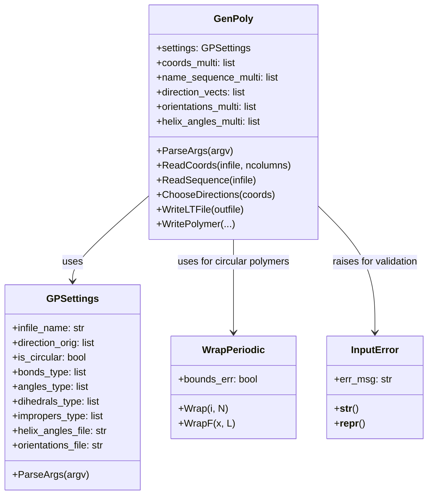
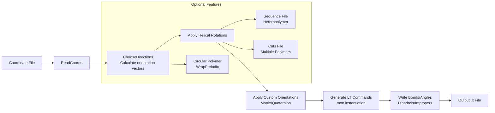
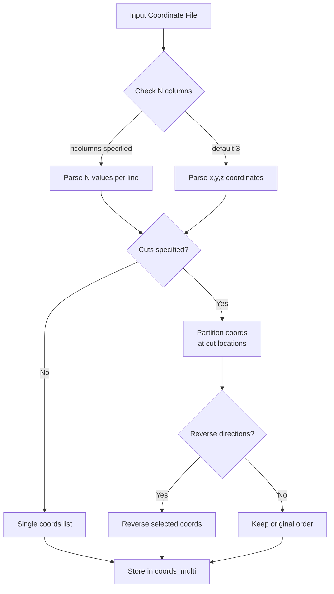

genpoly_lt.py is a sophisticated polymer generation tool that creates moltemplate (.lt) files for polymer molecules positioned along arbitrary 3D curves. This tool bridges geometric curve definition with molecular modeling, enabling advanced simulations of complex polymer conformations including DNA wrapping, protein folding, and confined polymer melts. The tool operates as both a command-line executable and a Python module, offering flexibility in workflow integration.

Sources: [genpoly_lt.py](moltemplate/genpoly_lt.py#L8-L30), [doc_genpoly_lt.md](doc/doc_genpoly_lt.md#L1-L30)

## Architecture Overview

The tool implements a layered architecture separating concerns between settings management, coordinate processing, and output generation. The core class structure enables modular polymer construction with support for multiple polymers, heteropolymers, and complex interaction topologies.



The data flow processes coordinate input through multiple transformation stages:



Sources: [genpoly_lt.py](moltemplate/genpoly_lt.py#L404-L448), [genpoly_lt.py](moltemplate/genpoly_lt.py#L646-L695), [genpoly_lt.py](moltemplate/genpoly_lt.py#L702-L768)

## Core Coordinate Processing

The coordinate reading subsystem handles multi-column ASCII text files with intelligent parsing for both single and multiple polymer scenarios. The `ReadCoords` method supports arbitrary column counts, enabling flexibility beyond the standard 3-column x,y,z format. When using the `-cuts` argument, coordinates are partitioned into multiple lists, each representing a distinct polymer within the same output file.



The direction calculation algorithm determines monomer orientation by analyzing local geometry. For interior monomers in linear polymers, the default direction points along the vector connecting neighbors (monomer i-1 to i+1). End monomers use the direction to their single neighbor. Circular polymers apply periodic boundary conditions via the `WrapPeriodic` class, which computes modular arithmetic while tracking boundary violations.

> [!TIP]
> For smooth curves, monomer orientation uses the tangent direction at each point. For coarse or zigzag coordinate data, consider pre-processing with `interpolate_curve.py` to generate smoother intermediate points before polymer construction.

Sources: [genpoly_lt.py](moltemplate/genpoly_lt.py#L524-L593), [genpoly_lt.py](moltemplate/genpoly_lt.py#L646-L695), [interpolate_curve.py](moltemplate/interpolate_curve.py#L250-L280)

## Monomer Orientation System

Monomer orientation follows a hierarchical transformation pipeline where later transformations accumulate on earlier ones. The system supports multiple orientation specification methods with clear precedence rules.

### Orientation Transformation Order

1. **Initial monomer orientation**: The monomer should be defined with its polymer axis aligned to the +X direction (1,0,0)
2. **Transformations from monomer name**: Commands embedded in the monomer name like `Monomer.scale(0.5,0.7,0.7)` or `CH3.rot(180,0,0,1)`
3. **Helical rotation**: Applied around the polymer axis specified by `-axis` (default: X-axis). Can be uniform (`-helix delta_phi`) or per-monomer (`-helix-angles file.txt`)
4. **Direction alignment**: Uses `rotvv()` to rotate from original axis direction to the local polymer tangent
5. **Custom orientation**: Optional rotation matrices or quaternions from `-orientations` or `-quaternions` files

The `WritePolymer` method generates moltemplate transformation commands using the `push()`/`pop()` stack for cumulative effects:

```python
# Transformation stack management
outfile.write("  push(rotvv(" +
              str(self.direction_vects[i - 1][0]) + "," +
              str(self.direction_vects[i - 1][1]) + "," +
              str(self.direction_vects[i - 1][2]) + "," +
              str(self.direction_vects[i][0]) + "," +
              str(self.direction_vects[i][1]) + "," +
              str(self.direction_vects[i][2]) + "))\n")
outfile.write("  push(move(" +
              str(coords[i][0]) + "," +
              str(coords[i][1]) + "," +
              str(coords[i][2]) + "))\n")
```

Sources: [genpoly_lt.py](moltemplate/genpoly_lt.py#L766-L920), [doc_genpoly_lt.md](doc/doc_genpoly_lt.md#L65-L95), [doc_genpoly_lt.md](doc/doc_genpoly_lt.md#L350-L400)

## Interaction Generation

### Bond Generation

The tool supports two bond specification modes controlled by whether a bond type is provided. When specifying `-bond btype a1 a2`, bonds are written to the "Data Bonds" section with explicit type assignment. Using `-bond a1 a2` omits the type, writing to "Data Bond List" which relies on force field lookup rules (useful with OPLSAA force field).

Bond connections use monomer index offsets, defaulting to (0,1) for connections between successive monomers. The `WrapPeriodic.Wrap` method handles circular polymer topology:

```python
I = i + self.settings.bonds_index_offsets[b][0]
J = i + self.settings.bonds_index_offsets[b][1]
I = WrapPeriodic.Wrap(I, N)
J = WrapPeriodic.Wrap(J, N)
if WrapPeriodic.bounds_err:
    WrapPeriodic.bounds_err = False
    if not self.settings.connect_ends:
        continue
```

### Angular Interactions

Angles, dihedrals, and impropers follow a similar pattern but require explicit monomer index specification. The arguments follow the pattern `-angle atype a1 a2 a3 i1 i2 i3` where indices (i1,i2,i3) indicate which monomer each atom belongs to, using relative offsets (0=current, 1=next, 2=following, etc.).

> [!TIP]
> When using force fields like OPLSAA that auto-generate interactions by atom type, manual angle/dihedral/improper specification is typically unnecessary. These arguments become valuable for custom force fields or when force field generation rules don't cover specific backbone patterns.

Sources: [genpoly_lt.py](moltemplate/genpoly_lt.py#L860-L999), [doc_genpoly_lt.md](doc/doc_genpoly_lt.md#L96-L150)

## Command-Line Interface Reference

| Argument | Purpose | Default | Notes |
|----------|---------|---------|-------|
| `-polymer-name pname` | Name of generated moltemplate object | Polymer | Creates object wrapper when specified |
| `-monomer-name mname` | Monomer type name | Monomer | Must be defined elsewhere, oriented along +X |
| `-sequence file.txt` | Heteropolymer monomer sequence | None | Required for end-caps and variable monomers |
| `-bond btype a1 a2` | Bond with explicit type | - | Write to "Data Bonds" |
| `-bond a1 a2` | Bond without type | - | Write to "Data Bond List", force field lookup |
| `-angle atype a1 a2 a3 i1 i2 i3` | Manual angle specification | - | Indices are monomer offsets |
| `-dihedral dtype a1 a2 a3 a4 i1 i2 i3 i4` | Manual dihedral | - | Typically unnecessary with force fields |
| `-improper itype a1 a2 a3 a4 i1 i2 i3 i4` | Manual improper | - | For specific chirality constraints |
| `-inherits ForceField` | Force field inheritance | None | Adds `inherits FORCE_FIELD` to object |
| `-header text` | Header insertion | None | Multiple uses insert multiple lines |
| `-helix deltaphi` | Uniform helical rotation (degrees) | 0 | Applied around polymer axis |
| `-helix-angles file.txt` | Per-monomer helical angles | None | One angle per line in degrees |
| `-orientations file.txt` | Rotation matrix file | None | 9 columns per monomer |
| `-quaternions file.txt` | Quaternion file | None | 4 columns per monomer |
| `-axis x,y,z` | Polymer axis in original monomer | 1,0,0 | Comma-separated, no spaces |
| `-circular keyword` | Circular polymer topology | no | Options: no, yes, connected |
| `-cuts file.txt` | Multiple polymer cut points | None | One index per line |
| `-polymer-directions file.txt` | Coordinate reading direction | None | 1 or -1 per polymer |
| `-dir-indices ia ib` | Direction calculation offsets | -1,1 | Override neighbor-based direction |
| `-padding x,y,z` | Box boundary padding | None | Comma-separated, no spaces |
| `-in coords.raw` | Input coordinate file | stdin | Alternative to standard input |

Sources: [genpoly_lt.py](moltemplate/genpoly_lt.py#L34-L63), [doc_genpoly_lt.md](doc/doc_genpoly_lt.md#L34-L380)

## Heteropolymer and End-Cap Construction

The `-sequence` argument enables sophisticated polymer architectures beyond simple homopolymers. The sequence file contains one monomer name per line, matching the total number of coordinate points across all polymers. Each line can include transformation commands as part of the monomer name.

**Example butane sequence:**
```
CH3
CH2
CH2
CH3.rot(180,0,0,1)
```

The final CH3 monomer includes a 180-degree rotation around the Z-axis, reversing its orientation relative to the polymer backbone. This pattern is essential for creating proper end-caps where the terminal monomer points opposite to the chain direction.

When combined with `-cuts` for multiple polymers, the sequence file must include appropriate end-caps at the boundaries between polymers. For example, with cuts at indices 10 and 20, the sequence would need end-caps at positions 9-10 and 19-20 to properly terminate each polymer segment.

Sources: [doc_genpoly_lt.md](doc/doc_genpoly_lt.md#L65-L95)

## Circular Polymer Topology

Circular polymers are supported through three distinct modes controlled by the `-circular` argument:

| Mode | Description | Use Case |
|------|-------------|----------|
| `no` | Linear chain with disconnected ends | Default for most polymers |
| `yes` | Closed loop with end orientation adjustment | True circular polymers like plasmids |
| `connected` | Ends bonded without orientation adjustment | Infinite polymers with periodic boundary conditions |

The `connected` mode creates bonds between the first and last monomers but maintains their original orientations, making it suitable for simulations using periodic boundary conditions where the polymer extends infinitely across box boundaries. In contrast, `yes` mode adjusts the first and last monomer orientations to point toward each other, creating a closed loop geometry.

Circular topology is handled through the `WrapPeriodic.Wrap` method, which performs modular arithmetic while tracking boundary violations. The `bounds_err` flag indicates when index wrapping occurred, enabling conditional interaction generation for circular polymers.

Sources: [genpoly_lt.py](moltemplate/genpoly_lt.py#L383-L397), [doc_genpoly_lt.md](doc/doc_genpoly_lt.md#L320-L345)

## Python API Integration

While designed as a command-line tool, genpoly_lt.py exposes a Python API enabling programmatic polymer generation. The `GenPoly` class can be instantiated and configured directly, offering an alternative workflow that avoids file I/O for coordinate data.

**Basic usage pattern:**

```python
import moltemplate

# Create GenPoly instance
gp = moltemplate.genpoly_lt.GenPoly()

# Set coordinates directly (list of [x,y,z] arrays)
gp.coords_multi = [x_new]  # Single polymer case

# Specify monomer sequence
gp.name_sequence_multi = [['AT', 'CG', 'GC', 'TA', ...]]

# Configure via argument parsing
gp.ParseArgs(['-helix', '34.2857',
              '-bond', 'Backbone', 'f', 'f',
              '-polymer-name', 'DNA_snippet',
              '-inherits', 'OXDNA2',
              '-header', 'import oxdna2.lt'])

# Generate output to file or stdout
import sys
gp.WriteLTFile(sys.stdout)
```

The Python API enables integration with coordinate generation tools like `interpolate_curve.py`, which can resample and smooth curves before polymer construction:

```python
# Generate smooth curve from coarse points
x_new = moltemplate.interpolate_curve.ResampleCurve(x_orig, 21, 0.5)

# Scale to appropriate monomer spacing
import math
x_new *= 0.332 / ((math.sqrt(1+0.5**2)*len(x_orig)) / (len(x_new)-1))
```

Sources: [test_genpoly_lt.py](tests/test_genpoly_lt.py#L1-L45), [doc_genpoly_lt.md](doc/doc_genpoly_lt.md#L430-L541)

## Practical Examples

### Simple Homopolymer

Create a basic linear polymer with backbone bonds between `c2` atom of each monomer and `c1` atom of the next:

```bash
genpoly_lt.py -bond Backbone c2 c1 < crds.raw > poly.lt
```

### Circular DNA with Helical Twist

Generate a double-stranded DNA plasmid where each monomer represents a base pair, with helical rotation and two bonds per connection:

```bash
genpoly_lt.py -circular yes -helix 34.2857 \
              -header 'import "basepair.lt"' \
              -monomer-name "BasePair" \
              -polymer-name "Plasmid" \
              -bond Backbone O3p_a P_a \
              -bond Backbone P_b O3p_b \
              < dna_basepair_CM_coords.raw \
              > chromosome.lt
```

### Confined Viral DNA

The viral DNA example demonstrates the complete workflow including coordinate generation, curve interpolation, and polymer construction within a capsid:

```bash
# Step 1: Generate lattice polymer with ndmansfield
NMONOMERS=3058; B=0.996; Nx=11; Ny=11; Nz=11
./ndmansfield -box $Nx $Ny $Nz -seed 0 -tstart 1 -tsave 1000000 \
             -tstop 1000000 > curve_lattice.txt

# Step 2: Interpolate and rescale
SCALE=$(echo "($NMONOMERS*$B)/($Nx*$Ny*$Nz-1)" | bc -l)
interpolate_curve.py $NMONOMERS $SCALE < curve_lattice.txt > curve_smooth.txt

# Step 3: Generate polymer LT file
genpoly_lt.py -helix 102.7797 \
              -polymer-name 'DNAPolymer' \
              -monomer-name 'DNAMonomer' \
              -inherits 'DNAForceField' \
              -header 'import "dna_monomer.lt"' \
              -bond Backbone a a \
              -bond Backbone b b \
              -dihedral MajorGroove b b a a 0 1 1 2 \
              -dihedral Torsion a a b b 1 0 0 1 \
              -padding 20,20,20 \
              < curve_smooth.txt > dna_polymer.lt

# Step 4: Run moltemplate
moltemplate.sh system.lt
```

Sources: [README.md](examples/coarse_grained/DNA_models/dsDNA_only/2strands/3bp_2particles/confined_viral_DNA/README.md#L1-L60)


Sources: [doc_genpoly_lt.md](doc/doc_genpoly_lt.md#L1-L10)

## Box Boundary Calculation

When using the `-padding` argument, the tool automatically calculates simulation box boundaries encompassing all coordinates with user-specified margins. The `CalcBoxBoundaries` method iterates through all coordinate sets to determine minimum and maximum values in each dimension, then `WriteBoxBoundaries` generates the appropriate moltemplate box specification.

This feature is particularly useful for confined simulations where the box must precisely enclose the polymer geometry without excessive empty space.

Sources: [genpoly_lt.py](moltemplate/genpoly_lt.py#L1031-L1060), [doc_genpoly_lt.md](doc/doc_genpoly_lt.md#L345-L360)

## Error Handling and Validation

The tool employs a custom `InputError` exception class for consistent error reporting. Input validation includes:

- Coordinate files must contain at least 2 positions
- Cut file entries must be in increasing order within valid range (1 to N-1)
- No duplicate entries allowed in cut files
- Polymer direction entries must be "+1" or "-1"
- Angular interaction indices must be non-negative

The validation occurs during argument parsing and file reading, providing immediate feedback on configuration errors before attempting polymer generation.

Sources: [genpoly_lt.py](moltemplate/genpoly_lt.py#L65-L79), [genpoly_lt.py](moltemplate/genpoly_lt.py#L530-L545)

## Integration with Force Fields

The `-inherits` argument connects generated polymers to force field definitions that automatically generate angle, dihedral, and improper interactions based on atom type matching. Common integration patterns:

```bash
# OPLSAA force field
genpoly_lt.py -inherits OPLSAA \
              -header 'import "oplsaa.lt"' \
              -bond Backbone c2 c1 \
              < coords.raw > polymer.lt

# Custom force field
genpoly_lt.py -inherits MyForceField \
              -header 'import "custom_forcefield.lt"' \
              < coords.raw > polymer.lt
```

Force field inheritance enables automatic interaction generation, eliminating the need for manual `-angle`, `-dihedral`, and `-improper` specifications in most cases.

Sources: [doc_genpoly_lt.md](doc/doc_genpoly_lt.md#L155-L175)

## Advanced Usage Patterns

### Polymer Melts

Generate multiple independent polymers of varying lengths using the `-cuts` argument:

```bash
# Create cuts at positions 20, 45, 70
echo -e "20\n45\n70" > cuts.txt

# Run with cuts specification
genpoly_lt.py -cuts cuts.txt \
              -sequence sequence_with_endcaps.txt \
              < coords.raw > polymers.lt
```

The output contains nested object definitions, with each polymer instantiated automatically when the parent object is instantiated.

### Reverse Polymer Directions

Use `-polymer-directions` to control coordinate reading order for each polymer:

```bash
echo -e "1\n-1\n1" > directions.txt
genpoly_lt.py -cuts cuts.txt \
              -polymer-directions directions.txt \
              < coords.raw > polymers.lt
```

This feature enables specialized topological arrangements without modifying coordinate files.

Sources: [doc_genpoly_lt.md](doc/doc_genpoly_lt.md#L175-L250), [doc_genpoly_lt.md](doc/doc_genpoly_lt.md#L300-L320)

## Next Steps

- **For molecular template syntax fundamentals**: Continue to [Moltemplate LT File Syntax](6-moltemplate-lt-file-syntax)
- **For coordinate transformation details**: Review [Affine Transformation Matrices](30-affine-transformation-matrices)
- **For interaction generation patterns**: See [N-Body Interaction Graph Search](18-n-body-interaction-graph-search)
- **For force field integration**: Explore [OPLSAA Force Field Integration](20-oplsaa-force-field-integration)
- **For advanced polymer modification**: Reference [genpoly_modify_lt.py](doc/doc_genpoly_modify_lt.md) for post-generation modifications
