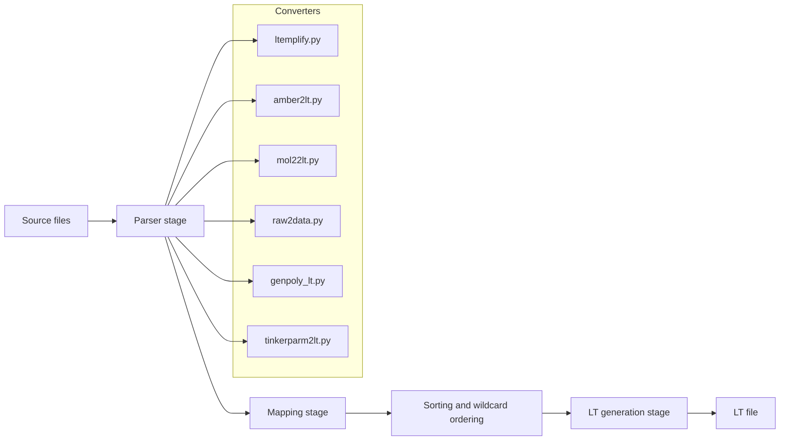

Moltemplate provides a suite of converter tools and libraries to transform external molecular simulation files and formats into moltemplate .lt files. These converters streamline workflows by ingesting AMBER, LAMMPS, MOL2, and other sources and producing reusable LT definitions that can be assembled with moltemplate. This page covers built-in converters, their programmatic APIs, practical options, and patterns for building custom converters without prescribing an opinionated developer workflow.

## Converter architecture overview

The converter ecosystem follows a common multi-stage pattern:
- Input ingestion and parsing into domain-specific structures
- Mapping of source concepts (atom types, bonds, angles, dihedrals, impropers, masses, nonbonded pairs) into LT constructs
- Sorting and wildcard handling to enable correct moltemplate precedence (more generic wildcarded rules first, then specific ones)
- Output generation in moltemplate .lt syntax



> [!TIP]
> Sort order matters for wildcards in LT "By Type" sections: generic wildcard rules should precede specific ones so moltemplate can override the generic rules when specific interactions are encountered later. amber2lt.py implements this via SortLines (see moltemplate/amber2lt.py#L189-L220).

## Built-in converters

| Converter | Primary input(s) | Main output | Purpose | Status |
|-----------|------------------|-------------|---------|--------|
| ltemplify.py | LAMMPS data + optional input scripts | .lt | Extract portions (atoms, bonds, angles, dihedrals, impropers, masses, some fixes) from LAMMPS runs into reusable LT templates | Stable (v0.69.0, 2021-8-30) |
| amber2lt.py | AMBER .frcmod / .dat | .lt | Convert AMBER force field definitions (masses, bonds, angles, dihedrals, impropers, pairs) into LT format with wildcards sorted appropriately | Experimental (v0.2.1, 2022-9-09) |
| mol22lt.py | MOL2 coordinates | .lt | Convert Tripos MOL2 geometry and connectivity into LT; can optionally read an external charge file | Experimental (v0.2.1, 2022-8-21) |
| raw2data.py | LAMMPS dump + reference .data | new .data | Update a LAMMPS data file from a dump file snapshot (supports various atom styles) | v0.44.2 (2022-1-06) |
| genpoly_lt.py | 3-column coordinate list (.raw) + optional sequence file | .lt | Generate a polymer LT definition with oriented monomers, automatic inter-monomer bonding and optional helical pitch | Specialized polymer tool |
| dump2data.py | LAMMPS dump + reference .data | new .data | Core snapshot-to-data file extraction used by raw2data; offers options for atom_style, timesteps, column handling | v0.62.0 (2022-1-06) |
| tinkerparm2lt.py | TINKER .prm | .lt | Convert TINKER parameter files to LT (source: moltemplate/force_fields/convert_TINKER_files_to_LT_files/tinkerparm2lt.py) | Present in repo |

Sources: [ltemplify.py](moltemplate/ltemplify.py#L8-L25), [amber2lt.py](moltemplate/amber2lt.py#L7-L12), [mol22lt.py](moltemplate/mol22lt.py#L76-L87), [raw2data.py](moltemplate/raw2data.py#L1-L23), [genpoly_lt.py](moltemplate/genpoly_lt.py#L8-L30), [dump2data.py](moltemplate/dump2data.py#L8-L22), [tinkerparm2lt.py location](moltemplate/force_fields/convert_TINKER_files_to_LT_files/tinkerparm2lt.py)

## ltemplify.py: LAMMPS to LT conversion

### Core concepts
ltemplify.py parses LAMMPS data files and optional input scripts, then writes a .lt file that captures selected atoms, topology, parameters, styles, groups, and selected fixes (e.g., fix rigid, fix shake/rattle). By default, if no selection is provided, it copies all atoms. Typically you use -mol, -id, or -type to select a subset to create reusable molecule templates.

The converter processes in three passes:
- Pass1: determine atom_style and infer atom type names (from comments or mapping)
- Pass2: parse Atoms, Bonds, Angles, Dihedrals, Impropers, Masses
- PostProcess: infer custom names, discard unneeded interactions, write LT

Sources: [ltemplify.py](moltemplate/ltemplify.py#L960-L981), [doc_ltemplify.md](doc/doc_ltemplify.md#L5-L20), [ltemplify.py class and passes](moltemplate/ltemplify.py#L383-L981)

### Key CLI options

| Option | Purpose |
|--------|---------|
| -name NAME | Object name used in LT for the molecule or selection |
| -atomstyle STYLE | LAMMPS atom style (if not inferred from comment after Atoms header) |
| -columns LIST | Explicit column names for Atoms section (alternative to -atomstyle) |
| -mol LIST | Select by molecule-ID(s) |
| -id LIST | Select by atom-ID(s) |
| -type LIST | Select by atom type(s) |
| -datacoeffs | Put force field info in the data file instead of the input script |
| -ignore-coeffs | Skip all force field coefficients |
| -ignore-angles | Skip angles, dihedrals, impropers |
| -ignore-bond-types | Omit bond type numbers; produce Bond List without types |
| -ignore-masses | Skip masses |
| -prepend-atom-type STR | Prepend a string to all atom type names |
| -preamble STR | Add string(s) at the top of the generated LT file (e.g., import directives) |
| -infer-comments | Infer type names from data file comments (default) |
| -ignore-comments | Do not use comments to infer names |
| -atom-type-map FILE | Map atom type integers to names via a two-column file (takes precedence over comments) |

Sources: [doc_ltemplify.md](doc/doc_ltemplify.md#L66-L90)

### Basic usage example

To create a reusable LT template for a single molecule (MolID) from existing LAMMPS files:

```bash
ltemplify.py -name MolName -mol MolID INPUT_SCRIPT.in DATA_FILE.data > molname.lt
```

Sources: [doc_ltemplify.md](doc/doc_ltemplify.md#L37-L39), [doc_ltemplify.md examples](doc/doc_ltemplify.md#L315-L402)

### Python API

Programmatic use via the Ltemplify class and Convert method:

```python
from moltemplate.ltemplify import Ltemplify
lt = Ltemplify(['-name', 'MolName', '-mol', 'MolID'])
with open('molname.lt', 'w') as out:
    lt.Convert(out,
               input_data_file='system.data',
               input_script_files=['system.in'])
```

Sources: [ltemplify.py](moltemplate/ltemplify.py#L849-L900), [doc_ltemplify.md Python API section](doc/doc_ltemplify.md#L509-L552)

### Known limitations

- Exotic LAMMPS styles/fixes may not be supported
- Wildcard character ("*") expansion has limitations
- Some specialized fixes may require manual adjustment

Sources: [doc_ltemplify.md](doc/doc_ltemplify.md#L466-L508)

## amber2lt.py: AMBER force field to LT conversion

### Core concepts
amber2lt.py converts AMBER force field files (e.g., gaff.dat, .frcmod) into LT definitions for masses, bonds, angles, dihedrals, impropers, and nonbonded pair interactions. It supports wildcards (X) and sorts rules so that generic wildcarded interactions precede specific ones, allowing moltemplate to override correctly. Each parameter section can be supplied separately via optional arguments if splitting files.

Sources: [amber2lt.py](moltemplate/amber2lt.py#L7-L12), [doc_amber2lt.md](doc/doc_amber2lt.md#L1-L10)

### Key CLI options

| Option | Purpose |
|--------|---------|
| --in FILE | AMBER .frcmod or .dat to convert |
| --out FILE | LT output file |
| --name NAME | Object (force field) name in LT |
| --mass FILE | Mass-only excerpt file |
| --bond FILE | Bond excerpt file |
| --angle FILE | Angle excerpt file |
| --dihedral FILE | Dihedral excerpt file |
| --improper FILE | Improper excerpt file |
| --pair FILE | Nonbonded pair excerpt file |

Sources: [doc_amber2lt.md](doc/doc_amber2lt.md#L91-L134), [amber2lt.py main](moltemplate/amber2lt.py#L800-L850)

### Basic usage example

```bash
amber2lt.py --in gaff.dat --out gaff.lt --name GAFF
```

Include in a molecule LT file as needed:

```text
import "gaff.lt"
Benzene inherits GAFF { ... }
```

Sources: [doc_amber2lt.md](doc/doc_amber2lt.md#L10-L49)

### Wildcard handling

AMBER wildcards (X) are sorted to appear before specific types via SortLines, ensuring that moltemplate processes generic rules first and overrides them with more specific rules encountered later. This order is required for correct parameter precedence.

Sources: [amber2lt.py](moltemplate/amber2lt.py#L189-L220)

## mol22lt.py: MOL2 geometry to LT conversion

### Core concepts
mol22lt.py reads Tripos MOL2 files, extracting ATOM and BOND sections and optionally reading external charges, then writes an LT file with atom definitions, coordinates, charges, and bonds. It can output a named object (object_name) to unify molecule-IDs. Support for multiple chains exists, but there are specific caveats.

Sources: [mol22lt.py](moltemplate/mol22lt.py#L76-L87), [doc_mol22lt.md](doc/doc_mol22lt.md#L1-L10)

### Key CLI options

| Option | Purpose |
|--------|---------|
| --in FILE.mol2 | Input MOL2 file |
| --out FILE.lt | Output LT file |
| --charges FILE.txt | External charges file |
| --name NAME | Object name in LT (if provided, merges all atoms into one molecule) |
| --ff FORCE_FIELD | Force field to use |
| --ff-file FILE | Force field file |
| --upper-case-types | Convert atom types to upper case |
| --lower-case-types | Convert atom types to lower case |
| --upper-case-names | Convert atom names to upper case |
| --lower-case-names | Convert atom names to lower case |

Sources: [doc_mol22lt.md](doc/doc_mol22lt.md#L172-L272)

### Basic usage example

```bash
mol22lt.py --in system.mol2 --out system.lt --name System
```

If charges are supplied separately:

```bash
mol22lt.py --in system.mol2 --out system.lt --charges charges.txt
```

Sources: [doc_mol22lt.md](doc/doc_mol22lt.md#L10-L67)

### Caveats

- Multi-chain support has limitations and is not fully robust; users should test output carefully

Sources: [doc_mol22lt.md](doc/doc_mol22lt.md#L60-L67), [doc_mol22lt.md](doc/doc_mol22lt.md#L272-L305)

## raw2data.py and dump2data.py: Dump snapshot to LAMMPS data

### Core concepts
raw2data.py extracts the last snapshot (or a specified timestep) from a LAMMPS dump file and updates a reference data file. It supports multiple atom styles and can optionally sort by atom ID (-sort). dump2data.py provides the underlying snapshot parsing capabilities used by raw2data.py.

Sources: [raw2data.py](moltemplate/raw2data.py#L1-L23), [dump2data.py](moltemplate/dump2data.py#L8-L22)

### Basic usage example

```bash
dump2data.py reference.data < trajectory.dump > updated.data
```

To select a specific timestep:

```bash
dump2data.py -t 1000 reference.data < trajectory.dump > updated.data
```

Sources: [dump2data.py](moltemplate/dump2data.py#L15-L21)

### Options

- -t STEP: select snapshot by timestep
- -atomstyle STYLE: specify atom style (e.g., full, hybrid bond ellipsoid)
- -ignore-atom-id: treat atom ID as not required (via raw2data)
- -sort: sort data file by atom ID (via raw2data)

Sources: [dump2data.py](moltemplate/dump2data.py#L19-L21), [raw2data.py main options](moltemplate/raw2data.py#L23-L50)

## genpoly_lt.py: Polymer building from coordinates

### Core concepts
genpoly_lt.py generates an LT file defining a polymer from a 3-column coordinate file and an optional monomer sequence file. It orients monomers along neighbor directions, creates inter-monomer bonds/angles/dihedrals, and can apply helical pitch. Multiple polymer cuts are supported via -cuts.

Sources: [genpoly_lt.py](moltemplate/genpoly_lt.py#L8-L30)

### Basic usage example

```bash
genpoly_lt.py -polymer-name Poly -monomer-name Mon -coords coords.raw -seq sequence.txt -bond-ids 1 2
```

Sources: [genpoly_lt.py usage comment](moltemplate/genpoly_lt.py#L34-L64)

## tinkerparm2lt.py: TINKER parameter conversion

tinkerparm2lt.py converts TINKER .prm files into LT definitions. It resides in moltemplate/force_fields/convert_TINKER_files_to_LT_files/.

Sources: [tinkerparm2lt.py location](moltemplate/force_fields/convert_TINKER_files_to_LT_files/tinkerparm2lt.py)

## Patterns for writing custom converters

If you need to support additional formats, adopt the following patterns from existing converters:

- Use argparse for CLI and define a main() function that reads input streams (file or stdin) and writes to output streams (file or stdout)
- Parse the source format into domain collections: masses, bonds, angles, dihedrals, impropers, nonbonded pairs, atom definitions, and coordinates
- Sort interaction rules such that generic wildcard rules precede specific ones to respect moltemplate precedence (see amber2lt.SortLines)
- Map source identifiers to LT atomtype names and optional bonded interaction type names
- Emit LT syntax sections: atomtype definitions, mass definitions, By Type rules for interactions (e.g., write "bond_coeffs", "angle_coeffs" sections with appropriate type names and parameters)
- Implement error handling with a custom InputError class
- Include a Python API function that takes input streams and output streams, separate from the CLI main, to enable programmatic use (see Convert in ltemplify, ConvertAmber2Lt in amber2lt, ConvertMol22Lt in mol22lt)

Sources: [ltemplify.py Convert](moltemplate/ltemplify.py#L849-L900), [amber2lt.py ConvertAmber2Lt](moltemplate/amber2lt.py#L767-L783), [mol22lt.py ConvertMol22Lt](moltemplate/mol22lt.py#L76-L87)

## Worked examples

See examples/file_conversion_examples for concrete usage workflows and expected files:

- convert_LAMMPS_to_LT_examples/cnad-cnt: Demonstrates using ltemplify.py to extract molecules from LAMMPS files and then using moltemplate to reassemble a new system
- read_PDB_file_examples/waterSPCE_from_PDBfile: Example of reading coordinates (may be combined with mol22lt or other converters)

Sources: [cnad-cnt README](examples/file_conversion_examples/convert_LAMMPS_to_LT_examples/cnad-cnt/README.md), [repository structure](examples/file_conversion_examples)

## Related documentation

- [LAMMPS Data File Format](12-lammps-data-file-format) for understanding the source/target formats for ltemplify.py and dump2data.py
- [Moltemplate LT File Syntax](6-moltemplate-lt-file-syntax) for reference on LT file structure
- [Force Field Conversion Tools](24-force-field-conversion-tools) for broader force field interoperability patterns