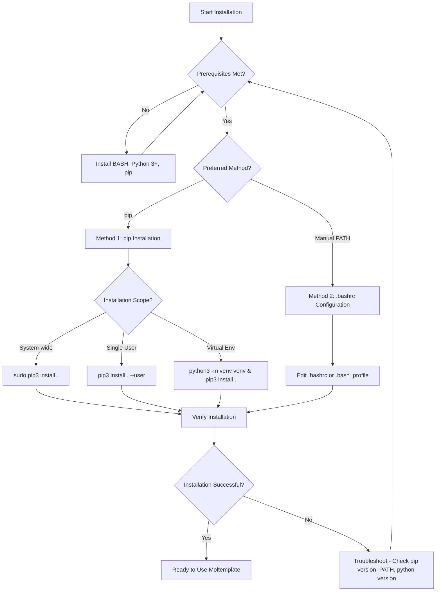

This guide provides comprehensive instructions for installing moltemplate on your system. Moltemplate is a cross-platform molecule builder for LAMMPS that requires specific prerequisites and offers multiple installation approaches suited to different environments and user preferences.


## Prerequisites

Before installing moltemplate, ensure your system has the following essential components:

- **Python 3.4+**: Required for running moltemplate's Python-based components
- **BASH shell**: Necessary for executing moltemplate's shell scripts
- **pip or pip3**: Python package manager for installation
- **numpy**: Mathematical library automatically installed as a dependency

These prerequisites must be installed regardless of your chosen installation method or operating system.

Sources: [INSTALL.md](/INSTALL.md#L1-L10), [setup.py](/setup.py#L60-L62), [README.md](/README.md#L1-L10)

## Installation Workflow

The installation process follows a decision tree based on your environment and preferences. Understanding this flow helps you choose the optimal method for your situation.



## Downloading Moltemplate

Before installation, you must obtain moltemplate from the official repository. Two methods are available:

### Method A: Using Git (Recommended)

```bash
git clone https://github.com/jewettaij/moltemplate DESTINATION_DIRECTORY
```

This method provides the full version history and easy updates through git commands.

### Method B: Manual Download

If git is not available:
1. Visit the [moltemplate GitHub repository](https://github.com/jewettaij/moltemplate)
2. Click the green "Code" button in the upper-right corner
3. Select "Download ZIP" from the menu
4. Unpack the downloaded file to your desired location

Sources: [INSTALL.md](/INSTALL.md#L1-L15)

## Installation Method 1: Using pip

The pip method is recommended for most users as it handles dependencies automatically and provides easy uninstallation. This method is **required** if you use software like "vipster", "cellpack2moltemplate", or other programs that import moltemplate as a Python module.

### Standard Installation

Navigate to the moltemplate directory and install:

```bash
cd DESTINATION_DIRECTORY
pip3 install .
```

If the command fails, try alternatives:

```bash
# Try pip instead of pip3
pip install .

# Install for current user only
pip3 install . --user

# Install system-wide (requires sudo)
sudo pip3 install .
```

### Uninstallation

To remove moltemplate when installed via pip:

```bash
pip3 uninstall moltemplate
```

Add `sudo` prefix if you used it during installation.

> [!TIP]
> Choose the pip command (pip or pip3) that corresponds to the Python version moltemplate will use. Verify compatibility by checking which python and pip share the same path using `which python3` and `which pip3`.

Sources: [INSTALL.md](/INSTALL.md#L16-L45), [setup.py](/setup.py#L1-L25)

### Optional: Virtual Environment Installation

For isolated development environments, use Python virtual environments:

```bash
cd ~/moltemplate
python3 -m venv venv  # or "virtualenv venv" if that fails
source venv/bin/activate
pip3 install .
```

Remember to activate the environment before use:
```bash
source ~/moltemplate/venv/bin/activate
```

Virtual environments provide clean uninstallation by simply deleting the venv directory and avoid permission issues without requiring sudo.

Sources: [INSTALL.md](/INSTALL.md#L90-L110)

## Installation Method 2: Manual PATH Configuration

This method manually configures your shell's PATH environment variable. **Note**: Do not use this method if other software depends on moltemplate as a Python module.

### BASH Shell Configuration

Add these lines to your `~/.bashrc` file (or `~/.profile` or `~/.bash_profile`):

```bash
export PATH="$PATH:$HOME/moltemplate/moltemplate"
export PATH="$PATH:$HOME/moltemplate/moltemplate/scripts"
```

### TCSH Shell Configuration

Add these lines to your `~/.cshrc`, `~/.tcshrc`, or `~/.login` file:

```bash
setenv PATH "$PATH:$HOME/moltemplate/moltemplate"
setenv PATH "$PATH:$HOME/moltemplate/moltemplate/scripts"
```

After making changes, open a new terminal for changes to take effect.

Sources: [INSTALL.md](/INSTALL.md#L112-L140)

> [!TIP]
> Warning: Manual PATH installation prevents other programs from importing moltemplate as a Python module. Use pip installation if you need Python import functionality or use moltemplate-dependent software.

## Installation Methods Comparison

| Feature | Method 1: pip | Method 2: Manual PATH |
|---------|---------------|----------------------|
| **Dependency Management** | Automatic (includes numpy) | Manual |
| **Uninstallation** | Clean (pip uninstall) | Manual file removal |
| **Python Module Import** | ✅ Supported | ❌ Not supported |
| **Shell Script Access** | ✅ Automatic | ✅ Manual configuration |
| **Permission Handling** | User/system/virtual env options | Requires PATH editing |
| **Ideal For** | Most users, Python integrations | Isolated environments, no pip access |

Sources: [INSTALL.md](/INSTALL.md#L16-L140), [setup.py](/setup.py#L88-L91)

## Operating System Specific Instructions

### Linux

Most Linux distributions include BASH and Python, but pip may need installation:

```bash
# Check for pip3
pip3

# Install pip3 if missing (Ubuntu example)
sudo apt install python3-pip

# Alternative: Install Anaconda for complete package management
```

**Recommended**: Anaconda Python includes pip, numpy, and automatic PATH configuration.

Sources: [INSTALL.md](/INSTALL.md#L200-L213)

### macOS

BASH and Python prerequisites can be installed via:

- **Homebrew**: Standard package manager approach
- **Xcode**: Apple's developer tools (includes Python)
- **Anaconda**: Recommended for reliability and completeness

Note that modern macOS may default to zsh shell; you may need to switch to BASH or adapt commands accordingly.

Sources: [INSTALL.md](/INSTALL.md#L216-L222)

### Windows

Windows requires a Unix-like environment for moltemplate:

#### Recommended Environments:

1. **Windows Subsystem for Linux (WSL2)**: Preferred method, provides native Linux environment
2. **VirtualBox + Linux Distribution**: Complete virtualization with lightweight desktop (e.g., Xubuntu)

#### Alternative Environments:
- Hyper-V
- CYGWIN (older Windows versions)

#### Text Editors Required:
Windows text editors like Word, WordPad, and Notepad **will not work**. Install Unix-compatible editors:
- **Graphical**: Atom, Sublime, Notepad++, VSCode
- **Terminal-based**: vim, emacs, nano, ne, jove

> [!TIP]
> When using WSL/WSL2, avoid editing Linux files with Windows applications to prevent file corruption. Use text editors installed within the WSL environment.

Sources: [INSTALL.md](/INSTALL.md#L225-L262)

## Verification and Testing

After installation, verify moltemplate is correctly installed:

```bash
# Check moltemplate command is available
moltemplate.sh -help

# Check Python module import (pip installation only)
python3 -c "import moltemplate; print(moltemplate.__version__)"
```

Run the included test suite to validate functionality:

```bash
# Navigate to tests directory
cd moltemplate/tests

# Run specific tests
./test_oplsaa.sh
./test_compass.sh
./test_genpoly_lt.py
```

Sources: [tests/](/tests/), [setup.py](/setup.py#L55-L56)

## Troubleshooting Common Issues

### "command not found" for pip or pip3

**Symptoms**: Installation commands fail with command not found

**Solutions**:
1. Try alternative command (pip vs pip3)
2. Verify Python installation: `which python3` or `which python`
3. Check Python version: `python --version` (must be 3.4+)
4. Install pip via package manager (e.g., `sudo apt install python3-pip`)
5. Install Anaconda for complete Python environment

### Multiple Python/pip Versions

**Symptoms**: Confusion about which pip corresponds to which Python

**Diagnosis**:
```bash
which python3
which pip3
```

**Solution**: Use the pip command that shares the same directory path as your Python installation. If paths differ, they refer to different Python versions.

### Python 2.x Detected

**Symptoms**: `python --version` returns version 2.7.x or lower

**Solution**: Upgrade to Python 3.x. Python versions below 3 are no longer supported by pip and will cease working. Anaconda provides the latest stable Python with simple installation.

Sources: [INSTALL.md](/INSTALL.md#L46-L90)

## Package Structure Overview

After installation, moltemplate provides the following components:


**Installed Components**:
- **Shell Scripts**: moltemplate.sh, cleanup_moltemplate.sh, molc.sh, emoltemplate.sh
- **Python Modules**: Core functionality in moltemplate/ directory
- **Force Field Libraries**: Pre-built force fields in moltemplate/force_fields/
- **Converter Utilities**: mol22lt.py, amber2lt.py, ltemplify.py, genpoly_lt.py
- **Post-processing Tools**: dump2data.py, raw2data.py, extract_lammps_data.py

Sources: [setup.py](/setup.py#L9-L40), [README.md](/README.md#L40-L45)

## Next Steps

After successful installation, proceed to:

- **[System Requirements](4-system-requirements)**: Verify your system meets LAMMPS and computational requirements
- **[Your First Moltemplate Simulation](5-your-first-moltemplate-simulation)**: Learn through hands-on tutorial
- **[Quick Start](2-quick-start)**: Get familiar with basic concepts and workflow

For comprehensive understanding of moltemplate's capabilities, explore the [Overview](1-overview) page to understand the project architecture and use cases.
