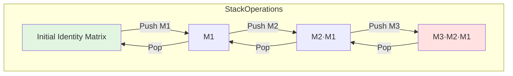

Moltemplate's affine transformation system provides a powerful framework for manipulating molecular coordinates through rotations, translations, and complex transformations. This system enables precise positioning and orientation of molecules in 3D space, essential for building complex molecular assemblies and coarse-grained models. The implementation follows a matrix stack architecture inspired by OpenGL's transformation pipeline, using **3×4 homogeneous matrices** that combine linear transformations with translations.

## Matrix Representation and Mathematical Foundation

Moltemplate uses **3×4 affine transformation matrices** to represent transformations in 3D space. This compact representation combines rotation and translation into a single matrix operation, where the first three columns encode rotation/scaling and the final column stores translational offsets. The mathematical formulation applies transformations as `x' = M[0][0]*x + M[0][1]*y + M[0][2]*z + M[0][3]`, treating coordinates as column vectors multiplied from the left [ttree_matrix_stack.py](moltemplate/ttree_matrix_stack.py#L75-L82).

The affine transformation operation multiplies a 3D vector by the first three columns of the matrix and adds the translation from the fourth column, implementing the classic affine map `x' = Ax + b` where `A` is the linear transformation and `b` is the translation vector. This representation is mathematically equivalent to 4×4 homogeneous coordinates but optimized for Moltemplate's needs since perspective transformations aren't required for molecular coordinate manipulation [ttree_matrix_stack.py](moltemplate/ttree_matrix_stack.py#L129-L147).

### Core Transformation Operations

The `AffineTransform()` function applies the complete affine transformation to a vector, performing matrix-vector multiplication followed by translation. This is the fundamental primitive that all higher-level transformation commands ultimately invoke [ttree_matrix_stack.py](moltemplate/ttree_matrix_stack.py#L75-L82). The `AffineCompose()` function combines two transformation matrices, creating a new transformation that applies `M1` first, then `M2`, which is essential for building complex multi-step transformations [ttree_matrix_stack.py](moltemplate/ttree_matrix_stack.py#L93-L122).

> [!TIP]
> The matrix composition order matters significantly: `AffineCompose(Mtmp, M2, M1)` applies M1 first, then M2. This matches the right-to-left matrix multiplication convention in linear algebra.

## AffineStack Architecture

The `AffineStack` class implements a **stack-based transformation system** that tracks cumulative transformations through a hierarchy of pushes and pops. Each push operation stores the current matrix state and composes it with a new transformation, while pops restore previous states. This design mirrors OpenGL's matrix stack and enables hierarchical transformation contexts essential for complex molecular assemblies [ttree_matrix_stack.py](moltemplate/ttree_matrix_stack.py#L129-L154).



The stack maintains a `deque` of matrix states and three working matrices: `self.M` (current transformation), `self._tmp` (temporary buffer), and implicitly the identity matrix for initialization. The `PushRight()` and `PushLeft()` methods compose transformations on different sides of the current matrix, though in practice both use identical push/pop semantics since Moltemplate requires reverse-order popping for correctness with non-invertible matrices [ttree_matrix_stack.py](moltemplate/ttree_matrix_stack.py#L163-L211).

### Multi-Affine Stacks

The `MultiAffineStack` class extends the basic stack to support **multiple independent transformation contexts** simultaneously. This advanced feature enables scenarios where different parts of a molecular system require distinct transformation hierarchies, such as rotating subdomains around different pivot points [ttree_matrix_stack.py](moltemplate/ttree_matrix_stack.py#L713-L730). The `_Update()` method synchronizes all active stacks to maintain consistency when transformations are applied to specific stacks [ttree_matrix_stack.py](moltemplate/ttree_matrix_stack.py#L734-L749).

## Transformation Commands

Moltemplate provides a rich set of **text-based transformation commands** that are parsed and converted into matrices. The `CommandsToMatrix()` static method interprets command strings and builds composite transformations through matrix composition [ttree_matrix_stack.py](moltemplate/ttree_matrix_stack.py#L250-L254).

### Translation Commands

**Basic translation** uses the `move(dx, dy, dz)` command, which constructs a pure translation matrix and composes it with the current transformation. For example, `move(10.0, 0.0, 5.0)` shifts coordinates by 10 units in x, 5 in z [ttree_matrix_stack.py](moltemplate/ttree_matrix_stack.py#L257-L272). The **random translation** command `move_rand()` provides stochastic placement capabilities with Gaussian or uniform distributions, supporting both single-sigma isotropic displacements and anisotropic displacements with per-component sigmas or ranges [ttree_matrix_stack.py](moltemplate/ttree_matrix_stack.py#L285-L343).

> [!TIP]
> Random transformations accept optional seed arguments for reproducible stochastic placement, crucial for generating statistically equivalent simulation replicas with identical initial configurations.

### Rotation Commands

The **axis-angle rotation** command `rot(angle, axisX, axisY, axisZ)` implements rotation around an arbitrary axis using Rodrigues' rotation formula. The angle is specified in degrees and converted internally to radians [ttree_matrix_stack.py](moltemplate/ttree_matrix_stack.py#L346-L387). When rotation about a center point is required, the command extends to `rot(angle, axisX, axisY, axisZ, centerX, centerY, centerZ)` which implements the standard three-step process: translate center to origin, rotate, translate back [ttree_matrix_stack.py](moltemplate/ttree_matrix_stack.py#L375-L399).

**Random rotations** via `rot_rand()` generate random rotation axes and angles within specified ranges, useful for isotropic orientation sampling. The function includes guard conditions to ensure valid rotation axis normalization and supports constrained rotation around specific axes [ttree_matrix_stack.py](moltemplate/ttree_matrix_stack.py#L489-L550).

### Quaternion Rotations

For **quaternion-based rotations**, Moltemplate provides `quat(qw, qx, qy, qz)` and `quatT(qw, qx, qy, qz)` commands. These convert quaternions to rotation matrices using the `Quaternion2Matrix()` conversion function, which implements the standard quaternion-to-matrix mapping [ttree_matrix_stack.py](moltemplate/ttree_matrix_stack.py#L403-L458). The `quatT` variant applies the transpose (inverse rotation), enabling both forward and backward rotations without explicit inversion operations [ttree_matrix_stack.py](moltemplate/ttree_matrix_stack.py#L436-L439).

The quaternion representation is mathematically advantageous for avoiding gimbal lock and enabling smooth interpolation between orientations. Moltemplate also supports matrix-to-quaternion conversion through `Matrix2Quaternion()` for extracting orientation parameters from existing transformations [ttree_matrix_stack.py](moltemplate/ttree_matrix_stack.py#L931-L970).

### Direct Matrix Operations

When explicit matrix control is required, the `matrix()` command accepts 9 comma-separated values representing the 3×3 rotation/scaling submatrix. The fourth column is automatically set to zero, creating a pure linear transformation without translation [ttree_matrix_stack.py](moltemplate/ttree_matrix_stack.py#L389-L401). This enables custom transformations that may be computed externally or derived from crystallographic symmetry operations.

## Command Chaining and Composition

Multiple transformation commands can be **chained using dot notation**, creating composite transformations in a single specification. For example, `rot(90, 0, 0, 1).move(10, 0, 0)` rotates 90 degrees around the z-axis then translates 10 units in the x-direction. The parsing system splits on `)` to identify individual commands and sequentially composes their matrices [ttree_matrix_stack.py](moltemplate/ttree_matrix_stack.py#L251-L254).

```mermaid
flowchart LR
    A[Command String] --> B[Split by ).]
    B --> C1[Parse cmd1]
    B --> C2[Parse cmd2]
    B --> C3[Parse cmd3]
    C1 --> D1[Generate Matrix M1]
    C2 --> D2[Generate Matrix M2]
    C3 --> D3[Generate Matrix M3]
    D1 --> E[AffineCompose M3·M2]
    E --> F[AffineCompose M3·M2·M1]
    F --> G[Final Transform Matrix]
```

The composition follows the **right-to-left application order**: commands appear left-to-right in the string, but mathematically the rightmost command applies first to coordinates. This matches the standard convention for transformation sequences in computer graphics and linear algebra.

## Integration with Template System

The transformation system integrates deeply with Moltemplate's template engine through command classes. The `PushCommand`, `PushRightCommand`, and `PushLeftCommand` classes in `ttree.py` wrap transformation commands and associate them with specific template contexts [ttree.py](moltemplate/ttree.py#L291-L338). The `PopCommand`, `PopRightCommand`, and `PopLeftCommand` classes handle restoration of previous transformation states [ttree.py](moltemplate/ttree.py#L341-L390).

These commands maintain **context node references**, enabling hierarchical transformations that respect template inheritance. When a template instantiates child templates, transformations push new states onto the stack; when instantiation completes, pops restore the parent context. This design naturally supports hierarchical molecular models where subunits have independent orientation constraints within larger assemblies.

## Mathematical Utility Functions

The matrix stack implementation includes comprehensive **mathematical utility functions** for vector and matrix operations. The `RotMatAXYZ()` function generates rotation matrices around arbitrary axes using the Rodrigues rotation formula [ttree_matrix_stack.py](moltemplate/ttree_matrix_stack.py#L874-L915). The `RotMatXYZXYZ()` function creates rotations that align one vector with another, useful for aligning molecular fragments along specific directions [ttree_matrix_stack.py](moltemplate/ttree_matrix_stack.py#L1012-L1031).

**Quaternion operations** include `MultQuat()` for quaternion multiplication (Hamilton product), which enables composition of rotations without gimbal lock [ttree_matrix_stack.py](moltemplate/ttree_matrix_stack.py#L971-L983). Vector utilities provide `CrossProd()`, `DotProd()`, `Length()`, and `Normalize()` for geometric calculations required in transformation construction [ttree_matrix_stack.py](moltemplate/ttree_matrix_stack.py#L985-L1010).

The `ScaleMat()` function creates scaling matrices, supporting both uniform scaling (single scalar) and anisotropic scaling (per-axis scalar vector) [ttree_matrix_stack.py](moltemplate/ttree_matrix_stack.py#L862-L872). This enables stretching and compression operations for adjusting molecular dimensions or aspect ratios.

## Practical Applications

In **coarse-grained modeling**, affine transformations enable efficient construction of complex systems. For example, membrane bilayer examples use rotations and translations to position lipid molecules into hexagonal lattices with proper headgroup orientations. The random displacement commands provide disorder essential for realistic membrane fluidity [examples/coarse_grained/membrane_examples](examples/coarse_grained/membrane_examples).

**Polymer building** applications use transformation chains to position monomers along trajectories defined by tangent vectors, enabling curved polymer chains and realistic backbone conformations. The axis rotation commands allow precise control of bond angles and dihedral rotations during polymer construction [examples/coarse_grained/simple_examples](examples/coarse_grained/simple_examples).

For **molecular complex assembly**, quaternions provide smooth orientation interpolation for placing subunits at specific relative orientations derived from experimental data or docking calculations. The matrix stack preserves hierarchical relationships, enabling subunits to inherit transformations from parent assemblies while maintaining local flexibility.

## Performance Considerations

The transformation system optimizes performance through **in-place matrix operations** and careful memory management. The `CopyMat()` function efficiently copies matrix states, while `AffineCompose()` directly computes the product without temporary allocations beyond the working buffer [ttree_matrix_stack.py](moltemplate/ttree_matrix_stack.py#L123-L127). This design minimizes memory overhead, which is critical when processing thousands of atoms in large molecular systems.

The push/pop mechanism uses Python's `deque` for **O(1) stack operations**, enabling efficient hierarchical transformation contexts. Matrix multiplication is unrolled in explicit loops rather than using NumPy to avoid external dependencies, making the system lightweight and portable across different Python environments.

## Error Handling and Validation

The transformation commands include **comprehensive error checking** for argument count and format. Commands raise `InputError` exceptions with detailed error messages including source location information, helping users identify and correct syntax mistakes quickly [ttree_matrix_stack.py](moltemplate/ttree_matrix_stack.py#L263-L267). The random transformation functions validate seed, range, and sigma arguments to ensure sensible stochastic parameters [ttree_matrix_stack.py](moltemplate/ttree_matrix_stack.py#L318-L326).

Rotation commands check for **degenerate axis vectors** (zero-length rotation axes) and default to identity transformation rather than failing silently. The quaternion normalization in `Matrix2Quaternion()` handles near-non-orthogonal input matrices gracefully, ensuring numerical stability even for noisy or approximated input data [ttree_matrix_stack.py](moltemplate/ttree_matrix_stack.py#L965-L970).

## Extension Points

The transformation system is designed for **extensibility** through the command parsing architecture. New transformation types can be added by extending the `CommandsToMatrix()` method with additional command recognition clauses. The matrix composition and stack mechanisms automatically handle the integration of new transformations into the existing framework [ttree_matrix_stack.py](moltemplate/ttree_matrix_stack.py#L250-L254).

For specialized applications requiring **custom transformation logic**, the `AffineStack` class methods can be overridden or extended in subclasses. The `MultiAffineStack` provides a foundation for implementing complex multi-context transformation scenarios beyond the basic hierarchical model [ttree_matrix_stack.py](moltemplate/ttree_matrix_stack.py#L713-L730).