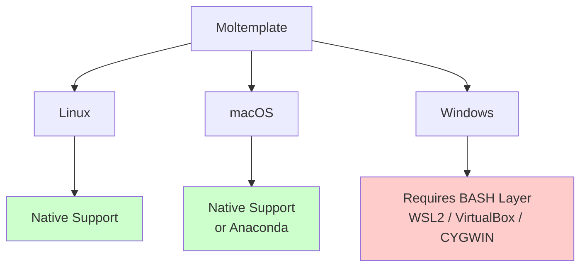
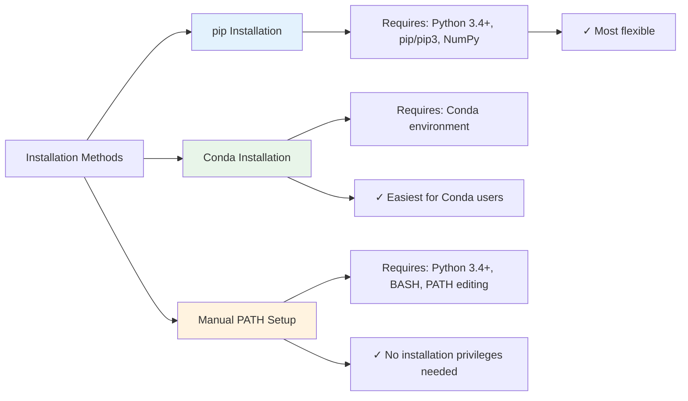

This page outlines the hardware and software prerequisites needed to install and run moltemplate successfully. Moltemplate is a **cross-platform** molecule builder designed to work across different operating systems, but it requires specific dependencies to function properly.

## Core Software Requirements

Moltemplate requires three essential components: a Python interpreter, the BASH shell, and the NumPy library. These form the foundation for all moltemplate operations.

### Python Environment

Moltemplate requires **Python 3.4 or later** for optimal performance and compatibility. While Python 2.7 may still work with deprecated support, it is strongly recommended to use a modern Python 3 version to ensure access to all features and ongoing security updates. The system automatically detects and validates the Python version at runtime [moltemplate.sh](moltemplate/scripts/moltemplate.sh#L27-L47).

The installation process relies on Python's package manager (pip or pip3) to install moltemplate and its dependencies. Many common installation issues stem from version mismatches between Python and pip, so ensuring they correspond to the same Python installation is critical [INSTALL.md](INSTALL.md#L54-L75).

### BASH Shell

The **BASH shell** is a non-negotiable requirement for moltemplate. All moltemplate scripts, including the main `moltemplate.sh` wrapper script, are written in BASH and expect to run in a BASH environment. This requirement applies across all operating systems and cannot be bypassed [INSTALL.md](INSTALL.md#L3-L4).

### Required Python Packages

Moltemplate has minimal Python dependencies, requiring only **NumPy** for numerical computations. This lightweight dependency tree makes installation straightforward and reduces potential conflicts with other scientific Python packages [setup.py](setup.py#L108).

## Operating System Support

Moltemplate is designed as a genuinely cross-platform application with official support for three major operating system families.

### Linux

Linux provides the most straightforward installation path. Most Linux distributions include the necessary prerequisites (BASH and Python 3), with the only common missing component being pip or pip3. Package managers like apt or yum can easily install this missing dependency [INSTALL.md](INSTALL.md#L202-L210).

**Recommended Prerequisites:**
- BASH (typically pre-installed)
- Python 3.4+ 
- pip or pip3 (install via system package manager if missing)

### macOS

macOS installations can proceed through two main approaches. Users can install BASH and Python using Homebrew or Xcode, but many developers find the **Anaconda distribution** to be more reliable and easier to manage. Anaconda provides a complete Python environment including pip and NumPy pre-configured [INSTALL.md](INSTALL.md#L213-L220).

**Installation Options:**
- **Option 1:** Homebrew + System Python
- **Option 2:** Anaconda Python distribution (recommended)

### Windows

Windows requires additional setup because the operating system does not natively include a BASH environment or Unix-style tools. You must install a compatibility layer to provide the required Unix environment. Three primary solutions exist [INSTALL.md](INSTALL.md#L223-L230).

**Windows BASH Environment Options:**

| Solution | Description | Best For |
|----------|-------------|----------|
| **WSL2** (Windows Subsystem for Linux) | Native Linux kernel integration | Development, modern workflows |
| **VirtualBox + Linux Distribution** | Complete virtual machine | Isolated testing environments |
| **CYGWIN** | Unix compatibility layer | Legacy systems, older Windows |

> [!TIP]
> WSL2 is strongly recommended for Windows users as it provides the best performance and integration while offering a full Linux filesystem environment. However, exercise caution when editing Linux files from Windows applications to avoid line-ending and permission issues.

**Additional Windows Requirements:**
- **Unix-style text editor** (not Word, WordPad, or Notepad): Atom, Sublime, Notepad++, VSCode, or traditional editors like vim, emacs, nano [INSTALL.md](INSTALL.md#L231-L235)

## Hardware Requirements

Moltemplate is primarily a text-processing tool with modest hardware requirements. The computational demands depend more on your downstream LAMMPS simulations than on moltemplate itself.

### Storage

The moltemplate source code is compact (approximately 2-3 MB), but the repository includes:
- Force field files (`.lt` format)
- Example simulation scripts
- Documentation

A full clone with all examples requires approximately **50-100 MB** of disk space [setup.py](setup.py#L1-L112).

### Memory

Moltemplate's memory usage scales with the size of the molecular systems being processed. For typical use cases:
- **Small molecules (< 10,000 atoms):** < 100 MB RAM
- **Medium systems (10,000-100,000 atoms):** 100-500 MB RAM
- **Large systems (> 100,000 atoms):** 500 MB - 2 GB RAM

The template processing is generally memory-efficient compared to the subsequent LAMMPS simulations.

### Processor

Moltemplate is **not computationally intensive** from a CPU perspective. Template expansion and variable substitution are primarily I/O-bound operations. Any modern processor (including those in laptops) will handle moltemplate operations without performance concerns.

## Optional Dependencies

While not strictly required for core moltemplate functionality, several optional dependencies enhance capabilities for specific workflows.

### For Force Field Integration

Various third-party tools can generate input files that moltemplate can process:
- **AmberTools** - For AMBER/GAFF force field compatibility
- **Open Babel** - For file format conversion
- **ATB database** - Automated topology builder
- **LigParGen** - OPLS-AA ligand parameter generation [README.md](README.md#L64-L76)

### For Coordinate Processing

Moltemplate includes utilities for working with coordinate files:
- PDB file support for atomic coordinates
- XYZ file format support
- Custom coordinate manipulation tools [README.md](README.md#L126-L127)

## Installation Method Prerequisites

Your chosen installation method determines which prerequisites are absolutely necessary.

### pip Installation Method

This method requires:
- Python 3.4 or later
- pip or pip3 package manager
- Internet connection for downloading packages
- Optional: virtual environment support for isolated installation [INSTALL.md](INSTALL.md#L15-L45)

### Conda Installation Method

This method requires:
- Anaconda or Miniconda distribution
- Conda package manager
- Conda-forge channel access [README.md](README.md#L105-L110)

### Manual PATH Method

This method requires:
- Python 3.4 or later
- BASH shell
- Ability to edit shell configuration files (`.bashrc`, `.profile`, etc.)
- No need for pip or sudo privileges [INSTALL.md](INSTALL.md#L98-L118)

## Verification Checklist

Before proceeding with installation, verify your system meets these requirements:

- [ ] **Python 3.4+ installed** (check with `python3 --version`)
- [ ] **BASH shell available** (check with `which bash`)
- [ ] **pip or pip3 installed** (check with `which pip3` or `which pip`)
- [ ] **NumPy available** (will be installed automatically)
- [ ] **For Windows:** BASH environment configured (WSL2, VirtualBox, or CYGWIN)
- [ ] **Text editor** capable of handling Unix-style line endings

Once these prerequisites are confirmed, proceed to the [Installation Guide](3-installation-guide) for detailed installation instructions. If you encounter issues, the troubleshooting section of the installation guide provides solutions for common dependency problems.