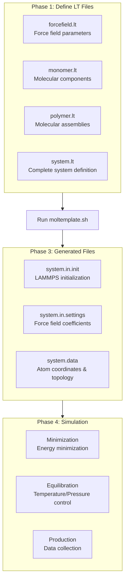

This guide walks you through creating and running your first molecular dynamics simulation using moltemplate. You'll learn the complete workflow from defining molecular structures in LT files to executing LAMMPS simulations, using concrete examples from the repository that demonstrate both coarse-grained and all-atom modeling approaches.

Sources: [README.md](README.md#L1-L50)

## Understanding the Moltemplate Workflow

Moltemplate provides a template-based system for building LAMMPS simulations. Rather than manually constructing complex LAMMPS data files, you define molecular components as template objects that moltemplate instantiates and connects. This approach separates molecular topology from force field parameters, making it easier to build and modify complex systems.

The workflow consists of four main phases:



Sources: [examples/README.md](examples/README.md#L1-L37), [examples/coarse_grained/simple_examples/2bead_polymer/README_setup.sh](examples/coarse_grained/simple_examples/2bead_polymer/README_setup.sh#L1-L24)

## Example 1: Coarse-Grained 2-Bead Polymer

This example builds a coarse-grained heteropolymer with 27 copies of a 14-residue chain, where each residue has two particles: a backbone bead (CA) and a residue bead (R). This demonstrates moltemplate's strengths in building repeating molecular assemblies.

### Step 1: Define Force Field Parameters

Create `forcefield.lt` to define the physical interactions:

Sources: [examples/coarse_grained/simple_examples/2bead_polymer/moltemplate_files/forcefield.lt](examples/coarse_grained/simple_examples/2bead_polymer/moltemplate_files/forcefield.lt#L1-L111)

The force field contains:
- **Atom types and masses**: CA (13.0 mass units) and R (50.0 mass units)
- **Pairwise interactions**: Lennard-Jones potentials with epsilon and sigma parameters
- **Bond interactions**: Harmonic bonds for sidechain and backbone connections
- **Angle interactions**: Harmonic angles for backbone (114°) and sidechain (132°) constraints
- **Dihedral interactions**: CHARMM-style dihedrals for rotational preferences

Key LAMMPS styles are specified using `write_once("In Init")` and `write_once("In Settings")` blocks, ensuring these commands appear only once in the generated input file regardless of how many times the ForceField object is inherited.

### Step 2: Define Molecular Building Blocks

Create `monomer.lt` to define the basic molecular unit:

Sources: [examples/coarse_grained/simple_examples/2bead_polymer/moltemplate_files/monomer.lt](examples/coarse_grained/simple_examples/2bead_polymer/moltemplate_files/monomer.lt#L1-L21)

The monomer definition shows three critical concepts:
- **Inheritance**: `Monomer inherits ForceField` gives the monomer access to all force field parameters
- **Variable substitution**: `$atom:ca`, `$mol:...` are variables that moltemplate resolves during instantiation
- **Atom writing**: The `write("Data Atoms")` block defines atom coordinates using the `@atom:CA` and `@atom:R` types from the force field

### Step 3: Build Molecular Assemblies

Create `polymer.lt` to connect monomers into chains:

Sources: [examples/coarse_grained/simple_examples/2bead_polymer/moltemplate_files/polymer.lt](examples/coarse_grained/simple_examples/2bead_polymer/moltemplate_files/polymer.lt#L1-L28)

This file demonstrates moltemplate's transformation capabilities:
- **Instantiation**: `new Monomer` creates a copy of the monomer template
- **Rotations**: `.rot(180.0, 1,0,0)` rotates coordinates 180° around the x-axis
- **Translations**: `.move(3.2,0,0)` shifts coordinates along the x-axis
- **Inter-monomer bonds**: Explicit bond connections link CA atoms from adjacent monomers

The `create_var {$mol}` command ensures all monomers share the same molecule ID number, important for LAMMPS molecule tracking.

### Step 4: Define Complete System

Create `system.lt` to assemble multiple polymer copies:

Sources: [examples/coarse_grained/simple_examples/2bead_polymer/moltemplate_files/system.lt](examples/coarse_grained/simple_examples/2bead_polymer/moltemplate_files/system.lt#L1-L30)

The system definition shows:
- **Boundary conditions**: Periodic box dimensions (90.0 Å in each direction)
- **Array instantiation**: `[3].move(0, 0, 30.0)` creates 3 copies with specified spacing
- **Multi-dimensional arrays**: Three nested `[3]` operators create 3×3×3 = 27 polymer copies

### Step 5: Generate LAMMPS Files

Run moltemplate to generate the LAMMPS input files:

Sources: [examples/coarse_grained/simple_examples/2bead_polymer/README_setup.sh](examples/coarse_grained/simple_examples/2bead_polymer/README_setup.sh#L1-L24)

```bash
cd moltemplate_files
moltemplate.sh system.lt
mv -f system.in* system.data ../
rm -rf output_ttree/
cd ../
```

This generates three key files:
- **system.in.init**: LAMMPS initialization commands (units, atom_style, pair_style)
- **system.in.settings**: Force field coefficients (pair_coeff, bond_coeff, angle_coeff)
- **system.data**: Complete atom coordinates, topology, and system definition

> [!TIP]
> The `output_ttree/` directory contains intermediate files useful for debugging. Keep it if your simulation fails and you need to inspect moltemplate's internal processing.

### Step 6: Run the LAMMPS Simulation

Execute the LAMMPS input script:

Sources: [examples/coarse_grained/simple_examples/2bead_polymer/run.in.nvt](examples/coarse_grained/simple_examples/2bead_polymer/run.in.nvt#L1-L33)

The LAMMPS script follows the standard LAMMPS structure:
- **Initialization**: Include `system.in.init`
- **Atom definition**: Read `system.data`
- **Settings**: Include `system.in.settings`
- **Run section**: Apply Langevin thermostat, NVE integrator, and run 40 million timesteps

```bash
lmp_mpi -i run.in.nvt
```


Sources: [examples/coarse_grained/simple_examples/2bead_polymer/README.md](examples/coarse_grained/simple_examples/2bead_polymer/README.md#L1-L31)

## Example 2: All-Atom Ice Crystal (SPC/E Water)

This example demonstrates moltemplate's capability with realistic all-atom force fields, specifically building a hexagonal ice crystal using the SPC/E water model.

### Force Field Definition

The `spce.lt` file defines a complete water molecule with constraints:

Sources: [examples/all_atom/force_field_explicit_parameters/ice_crystal_SPCE/moltemplate_files/spce.lt](examples/all_atom/force_field_explicit_parameters/ice_crystal_SPCE/moltemplate_files/spce.lt#L1-L63)

Key features:
- **Three-atom water molecule**: One oxygen (O) and two hydrogens (H1, H2)
- **Partial charges**: O (-0.8476), H (+0.4238 each)
- **RATTLE constraints**: Fixes bond lengths (1.0 Å) and angles (109.47°) during dynamics
- **Long-range electrostatics**: Uses PPPM with `lj/charmm/coul/long` pair style
- **Hybrid styles**: Demonstrates using multiple force field styles in one simulation

### Crystal Assembly

Multiple unit cell options are available, with `spce_ice_rect8.lt` containing 8 water molecules arranged in a hexagonal lattice:

Sources: [examples/all_atom/force_field_explicit_parameters/ice_crystal_SPCE/moltemplate_files/system.lt](examples/all_atom/force_field_explicit_parameters/ice_crystal_SPCE/moltemplate_files/system.lt#L1-L12)

The system creates a 3×2×2 array of unit cells, resulting in 96 water molecules total, with boundary conditions matching the crystal dimensions.

### Running the Ice Simulation

The workflow is similar to the polymer example, but includes additional steps:

Sources: [examples/all_atom/force_field_explicit_parameters/ice_crystal_SPCE/run.in.npt](examples/all_atom/force_field_explicit_parameters/ice_crystal_SPCE/run.in.npt#L1-L52)

```bash
cd moltemplate_files
moltemplate.sh -atomstyle full system.lt
mv -f system.in* system.data ../
cd ../
lmp_mpi -i run.in.npt
```

The simulation includes:
- **Energy minimization**: 100,000 steps to relax the crystal
- **NPT equilibration**: Temperature drops from 400K to 300K at 1 atm pressure
- **Constraint application**: RATTLE constraints maintain water geometry


Sources: [examples/all_atom/force_field_explicit_parameters/ice_crystal_SPCE/README.md](examples/all_atom/force_field_explicit_parameters/ice_crystal_SPCE/README.md#L1-L51)

## Understanding Generated Files

After running moltemplate, you'll find these files in your directory:

| File | Purpose | Contains |
|------|---------|----------|
| `system.in.init` | LAMMPS initialization | `units`, `atom_style`, `pair_style`, `bond_style` commands |
| `system.in.settings` | Force field parameters | `pair_coeff`, `bond_coeff`, `angle_coeff`, `dihedral_coeff` |
| `system.data` | Molecular topology | Atom coordinates, bonds, angles, dihedrals, mass, boundary |
| `system.in.charges` (optional) | Atomic charges | Charge assignments for electrostatic interactions |
| `system.in.constraints` (optional) | Geometric constraints | RATTLE or SHAKE constraint definitions |

Sources: [examples/README.md](examples/README.md#L1-L37)

## Common Workflow Patterns

### Creating Multiple Copies

Use array syntax to create periodic arrangements:

```lt
# Create 10 copies spaced by 5.0 Å in x-direction
molecules = new Molecule [10].move(5.0, 0, 0)

# Create 3D grid (4×3×2 = 24 copies)
crystal = new UnitCell [4].move(4.0, 0, 0)
                       [3].move(0, 4.0, 0)
                       [2].move(0, 0, 4.0)
```

Sources: [examples/coarse_grained/simple_examples/2bead_polymer/moltemplate_files/system.lt](examples/coarse_grained/simple_examples/2bead_polymer/moltemplate_files/system.lt#L8-L11)

### Applying Transformations

Chain transformations to position molecules precisely:

```lt
# Rotate then translate
molecule = new Molecule.rot(90.0, 0, 0, 1).move(10.0, 5.0, 0)

# Multiple transformations
assembly = new Molecule.move(0, 0, 5.0).rot(45.0, 1, 0, 0)
```

Sources: [examples/coarse_grained/simple_examples/2bead_polymer/moltemplate_files/polymer.lt](examples/coarse_grained/simple_examples/2bead_polymer/moltemplate_files/polymer.lt#L9-L15)

### Connecting Molecules

Define bonds between atoms in different molecules:

```lt
write("Data Bonds") {
  $bond:link1 @bond:Type $atom:molecule1/atomA $atom:molecule2/atomB
  $bond:link2 @bond:Type $atom:molecule2/atomC $atom:molecule3/atomD
}
```

Sources: [examples/coarse_grained/simple_examples/2bead_polymer/moltemplate_files/polymer.lt](examples/coarse_grained/simple_examples/2bead_polymer/moltemplate_files/polymer.lt#L20-L26)

## Project Structure for Your Simulation

A typical moltemplate project organizes files this way:

```
my_simulation/
├── moltemplate_files/
│   ├── forcefield.lt          # Force field parameters
│   ├── molecule.lt            # Molecular building blocks
│   ├── assembly.lt            # Molecular assemblies
│   └── system.lt              # Complete system definition
├── run.in.min                 # Minimization script
├── run.in.npt                 # Equilibration script
└── run.in.nvt                 # Production script
```

Sources: [examples/coarse_grained/simple_examples/2bead_polymer/](examples/coarse_grained/simple_examples/2bead_polymer/), [examples/all_atom/force_field_explicit_parameters/ice_crystal_SPCE/](examples/all_atom/force_field_explicit_parameters/ice_crystal_SPCE/)

## Troubleshooting Common Issues

| Problem | Cause | Solution |
|---------|-------|----------|
| "Atom type not found" | Missing atom type definition | Ensure all `@atom:` types are defined in force field |
| "Bond type not found" | Missing bond coefficient | Check `bond_coeff` definitions in `write_once("In Settings")` |
| Incorrect atom IDs | Variable name conflicts | Use unique variable names ($atom:ca vs $atom:ca2) |
| Periodic boundary issues | Boundary mismatch | Ensure box dimensions in `Data Boundary` match atomic coordinates |
| Energy explosion | Bad initial geometry | Run minimization before dynamics |

Sources: [README.md](README.md#L1-L50), [examples/coarse_grained/simple_examples/2bead_polymer/README_run.sh](examples/coarse_grained/simple_examples/2bead_polymer/README_run.sh#L1-L24)

> [!TIP]
> Always check the `output_ttree/` directory if moltemplate fails. It contains the intermediate tree structure showing how variables were resolved, which helps identify inheritance or naming issues.

## Next Steps

After completing your first simulation, explore these topics:

- **[Moltemplate LT File Syntax](6-moltemplate-lt-file-syntax)**: Deep dive into the template language features
- **[Core Template System Architecture](7-core-template-system-architecture)**: Understand how moltemplate's template engine works internally
- **[Force Field Parameter Management](15-force-field-parameter-management)**: Learn to work with complex force fields
- **[OPLSAA Force Field Integration](20-oplsaa-force-field-integration)**: Use production-ready biomolecular force fields

Explore more examples in the repository:
- `examples/coarse_grained/simple_examples/` - Additional coarse-grained systems
- `examples/all_atom/force_field_*/` - Various all-atom force field implementations
- `examples/coarse_grained/DNA_models/` - Nucleic acid simulations
- `examples/coarse_grained/membrane_examples/` - Lipid bilayer systems
