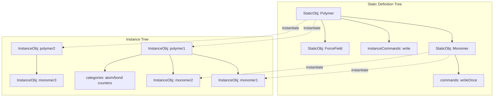
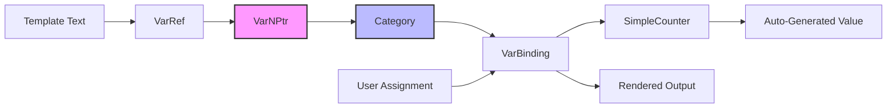
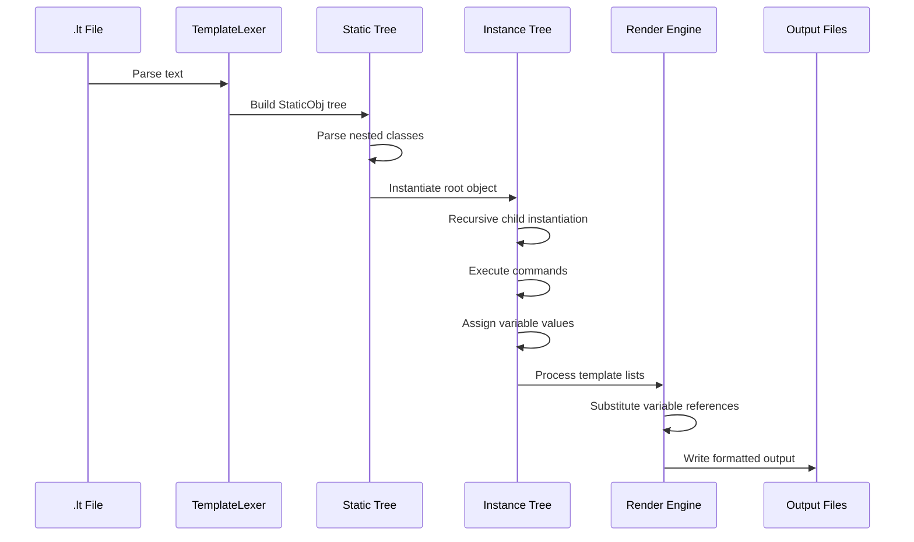

This page documents the fundamental architectural patterns that enable moltemplate to transform compact template definitions into complete molecular simulation files. The core template system implements a **dual-tree architecture**—a static definition tree and a dynamic instance tree—working together through a sophisticated command processing pipeline.

## Dual Tree Architecture

The template system maintains two complementary tree structures that serve different purposes in the template generation lifecycle.

### Static Tree: Class Definitions

The **static tree** contains class definitions stored in `StaticObj` nodes, analogous to class definitions in object-oriented programming. Each node represents a template definition with nested child classes, but notably, these children are **not** OOP subclasses—they are merely hierarchical organizational containers. Static objects store definitions without instantiated data, including:

- **Commands**: Template writing instructions (e.g., `write_once()` for immediate execution)
- **Instance Commands**: Instructions deferred until instantiation (e.g., `write()`)
- **Categories**: Variable scoping mechanisms for automatic value generation
- **Children**: Nested class definitions organized hierarchically

### Instance Tree: Instantiated Objects

The **instance tree** contains `InstanceObj` nodes representing actual instantiated classes (molecules, atoms, etc.). When you instantiate a root static object, the system recursively generates a complete instance tree. Each instance node stores:

- **Reference to StaticObj**: The template definition it was instantiated from
- **Children**: Constituent sub-instances (e.g., amino acids within a protein)
- **Categories**: Variable bindings specific to this instance
- **Commands**: Template execution instructions including stackable commands

The separation between definition and instantiation enables a single template to generate thousands of molecular copies efficiently.
Sources: [ttree.py](moltemplate/ttree.py#L1903-L2035)



## Variable System Architecture

Variables form the bridge between template definitions and generated output. The system uses a sophisticated three-layer reference mechanism.

### Variable Reference Chain

**VarRef** objects store variable references within templates, containing:
- `prefix`: The `$` or `@` indicator
- `descr_str`: The descriptor path (e.g., `"atom:CA"`)
- `suffix`: Optional formatting instructions (e.g., `{ljust:10}`)
- `nptr`: A `VarNPtr` pointer to the actual variable binding
- `srcloc`: Source location for error reporting

The **VarNPtr** (Variable Node Pointer) provides an indirect reference through two attributes:
- `cat_node`: The node containing the category
- `cat_name`: The category name (e.g., `"atom"`)
- `leaf_node`: The specific variable leaf node

This indirection enables the system to rebind variables to different values without modifying template references.
Sources: [ttree_lex.py](moltemplate/ttree_lex.py#L1143-L1256)

### Variable Bindings

**VarBinding** objects store the actual variable data:
- `full_name`: Complete variable name path
- `value`: The assigned value (often auto-generated)
- `refs`: List of references to this variable
- `order`: Assignment ordering information
- `category`: Reference to parent category

Bindings are stored within **Category** objects, which group variables that share the same counter mechanism. Categories maintain an `OrderedDict` of `leaf_node:VarBinding` pairs and a `SimpleCounter` for automatic value generation.
Sources: [ttree.py](moltemplate/ttree.py#L1849-L1915)



## Command Processing Pipeline

Commands drive the template generation process through a multi-stage pipeline. Each command type serves a specific purpose in the instantiation and rendering workflow.

### Core Command Types

| Command Type | Purpose | Execution Timing |
|--------------|---------|------------------|
| **WriteFileCommand** | Store template text to write to specific files | During instance tree traversal |
| **InstantiateCommand** | Create new instances from class references | During instance tree construction |
| **DeleteCommand** | Mark objects for deletion | Post-instantiation cleanup |
| **PushCommand/PopCommand** | Stackable command management for hierarchical execution | Before/after child processing |

Commands are stored in multiple lists within nodes:
- `commands`: Immediate execution commands
- `instance_commands`: Commands executed per-instance
- `commands_push`: Stackable commands executed before children
- `commands_pop`: Stackable commands executed after children Sources: [ttree.py](moltemplate/ttree.py#L157-L376)

### Command Execution Flow

The `_ExecCommands()` function in `lttree.py` (and its variant in `ettree.py`) processes commands sequentially while maintaining a matrix stack for coordinate transformations. This is particularly important for LAMMPS files where `rot()` and `move()` commands apply rigid-body transformations.
Sources: [lttree.py](moltemplate/lttree.py#L611-L843)

```mermaid
flowchart TD
    A[Parse LT File] --> B[Build Static Tree]
    B --> C[Instantiate Root Object]
    C --> D[Build Instance Tree]
    D --> E{Process Commands}
    E -->|Push Commands| F[Execute Pre-Child]
    F --> G[Process Child Instances]
    G --> H[Execute Post-Child]
    H --> I|Pop Commands| J[Render Templates]
    J --> K[Apply Variable Substitution]
    K --> L[Write Output Files]
    L --> M[Apply Transformations]
    M --> N[Final LAMMPS Files]
```

## Lexical Analysis Layer

The template system uses a custom lexical analyzer built on Python's `shlex` module, extended for moltemplate-specific syntax.

### TtreeShlex Core

**TtreeShlex** provides shell-like token parsing with unicode support and custom word terminators. It handles:
- Quoted strings (single/double quotes)
- Escape sequences (backslash)
- Comment characters (`#`)
- Custom word boundaries

Key innovation: `self.wordterminators` member overrides standard `wordchars`, enabling better unicode character handling.
Sources: [ttree_lex.py](moltemplate/ttree_lex.py#L76-L452)

### TemplateLexer Extension

**TemplateLexer** extends `TtreeShlex` with template-specific functionality:
- **ReadTemplate()**: Parses raw text into alternating `TextBlock` and `VarRef` objects
- **Variable parsing**: Recognizes `$` and `@` prefixes with optional `{}` delimiters
- **Source tracking**: Maintains `OSrcLoc` objects for error reporting

The lexer produces a dual-element list structure where text blocks and variable references alternate, enabling precise variable substitution during rendering.
Sources: [ttree_lex.py](moltemplate/ttree_lex.py#L1669-L2245)

### Token Types

| Type | Class | Purpose |
|------|-------|---------|
| **TextBlock** | `TextBlock` | Raw text content with source location |
| **VarRef** | `VarRef` | Variable reference with binding pointer |
| **SrcLoc/OSrcLoc** | `SrcLoc/OSrcLoc` | File name and line number for error reporting |

## Category and Counter System

The category system provides automatic variable value assignment through scoped counters, essential for generating unique atom IDs, bond types, and other sequential identifiers.

### Category Structure

Each **Category** object manages:
- `bindings`: OrderedDict mapping leaf nodes to `VarBinding` objects
- `counter`: A `SimpleCounter` that generates sequential values
- `manual_assignments`: User-specified values overriding auto-generation
- `reserved_values`: Pre-reserved values that won't be auto-assigned

Categories can be scoped to specific nodes or global (default). Local categories enable independent counter namespaces for different molecule types.
Sources: [ttree.py](moltemplate/ttree.py#L1849-L1915)

### SimpleCounter Mechanism

**SimpleCounter** implements incrementing counters:
- `n`: Current counter value
- `nincr`: Increment amount (default: 1)
- `default_n0`: Starting value (default: 1)
- `incr()`: Increment and return next value

Counters are copied (deep copied) when categories are instantiated, ensuring each instance maintains its own counter state.
Sources: [ttree.py](moltemplate/ttree.py#L1823-L1847)

## Template Rendering Engine

The rendering pipeline converts template structures with variable references into final output text.

### Render Function

The `Render()` function processes `TextBlock`/`VarRef` lists:
1. Iterate through alternating text and variable references
2. For each `VarRef`, look up its `VarBinding` via the `VarNPtr`
3. Extract the value from the binding
4. Apply any formatting commands from the suffix
5. Substitute the value into the output stream
6. Concatenate all text blocks into final string

### Variable Substitution Process

Variable substitution occurs in three phases:
1. **Assignment Phase**: Counter variables auto-assigned, manual bindings applied
2. **Pointer Resolution Phase**: `VarRef.nptr` resolves to actual `VarBinding` objects
3. **Render Phase**: Values extracted and substituted into templates

The `substitute_vars` parameter in `Render()` allows writing variable names instead of values for debugging purposes.
Sources: [ttree.py](moltemplate/ttree.py#L4525-L4581)

> [!TIP]
> The rendering engine supports formatting commands in variable suffixes (e.g., `${atom:CA}{ljust:10}`). These are applied during rendering without modifying the underlying value, enabling flexible output formatting while preserving data integrity.

## Platform-Specific Extensions

The core template system has platform-specific extensions for different simulation engines.

### LAMMPS Extension (lttree.py)

`lttree.py` extends `ttree.py` with LAMMPS-specific features:
- **Rigid-body transformations**: `rot()` and `move()` commands modify atomic coordinates
- **Matrix stack management**: Hierarchical transformation application
- **LAMMPS data file formats**: Understanding of "Data Atoms", "Data Bonds", etc.
- **Atom style support**: Different coordinate representations

`TransformAtomText()` applies affine transformation matrices to coordinate text, enabling precise placement of molecules.
Sources: [lttree.py](moltemplate/lttree.py#L307-L371)

### ESPResSo Extension (ettree.py)

`ettree.py` provides similar extensions for ESPResSo/TCL:
- Rigid-body transformations for ESPResSo coordinate systems
- TCL-specific data format handling
- Quaternion transformations for ellipsoidal particles

The architecture allows adding new simulation backends by implementing transformation functions and format parsers while reusing the core template engine.
Sources: [ettree.py](moltemplate/ettree.py#L1-L579)

## Data Flow Summary



## Key Design Patterns

The template system employs several important design patterns:

1. **Visitor Pattern**: Commands traverse trees applying operations to nodes
2. **Builder Pattern**: StaticObj.Parse() builds tree structures incrementally
3. **Flyweight Pattern**: Template definitions shared across multiple instances
4. **Command Pattern**: All operations encapsulated as command objects
5. **Template Method**: Rendering pipeline with customizable substitution behavior

> [!TIP]
> The dual-tree architecture enables a critical optimization: the static tree is parsed once but can be instantiated thousands of times, with only the lightweight instance tree requiring memory for each copy. This makes large-scale polymer generation feasible with minimal memory overhead.

## Next Steps

Continue exploring the template system internals:

- **[Static Objects and Class Definitions](8-static-objects-and-class-definitions)**: Deep dive into StaticObj internals and parsing mechanisms
- **[Instance Objects and Instantiation](9-instance-objects-and-instantiation)**: InstanceObj lifecycle and tree construction algorithms
- **[Variable Substitution and Binding](10-variable-substitution-and-binding)**: Variable resolution and binding strategies
- **[Command Processing Pipeline](11-command-processing-pipeline)**: Detailed command execution flow and transformation handling
