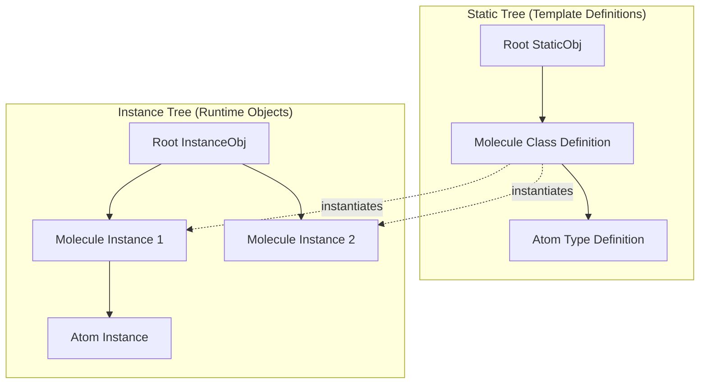

This page examines the foundational architecture of moltemplate's template system: the static object tree and class definitions. Static objects serve as blueprints for molecular structures, force field parameters, and simulation components, enabling efficient reuse and parameter management in LAMMPS simulations.

## Architectural Foundation: The Dual-Tree System

Moltemplate maintains two distinct but interconnected tree structures that form the backbone of the template system. The **static tree** contains class definitions that act as templates, while the **instance tree** holds the concrete objects created from those templates. This separation enables template reuse, parameter inheritance, and hierarchical organization of molecular systems.

Sources: [ttree.py](moltemplate/ttree.py#L1904-L1916)

The static tree operates as a hierarchical collection of `StaticObj` nodes, where each node represents a class definition. When you define a molecule type in an LT file, you're creating a static object that can be instantiated multiple times with different parameters. The instance tree emerges automatically during instantiation, containing `InstanceObj` nodes that represent actual molecules with assigned coordinates and parameters.



## StaticObj Class: The Blueprint Container

The `StaticObj` class encapsulates all information needed to define a reusable class in moltemplate. Unlike traditional object-oriented programming, moltemplate's "children" are not subclasses in the inheritance sense—they represent nested class definitions within the hierarchical namespace structure.

Sources: [ttree.py](moltemplate/ttree.py#L1903-L2013)

### Core Attributes

| Attribute | Type | Purpose |
|-----------|------|---------|
| `name` | str | Unique identifier for the class definition |
| `parent` | StaticObj | Reference to parent node in static tree |
| `children` | OrderedDict | Nested class definitions (not OOP children) |
| `categories` | OrderedDict | Static variable categories with counters |
| `instance_categories` | OrderedDict | Instance variable categories |
| `commands` | list | Commands executed once at definition time |
| `instance_commands` | list | Commands executed for each instance |
| `class_parents` | list | Inheritance sources for trait sharing |
| `namespaces` | list | Additional search scopes for variables |

The `__slots__` declaration (lines 2015-2029) optimizes memory usage by fixing the class attributes, which is critical for systems with thousands of molecular definitions.

Sources: [ttree.py](moltemplate/ttree.py#L2015-L2029)

### Command Storage Architecture

Static objects distinguish between two types of commands based on execution timing:

1. **Static Commands** (`self.commands`): Execute once when the class is defined. Used for `write_once()`, `create_static_var()`, and `replace` commands that output templates shared across all instances.

2. **Instance Commands** (`self.instance_commands`): Execute each time an instance is created. Used for `write()` commands that output instance-specific data like atomic coordinates.

Sources: [ttree.py](moltemplate/ttree.py#L1942-L1961)

The `instance_commands_push`, `instance_commands`, and `instance_commands_pop` attributes form a three-stage execution pipeline (lines 2076-2081), enabling ordered command processing during instantiation.

## Variable Categories: Scoping and Counting

Categories implement moltemplate's variable scoping system, enabling automatic assignment of unique identifiers across large molecular systems. Each category maintains a counter that generates sequential values for variables belonging to that scope.

Sources: [ttree.py](moltemplate/ttree.py#L1973-L2009)

### Category Structure

The `Category` class (lines 1849-1902) manages variable collections within a specific scope:

```python
class Category(object):
    __slots__ = ["name", "bindings", "counter",
                 "manual_assignments", "reserved_values"]
```

The `counter` attribute is typically a `SimpleCounter` object that increments on each call, generating sequential integers or custom sequences. The `bindings` OrderedDict maps leaf nodes to `VarBinding` objects, storing variable metadata including names, values, and reference counts.

Sources: [ttree.py](moltemplate/ttree.py#L1849-L1900)

### Static vs Instance Variables

Variables in moltemplate are categorized by prefix indicating their scope:

| Prefix | Type | Counter Storage | Usage Context |
|--------|------|-----------------|---------------|
| `@` | Static variable | `self.categories` | Class-level definitions, force field parameters |
| `$` | Instance variable | `self.instance_categories` | Instance-specific data, atom IDs, coordinates |

Static variables (prefixed with `@`) share a single counter across all instances, ensuring unique type identifiers. Instance variables (prefixed with `$`) have per-instance counters, enabling each molecule copy to have distinct atom IDs or local variable assignments.

Sources: [ttree.py](moltemplate/ttree.py#L2327-L2343)

> [!TIP]
> **Critical Implementation Detail**: When parsing category definitions, the prefix character is stripped from the category name during storage (line 2328), but the prefix determines whether the category goes into `self.categories` (static) or `self.instance_categories` (instance). This separation prevents type ID collisions between template definitions and runtime instances.

## Parse Method: Building the Static Tree

The `StaticObj.Parse()` method (lines 2096-2845) is the recursive parser that transforms LT file text into the static tree structure. It reads tokens from a `TemplateLexer` instance, recognizing commands and class definitions to build the hierarchical object model.

Sources: [ttree.py](moltemplate/ttree.py#L2096-L2100)

### Template Parsing Flow

```mermaid
flowchart TD
    Start([Parse Start]) --> ReadToken[Read Next Token]
    ReadToken --> CheckCmd{Command Type?}
    
    CheckCmd -->|write/create_var| ProcessWrite[Process Write Command]
    CheckCmd -->|write_once| ProcessWriteOnce[Process Write Once]
    CheckCmd -->|category| ProcessCategory[Process Category Def]
    CheckCmd -->|class/new| ProcessClass[Process Class Definition]
    CheckCmd -->|}| EndScope[End Scope]
    CheckCmd -->|inherit| ProcessInherit[Process Inheritance]
    
    ProcessWrite --> CreateCmd[Create WriteFileCommand]
    ProcessWriteOnce --> CreateCmd
    CreateCmd --> AddCommands[Append to commands list]
    
    ProcessCategory --> CreateCat[Create Category Object]
    CreateCat --> AddCat[Add to categories dict]
    
    ProcessClass --> CheckExists{Child Exists?}
    CheckExists -->|No| CreateStatic[Create New StaticObj]
    CheckExists -->|Yes| GetChild[Retrieve Existing Child]
    CreateStatic --> AddChild[Add to children dict]
    GetChild --> RecursiveParse[Recursive Parse Call]
    AddChild --> RecursiveParse
    
    AddCommands --> ReadToken
    AddCat --> ReadToken
    RecursiveParse --> ReadToken
    ProcessInherit --> ReadToken
    
    EndScope --> Return([Return to Caller])
```

### Command Processing

The parser handles multiple command types that populate the static object structure:

**Write Commands** (lines 2129-2228): When encountering `write()`, `write_once()`, `create_var()`, or `create_static_var()`, the parser extracts the target filename and template contents, creating a `WriteFileCommand` object. The command is appended to either `self.commands` (for `write_once`) or `self.instance_commands` (for `write`).

Sources: [ttree.py](moltemplate/ttree.py#L2129-L2228)

**Category Commands** (lines 2257-2346): The `category` command creates new variable categories with optional starting values and increment values. The parser recognizes the prefix character (`@` or `$`) to determine whether the category belongs in the static or instance namespace.

Sources: [ttree.py](moltemplate/ttree.py#L2257-L2346)

**Class Definition** (lines 2410-2494): When encountering a class definition (optional `class` keyword followed by name), the parser creates a new `StaticObj` as a child of the current node. If a child with that name already exists, the new definition augments the existing one rather than replacing it—similar to C++ namespace behavior.

Sources: [ttree.py](moltemplate/ttree.py#L2410-L2478)

> [!TIP]
> **Critical Implementation Detail**: The parser supports class augmentation through the `inherits` keyword (lines 2429-2456). Multiple parent classes can be listed, and their traits are merged into the child's `class_parents` list. This enables composing complex molecular types from simpler building blocks without code duplication.

## Inheritance and Namespaces

Moltemplate provides two mechanisms for code reuse and scope management: class inheritance for trait sharing, and namespaces for variable lookup expansion.

### Class Inheritance

The `class_parents` attribute (line 2062-2064) stores references to parent classes whose definitions should be merged into the current class. Unlike traditional OOP inheritance, this is primarily a composition mechanism for template content rather than polymorphism. During instantiation, commands and categories from parent classes are available to the child.

Sources: [ttree.py](moltemplate/ttree.py#L2062-L2068)

### Namespace Lookup

The `namespaces` attribute (lines 2066-2068) provides additional search paths for variable resolution. When a variable reference cannot be found in the current scope, moltemplate searches through listed namespaces before raising an error. This is particularly useful for accessing force field parameters defined in separate files.

Sources: [ttree.py](moltemplate/ttree.py#L2242-L2255)

The `using namespace` command (lines 2242-2255) adds static nodes to the namespace list, enabling cross-file variable references without requiring full path specifications.

## Real-World Example: Water Molecule Definition

Consider a simplified water molecule definition from the OPLSAA force field:

```lt
# Define water molecule type
Water inherits OPLSAA {
  write_once("Data Atoms") {
    @atom:O @atom:H1 @atom:H2
  }

  write("Data Atoms") {
    $atom:O $atom:H1 $atom:H2
  }
  
  # Define atom types
  atomTypes {
    @atom:O 1
    @atom:H1 2
    @atom:H2 2
  }
  
  # Bond connectivity
  write("Bonds") {
    $bond:OH1 $bond:OH2
  }
}
```

This definition demonstrates several key concepts:
- Static variables (`@atom:O`) shared across all water instances
- Instance variables (`$atom:O`) unique to each water molecule
- `write_once` for template headers written once to the data file
- `write` for per-instance atom data

Sources: [examples/all_atom/force_field_OPLSAA/waterSPC/moltemplate_files](examples/all_atom/force_field_OPLSAA/waterSPC/moltemplate_files)

## Error Handling and Source Tracking

Each `StaticObj` maintains `srcloc_begin` and `srcloc_end` attributes (lines 2051-2052) storing file path and line number information. This enables precise error reporting that points users to the exact location of syntax errors or undefined references.

Sources: [ttree.py](moltemplate/ttree.py#L2051-L2052)

The `DeleteSelf()` method (lines 2082-2085) marks a node and all its children as deleted without removing them from the tree structure immediately. This lazy deletion strategy simplifies tree traversal algorithms while supporting the `delete` command for removing instantiated objects.

## Next Steps

Understanding static objects is essential before diving into instantiation mechanics. Continue with **[Instance Objects and Instantiation](9-instance-objects-and-instantiation)** to learn how the static tree transforms into concrete molecular systems, or explore **[Variable Substitution and Binding](10-variable-substitution-and-binding)** to understand how template variables resolve to concrete values.

For practical application, examine the example force field definitions in [examples/all_atom/force_field_OPLSAA](examples/all_atom/force_field_OPLSAA) which demonstrate advanced static object patterns including inheritance, categories, and template organization.