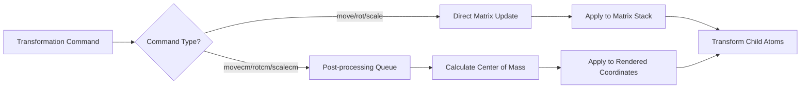

This page examines moltemplate's instance object system—the mechanism that transforms static class definitions into concrete, executable simulation objects. The instantiation engine creates hierarchical object trees through recursive composition, enabling complex molecular systems to be assembled from reusable template definitions. This documentation targets advanced developers requiring deep understanding of the instantiation pipeline for building custom force fields or extending moltemplate's capabilities.

Sources: [ttree.py](moltemplate/ttree.py#L1903-L2100), [ttree.py](moltemplate/ttree.py#L3518-L3800)

## Two-Tree Architecture

Moltemplate maintains two distinct tree structures: the **static tree** and the **instance tree**. The static tree contains class definitions (blueprints), while the instance tree contains instantiated objects (actual molecules). This separation enables multiple instances to share the same class definition while maintaining independent state, similar to the relationship between a class and its instances in object-oriented programming, but with important architectural differences for molecular modeling.

```mermaid
graph TB
    subgraph["Static Tree (Class Definitions)"]
        StaticRoot[StaticObj Root]
        ClassA[StaticObj Class A]
        ClassB[StaticObj Class B]
        StaticRoot --> ClassA
        StaticRoot --> ClassB
        ClassA -.->|instance_commands_push| PushCmd1[Push Commands]
        ClassA -.->|instance_commands| InstCmd1[Instance Commands]
        ClassA -.->|instance_categories| Cat1[Instance Categories]
    end
    
    subgraph["Instance Tree (Instantiated Objects)"]
        InstanceRoot[InstanceObj Root]
        ObjA1[InstanceObj A1]
        ObjA2[InstanceObj A2]
        InstanceRoot --> ObjA1
        InstanceRoot --> ObjA2
        ObjA1 -->|children| ChildA1[Child Instance]
        ObjA2 -->|children| ChildA2[Child Instance]
    end
    
    ClassA ==|Instantiates|==> ObjA1
    ClassA ==|Instantiates|==> ObjA2
    
    style StaticRoot fill:#e1f5ff
    style InstanceRoot fill:#fff4e1
    style ClassA fill:#c8e6c9
    style ClassB fill:#c8e6c9
    style ObjA1 fill:#ffecb3
    style ObjA2 fill:#ffecb3
```

The static tree uses `StaticObj` nodes to store template definitions, commands for instantiation, and category information for variable assignment. Each `StaticObj` contains `instance_commands` (executed upon instantiation), `instance_commands_push` (executed before children), `instance_commands_pop` (executed after children), and `instance_categories` (counter-based variable assignments). The instance tree uses `InstanceObj` nodes that inherit structural information from their corresponding `StaticObj` parents while maintaining independent state.

Sources: [ttree.py](moltemplate/ttree.py#L1903-L2100)

## InstanceObj Core Structure

The `InstanceObj` class serves as the fundamental data structure for instantiated objects in the instance tree. Each `InstanceObj` maintains a reference to its originating `StaticObj` through the `statobj` attribute, preserving the connection to its class definition. This enables the instantiated object to access template content and structural information from its blueprint while maintaining runtime-specific state.

| Attribute | Type | Purpose |
|-----------|------|---------|
| `statobj` | StaticObj reference | Pointer to the originating class definition |
| `children` | dict | Dictionary of child instances (constituent parts) |
| `categories` | dict | Instance variables with `$` prefix, organized by category |
| `commands` | list | Ordered list of commands to execute during instantiation |
| `commands_push` | list | Stackable commands executed before children |
| `commands_pop` | list | Stackable commands executed after children |
| `deleted` | bool | Flag marking whether this instance has been logically deleted |

The `children` dictionary stores nested `InstanceObj` objects representing the hierarchical composition of complex molecules. For example, a protein instance would contain amino acid children, which in turn contain atom children. This tree structure mirrors the molecular topology while enabling independent manipulation of each component.

Sources: [ttree.py](moltemplate/ttree.py#L3518-L3600)

## Instantiation Command Processing

Instantiation begins with the `InstantiateCommand` data structure, which stores pairs of instance names and `ClassReference` objects. When the `ProcessCommand()` method encounters an `InstantiateCommand`, it creates a new `InstanceObj` and recursively builds its instance tree by calling `BuildInstanceTree()`. This method performs a deep copy of instance variables and categories while maintaining shallow copies of template text, optimizing memory usage for multiple instances sharing identical templates.

> [!TIP]
> The instantiation pipeline uses a three-phase command execution strategy: `instance_commands_push` executes before any child instantiation, `instance_commands` executes during instantiation, and `instance_commands_pop` executes after all children are processed. This enables sophisticated initialization sequences where parent-level setup occurs before children, followed by cleanup or post-processing after children are complete.

The command processing handles special cases for array instantiation with random vacancies—when an instantiation command references an empty class type string, the system creates a "deleted" instance placeholder. This maintains array integrity for safe iteration while logically marking the element as absent, preventing errors when applying wildcard operations like `delete[*]` or `move[*]` across the entire array.

Sources: [ttree.py](moltemplate/ttree.py#L214-L250), [ttree.py](moltemplate/ttree.py#L3920-L4100)

## Recursive Instantiation and Inheritance

The `BuildInstanceTree()` method implements recursive instantiation with support for multiple inheritance. When a class references parent classes through the `class_parents` attribute, the method recursively builds instance trees from each parent, avoiding the "diamond of death" multiple inheritance problem by tracking which parents have already been processed in the `class_parents_in_use` set. This ensures shared parent classes are instantiated only once per descendant, preventing redundant object creation.

The recursive process follows this sequence for each node:
1. Copy instance categories (counter objects for variable assignment)
2. Process `instance_commands_push` 
3. Recursively process class parents (inherited definitions)
4. Process `instance_commands` (including nested `InstantiateCommand`s for children)
5. Process `instance_commands_pop`

This ordering guarantees that inherited infrastructure is established before a class's own instantiation logic, and that parent-level operations surround child operations through the push/pop mechanism. For example, a `Polymer` class might set up molecule ID counters in `push`, instantiate monomers in `commands`, then clean up or finalize in `pop`.

Sources: [ttree.py](moltemplate/ttree.py#L3800-L3920)

## Multi-Dimensional Array Instantiation

Moltemplate supports multi-dimensional array instantiation using bracket notation with wildcards and ranges. The instantiation engine interprets patterns like `polymers[3][3][3]` to create three-dimensional arrays of objects, with each dimension supporting different sizes. The `LookupMultiDescrStr()` method provides sophisticated pattern matching for post-instantiation modifications, supporting wildcard expressions like `polymers[*][1][*]` to reference entire slices of multi-dimensional arrays.

| Syntax Pattern | Description | Example |
|----------------|-------------|---------|
| `[n]` | Fixed-size dimension | `monomers[5]` creates 5 monomers |
| `[a:b]` | Range from a to b (exclusive) | `polymers[0:3]` references indices 0,1,2 |
| `[a-b]` | Range from a to b (inclusive) | `polymers[1-2]` references indices 1,2 |
| `[*]` | Wildcard (all elements) | `polymers[*].move(10,0,0)` moves all polymers |
| `[*][n][*]` | Sliced wildcard | `grid[*][2][*]` references all elements where second index equals 2 |

The wildcard matching algorithm performs counter-based iteration through multi-dimensional spaces, incrementing counters and carrying overflows to higher dimensions when lower dimensions exhaust their ranges. This enables concise operations like moving entire planes of objects with single commands: `grid[*][1][*].move(0,10,0)` shifts the entire middle slice in the Y direction by 10 units.

Sources: [ttree.py](moltemplate/ttree.py#L3520-L3720)

## Coordinate Transformations

The `lttree.py` module extends the basic template engine with rigid-body transformation capabilities, enabling spatial manipulation of instantiated objects. The transformation system uses matrix stacks to apply sequences of `move()`, `rot()`, and `scale()` commands to atomic coordinates in the LAMMPS data file. Transformations are applied hierarchically—child objects inherit their parent's coordinate system, enabling relative positioning and orientation specifications.



Center-of-mass transformations (`movecm()`, `rotcm()`, `scalecm()`) require special handling because they depend on the complete set of atomic coordinates after rendering. The transformation pipeline splits command sequences into blocks separated by center-of-mass operations. The first block executes immediately via matrix stack manipulation, while subsequent blocks queue for post-processing. For example, `.rot(30,0,0,1).movecm(0,0,0).rot(45,1,0,0)` rotates the object around its own axis, then rotates around the center of mass after the coordinates are fully rendered.

Sources: [lttree.py](moltemplate/lttree.py#L307-L380), [lttree.py](moltemplate/lttree.py#L610-L750)

## Variable Binding and Resolution

The instantiation system maintains two-way pointers between variable references and their bindings. When `ProcessCommand()` encounters `WriteFileCommand`s containing template text with variable references (marked with `$` prefix for instance variables or `@` prefix for static variables), it resolves these references to their corresponding `VarBinding` objects within the appropriate category. The binding stores the variable's full name (including complete path), value, and all locations where it is referenced.

Variable resolution follows hierarchical scoping rules: each `InstanceObj` maintains its own `categories` dictionary containing `Category` objects, which in turn store `VarBinding` objects indexed by leaf nodes. When a variable is referenced, the system searches upward through the instance tree to find the appropriate category, enabling parent objects to define counters that children share. This is commonly used for molecule IDs (`$mol:...`) where all atoms in a molecule share the same molecule identifier.

The canonical variable naming system generates globally unique identifiers like `$atom:water[1423]/H` or `@bond:Backbone`, combining the variable prefix, category name, and complete path through the instance tree. This enables unambiguous reference to any variable regardless of nesting depth or duplication across different instances.

Sources: [ttree.py](moltemplate/ttree.py#L4100-L4190)

## Command Execution Pipeline

After the instance tree is built, the `_ExecCommands()` function executes the linear command list generated by `BuildCommandList()`. This function processes commands sequentially, applying variable substitutions and executing write operations to generate output files. The command pipeline handles `WriteFileCommand` by rendering template text with bound variable values, removing lines containing references to deleted variables, and accumulating the results in a `defaultdict(list)` where keys are filenames and values are lists of rendered line strings.

The pipeline distinguishes between different command types:
- **WriteFileCommand**: Renders template content to the specified output file
- **PushCommand**: Applies immediate transformations to the matrix stack
- **PopCommand**: Removes transformations from the matrix stack
- **ScopeCommand/ScopeBegin/ScopeEnd**: Marks boundaries for debugging and context tracking

Variable substitution uses the `Render()` function which traverses template lists (alternating `TextBlock` and `VarRef` objects), replacing `VarRef` entries with their bound values while preserving literal text blocks unchanged. The substitution process respects variable formatting instructions specified in the `VarRef.suffix` attribute, enabling control over output formatting like width, precision, and padding.

Sources: [lttree.py](moltemplate/lttree.py#L610-L750), [ttree.py](moltemplate/ttree.py#L4525-L4580)

## Deletion and Modification

Instance objects support logical deletion through the `deleted` flag, which marks objects for removal without destroying their structural data. This enables safe traversal of modified trees during command processing. The `DeleteSelf()` method sets this flag, and subsequent operations check `IsDeleted()` before processing. Deletion is essential for implementing random vacancies in arrays and conditional instantiation based on runtime criteria.

Post-instantiation modifications use the `ModCommand` data structure, which encapsulates a command and a multi-description string specifying target instances. The `LookupMultiDescrStr()` method resolves these patterns to concrete instance lists, applying the modification command to each matching instance. This enables retroactive modifications like `polymers[1][*][*].move(20,0,0)` applied after the entire array is instantiated, demonstrating the system's flexibility for complex spatial arrangements.

Sources: [ttree.py](moltemplate/ttree.py#L3520-L3720)

## Practical Example: Polymer Chain Instantiation

The 2bead polymer example demonstrates instantiation of hierarchical molecular structures. The `system.lt` file instantiates a 3×3×3 array of polymers using nested bracket syntax:

```lt
polymers = new Polymer [3].move(0, 0, 30.0)
                       [3].move(0, 30.0, 0)
                       [3].move(30.0, 0, 0)
```

Each `Polymer` instance inherits from `ForceField` and instantiates seven `Monomer` objects with alternating rotations to create a zigzag chain:

```lt
Polymer inherits ForceField {
  create_var {$mol}  # Share molecule ID across monomers
  
  mon1 = new Monomer
  mon2 = new Monomer.rot(180.0, 1,0,0).move(3.2,0,0)
  mon3 = new Monomer.move(6.4,0,0)
  # ... additional monomers
}
```

The `Monomer` class defines atomic coordinates and writes them to the "Data Atoms" section of the LAMMPS data file. The `create_var {$mol}` directive ensures all atoms in a polymer share the same molecule ID, using the parent polymer's counter rather than creating separate counters for each monomer.

This example illustrates key instantiation concepts: hierarchical composition (polymers contain monomers), spatial transformations (rotations and translations applied to specific monomers), variable scoping (shared molecule IDs), and array instantiation (27 polymers created in a grid).

Sources: [2bead_polymer/system.lt](examples/coarse_grained/simple_examples/2bead_polymer/moltemplate_files/system.lt#L1-L30), [2bead_polymer/polymer.lt](examples/coarse_grained/simple_examples/2bead_polymer/moltemplate_files/polymer.lt#L1-L28), [2bead_polymer/monomer.lt](examples/coarse_grained/simple_examples/2bead_polymer/moltemplate_files/monomer.lt#L1-L21)

## Performance Considerations

The instantiation system uses shallow copies for template text and deep copies only for variable state, enabling efficient memory usage when creating many instances from the same class definition. The command linearization process creates a flat command list during tree traversal, avoiding repeated recursion during execution and improving rendering performance.

Matrix transformations are applied hierarchically, with child objects inheriting their parent's coordinate system through the matrix stack. This enables efficient batch transformations where moving a parent automatically moves all descendants without explicit commands for each child. The center-of-mass transformation queuing mechanism defers expensive calculations until all coordinates are available, preventing redundant calculations during hierarchical traversal.

Variable binding uses dictionary-based lookups with path-based keys, enabling O(1) access to variable bindings once resolved. The two-way pointer system between variable references and bindings enables efficient updates during counter assignment and variable substitution phases.

Sources: [ttree.py](moltemplate/ttree.py#L4525-L4580), [lttree.py](moltemplate/lttree.py#L307-L380)

## Advanced Patterns

Complex instantiation patterns enable sophisticated molecular system construction:

**Conditional Instantiation**: Use empty class references with deletion to create random vacancies in arrays. The system creates placeholder instances marked as deleted, enabling safe iteration with wildcard operations.

**Hierarchical Transformation**: Apply transformations at different hierarchy levels to achieve relative positioning. For example, position a protein at a specific location, then apply internal rotations to sidechains.

**Counter Sharing**: Use `create_var` directives to share counters across sibling instances, ensuring consistent numbering for molecule IDs or bond types across complex assemblies.

**Dynamic Modification**: Apply post-instantiation commands using wildcard patterns to modify entire subsets of objects. Move all polymers in a specific layer with `polymers[*][1][*].move(0,10,0)` rather than addressing each individually.

**Transformation Chaining**: Combine multiple transformations in sequence, with center-of-mass operations requiring careful ordering relative to coordinate rendering.
