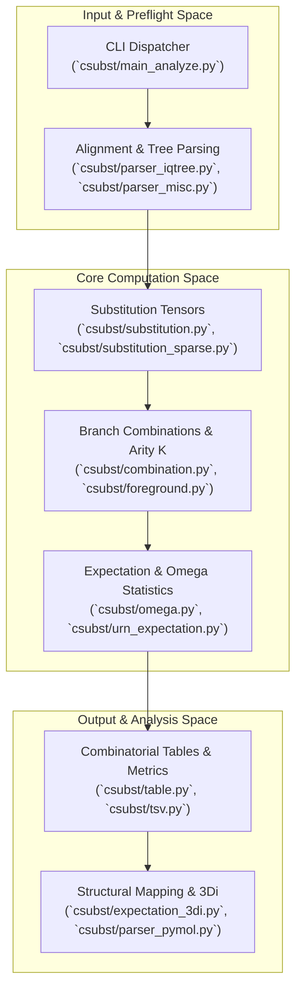
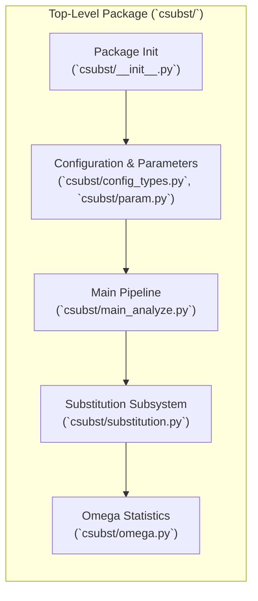

# Overview

Relevant source files

The following files were used as context for generating this wiki page:

- [README.md](README.md)
- [csubst/__init__.py](csubst/__init__.py)
- [csubst/combination.py](csubst/combination.py)
- [csubst/foreground.py](csubst/foreground.py)
- [csubst/main_analyze.py](csubst/main_analyze.py)
- [csubst/main_benchmark.py](csubst/main_benchmark.py)
- [csubst/main_benchmark_plot.py](csubst/main_benchmark_plot.py)
- [csubst/main_simulate.py](csubst/main_simulate.py)
- [csubst/omega.py](csubst/omega.py)
- [csubst/param.py](csubst/param.py)
- [csubst/parser_biodb.py](csubst/parser_biodb.py)
- [csubst/parser_iqtree.py](csubst/parser_iqtree.py)
- [csubst/parser_misc.py](csubst/parser_misc.py)
- [csubst/parser_pymol.py](csubst/parser_pymol.py)
- [csubst/plotting.py](csubst/plotting.py)
- [csubst/recoding.py](csubst/recoding.py)
- [csubst/substitution.py](csubst/substitution.py)
- [csubst/tree.py](csubst/tree.py)
- [docs/ARCHITECTURE.md](docs/ARCHITECTURE.md)
- [pyproject.toml](pyproject.toml)
- [setup.py](setup.py)
- [tests/integration/test_main_benchmark.py](tests/integration/test_main_benchmark.py)
- [tests/unit/test_plotting.py](tests/unit/test_plotting.py)

## Purpose and Scope
**CSUBST** (`csubst`) is a technical computing package designed for detecting and evaluating **C**ombinatorial **SUBST**itutions (recurrent substitutions at the same protein site across multiple independent lineages) on phylogenetic trees [README.md:11-15](). When these independent events result in identical amino acid states, they are quantified as convergent amino acid substitutions [README.md:13-14](). 

The package provides rigorous statistical frameworks—including codon substitution models, empirical rate matrices, and urn-sampling null models [README.md:17-19]()—to compute error-corrected rates of convergence (`omegaC`), non-synonymous substitution densities (`dNC`), and synonymous substitution baselines (`dSC`) [README.md:100]().

As a parent wiki page, this section outlines the high-level architecture, module organization, and core data flow of `csubst`. For installation procedures, environment configuration, and bundled datasets (`PGK`/`PEPC`), see [Getting Started and Installation](#1.1). For a complete tour of the repository layout and internal documentation sets, see [Repository Map and Documentation Set](#1.2).

Sources: `README.md:11-19`, `README.md:100`

---

## High-Level System Architecture

The execution lifecycle of `csubst` flows from raw sequence alignments and phylogenetic trees through ancestral state reconstruction (ASR), substitution tensor generation, branch-combination enumeration, and statistical calibration.

*Figure 1: High-level data flow mapping natural language analysis phases to core Python modules.*

Sources: `csubst/main_analyze.py:140-163`, `csubst/substitution.py:20-43`, `csubst/omega.py:7-49`, `csubst/parser_misc.py:105-128`

---

## Package Layout and Core Modules

The `csubst` codebase is organized into modular subsystems that isolate sequence I/O, tree manipulation, sparse tensor operations, statistical modeling, and visualization.

*Figure 2: Package layout mapping configuration, analysis orchestrators, and calculation modules.*

### Key Component Roles:
- **Initialization and Extension Loading**: `csubst/__init__.py` defines package versioning (`__version__ = '1.16.20'`) and lazy-loads optional high-performance Cython modules (`combination_cy`, `omega_cy`, `substitution_cy`, etc.) with transparent NumPy/pure-Python fallbacks [csubst/__init__.py:1-10]().
- **Configuration and Parameter Validation**: `csubst/config_types.py` and `csubst/param.py` define strongly typed configuration schemas (`AnalysisConfig`) and normalize runtime parameters [csubst/main_analyze.py:10]().
- **Pipeline Orchestration**: `csubst/main_analyze.py` manages the arity ($K$) progression loop, streaming output tables (`_write_cbs_stream`), and filtering high-order candidates [csubst/main_analyze.py:54-138, 140-163]().

Sources: `csubst/__init__.py:1-11`, `csubst/main_analyze.py:10-163`, `csubst/param.py:1-20`

---

## Child Pages

For comprehensive technical documentation on specific subsystems, consult the following child pages:
- [Getting Started and Installation](#1.1) — Installation workflows (`pip`, `sdist`, wheels, Bioconda), optional Cython extensions, environment variables (`CSUBST_SKIP_EXTENSIONS`), bundled datasets (`PGK`/`PEPC`), and first-run examples [README.md:34-80]().
- [Repository Map and Documentation Set](#1.2) — Detailed inventory of top-level directories (`csubst/`, `docs/`, `tests/`, `tools/`, `reports/`, `logo/`, `images/`, `.github/`) and method documentation files [README.md:96-107]().

Sources: `README.md:34-107`

---