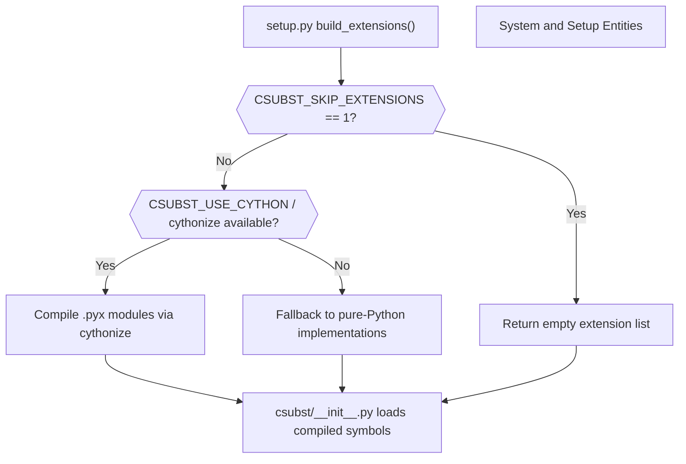
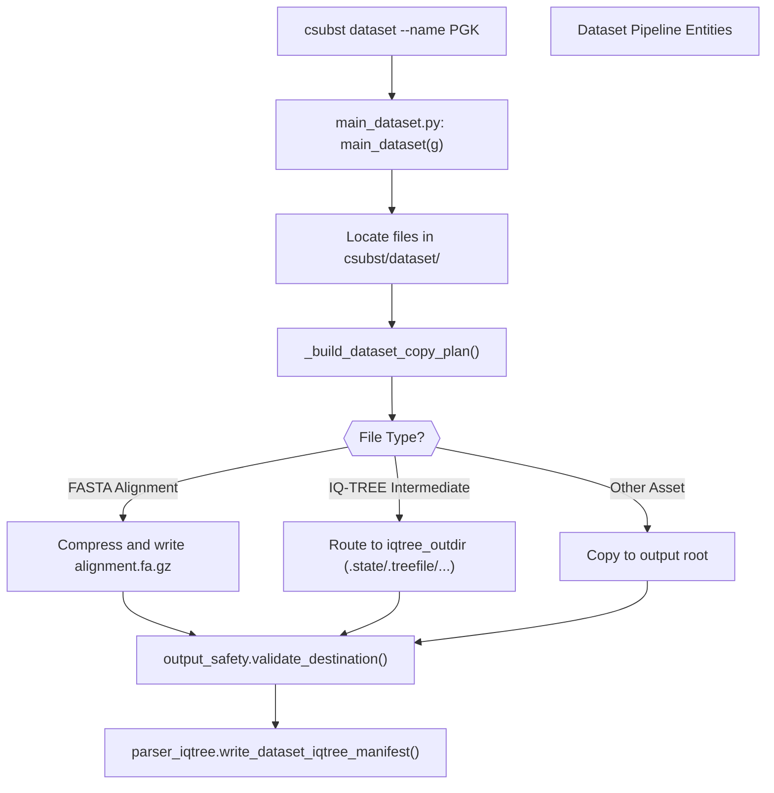

# Getting Started and Installation

<details>
<summary>Relevant source files</summary>

The following files were used as context for generating this wiki page:

- [.github/dependabot.yml](.github/dependabot.yml)
- [.github/scripts/_safe_workdir.py](.github/scripts/_safe_workdir.py)
- [.github/scripts/repository_hygiene_check.py](.github/scripts/repository_hygiene_check.py)
- [.github/workflows/dependency-audit.yml](.github/workflows/dependency-audit.yml)
- [.github/workflows/wheels.yml](.github/workflows/wheels.yml)
- [README.md](README.md)
- [csubst/__init__.py](csubst/__init__.py)
- [csubst/dataset/PEPC.alignment.fa](csubst/dataset/PEPC.alignment.fa)
- [csubst/dataset/PEPC.foreground.tsv](csubst/dataset/PEPC.foreground.tsv)
- [csubst/dataset/PEPC.foreground.txt](csubst/dataset/PEPC.foreground.txt)
- [csubst/dataset/PEPC.tree.nwk](csubst/dataset/PEPC.tree.nwk)
- [csubst/dataset/PGK.alignment.fa](csubst/dataset/PGK.alignment.fa)
- [csubst/dataset/PGK.foreground.txt](csubst/dataset/PGK.foreground.txt)
- [csubst/dataset/PGK.tree.nwk](csubst/dataset/PGK.tree.nwk)
- [csubst/main_dataset.py](csubst/main_dataset.py)
- [csubst/main_doctor.py](csubst/main_doctor.py)
- [csubst/main_simulate.py](csubst/main_simulate.py)
- [csubst/parser_biodb.py](csubst/parser_biodb.py)
- [csubst/parser_pymol.py](csubst/parser_pymol.py)
- [setup.py](setup.py)
- [tests/cli/test_cli_logging.py](tests/cli/test_cli_logging.py)
- [tests/integration/test_foreground_targets.py](tests/integration/test_foreground_targets.py)
- [tests/integration/test_main_dataset.py](tests/integration/test_main_dataset.py)
- [tests/parity/test_expected_sparse.py](tests/parity/test_expected_sparse.py)
- [tests/parity/test_omega_expected_state.py](tests/parity/test_omega_expected_state.py)
- [tests/parity/test_omega_expected_state_parity.py](tests/parity/test_omega_expected_state_parity.py)
- [tests/unit/test_simulate_core.py](tests/unit/test_simulate_core.py)
- [tests/unit/test_substitution_dense_tensor.py](tests/unit/test_substitution_dense_tensor.py)

</details>


## Purpose and Scope
This page covers installation workflows, optional compilation of Cython extensions, environment variable configurations, bundled example datasets (`PGK`/`PEPC`), and first-run execution examples for CSUBST. It documents the underlying Python build system logic (`setup.py`), fallback execution modes (`csubst/__init__.py`), and asset extraction routines (`csubst/main_dataset.py`).

Sources: [setup.py:1-89](), [csubst/__init__.py:1-10](), [csubst/main_dataset.py:1-155]()

---

## Installation Methods and Package Extras
CSUBST supports Python 3.10 through 3.14 [README.md:6](). Installation is supported via Bioconda, source builds, or binary wheels.

### Recommended Installation (Bioconda)
Bioconda automatically provisions system dependencies such as the IQ-TREE binary [README.md:34]:
```bash
conda install bioconda::csubst
```

### Pip and Source Installation
When installing via `pip`, IQ-TREE and a C compiler must be provisioned independently [README.md:34]:
```bash
python -m pip install git+https://github.com/kfuku52/csubst
```

### Optional Extras
- **Structure mapping**: Installs PyMOL dependencies [README.md:52]:
  ```bash
  python -m pip install "csubst[structure] @ git+https://github.com/kfuku52/csubst"
  ```
- **Protein-language-model features (VESM)**: Installs language-model inference requirements [README.md:59]:
  ```bash
  python -m pip install "csubst[vep] @ git+https://github.com/kfuku52/csubst"
  ```

Sources: [README.md:33-64]()

---

## Cython Extension Architecture and Environment Variables
CSUBST accelerates heavy tensor operations and substitution matrix computations using compiled Cython extensions. The build script (`setup.py`) inspects environment variables and determines whether to compile `.pyx` modules or fallback to pure-Python implementations.

### Cython Modules and Build Logic
The six core extension modules defined in `setup.py` are [setup.py:15-22]():
1. `combination_cy`
2. `omega_cy`
3. `parser_iqtree_cy`
4. `recoding_cy`
5. `substitution_cy`
6. `substitution_sparse_cy`

The build function `build_extensions()` evaluates the `CSUBST_SKIP_EXTENSIONS` and `CSUBST_USE_CYTHON` flags [setup.py:50-84]():
- `CSUBST_SKIP_EXTENSIONS=1`: Bypasses extension compilation entirely, returning an empty extension list [setup.py:51-52]().
- `CSUBST_USE_CYTHON=auto` (default): Attempts to compile `.pyx` files using `cythonize` if Cython is installed and source files are present [setup.py:53-59]().
- If extensions are unbuilt or skipped, `csubst/__init__.py` exposes `None` compatibility attributes, allowing internal modules to load pure-Python fallbacks lazily [csubst/__init__.py:3-10]().


*Figure 1: Cython compilation resolution and fallback data flow connecting `setup.py` and `csubst/__init__.py`.*

Sources: [setup.py:1-89](), [csubst/__init__.py:1-10](), [.github/workflows/wheels.yml:58-69](), [.github/workflows/dependency-audit.yml:37-41]()

---

## Bundled Datasets and Asset Pipeline
CSUBST bundles example datasets (`PGK` and `PEPC`) inside the package tree (`csubst/dataset/`) [README.md:97, csubst/main_dataset.py:147-148](). The `csubst dataset` CLI command invokes `main_dataset(g)` to extract, format, and copy these files into the working directory [csubst/main_dataset.py:146-155]().

### Asset Extraction Data Flow
The extraction routine `_copy_dataset_files` performs the following steps:
1. Locates source files matching the dataset name prefix (e.g., `PGK.`) [csubst/main_dataset.py:34, 147-151]().
2. Automatically gzips plain FASTA files into `alignment.fa.gz` [csubst/main_dataset.py:39-42]().
3. Routes IQ-TREE intermediate artifacts (`.state`, `.rate`, `.treefile`, `.iqtree`, `.log`) to the configured `iqtree_outdir` [csubst/main_dataset.py:43-50, 85-94]().
4. Validates target path safety using `output_safety.validate_destination()` [csubst/main_dataset.py:102-103]().
5. Generates an IQ-TREE provenance manifest (`.csubst-manifest.json`) via `parser_iqtree.write_dataset_iqtree_manifest()` upon successful extraction [csubst/main_dataset.py:131-143]().


*Figure 2: Dataset asset unpacking and manifest generation pipeline.*

Sources: [csubst/main_dataset.py:1-155]()

---

## First Run Workflow and Verification
To verify the installation and test dataset generation, run the following commands in an empty directory [README.md:67-75]():

```bash
# Generate the bundled PGK test dataset
csubst dataset --name PGK

# Run combinatorial substitution search analysis
csubst search --alignment_file alignment.fa.gz --rooted_tree_file tree.nwk --foreground foreground.txt
```

### Execution Artifacts
Upon completion of `csubst search`, inspect the output directory:
- `csubst_search/csubst_cb_2.tsv`: Tab-separated table containing inferred combinatorial substitutions for branch pairs ($K=2$) [README.md:79]().
- `csubst_search/csubst_search_run.json`: Run history and status log; verify that the execution status reads `complete` before downstream interpretation [README.md:79-80]().

Sources: [README.md:65-83]()

---