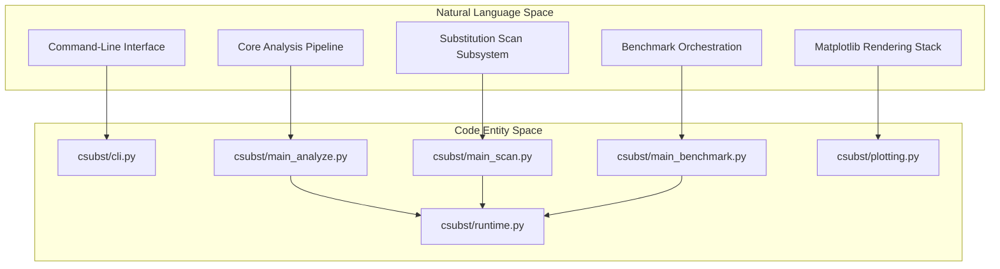
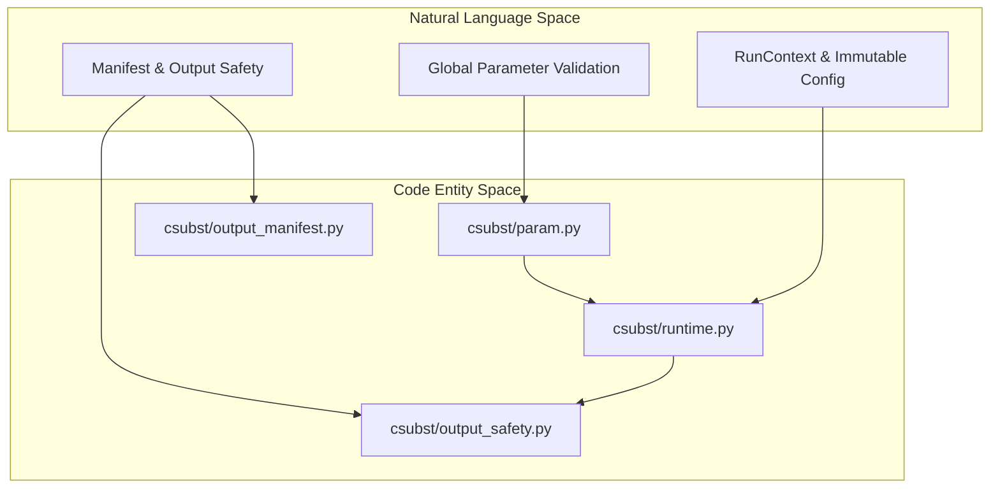

# Repository Map and Documentation Set

Relevant source files

The following files were used as context for generating this wiki page:

- [csubst/main_benchmark.py](csubst/main_benchmark.py)
- [csubst/main_benchmark_plot.py](csubst/main_benchmark_plot.py)
- [csubst/plotting.py](csubst/plotting.py)
- [csubst/recoding.py](csubst/recoding.py)
- [docs/ARCHITECTURE.md](docs/ARCHITECTURE.md)
- [docs/SCAN_CALIBRATION.md](docs/SCAN_CALIBRATION.md)
- [logo/logo_csubst.svg](logo/logo_csubst.svg)
- [logo/logo_csubst_large.svg](logo/logo_csubst_large.svg)
- [pyproject.toml](pyproject.toml)
- [reports/documentation_audit_20260922/README.md](reports/documentation_audit_20260922/README.md)
- [tests/integration/test_main_benchmark.py](tests/integration/test_main_benchmark.py)
- [tests/integration/test_scan_calibration_null.py](tests/integration/test_scan_calibration_null.py)
- [tests/unit/test_plotting.py](tests/unit/test_plotting.py)
- [tools/validate_scan_calibration.py](tools/validate_scan_calibration.py)

### Purpose and Scope

This document provides a comprehensive technical tour of the `csubst` repository layout and its documentation set. It maps top-level directories—such as `csubst/`, `docs/`, `tests/`, `tools/`, `reports/`, `logo/`, `images/`, and `.github/`—to their underlying code entities, data flows, and structural roles. It serves as a navigational guide for developers and system maintainers exploring the codebase structure defined in `pyproject.toml` [pyproject.toml:1-115] and described in `docs/ARCHITECTURE.md` [docs/ARCHITECTURE.md:1-114].

Sources: `pyproject.toml:1-115`, `docs/ARCHITECTURE.md:1-114`

---

## Top-Level Directory Tour

The repository is organized into distinct functional domains separating core numerical pipelines, command-line interfaces, tests, build configurations, and research artifacts.

| Directory / Path | Architectural Role & Contents | Key Entry Points / References |
| --- | --- | --- |
| `csubst/` | Core Python package containing CLI dispatchers, analysis pipelines, optimization routines, and optional Cython accelerators. | `csubst/cli.py`, `csubst/main_analyze.py`, `csubst/runtime.py` [pyproject.toml:60-60]() |
| `docs/` | Methodological guides, architectural specifications, and validation documentation (e.g., architectural design, scan calibration). | `docs/ARCHITECTURE.md`, `docs/SCAN_CALIBRATION.md` [docs/ARCHITECTURE.md:1-113]() |
| `tests/` | Automated test suite organized into unit, integration, CLI, parity, and process validation suites. | `tests/unit/test_plotting.py`, `tests/integration/test_main_benchmark.py` [tests/unit/test_plotting.py:1-61]() |
| `tools/` | Standalone utility scripts for deployment validation, scan calibration auditing, and benchmark execution. | `tools/validate_scan_calibration.py` [reports/documentation_audit_20260922/README.md:1-96]() |
| `reports/` | Historical audit logs, documentation audit reports, and issue investigation artifacts. | `reports/documentation_audit_20260922/README.md` [reports/documentation_audit_20260922/README.md:1-96]() |
| `logo/` & `images/` | Vector branding assets, SVG package logos, and documentation illustration files. | `logo/logo_csubst.svg`, `logo/logo_csubst_large.svg` [logo/logo_csubst.svg:1-131]() |
| `.github/` | CI/CD automation workflows, GitHub Actions configuration, and repository management scripts. | `.github/workflows/` (implied by CI setup) [docs/ARCHITECTURE.md:97-105]() |
| Root Files | Build specifications, package dependencies, license files, and project manifests. | `pyproject.toml`, `LICENSE`, `README.md` [pyproject.toml:1-114]() |

Sources: `pyproject.toml:1-115`, `docs/ARCHITECTURE.md:1-114`, `reports/documentation_audit_20260922/README.md:1-96`, `logo/logo_csubst.svg:1-131`

---

## Method Documentation and Architectural Specs (`docs/`)

The `docs/` directory houses technical specifications detailing numerical algorithms, statistical expectations, and operational safety guarantees. These documents bridge mathematical formulations with implementation modules in `csubst/`.

- **`docs/ARCHITECTURE.md`**: Defines package staging, the `runtime.RunContext` data flow, parameter normalization stages, and optional Cython acceleration fallback modes [docs/ARCHITECTURE.md:1-114].
- **`docs/SCAN_CALIBRATION.md`**: Outlines the empirical uniform clade-assignment null model, permutation samplers, and family-wise error control options used by `csubst scan` [docs/SCAN_CALIBRATION.md:1-118].
- **Additional Method Notes**: Cover topics such as analytical endpoint-enrichment inference (`SCAN_ANALYTICAL.md`), scan scores and bootstrap inference (`SCAN_INFERENCE.md`), structural weighting (`STRUCTURE_WEIGHTING.md`), and CLI safety guarantees (`CLI_SAFETY.md`) [docs/ARCHITECTURE.md:10-12,107-114].

Sources: `docs/ARCHITECTURE.md:1-114`, `docs/SCAN_CALIBRATION.md:1-118`

---

## Diagram: Top-Level System Architecture and Directory Mapping

This diagram maps natural language system concepts to their specific code entities and file paths across the repository layout.

Sources: `docs/ARCHITECTURE.md:1-13`, `csubst/main_benchmark.py:1-25`, `csubst/plotting.py:1-55`

---

## Diagram: Architectural State Management and Documentation Flow

This diagram illustrates how command inputs, validated configuration objects, and architectural states interact within the pipeline execution framework.

Sources: `docs/ARCHITECTURE.md:19-34`, `csubst/main_benchmark_plot.py:1-12`, `tests/integration/test_main_benchmark.py:1-15`

---