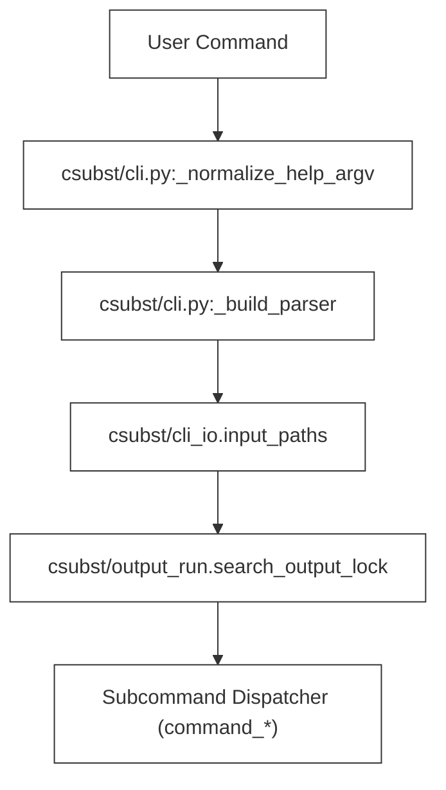
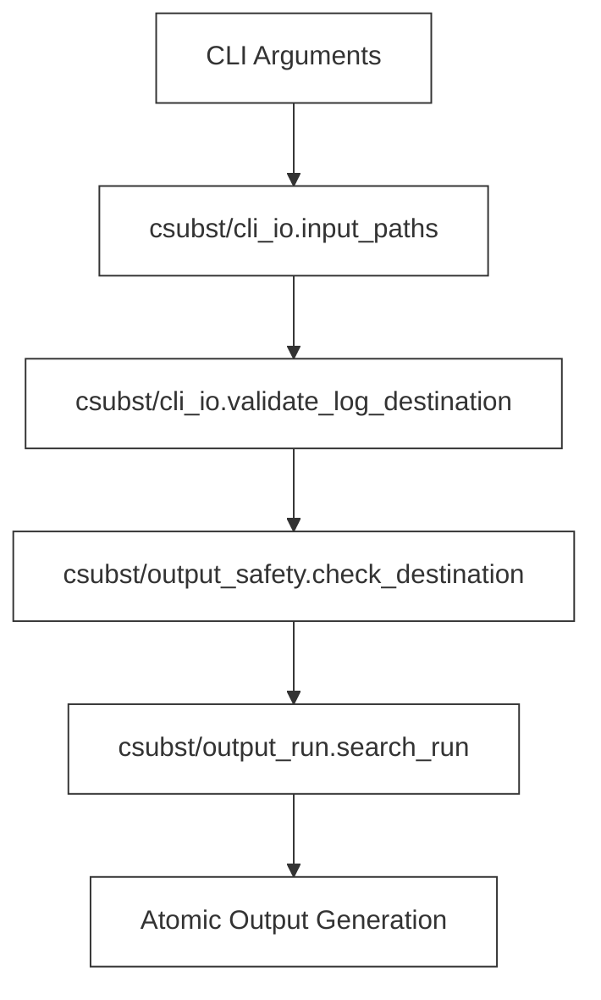

# Command-Line Interface

Relevant source files

The following files were used as context for generating this wiki page:

- [Makefile](Makefile)
- [csubst/cli.py](csubst/cli.py)
- [csubst/cli_io.py](csubst/cli_io.py)
- [csubst/config_types.py](csubst/config_types.py)
- [csubst/main_download.py](csubst/main_download.py)
- [csubst/output_run.py](csubst/output_run.py)
- [docs/CLI_SAFETY.md](docs/CLI_SAFETY.md)
- [tests/cli/test_cli_validation.py](tests/cli/test_cli_validation.py)
- [tests/cli/test_output_lifecycle.py](tests/cli/test_output_lifecycle.py)
- [tests/integration/test_resource_cache.py](tests/integration/test_resource_cache.py)
- [tests/unit/test_main_download.py](tests/unit/test_main_download.py)

The Command-Line Interface (CLI) serves as the primary orchestration entry point for `csubst`. It handles command-line argument parsing, preflight safety validation for files and logs, configuration typing, and dispatching execution across diverse bioinformatics workflows—ranging from combinatorial substitution searches and recurrent substitution scans to structural alphabet predictions and sequence simulations.

The core CLI entry point is defined in `[csubst/cli.py:1-43]()`, which coordinates parser construction [[tests/cli/test_cli_validation.py:60-67]()], argument normalization, and dispatching to subcommand handlers.

Sources: `[csubst/cli.py:1-65]()`, `[tests/cli/test_cli_validation.py:60-67]()`, `[csubst/cli_io.py:20-91]()`, `[csubst/output_run.py:23-33]()`

---

## 2.1. Subcommand Organization and Argument Parsing

The CLI exposes a modular set of subcommands via `[csubst/cli.py:55-117]()`, covering analytical pipelines (`search`, `analyze`), scanning (`scan`), site-level structural workflows (`sites`), simulations (`simulate`), resource management (`download`, `dataset`), diagnostics (`doctor`), and benchmarking (`benchmark`, `benchmark-plot`). Shared option groups—such as output layout arguments defined in `[csubst/cli.py:151-171]()`—ensure consistent path management and logging controls across all subcommands.

Argument parsing relies on `argparse` with custom extensions for advanced parameter visibility (`[csubst/cli.py:55-60]()`) and namespace default resolution (`[csubst/cli.py:127-148]()`). For full details on parser construction, subcommand dispatchers, and argument validation routines, see [Subcommands and Argument Parsing](#2.1).

Sources: `[csubst/cli.py:55-171]()`

---

## 2.2. Input/Output Safety and Run Lifecycle

Robustness is enforced before execution via preflight safety checks implemented in `[csubst/cli_io.py:1-98]()`. These checks scan supplied, default, and inferred paths (such as IQ-TREE outputs managed by `[csubst/runtime.py]()`) to prevent logs or output tables from overwriting primary input files or active log files through file paths, symbolic links, or hard links `[docs/CLI_SAFETY.md:1-22]()`.

Sources: `[docs/CLI_SAFETY.md:1-37]()`, `[csubst/cli_io.py:20-98]()`, `[csubst/output_run.py:58-94]()`

Output files utilize atomic writes and manifest generation (`outputs.tsv`), while search jobs enforce directory locking and historical table archiving (`[csubst/output_run.py:50-94]()`). For comprehensive coverage of preflight collision checks, atomic writing contracts, and execution history management, see [Input/Output Safety and Run Lifecycle](#2.2).

Sources: `[docs/CLI_SAFETY.md:1-37]()`, `[csubst/output_run.py:50-94]()`

---

## 2.3. Configuration, Parameters and Diagnostics

Runtime parameters and analytical settings are mapped to typed structures using `TypedDict` contracts in `[csubst/config_types.py:1-157]()`. These configurations organize settings into distinct functional categories—including `InputConfig`, `OutputConfig`, `NumericConfig`, `ModelConfig`, and `ScanConfig`—which collectively form the `AnalysisConfig` mapping passed through pipeline stages.

Validation of parameters and inputs is reinforced by diagnostic tooling such as `main_doctor` and configuration validators, ensuring invalid inputs or misconfigured parameters fail early with descriptive error codes before compute-heavy inference steps run `[tests/cli/test_cli_validation.py:127-181]()`. For deep technical details on typed schemas, parameter validation logic, and diagnostic helpers, see [Configuration, Parameters and Diagnostics](#2.3).

Sources: `[csubst/config_types.py:1-157]()`, `[tests/cli/test_cli_validation.py:127-181]()`

---