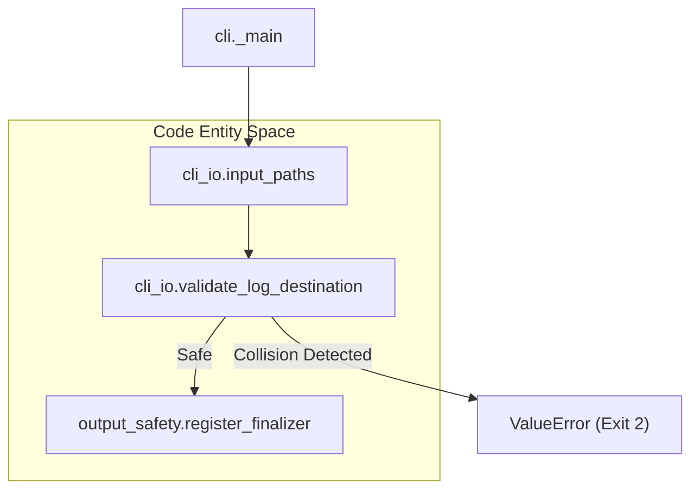
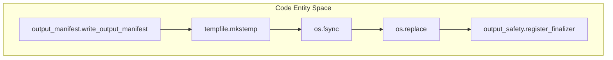
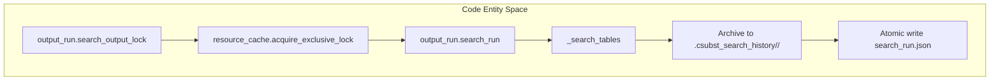

# Input/Output Safety and Run Lifecycle

Relevant source files

The following files were used as context for generating this wiki page:

- [Makefile](Makefile)
- [csubst/cli.py](csubst/cli.py)
- [csubst/cli_io.py](csubst/cli_io.py)
- [csubst/config_types.py](csubst/config_types.py)
- [csubst/main_download.py](csubst/main_download.py)
- [csubst/output_manifest.py](csubst/output_manifest.py)
- [csubst/output_run.py](csubst/output_run.py)
- [docs/CLI_SAFETY.md](docs/CLI_SAFETY.md)
- [tests/cli/test_cli_input_safety.py](tests/cli/test_cli_input_safety.py)
- [tests/cli/test_cli_validation.py](tests/cli/test_cli_validation.py)
- [tests/cli/test_output_lifecycle.py](tests/cli/test_output_lifecycle.py)
- [tests/integration/test_clade_permutation.py](tests/integration/test_clade_permutation.py)
- [tests/integration/test_output_run.py](tests/integration/test_output_run.py)
- [tests/integration/test_resource_cache.py](tests/integration/test_resource_cache.py)
- [tests/unit/test_main_download.py](tests/unit/test_main_download.py)
- [tests/unit/test_main_sites_tree_selection.py](tests/unit/test_main_sites_tree_selection.py)
- [tests/unit/test_omega_calibration.py](tests/unit/test_omega_calibration.py)
- [tests/unit/test_omega_pvalues.py](tests/unit/test_omega_pvalues.py)
- [tests/unit/test_tree_rendering_config.py](tests/unit/test_tree_rendering_config.py)
- [tests/unit/test_tree_rendering_layout.py](tests/unit/test_tree_rendering_layout.py)
- [tests/unit/test_tree_rendering_matplotlib.py](tests/unit/test_tree_rendering_matplotlib.py)

## Purpose and Scope

This page documents the input/output safety, collision protection, atomic writing mechanics, output manifesting (`outputs.tsv`), and search execution lifecycle in `csubst`. The subsystem guarantees that user inputs, existing logs, and previously computed tables are never overwritten or truncated by careless option configuration, shell redirection mistakes, or concurrent process collisions.

Sources: `docs/CLI_SAFETY.md:1-120` [docs/CLI_SAFETY.md](), `csubst/cli_io.py:1-126` [csubst/cli_io.py]()

---

## 1. Preflight Input Collision Checks (`cli_io.py`)

Before the CLI opens log files or executes any numerical pipelines, `csubst/cli_io.py` inspects parsed arguments, inferred paths, and raw CLI tokens to prevent destination-input collisions.

### Key Functions and Data Flow

* `_path_actions(parser)`: Recursively extracts all `argparse.Action` objects from the parser hierarchy whose metavar starts with `PATH` [csubst/cli_io.py:11-18]().
* `input_paths(parser, args, argv)`: Enumerates explicitly supplied files, default paths, raw `argv` tokens, and inferred IQ-TREE input files (`treefile`, `state`, `rate`, `iqtree`, `log`) under `iqtree_outdir` [csubst/cli_io.py:20-91]().
* `validate_log_destination(log_path, parser, args, argv)`: Compares the resolved log path against every enumerated input path using `output_safety.same_path()`. If a collision occurs, it raises a `ValueError` exiting with status 2 [csubst/cli_io.py:93-97]().
* `validate_output_destinations(layout, args, protected)`: Checks command-specific output destinations (such as `doctor_summary.tsv`, `outputs.tsv`, or search table sets like `_cb_[0-9]+\.tsv`) against protected input collections [csubst/cli_io.py:99-125]().

Sources: `csubst/cli_io.py:11-125` [csubst/cli_io.py](), `tests/cli/test_output_lifecycle.py:55-74` [tests/cli/test_output_lifecycle.py]()

---

## 2. Atomic Writes and Output Manifests (`output_manifest.py`)

To prevent partial writes or corrupted files when processes terminate abruptly, file outputs are written atomically. The final output manifest (`outputs.tsv`) records file metadata, sizes, and paths.

### Key Functions and Mechanics

* `_write_text_atomic(path, text)`: Creates a temporary file in the target directory via `tempfile.mkstemp()`, writes the payload, flushes buffers, calls `os.fsync()`, and atomically replaces the destination via `os.replace()` [csubst/output_manifest.py:111-129]().
* `add_output_manifest_row(...)`: Appends a record of a generated artifact to the manifest rows structure, capturing UTC timestamps, absolute/relative paths, existence status, file sizes, and branch IDs [csubst/output_manifest.py:46-92]().
* `write_output_manifest(...)`: Initializes the manifest row for `outputs.tsv`, registers a finalization callback with `output_safety.register_finalizer()`, and iteratively stabilizes column-width self-sizing metadata before atomic serialization [csubst/output_manifest.py:131-180]().

Sources: `csubst/output_manifest.py:46-180` [csubst/output_manifest.py](), `tests/cli/test_output_lifecycle.py:95-110` [tests/cli/test_output_lifecycle.py]()

---

## 3. Search Run History, Locking, and Lifecycle (`output_run.py`)

Combinatorial search runs (`csubst search` or `analyze`) maintain historical search tables and prevent overlapping writes through directory locking and archival.

### Key Mechanisms

* `search_output_lock(g)`: Acquires an exclusive lock on `search_run.json` before the CLI opens its log, guarding the search namespace against concurrent invocations [csubst/output_run.py:23-33]().
* `search_run(g)`: Context manager that establishes a unique run ID (`uuid.uuid4().hex`), archives existing combinatorial tables (`cb_*.tsv`, `b.tsv`, `s.tsv`, etc.) into `.csubst_search_history/<run-id>/`, maintains a running/complete/failed status record in `search_run.json`, and records final outputs upon completion [csubst/output_run.py:58-94]().

Sources: `csubst/output_run.py:1-95` [csubst/output_run.py](), `tests/cli/test_output_lifecycle.py:111-145` [tests/cli/test_output_lifecycle.py]()

---