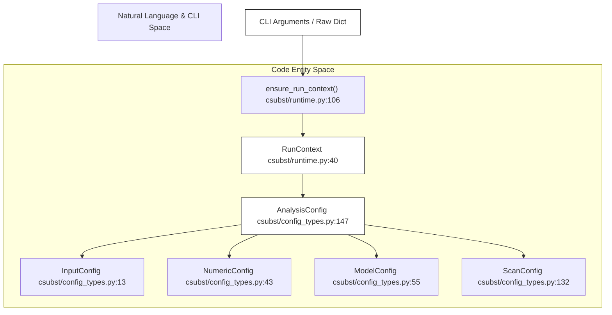
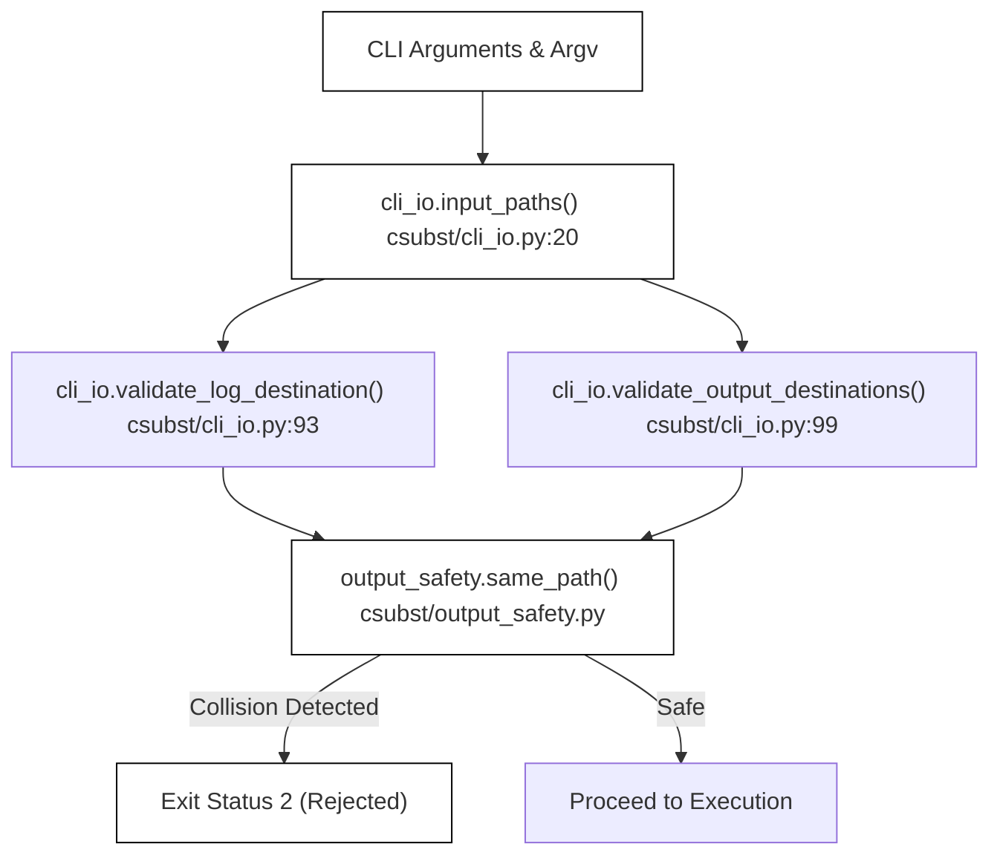

# Configuration, Parameters and Diagnostics

Relevant source files

The following files were used as context for generating this wiki page:

- [Makefile](Makefile)
- [csubst/cli.py](csubst/cli.py)
- [csubst/cli_io.py](csubst/cli_io.py)
- [csubst/config_types.py](csubst/config_types.py)
- [csubst/endpoint_io.py](csubst/endpoint_io.py)
- [csubst/event_reporting.py](csubst/event_reporting.py)
- [csubst/main_download.py](csubst/main_download.py)
- [csubst/output_run.py](csubst/output_run.py)
- [csubst/runtime.py](csubst/runtime.py)
- [csubst/tsv.py](csubst/tsv.py)
- [docs/CLI_SAFETY.md](docs/CLI_SAFETY.md)
- [reports/documentation_audit_20260922/RESOLUTION.md](reports/documentation_audit_20260922/RESOLUTION.md)
- [tests/cli/test_cli_validation.py](tests/cli/test_cli_validation.py)
- [tests/cli/test_output_lifecycle.py](tests/cli/test_output_lifecycle.py)
- [tests/integration/test_main_doctor.py](tests/integration/test_main_doctor.py)
- [tests/integration/test_resource_cache.py](tests/integration/test_resource_cache.py)
- [tests/unit/test_main_download.py](tests/unit/test_main_download.py)
- [tests/unit/test_param_core.py](tests/unit/test_param_core.py)

## Purpose and Scope

This page documents the configuration contracts, parameter validation layers, input diagnostics, and runtime safety infrastructure in `csubst`. It details howtyped dictionaries in `csubst/config_types.py` organize pipeline settings, how `csubst/runtime.py` and `csubst/cli_io.py` manage run contexts and preflight collision checks, how `csubst/output_run.py` handles execution history, and how diagnostic routines verify inputs prior to heavy computation.

---

## 1. Typed Configuration and Runtime Contexts (`AnalysisConfig`)

The `csubst` pipeline manages configurations via typed dictionaries defined in `csubst/config_types.py` and wrapped by the `RunContext` class in `csubst/runtime.py`. Rather than relying on unstructured global dictionaries, settings are partitioned into logical sub-dictionaries representing distinct configuration lifecycles.

### Configuration Categories

The root configuration contract `AnalysisConfig` inherits from several specialized `TypedDict` definitions (`[csubst/config_types.py:14-156]()`):

*   `InputConfig`: File path references, alignment sources, rooted trees, foreground definitions, and genetic codes (`[csubst/config_types.py:13-32]()`).
*   `OutputConfig`: Output directory (`outdir`), filename stems (`output_prefix`), log paths, and floating-point precision rules (`[csubst/config_types.py:34-42]()`).
*   `NumericConfig`: Multithreading bounds (`threads`, `blas_threads`), random seeds, and arity parameters (`[csubst/config_types.py:43-54]()`).
*   `ModelConfig`: Substitution models, posteriors, expectation methods, rate heterogeneity parameters, and recoding configuration (`[csubst/config_types.py:55-88]()`).
*   `AnalysisState`: Mutable analysis state holding loaded trees, node counts, tensor reducers, branch tables, and score matrices (`[csubst/config_types.py:90-110]()`).
*   `OutputSwitches`: Booleans controlling which output tables (`b.tsv`, `bs.tsv`, `cb_*.tsv`, etc.) are materialized (`[csubst/config_types.py:112-124]()`).
*   `ScanConfig`: Settings for recurrent substitution scans, analytic p-values, and calibration permutations (`[csubst/config_types.py:132-146]()`).

### Runtime Context Wrapping

The `RunContext` class wraps configuration dictionaries and runtime state to provide transparent attribute/key lookup, mutation isolation, and dictionary compatibility (`[csubst/runtime.py:40-104]`). The helper `ensure_run_context()` normalizes raw dictionaries into active `RunContext` instances (`[csubst/runtime.py:106-110]()`).

*Figure 1: Bridge from CLI/Natural Language arguments to typed configuration classes (`AnalysisConfig` and `RunContext`).*

Sources: `csubst/config_types.py:1-158()`, `csubst/runtime.py:29-110()`

---

## 2. Preflight Safety, Input Paths, and Output Collisions

Before any computation or logging starts, `csubst` performs rigorous preflight validation through `csubst/cli_io.py` and `csubst/output_safety.py`. This ensures logs never overwrite input alignments, trees, or active search history files.

### Input Path Enumeration and Collision Checks

The `input_paths()` function in `csubst/cli_io.py` parses command-line actions and raw arguments to enumerate all supplied and inferred file inputs, including IQ-TREE intermediate files (`.state`, `.rate`, `.treefile`, `.log`, `.iqtree`) (`[csubst/cli_io.py:20-70]()`). 

The function `validate_log_destination()` verifies that the designated log file does not collide with any input path via direct matching, symlinks, or hardlinks (`[csubst/cli_io.py:93-97]()`). Any collision triggers an immediate exit (status 2) without modifying files (`[tests/cli/test_output_lifecycle.py:55-74]()`, `[docs/CLI_SAFETY.md:1-10]()`).

Similarly, `validate_output_destinations()` checks analysis-specific outputs such as `search_run.json`, `cb_stats.tsv`, and combinatorial tables (`cb_<arity>.tsv`) against protected input paths (`[csubst/cli_io.py:99-125]()`).

*Figure 2: Preflight validation data flow verifying input/output separation before execution.*

Sources: `csubst/cli_io.py:11-126()`, `docs/CLI_SAFETY.md:1-22()`

---

## 3. Search History and Run Isolation (`output_run.py`)

When executing `csubst search` or `csubst analyze`, earlier search tables are preserved and tracked using search run records (`[docs/CLI_SAFETY.md:23-33]()`).

### Search Output Locking and Archival

*   `search_output_lock(g)` acquires an exclusive resource lock on `search_run.json` before the CLI log opens, preventing concurrent writes to the same output namespace (`[csubst/output_run.py:23-33]()`).
*   `search_run(g)` manages the run lifecycle by creating a unique run directory under `.csubst_search_history/<run-id>/` and moving previous tables into it before new computations begin (`[csubst/output_run.py:58-84]()`).
*   The metadata file `<prefix>_search_run.json` records schema versions, run identifiers, `running`, `complete`, or `failed` statuses, and lists archived vs. active output files (`[csubst/output_run.py:81-94]()`).

Sources: `csubst/output_run.py:1-95()`, `docs/CLI_SAFETY.md:23-36()`

---

## 4. Diagnostics and Health Checks (`main_doctor`)

The `doctor` subcommand verifies input alignments, phylogenetic trees, IQ-TREE execution availability, and metadata consistency without executing downstream substitution analyses (`[tests/integration/test_main_doctor.py]()`).

### Diagnostic Checks Performed

1.  **Alignment and Tree Parsing**: Validates FASTA formatting, checks for duplicate sequence identifiers, and ensures header-to-node matching succeed (`[docs/CLI_SAFETY.md:43-53]()`).
2.  **IQ-TREE Executable & Intermediates**: Confirms the availability of the IQ-TREE binary (unless disabled via `--check_iqtree_exe no`) and verifies the presence or compatibility of the five required model files (`.iqtree`, `.log`, `.rate`, `.state`, `.treefile`) (`[docs/CLI_SAFETY.md:87-90]()`).
3.  **Output Manifest Validation**: Ensures all report destinations and summary files (`doctor_summary.tsv`, `doctor_summary.json`, `outputs.tsv`) can be safely written without colliding with input files (`[csubst/cli_io.py:109-113]()`, `[tests/cli/test_output_lifecycle.py:55-74]()`).

Sources: `csubst/cli_io.py:109-113()`, `docs/CLI_SAFETY.md:87-90()`, `tests/integration/test_main_doctor.py`

---

## 5. Runtime Environment and TSV Helpers

Runtime configuration helpers manage thread allocations for BLAS and numerical libraries, layout directories, and structured tabular file generation.

### Thread Configuration and Layouts

*   `configure_native_threads(num_threads)` sets environment variables (`OMP_NUM_THREADS`, `OPENBLAS_NUM_THREADS`, `MKL_NUM_THREADS`, etc.) to control native library parallelism before NumPy and SciPy initialize (`[csubst/runtime.py:29-37]()`).
*   `ensure_output_layout(g)` normalizes output directory paths, output stems, and log file locations, creating parent directories on demand (`[csubst/runtime.py:132-150]()`).
*   `ensure_iqtree_layout(g)` resolves and establishes the default IQ-TREE output directory (`csubst_iqtree`) (`[csubst/runtime.py:161-166]()`).

Sources: `csubst/runtime.py:29-166()`, `Makefile:3`

---