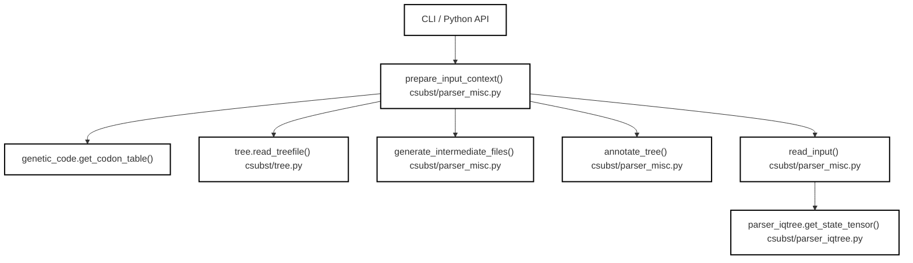
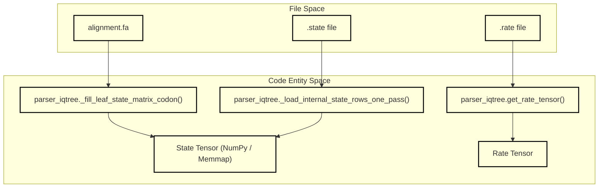

# Input Parsing and Ancestral States

Relevant source files

The following files were used as context for generating this wiki page:

- [.github/scripts/ci_scope.py](.github/scripts/ci_scope.py)
- [csubst/clade_index.py](csubst/clade_index.py)
- [csubst/combination.py](csubst/combination.py)
- [csubst/epistasis.py](csubst/epistasis.py)
- [csubst/ete.py](csubst/ete.py)
- [csubst/foreground.py](csubst/foreground.py)
- [csubst/genetic_code.py](csubst/genetic_code.py)
- [csubst/main_analyze.py](csubst/main_analyze.py)
- [csubst/omega.py](csubst/omega.py)
- [csubst/param.py](csubst/param.py)
- [csubst/parser_iqtree.py](csubst/parser_iqtree.py)
- [csubst/parser_misc.py](csubst/parser_misc.py)
- [csubst/scan_permutation.py](csubst/scan_permutation.py)
- [csubst/scan_statistics.py](csubst/scan_statistics.py)
- [csubst/sequence.py](csubst/sequence.py)
- [csubst/sequence_io.py](csubst/sequence_io.py)
- [csubst/substitution.py](csubst/substitution.py)
- [csubst/tree.py](csubst/tree.py)
- [tests/integration/test_scan_endpoint.py](tests/integration/test_scan_endpoint.py)
- [tests/unit/test_ci_artifacts.py](tests/unit/test_ci_artifacts.py)
- [tests/unit/test_iqtree_state_tensor.py](tests/unit/test_iqtree_state_tensor.py)
- [tests/unit/test_scan_statistics.py](tests/unit/test_scan_statistics.py)

## Purpose and Scope
This page covers the technical implementation of input parsing, phylogenetic tree handling, sequence input/output operations, and ancestral state reconstruction (ASR) parsing within `csubst`. It details how alignment files, phylogenetic trees, and IQ-TREE output files (`.state`, `.rate`, `.treefile`) are consumed, validated, mapped to numerical node indices, and transformed into dense or memory-mapped state tensors for downstream combinatorial substitution analysis.

---

## 1. Input Context Orchestration (`parser_misc.py`)

The high-level entry point for setting up the analysis pipeline is `prepare_input_context()` defined in `csubst/parser_misc.py` [csubst/parser_misc.py:105-128](). This orchestrates genetic code assignment, tree file reading, intermediate file generation, tree annotation, and input state loading [csubst/parser_misc.py:115-119]().

*Figure 1: Architectural bridge between high-level input orchestration and specific code modules.*

Sources: `csubst/parser_misc.py` [csubst/parser_misc.py:105-128]

---

## 2. IQ-TREE Subprocess Integration and Output Parsers (`parser_iqtree.py`)

`csubst` relies heavily on IQ-TREE outputs for maximum likelihood ancestral states (`.state`), site rates (`.rate`), and tree topologies (`.treefile`). The module `csubst/parser_iqtree.py` manages file parsing, version detection, and state tensor allocation.

### State Tensor Construction and Leaf Filling
State tensors store the probability distribution of codons or amino acids across all tree nodes and alignment sites. Leaf node states are populated directly from input sequences via `_fill_leaf_state_matrix_codon()` [csubst/parser_iqtree.py:72-95](), which uses an unambiguous codon lookup table and optionally falls back to Cython acceleration (`parser_iqtree_cy.fill_leaf_state_matrix_codon_unambiguous`) [csubst/parser_iqtree.py:75-81]().

*Figure 2: Data flow mapping raw files to internal memory structures.*

### Version Detection and Compatibility
IQ-TREE version outputs are inspected using `detect_iqtree_output_version()` [csubst/parser_iqtree.py:126-139]() and `_parse_iqtree_version_text()` [csubst/parser_iqtree.py:108-120]() to accommodate format variations between IQ-TREE 1, 2, and 3 (such as equilibrium frequency formatting `pi(AAA)=...`) [csubst/parser_iqtree.py:150-159]().

Sources: `csubst/parser_iqtree.py` [csubst/parser_iqtree.py:35-139]

---

## 3. Phylogenetic Tree Handling and ETE Compatibility (`tree.py`, `ete.py`)

Tree topology processing and node indexing are implemented in `csubst/tree.py` and wrapped by `csubst/ete.py` to support both `ete3` and `ete4` backends transparently [csubst/ete.py:1-38]().

### Numerical Node Labeling
To facilitate tensor indexing and branch combination searches, `add_numerical_node_labels()` assigns a deterministic, zero-based integer index (`numerical_label`) and unique bitset signatures to every node in the tree [csubst/tree.py:124-147](). 

Key utility functions in `csubst/tree.py` include:
* `is_consistent_tree()`: Validates topological consistency between two trees [csubst/tree.py:149-162]().
* `get_tree_topology_signature()`: Generates rooted/unrooted topology signatures invariant to child ordering [csubst/tree.py:165-180]().
* `get_tree_cache_signature()`: Produces hashable cache keys combining branch distances and leaf partitions [csubst/tree.py:183-190]().

Sources: `csubst/tree.py` [csubst/tree.py:124-190](), `csubst/ete.py` [csubst/ete.py:1-55]()

---

## 4. Sequence I/O and Genetic Code Translation (`sequence.py`, `genetic_code.py`)

Raw nucleotide states must be aggregated into codon states and subsequently projected into amino acid or recoded nonsynonymous state spaces.

### State Space Reductions
* Codon State Calculation: `calc_omega_state()` converts triplet nucleotide probabilities into 64-element codon probability vectors across alignment sites [csubst/sequence.py:23-37]().
* Peptide / Amino Acid Projection: `cdn2pep_state()` applies `_cdn2group_state()` using synonymous index mappings derived from the active genetic code (`genetic_code.py`) [csubst/sequence.py:132-139]().
* Nonsynonymous Recoding: `cdn2nsy_state()` maps codon states to custom or automated nonsynonymous groupings (e.g., `3di20` structural alphabet states) [csubst/sequence.py:142-150](). Memory mapping (`np.memmap`) is utilized when processing large alignments for selected branch subsets to bound RAM consumption [csubst/sequence.py:87-93]().

Sources: `csubst/sequence.py` [csubst/sequence.py:23-150](), `csubst/genetic_code.py`

---