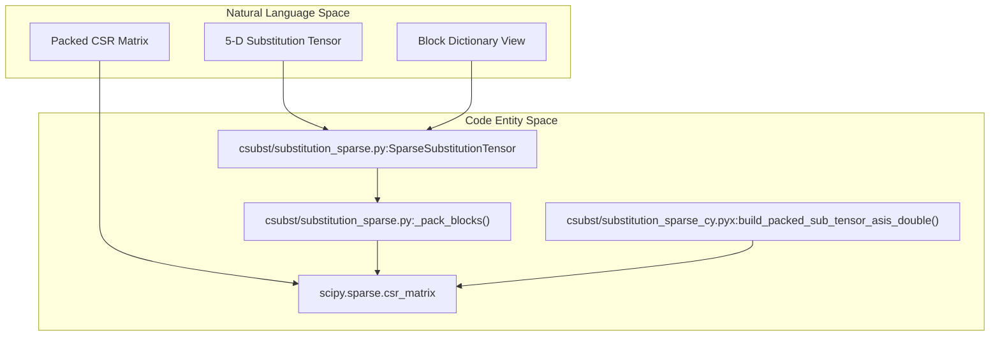
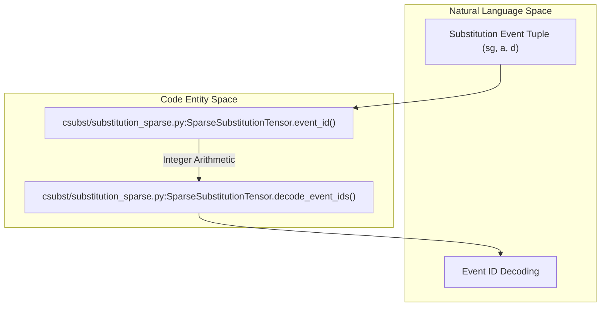
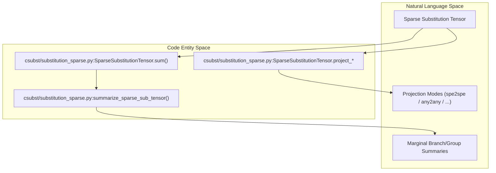

# SparseSubstitutionTensor and Packed CSR Design

Relevant source files

The following files were used as context for generating this wiki page:

- [csubst/substitution_sparse.py](csubst/substitution_sparse.py)
- [csubst/substitution_sparse_cy.pyx](csubst/substitution_sparse_cy.pyx)
- [tests/unit/test_sparse_projection.py](tests/unit/test_sparse_projection.py)
- [tests/unit/test_sparse_tensor_primitives.py](tests/unit/test_sparse_tensor_primitives.py)

## Purpose and Scope
This page details the implementation of `SparseSubstitutionTensor` and its underlying packed Compressed Sparse Row (CSR) layout in `csubst`. The substitution tensor tracks ancestral state reconstruction (ASR) probabilities and codon/amino-acid substitution events across branches and sites. By flattening a 5-dimensional tensor into a single SciPy CSR matrix, `csubst` eliminates per-event `indptr` overhead, reduces Python object churn, and accelerates projection and reduction operations without materializing dense arrays.

Sources: `csubst/substitution_sparse.py:31-75`(), `csubst/substitution_sparse_cy.pyx:14-162`()

---

## Packed CSR Layout and 5-D Tensor Flattening

The substitution tensor is conceptually a 5-dimensional structure defined by shape `(num_branch, num_site, num_group, num_state_from, num_state_to)`. In `SparseSubstitutionTensor`, this tensor is flattened into a 2-D SciPy CSR matrix (`matrix`) of shape `(num_branch, num_event * num_site)`.

- **Rows**: Represent phylogenetic tree branches (`0` to `num_branch - 1`).
- **Columns**: Represent the flattened combination of substitution event types and sites (`event_id * num_site + site`).

The constructor `SparseSubstitutionTensor.__init__()` validates shapes, accepts either sparse blocks or a pre-packed CSR matrix, ensures canonical sorting and elimination of explicit zeros, and locks array flags (`writeable = False`) to enforce immutability.

Sources: `csubst/substitution_sparse.py:31-74`(), `csubst/substitution_sparse_cy.pyx:14-76`()

---

## Event ID Encoding and Decoding

To map 3-tuple substitution events `(group, from_state, to_state)` into a 1-D column coordinate space alongside sites, `SparseSubstitutionTensor` implements deterministic encoding and decoding formulas.

- **`event_id(sg, a, d)`**: Computes a unique integer ID for a given substitution group `sg`, ancestral state `a`, and descendant state `d`:
  $$\text{event\_id} = (\text{sg} \times \text{num\_state\_from} + a) \times \text{num\_state\_to} + d$$
- **`decode_event_ids(event_ids)`**: Uses integer division and modulo arithmetic (`np.divmod`) to reverse the `event_id` back into `(sg, a, d)` coordinate components.

Sources: `csubst/substitution_sparse.py:100-111`()

---

## Projection Statistics and Reducer Subclasses

`SparseSubstitutionTensor` provides projection and summary methods that reduce dimensions without expanding the packed CSR matrix into dense storage. These methods correspond to core substitution statistics (`spe2spe`, `spe2any`, `any2spe`, `any2any`):

- **`project_any2any(sg)`**: Sums over states for a given substitution group `sg`.
- **`project_spe2any(sg, a)`**: Fixes the ancestral state `a` while summing over descendant states.
- **`project_any2spe(sg, d)`**: Fixes the descendant state `d` while summing over ancestral states.
- **`project_spe2spe(sg, a, d)`**: Extracts a specific source-to-destination state slice.
- **`sum(axis)`**: Computes marginal sums across arbitrary axes (`num_branch`, `num_site`, `num_group`, `num_state_from`, `num_state_to`) by operating directly on CSR slices or index groupings.
- **`summarize_sparse_sub_tensor(tensor, mode)`**: Aggregates tensor data across branches (`sub_bg`) and substitution groups (`sub_sg`) based on mode selectors (`spe2spe`, `spe2any`, etc.).

Sources: `csubst/substitution_sparse.py:175-350`(), `tests/unit/test_sparse_projection.py:18-74`()

---

## Cython Acceleration and Memory Safety

Performance-critical tensor creation loops are implemented in Cython within `substitution_sparse_cy.pyx`. 

- **`build_packed_sub_tensor_asis_double`**: Constructs branch-by-(event $\times$ site) CSR arrays directly from state tensors and branch pairs without intermediate Python dictionary mappings.
- **`build_packed_sub_tensor_syn_double`**: Handles synonymous substitution groups using a two-pass counter and builder design.
- **Memory Safety**: NumPy arrays exported from Cython or constructed in Python are marked read-only (`matrix.data.flags.writeable = False`) to prevent accidental mutation during downstream combinatorial searches.

Sources: `csubst/substitution_sparse_cy.pyx:14-162`(), `tests/unit/test_sparse_tensor_primitives.py:42-60`()

---