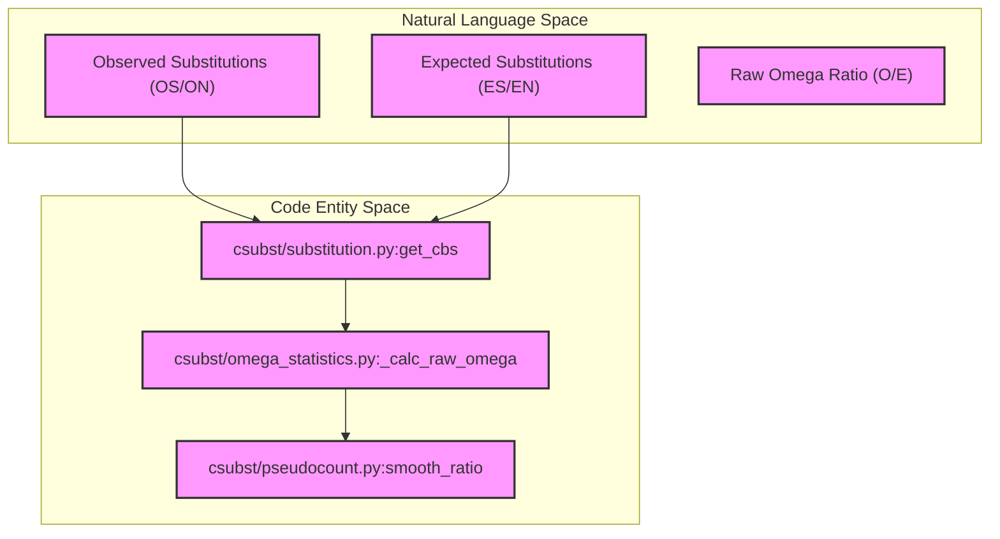
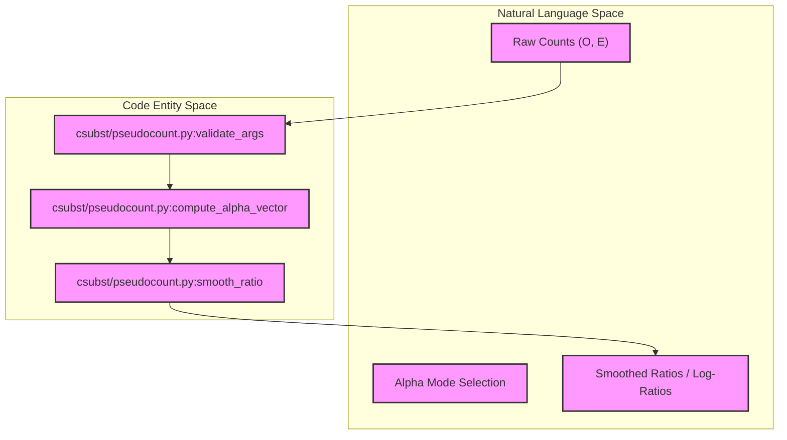

# Omega Statistics, Expectations and Calibration

Relevant source files

The following files were used as context for generating this wiki page:

- [.github/scripts/omega_count_null_check.py](.github/scripts/omega_count_null_check.py)
- [.github/scripts/omega_pipeline_fpr.py](.github/scripts/omega_pipeline_fpr.py)
- [.github/scripts/omega_pipeline_fpr_report.py](.github/scripts/omega_pipeline_fpr_report.py)
- [.github/scripts/omega_pvalue_calibration_check.py](.github/scripts/omega_pvalue_calibration_check.py)
- [csubst/asrv.py](csubst/asrv.py)
- [csubst/combination.py](csubst/combination.py)
- [csubst/foreground.py](csubst/foreground.py)
- [csubst/main_analyze.py](csubst/main_analyze.py)
- [csubst/omega.py](csubst/omega.py)
- [csubst/omega_calibration.py](csubst/omega_calibration.py)
- [csubst/omega_null.py](csubst/omega_null.py)
- [csubst/omega_statistics.py](csubst/omega_statistics.py)
- [csubst/param.py](csubst/param.py)
- [csubst/parser_iqtree.py](csubst/parser_iqtree.py)
- [csubst/parser_misc.py](csubst/parser_misc.py)
- [csubst/pseudocount.py](csubst/pseudocount.py)
- [csubst/substitution.py](csubst/substitution.py)
- [csubst/tree.py](csubst/tree.py)
- [docs/PSEUDOCOUNT_PVALUES.md](docs/PSEUDOCOUNT_PVALUES.md)
- [docs/URN_CALIBRATION.md](docs/URN_CALIBRATION.md)
- [reports/implementation_audit_20260908/followup.md](reports/implementation_audit_20260908/followup.md)
- [reports/issue46_20260910/README.md](reports/issue46_20260910/README.md)
- [reports/issue46_20260910/calibration.log](reports/issue46_20260910/calibration.log)
- [reports/issue46_20260910/count_benchmark.log](reports/issue46_20260910/count_benchmark.log)
- [reports/issue46_20260910/count_null.json](reports/issue46_20260910/count_null.json)
- [reports/issue46_20260910/final_checks.log](reports/issue46_20260910/final_checks.log)
- [reports/issue46_20260910/full_tests.log](reports/issue46_20260910/full_tests.log)
- [reports/scientific_review_20260910/README.md](reports/scientific_review_20260910/README.md)
- [tests/unit/test_asrv_options.py](tests/unit/test_asrv_options.py)
- [tests/unit/test_omega_calibration_script.py](tests/unit/test_omega_calibration_script.py)
- [tests/unit/test_omega_statistics_arrays.py](tests/unit/test_omega_statistics_arrays.py)
- [tests/unit/test_runtime_io.py](tests/unit/test_runtime_io.py)
- [tests/unit/test_tsv.py](tests/unit/test_tsv.py)

## Purpose and Scope
This page details the implementation of $\omega$ (omega) statistics, expected substitution formulations, pseudocount smoothing, Ancestral State Rate Variation (ASRV), and dSC (substitution count/rate) calibration within `csubst`. It bridges the theoretical foundation of combinatorial/convergent substitution detection with the core Python modules responsible for calculating observed-to-expected ratios, establishing baseline models (codon-model vs. urn expectations), adjusting for rate heterogeneity, and computing empirical upper-tail $p$-values with Benjamini-Hochberg false discovery rate (FDR) corrections.

Sources: [`csubst/omega.py:1-166`](), [`csubst/substitution.py:1-168`](), [`csubst/param.py:1-187`](), [`csubst/pseudocount.py:1-180`]()

---

## 1. Omega Statistics and Ratio Computations
The $\omega$ statistic in `csubst` measures the ratio of observed combinatorial substitutions ($O$) to expected substitutions ($E$) across branch combinations and alignment sites. Base substitution tensors store counts partitioned into four categories: `any2any`, `spe2any`, `any2any` (stored as `any2spe`), and `spe2spe` [csubst/substitution.py:23-23](). 

Raw ratio calculations and rate enumerations are implemented across `csubst/omega.py` [csubst/omega.py:19-33]() and `csubst/omega_statistics.py`. The pipeline processes these counts to derive substitution metrics for both synonymous ($S$) and nonsynonymous ($N$) channels:

*Figure 1: Mapping Omega statistics conceptual flow to code components.*

Sources: [`csubst/omega.py:19-33`](), [`csubst/substitution.py:23-23`](), [`csubst/pseudocount.py:167-180`]()

---

## 2. Codon-Model vs. Urn Expectations
`csubst` supports two primary methods for generating expected substitution baselines via `--expectation_method`: `codon_model` (also accepted as `submodel`) and `urn` (also accepted as `modelfree`) [csubst/param.py:145-152]().

- **Codon-Model (`codon_model`)**: Utilizes instantaneous rate matrices derived from IQ-TREE ancestral state reconstructions and substitution models (`parser_iqtree.py`) to compute model-based probabilities of state transitions along branches.
- **Urn Model (`urn`)**: Implements combinatorially motivated hypergeometric or Wallenius non-central hypergeometric sampling expectations (`urn_expectation.py`), treating site-wise substitutions as draws from an urn without relying on explicit codon substitution matrix parametrizations.

The expectation method is resolved during analysis initialization [csubst/main_analyze.py:27-35]() and validated against allowed configuration parameters [csubst/param.py:145-162]().

Sources: [`csubst/param.py:145-162`](), [`csubst/main_analyze.py:27-35`]()

---

## 3. Pseudocount Smoothing and Mathematical Handling
To prevent division-by-zero errors and stabilize ratios when observed or expected substitution counts are small, `csubst` implements pseudocount smoothing in `csubst/pseudocount.py` [csubst/pseudocount.py:1-180]().

### Configuration and Modes
Pseudocount behavior is controlled by three main parameters validated by `pseudocount.validate_args()`:
1. `--pseudocount_alpha`: A finite non-negative number or `"auto"` [csubst/pseudocount.py:30-45]().
2. `--pseudocount_mode`: Strategy for alpha vector calculation, restricted to `none`, `symmetric`, or `empirical` [csubst/pseudocount.py:51-55]().
3. `--pseudocount_target`: Target tensors for smoothing, restricted to `observed`, `expected`, or `both` [csubst/pseudocount.py:56-60]().

### Smoothing Functions
- **Alpha Vector Computation**: `compute_alpha_vector()` allocates pseudocount weights symmetrically or proportional to global state frequencies (`p_global`) [csubst/pseudocount.py:78-121]().
- **Count & Ratio Smoothing**: `smooth_counts()`, `smooth_ratio()`, and `smooth_log_ratio()` execute numerically stable additions and safe divisions [csubst/pseudocount.py:123-180](). Zero-over-zero states are explicitly mapped to `0.0` [csubst/pseudocount.py:142-164]().

*Figure 2: Pseudocount data flow and transformation.*

Sources: [`csubst/pseudocount.py:30-180`]()

---

## 4. Ancestral State Rate Variation (ASRV)
Ancestral State Rate Variation accounts for site-to-site rate heterogeneity along phylogenies. Controlled via the `--asrv` option (such as `--asrv sn`), `csubst` computes branch-site substitution weights and combines structural epistasis probabilities when enabled [csubst/omega.py:159-166]().

When structure-aware weighting is active, cross-fitted probabilities from structural alphabets (e.g., 3Di features) modulate branch-site substitution counts prior to tensor reduction and combination scoring [csubst/omega.py:143-157]() [csubst/parser_misc.py:33-42]().

Sources: [`csubst/omega.py:143-166`](), [`csubst/parser_misc.py:33-42`]()

---

## 5. dSC Calibration and Long-Tail P-Value Computation
To evaluate the statistical significance of observed combinatorial substitution counts, `csubst` computes empirical upper-tail $p$-values through permutation matrices and clade randomization schemes (`omega_statistics.py`, `omega_calibration.py`).

- **Permutation Schedules**: `--omega_pvalue_niter_schedule` defines iteration thresholds (e.g., `100,1000`) for adaptive refinement of tail probabilities [csubst/param.py:118-143]().
- **Calibration (`dSC`)**: Corrects for tree topology biases and lineage-specific rate variations by comparing observed branch combination scores against null distributions generated via branch shuffling or clade permutations.
- **Multiple Testing Correction**: False discovery rate adjustments are applied using Benjamini-Hochberg $q$-value calculations (`_calc_bh_fdr_qvalues`) [csubst/omega.py:19-33]().

Sources: [`csubst/omega.py:19-33`](), [`csubst/param.py:118-143`]()

---