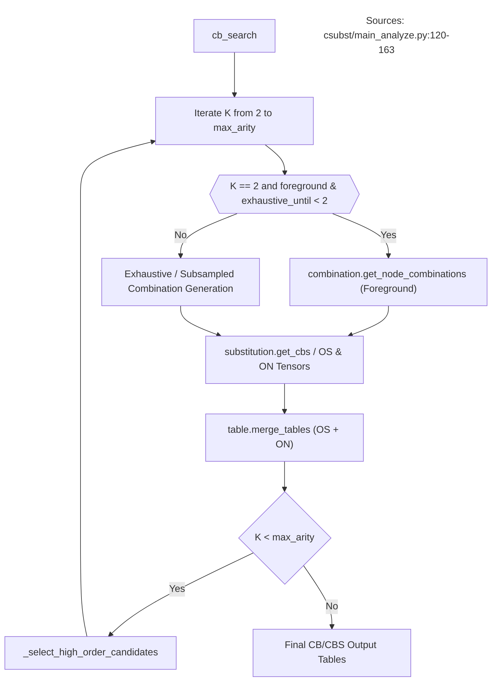
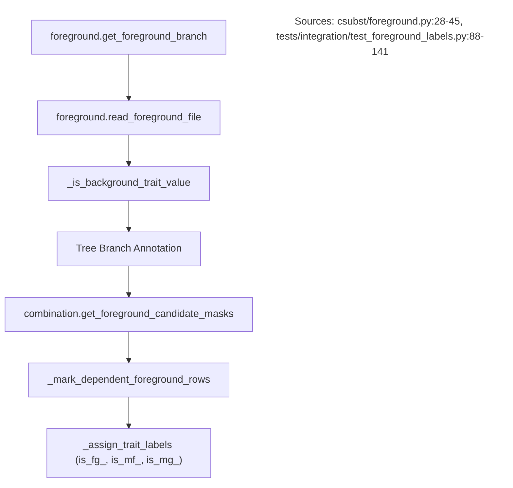

# Branch Combinations, Foreground and Higher-Order Search

Relevant source files

The following files were used as context for generating this wiki page:

- [csubst/combination.py](csubst/combination.py)
- [csubst/foreground.py](csubst/foreground.py)
- [csubst/main_analyze.py](csubst/main_analyze.py)
- [csubst/omega.py](csubst/omega.py)
- [csubst/parallel.py](csubst/parallel.py)
- [csubst/param.py](csubst/param.py)
- [csubst/parser_iqtree.py](csubst/parser_iqtree.py)
- [csubst/parser_misc.py](csubst/parser_misc.py)
- [csubst/substitution.py](csubst/substitution.py)
- [csubst/tree.py](csubst/tree.py)
- [tests/cli/test_cli_input_safety.py](tests/cli/test_cli_input_safety.py)
- [tests/integration/test_clade_permutation.py](tests/integration/test_clade_permutation.py)
- [tests/integration/test_foreground_labels.py](tests/integration/test_foreground_labels.py)
- [tests/unit/test_main_sites_tree_selection.py](tests/unit/test_main_sites_tree_selection.py)
- [tests/unit/test_omega_calibration.py](tests/unit/test_omega_calibration.py)
- [tests/unit/test_omega_pvalues.py](tests/unit/test_omega_pvalues.py)
- [tests/unit/test_tree_rendering_config.py](tests/unit/test_tree_rendering_config.py)
- [tests/unit/test_tree_rendering_layout.py](tests/unit/test_tree_rendering_layout.py)
- [tests/unit/test_tree_rendering_matplotlib.py](tests/unit/test_tree_rendering_matplotlib.py)

## Purpose and Scope
This page details the implementation of combinatorial branch search algorithms within `csubst`, covering arity ($K$) progression, combination generation and subsampling, foreground trait mapping, clade permutation and randomization for significance testing, and parallel execution pipelines. These subsystems bridge the substitution tensors (from Section 3.2) and the statistical calibration (from Section 3.3) to detect higher-order combinatorial and convergent substitutions across phylogenies.

---

## 1. Arity K Progression and Core Combination Search Pipeline

The core search orchestration resides in `csubst/main_analyze.py`, where `cb_search()` iterates through combination arities from $K = 2$ up to `--max_arity` [csubst/main_analyze.py:140-148](). For each arity level, the pipeline generates valid branch combinations, queries substitution tensors, and calculates branch statistics.

For $K = 2$, the search can operate either exhaustively over all branch pairs or targeted to foreground branches if `--exhaustive_until` is configured [csubst/main_analyze.py:153-163](). For higher arities ($K > 2$), candidate combinations are filtered and pruned using thresholds defined by `--cutoff_stat` and `--max_combination` via `_select_high_order_candidates()` [csubst/main_analyze.py:120-137]().

*Diagram 1: Arity progression and candidate filtering control flow from Natural Language requirements to code entities.*

### Sources
- `csubst/main_analyze.py:120-163`

---

## 2. Combination Generation and Subsampling Strategies

Combination generation is handled primarily by `csubst/combination.py`. To maximize performance on large trees, combination routines leverage optional Cython extensions (`combination_cy`) with pure-Python fallback implementations using `itertools.combinations` [csubst/combination.py:59-84]().

### Key Functions and Data Structures
- `_generate_all_k_combinations_from_sorted_nodes()`: Generates all $\binom{N}{K}$ combinations of sorted node identifiers, routing to `combination_cy.generate_all_k_combinations_from_sorted_nodes_int64` when available [csubst/combination.py:59-84]().
- `_unique_rows_int64()`: Ensures uniqueness of multidimensional integer arrays using pandas `drop_duplicates` or `np.unique` depending on row count thresholds [csubst/combination.py:30-43]().
- `_unique_sorted_int64_1d()`: Fast 1D integer uniqueness utilizing vector bitmap allocations when density permits [csubst/combination.py:45-57]().

When higher-order searches generate excessively large combinatorial spaces, `_select_high_order_candidates()` restricts the working set to the top $M$ rows sorted by user-defined cutoff statistics (`--max_combination`) [csubst/main_analyze.py:120-137]().

### Sources
- `csubst/main_analyze.py:120-137`
- `csubst/combination.py:30-84`

---

## 3. Foreground Traits and Targeted Subgraph Selection

Foreground traits categorize lineages into functional classes (e.g., C4 photosynthesis, drug resistance, or phenotypic adaptations) to test for accelerated convergent substitution rates within specific clades.

### Foreground Parsing and Branch Marking
Foreground annotation files are parsed and validated in `csubst/foreground.py`. Background values are identified via `_is_background_trait_value()`, which evaluates missing, zero, or boolean-false entries [csubst/foreground.py:28-45](). 

Combinations involving foreground lineages are marked, and dependent branch rows are filtered using `_mark_dependent_foreground_rows()` to avoid redundant sub-tree counting [tests/integration/test_foreground_labels.py:88-104](). Trait labels (`is_fg_`, `is_mf_`, `is_mg_`) are assigned based on whether all, some, or none of the branches in a combination belong to the foreground trait set [tests/integration/test_foreground_labels.py:125-141]().

*Diagram 2: Foreground trait processing pipeline mapping input files to branch categorical labels.*

### Sources
- `csubst/foreground.py:28-45`
- `tests/integration/test_foreground_labels.py:88-141`

---

## 4. Clade Permutation, Trait Randomization, and Significance Testing

To evaluate whether observed combinatorial substitution rates ($\omega_C$) in foreground lineages are significantly higher than expected by chance, `csubst` implements clade-preserving permutation and trait randomization tests.

### Caching and Permutation Structures
- `_build_trait_clade_permutation_cache()` constructs clade index structures (`CladeIndex`, `CladeDescendants`, `CladesByBranch`) to preserve topological constraints during permutations [csubst/foreground.py:83-138]().
- `_get_trait_clade_permutation_cache()` memoizes these indices per trait name [csubst/foreground.py:141-148]().
- `_invalidate_clade_permutation_cache()` purges memoized dictionaries when parameters or trees are re-rooted or modified [csubst/foreground.py:55-69]().

### Sources
- `csubst/foreground.py:55-148`

---

## 5. Parallelism, Chunking, and Streaming Combinations

Due to the combinatorial explosion of high-order branch tuples ($K \ge 3$), `csubst` utilizes multi-core task distribution and memory-bounded streaming architectures.

### Parallel Backends and Adaptive Policies
Task distribution is managed by `csubst/parallel.py`. `run_starmap()` supports both `multiprocessing` and `threading` backends [csubst/parallel.py:153-180](). To prevent overhead on small tasks, adaptive policies defined in `_ADAPTIVE_JOB_POLICIES` scale worker allocations dynamically based on workload size and minimum items per job [csubst/parallel.py:15-23, 103-130]().

When using `multiprocessing` with the `spawn` start method, worker import paths are explicitly synchronized via `_set_spawn_worker_import_path()` and `_restore_import_path()` [csubst/parallel.py:36-84]().

### Memory-Bounded Streaming (`_write_cbs_stream`)
To prevent memory exhaustion during combinatorial site statistics calculation (`cbs`), `_write_cbs_stream()` in `csubst/main_analyze.py` processes branch combinations in bounded chunks [csubst/main_analyze.py:54-67](). OS and ON tensors are queried per chunk, merged, mapped to alignment indices, and incrementally written to disk using `tsv.write_dataframe()` [csubst/main_analyze.py:70-98]().

### Sources
- `csubst/parallel.py:15-180`
- `csubst/main_analyze.py:54-105`

---