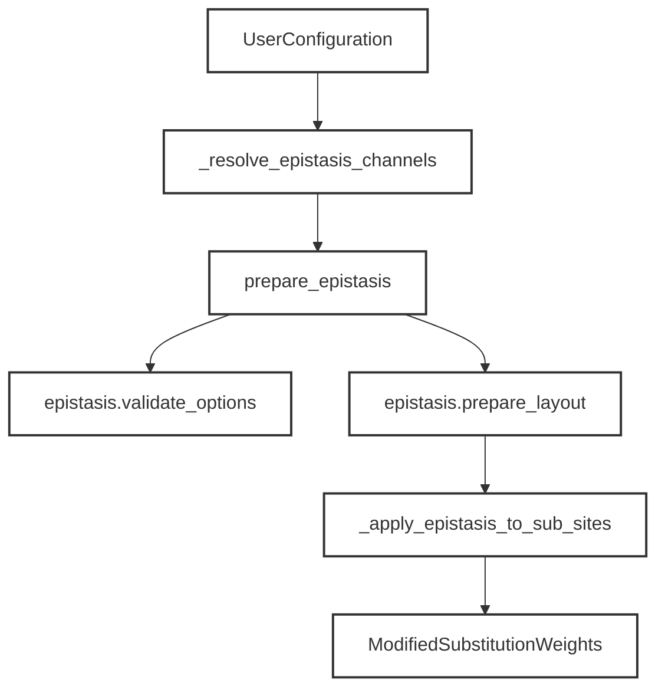
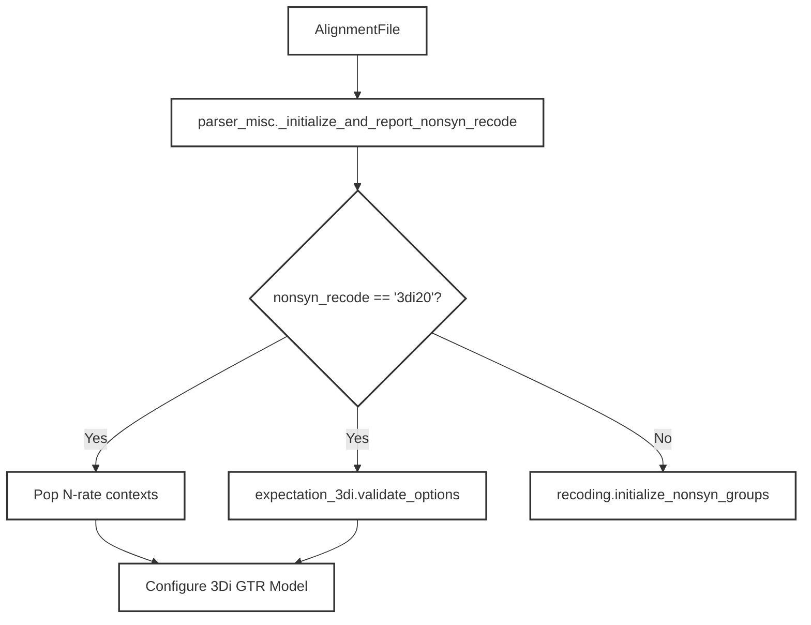

# Epistasis and Structure Weighting

<details>
<summary>Relevant source files</summary>

The following files were used as context for generating this wiki page:

- [.github/scripts/ci_scope.py](.github/scripts/ci_scope.py)
- [csubst/clade_index.py](csubst/clade_index.py)
- [csubst/combination.py](csubst/combination.py)
- [csubst/epistasis.py](csubst/epistasis.py)
- [csubst/expectation_3di.py](csubst/expectation_3di.py)
- [csubst/foreground.py](csubst/foreground.py)
- [csubst/main_analyze.py](csubst/main_analyze.py)
- [csubst/omega.py](csubst/omega.py)
- [csubst/param.py](csubst/param.py)
- [csubst/parser_iqtree.py](csubst/parser_iqtree.py)
- [csubst/parser_misc.py](csubst/parser_misc.py)
- [csubst/scan_ctmc.py](csubst/scan_ctmc.py)
- [csubst/scan_endpoint.py](csubst/scan_endpoint.py)
- [csubst/scan_permutation.py](csubst/scan_permutation.py)
- [csubst/scan_statistics.py](csubst/scan_statistics.py)
- [csubst/substitution.py](csubst/substitution.py)
- [csubst/tree.py](csubst/tree.py)
- [docs/SCAN_ENDPOINT.md](docs/SCAN_ENDPOINT.md)
- [docs/STRUCTURAL_ALPHABET.md](docs/STRUCTURAL_ALPHABET.md)
- [tests/integration/test_scan_endpoint.py](tests/integration/test_scan_endpoint.py)
- [tests/unit/test_ci_artifacts.py](tests/unit/test_ci_artifacts.py)
- [tests/unit/test_endpoint_io.py](tests/unit/test_endpoint_io.py)
- [tests/unit/test_iqtree_state_tensor.py](tests/unit/test_iqtree_state_tensor.py)
- [tests/unit/test_scan_statistics.py](tests/unit/test_scan_statistics.py)

</details>


This page documents the implementation of epistasis handling, structure-aware site weighting, and 3Di structural expectations within `csubst`. It details how structural contact degrees, protein data bank (PDB) features, and structural alphabets interact with substitution tensors and omega calculation pipelines.

---

## 1. Epistasis Framework and Configuration

The epistasis subsystem provides mechanisms to adjust substitution expectations based on site features or cross-fitted structural weights. Options and layout preparations are managed in `csubst/omega.py` and `csubst/epistasis.py`.

When epistasis is enabled via runtime parameters, the pipeline resolves target channels (`N`, `S`, or both) through `_resolve_epistasis_channels()` [csubst/omega.py:112-120]():

```python
def _resolve_epistasis_channels(g):
    token = str(g.get('epistasis_apply_to', 'N')).strip().upper()
    if token == 'N':
        return ('N',)
    if token == 'S':
        return ('S',)
    if token == 'NS':
        return ('N', 'S')
    raise ValueError('Unsupported epistasis_apply_to value: {}'.format(token))
```

The preparation step `prepare_epistasis()` initializes options, verifies that `--asrv sn` is active, and extracts site feature matrices:

```python
def prepare_epistasis(g, ON_tensor, OS_tensor):
    g['epistasis_enabled'] = False
    epistasis.validate_options(g)
    if g.get('asrv', 'each') != 'sn':
        raise ValueError('Structure weighting requires --asrv sn.')
    features = np.asarray(g['epistasis_site_feature_matrix_internal'], dtype=np.float64)
    mask = np.asarray(g['is_site_nonmissing'], dtype=bool)
    context, groups, partitions = epistasis.prepare_layout(g, mask.shape[0], features.shape[1])
```
*(Cited from [csubst/omega.py:159-166]())*

### Diagram: Epistasis Pipeline Data Flow


Sources: [csubst/omega.py:112-166]()

---

## 2. Structure-Aware Site Weighting and Cross-Fitting

Structure-aware site weighting incorporates residue contact degrees derived from PDB structures or contact maps. During rate calculations, `_get_epistasis_branch_site_counts()` collects branch-site substitution counts across valid branch IDs [csubst/omega.py:123-140]().

When applying epistasis to substitution sites (`_apply_epistasis_to_sub_sites()`), cross-fitted probability matrices are substituted for raw counts to prevent invalidating the tuning and cross-fitting contract [csubst/omega.py:143-157]():

```python
def _apply_epistasis_to_sub_sites(sub_sites, obs_col, g):
    if not g.get('epistasis_enabled', False):
        return sub_sites
    channel = 'N' if obs_col.startswith('OCN') else 'S' if obs_col.startswith('OCS') else None
    state = g.get('_epistasis_state', {}).get(channel)
    if state is None:
        return sub_sites
    probabilities = state['probabilities']
    if np.shape(sub_sites) != probabilities.shape:
        raise ValueError('Cross-fitted structure probabilities require branch-by-site ASRV sn weights.')
    return probabilities
```

Sources: [csubst/omega.py:123-157]()

---

## 3. 3Di Structural Alphabets and Expectations

When running with `--nonsyn_recode 3di20`, amino-acid sequences are mapped to the 20-state Foldseek 3Di structural alphabet [docs/STRUCTURAL_ALPHABET.md:11-12](). 

The initialization function `_initialize_and_report_nonsyn_recode()` in `csubst/parser_misc.py` configures the structural state orders and discards codon-derived nonsynonymous rates when `3di20` is selected [csubst/parser_misc.py:33-42]():

```python
def _initialize_and_report_nonsyn_recode(g):
    recode = recoding_config.normalize_nonsyn_recode(g.get("nonsyn_recode", "no"))
    g["nonsyn_recode"] = recode
    if recode == '3di20':
        g.pop('instantaneous_nsy_rate_matrix', None)
        g.pop('rate_nsy_tensor', None)
        for key in expectation_3di.CONTEXT_KEYS:
            g.pop(key, None)
    ...
```

The default expectation method (`codon_model`) automatically routes **N to the fitted 3Di model and S to the codon model** when `--nonsyn_recode 3di20` is specified [docs/STRUCTURAL_ALPHABET.md:62-67]().

### Diagram: Structural Expectation & Code Entity Mapping


Sources: [csubst/parser_misc.py:33-78](), [docs/STRUCTURAL_ALPHABET.md:62-67]()

---

## 4. Integration with Omega and Substitution Pipelines

Substitution tensors and expectation calculators coordinate with epistasis and 3Di structures to calculate omega statistics (`omegaC`, `omegaN`, `omegaS`). 

The pipeline ensures that:
1. Structural N branches use fitted 3Di substitution models or cross-fitted structural probabilities [docs/STRUCTURAL_ALPHABET.md:3-6]().
2. Synonymous S branches retain standard codon models and substitution rates [docs/STRUCTURAL_ALPHABET.md:92-93]().
3. Long-tail calibration (`_calibrate_dsc_matrix` / `_calibrate_dsc_vector`) correctly handles modified N distributions when structural weighting or 3Di recoding alters the nonsynonymous channel [docs/STRUCTURAL_ALPHABET.md:95-99]().

Sources: [csubst/omega.py:19-48](), [docs/STRUCTURAL_ALPHABET.md:62-99]()

---