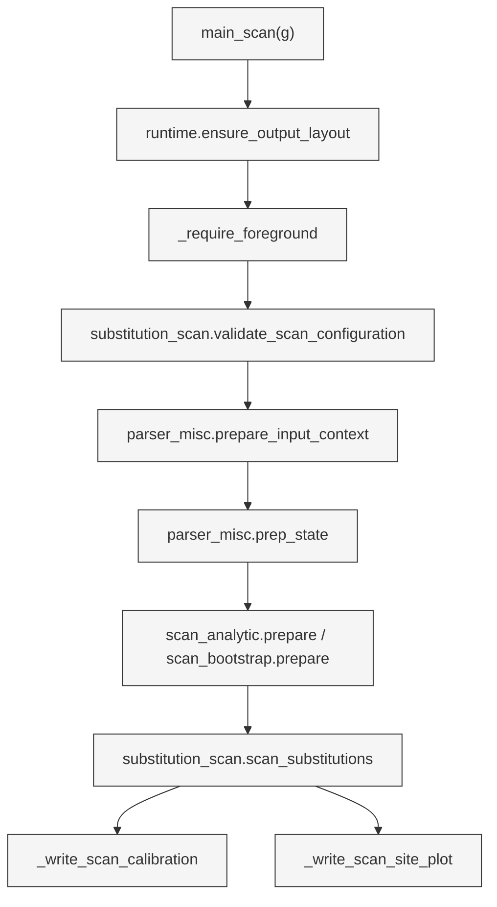
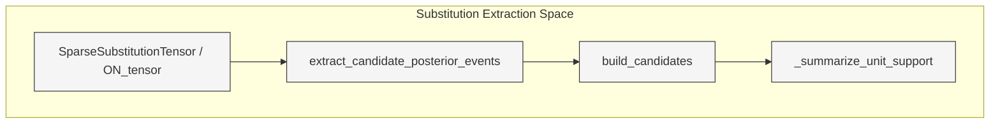

# Scan Pipeline and Candidate Detection

<details>
<summary>Relevant source files</summary>

The following files were used as context for generating this wiki page:

- [csubst/main_scan.py](csubst/main_scan.py)
- [csubst/main_sites.py](csubst/main_sites.py)
- [csubst/substitution_scan.py](csubst/substitution_scan.py)
- [docs/ENDPOINT_POSTERIORS.md](docs/ENDPOINT_POSTERIORS.md)
- [docs/SCAN_INFERENCE.md](docs/SCAN_INFERENCE.md)
- [docs/SITE_FILTERING.md](docs/SITE_FILTERING.md)
- [reports/review_20260910_15afbf4/README.md](reports/review_20260910_15afbf4/README.md)
- [reports/review_20260910_15afbf4/fixed-comparison.json](reports/review_20260910_15afbf4/fixed-comparison.json)
- [reports/review_20260910_15afbf4/fixed-static.log](reports/review_20260910_15afbf4/fixed-static.log)
- [reports/review_20260910_15afbf4/fixed-tests.log](reports/review_20260910_15afbf4/fixed-tests.log)
- [reports/review_20260910_15afbf4/inputs/foreground.tsv](reports/review_20260910_15afbf4/inputs/foreground.tsv)
- [reports/review_20260910_15afbf4/inputs/input.fa](reports/review_20260910_15afbf4/inputs/input.fa)
- [reports/review_20260910_15afbf4/inputs/tree.nwk](reports/review_20260910_15afbf4/inputs/tree.nwk)
- [reports/test_audit_20260922/README.md](reports/test_audit_20260922/README.md)
- [tests/integration/test_evaluate_epistasis_simulation_tool.py](tests/integration/test_evaluate_epistasis_simulation_tool.py)
- [tests/integration/test_scan_candidates_and_rates.py](tests/integration/test_scan_candidates_and_rates.py)
- [tests/integration/test_scan_ctmc.py](tests/integration/test_scan_ctmc.py)
- [tests/integration/test_scan_execution.py](tests/integration/test_scan_execution.py)
- [tests/integration/test_scan_outputs.py](tests/integration/test_scan_outputs.py)
- [tests/unit/test_combination_subsampling.py](tests/unit/test_combination_subsampling.py)
- [tests/unit/test_tree_core.py](tests/unit/test_tree_core.py)

</details>


This page covers the technical architecture and implementation details of the `csubst scan` subsystem, which orchestrates the detection and statistical evaluation of recurrent, combinatorial, and convergent substitutions across foreground lineages.

## Purpose and Scope

The scan pipeline identifies amino acid or codon substitutions enriched in user-defined foreground lineages relative to background lineages. It coordinates input context setup, substitution tensor projections, candidate event extraction, unit-level support summarization, rate exposure calculations, and output table generation.

Sources: `csubst/main_scan.py:1-168]`, `csubst/substitution_scan.py:1-215]()`

---

## Orchestration and Execution Pipeline (`main_scan`)

The execution entry point for scan analysis is `main_scan()` defined in `csubst/main_scan.py`. It coordinates configuration validation, input preparation via `parser_misc`, analytic engine setup, candidate scanning, and output serialization.


*Figure 1: Orchestration flow from `main_scan` to substitution scanning.*

Sources: `csubst/main_scan.py:1-168]()`

---

## Candidate Detection and Substitution Extraction (`substitution_scan`)

Candidate detection is driven by `substitution_scan.py`, which filters substitution tensors according to specific match classes (`SCAN_MATCHES`), rate event modes, and exposure definitions.

The supported match classes define the state transition constraints for candidate detection:

```python
SCAN_MATCHES = (
    "any2any",
    "any2spe",
    "any2dif",
    "spe2any",
    "spe2spe",
    "spe2dif",
    "dif2any",
    "dif2spe",
    "dif2dif",
)
```

Here, `any`, `spe` (specified target state), and `dif` (different state) denote state categories. Candidate events are extracted from dense or sparse substitution tensors (`ON_tensor`) and cached using bounded caches (`_CandidateCache`) to optimize repeated evaluations during permutation or bootstrap cycles.


*Figure 2: Data flow for candidate event extraction and support summarization.*

Sources: `csubst/substitution_scan.py:31-82]`, `tests/integration/test_scan_execution.py:31-56]()`

---

## Scan Unit Modes and Lineage Support

Scan units determine how branches are aggregated to assess support. The normalization function `normalize_scan_unit_mode()` accepts three operational modes:

```python
SCAN_UNIT_MODES = ("lineage", "stem", "clade")
```

- **`lineage`**: Evaluates individual foreground branch IDs.
- **`stem`**: Restricts evaluation to the stem branches of foreground clades (`g["fg_stem_only"] = True`).
- **`clade`**: Evaluates both stem and internal/tip branches within foreground clades (`g["fg_stem_only"] = False`).

Unit support aggregation (`_summarize_unit_support()`) maps candidate events to specific units and groups counts by original foreground lineage identifiers (`lineage_value`), recording metrics such as `support_lineage_count`, `lineage_total`, and `support_lineage_fraction`.

Sources: `csubst/substitution_scan.py:88]`, `csubst/main_scan.py:142-146]`, `tests/integration/test_scan_candidates_and_rates.py:33-40]()`

---

## Rate Exposure and Normalization

Rate exposures quantify the opportunity or expected baseline frequency for substitutions to occur in target versus background classes. The recognized exposure modes are:

```python
SCAN_RATE_EXPOSURES = ("q_weighted", "state_aware", "raw_branch_length", "endpoint")
```

Rate event modes determine whether events are counted via hard thresholds or summed posterior probabilities:

```python
SCAN_RATE_EXPOSURES = ("q_weighted", "state_aware", "raw_branch_length", "endpoint")
SCAN_RATE_EVENT_MODES = ("called", "posterior_sum")
```

When `scan_rate_event_mode` is set to `posterior_sum`, unthresholded rate tensors are utilized to accumulate fractional posterior masses, whereas `called` restricts sums to events exceeding `scan_min_event_pp`.

Sources: `csubst/substitution_scan.py:84-85]`, `tests/integration/test_scan_outputs.py:157-174]()`

---

## Output Tables and Manifests

The scan subsystem generates comprehensive output tables containing columns defined by `SCAN_OUTPUT_COLUMNS`. These columns capture scan identifiers, trait names, match classes, site indices, substitution distributions, event mass sums, support metrics, rate ratios, enrichment scores, and asymptotic/empirical p-values (e.g., `p_rate_enrichment_asymptotic`, `q_rate_enrichment_empirical_by_trait_match`).

| Output Category | Key Columns | Description |
| --- | --- | --- |
| Identifiers & Match | `scan_id`, `trait`, `target_class`, `scan_match`, `site` | Identifies the run context, trait, and substitution classification. |
| States & Events | `from_state`, `to_state`, `candidate_event_pp_sum`, `state_change` | Details observed state changes and aggregated posterior probabilities. |
| Support Metrics | `support_unit_count`, `support_fraction`, `support_lineage_count`, `support_lineage_ids` | Quantifies support across units and grouped foreground lineage IDs. |
| Rate & Enrichment | `target_exposure`, `other_exposure`, `rate_ratio`, `score_rate_enrichment` | Stores exposure values, effect sizes, and Poisson enrichment scores. |

Sources: `csubst/substitution_scan.py:91-215]`, `docs/SCAN_INFERENCE.md:13-38]()`

---