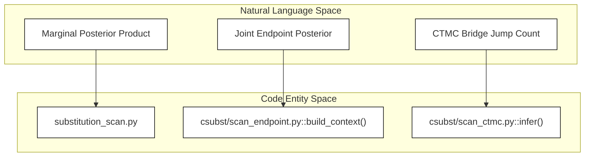
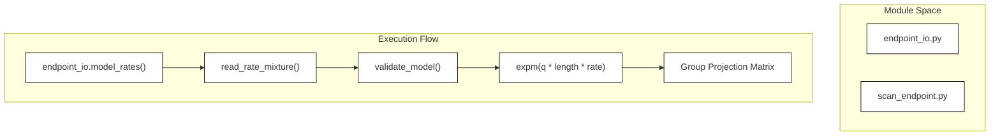
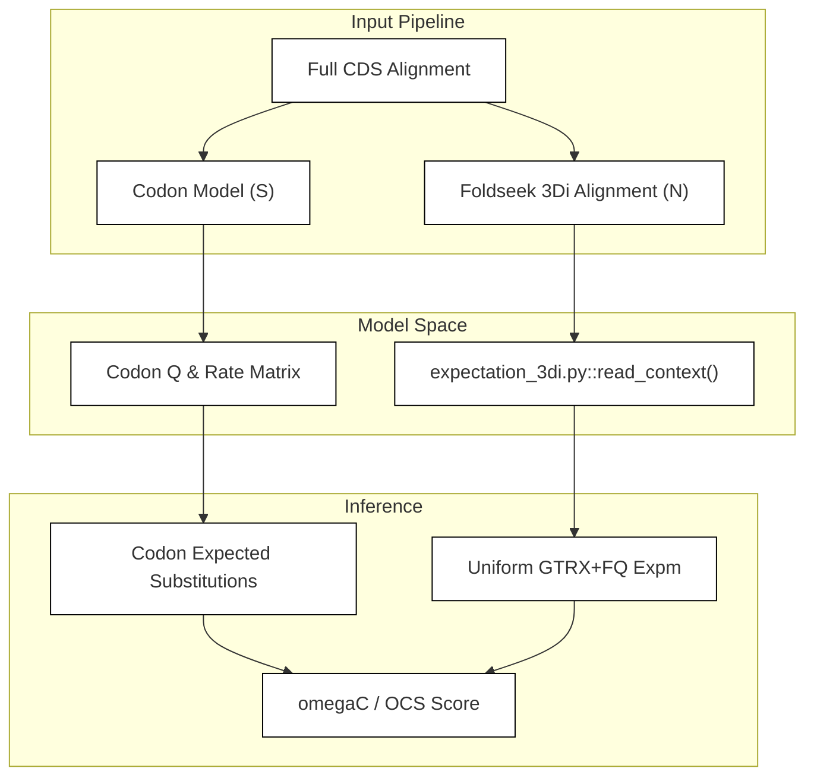

# Observation Methods: Marginal, Joint and Bridge CTMC

<details>
<summary>Relevant source files</summary>

The following files were used as context for generating this wiki page:

- [.github/scripts/verify_endpoint_scaling.py](.github/scripts/verify_endpoint_scaling.py)
- [csubst/endpoint_io.py](csubst/endpoint_io.py)
- [csubst/event_reporting.py](csubst/event_reporting.py)
- [csubst/expectation_3di.py](csubst/expectation_3di.py)
- [csubst/runtime.py](csubst/runtime.py)
- [csubst/scan_ctmc.py](csubst/scan_ctmc.py)
- [csubst/scan_endpoint.py](csubst/scan_endpoint.py)
- [csubst/tsv.py](csubst/tsv.py)
- [docs/SCAN_ENDPOINT.md](docs/SCAN_ENDPOINT.md)
- [docs/STRUCTURAL_ALPHABET.md](docs/STRUCTURAL_ALPHABET.md)
- [reports/endpoint_arity6_20260910/README.md](reports/endpoint_arity6_20260910/README.md)
- [reports/endpoint_arity6_20260910/blas.json](reports/endpoint_arity6_20260910/blas.json)
- [reports/endpoint_arity6_20260910/blas_recheck.json](reports/endpoint_arity6_20260910/blas_recheck.json)
- [reports/endpoint_arity6_20260910/blas_with_interference.json](reports/endpoint_arity6_20260910/blas_with_interference.json)
- [reports/endpoint_arity6_20260910/checks.log](reports/endpoint_arity6_20260910/checks.log)
- [reports/endpoint_arity6_20260910/integration.json](reports/endpoint_arity6_20260910/integration.json)
- [reports/endpoint_arity6_20260910/integration_checks.log](reports/endpoint_arity6_20260910/integration_checks.log)
- [reports/endpoint_arity6_20260910/integration_tests.log](reports/endpoint_arity6_20260910/integration_tests.log)
- [reports/endpoint_arity6_20260910/logs/heuristic6-t1-b1-joint-r2.log](reports/endpoint_arity6_20260910/logs/heuristic6-t1-b1-joint-r2.log)
- [tests/unit/test_endpoint_io.py](tests/unit/test_endpoint_io.py)
- [tests/unit/test_joint_defaults.py](tests/unit/test_joint_defaults.py)
- [tests/unit/test_parser_misc_rate_models.py](tests/unit/test_parser_misc_rate_models.py)

</details>


This page details the observation and inference frameworks used during substitution scans (`csubst scan`), focusing on the mathematical formulation, implementation, and performance characteristics of marginal posterior products, joint endpoint posteriors, and continuous-time Markov chain (CTMC) bridge jump counting.

Sources: [csubst/scan_endpoint.py:1-6](), [csubst/scan_ctmc.py:1-5]()

---

## 1. Overview of Observation Models

The substitution scan subsystem evaluates recurrent substitutions across foreground lineages. Depending on the chosen observation method (`--scan_observation`), csubst computes evolutionary expectations and observed event counts via distinct probabilistic routes:

1. **Marginal (`marginal`)**: Uses products of separately inferred marginal ancestral state posteriors at parent and child nodes, paired with legacy weighted branch length exposure (`q_weighted`) [docs/SCAN_ENDPOINT.md:6-7]().
2. **Joint Endpoint (`joint`)**: Computes finite-time fitted endpoint probabilities by exponentiating the full CTMC generator matrix prior to grouping states, paired with raw-length expected endpoint exposure (`endpoint`) [csubst/scan_endpoint.py:4-5](), [docs/SCAN_ENDPOINT.md:3-5]().
3. **Bridge CTMC (`bridge`)**: Computes exact edge posteriors and posterior CTMC jump counts using scaled pruning, bridge kernels, and spectral decompositions [csubst/scan_ctmc.py:1-4]().



Sources: [csubst/scan_endpoint.py:1-25](), [csubst/scan_ctmc.py:150-154](), [docs/SCAN_ENDPOINT.md:1-125]()

---

## 2. Endpoint Exposure and Finite-Time Transition Mathematics

When operating in joint endpoint mode, csubst avoids multiplying separately inferred marginals. Instead, it models the exact finite-time transition probability matrix over branch length $t_b$ [docs/SCAN_ENDPOINT.md:3-5]().

### Model Validation and Rate Mixtures
The module `csubst/scan_endpoint.py` validates that state matrices, rate matrices ($Q$), equilibrium frequencies ($\pi$), and branch lengths are finite and consistent [csubst/scan_endpoint.py:28-86](). Rate heterogeneity mixtures (e.g., $+G, +R, +I$) are parsed via `endpoint_io.model_rates()`, which extracts fitted rate categories and category proportions from IQ-TREE text reports rather than posterior-mean site rates [csubst/scan_endpoint.py:46](), [csubst/endpoint_io.py:31-45]().



### Transition Probability Exponentiation
For each rate category and unique branch length, the full codon generator matrix $Q$ is exponentiated before grouping destination states [csubst/scan_endpoint.py:98-106]():

$$P(t) = \exp(Q \cdot t)$$

Grouping is applied post-exponentiation via projection matrices that map codons to amino acids or recoded states [csubst/scan_endpoint.py:92-106](). For bridge observations, integrated transition probabilities (occupation times) are computed without inverting singular $Q$ matrices by augmenting the generator [csubst/scan_endpoint.py:110-122]():

$$\begin{pmatrix} Q & I \\ 0 & 0 \end{pmatrix}$$

Sources: [csubst/scan_endpoint.py:14-124](), [csubst/endpoint_io.py:31-100]()

---

## 3. CTMC Pruning, Jump Counting, and Bridge Kernels

For exact Bayesian tree pruning and posterior CTMC jump counts, `csubst/scan_ctmc.py` implements scaled likelihood pruning, spectral decomposition of reversible generators, and adjoint Fréchet derivative bridge kernels [csubst/scan_ctmc.py:1-44]().

### Bridge Kernel and Adjoint Fréchet Derivative
The function `bridge_kernel()` calculates unnormalized expected jump masses for boundary messages by evaluating the Fréchet derivative of matrix exponentials with respect to generator entries, holding diagonals fixed [csubst/scan_ctmc.py:21-33]():

```python
def bridge_kernel(q, length, left, right):
    out = np.empty((len(left), len(q), len(q)))
    for k, (a, b) in enumerate(zip(left, right)):
        out[k] = q * expm_frechet((q * length).T, np.outer(a, b) * length,
                                  compute_expm=False)
    idx = np.arange(len(q))
    out[:, idx, idx] = 0
    return out
```
*Citations: `csubst/scan_ctmc.py:21-33`*

### Spectral Decomposition and Joint Inference
Reversible generators are decomposed via `_bridge_spectral()` using symmetric transformations with equilibrium frequencies $\pi$ [csubst/scan_ctmc.py:36-44](). The function `_joint_infer()` iterates over tree blocks to construct site event tensors and evaluate synonymous and nonsynonymous event counts across branches [csubst/scan_ctmc.py:56-147]().

Sources: [csubst/scan_ctmc.py:1-154]()

---

## 4. Structural 3Di Integration

When analyzing structural alphabets with `--nonsyn_recode 3di20`, csubst routes nonsynonymous (N) expectations through an independently fitted uniform GTRX+FQ model while keeping synonymous (S) expectations bound to codon models [docs/STRUCTURAL_ALPHABET.md:3-6, 65-67]().



The module `csubst/expectation_3di.py` reads IQ-TREE ModelMorph checkpoints and exchangeability vectors to construct the 20-state structural rate matrix $Q$, verifying stationarity and normalization [csubst/expectation_3di.py:75-124]().

Sources: [csubst/expectation_3di.py:1-137](), [docs/STRUCTURAL_ALPHABET.md:1-126]()

---

## 5. Bounded-Memory Spooling and Scaling Benchmarks

To handle large alignments and high-arity combinations without excessive RAM consumption, joint endpoint and CTMC modules utilize disk-backed temporary spools (`_Spool`) [csubst/endpoint_io.py:102-143]().

### Spooling Architecture
`_Spool` streams unordered CSR row fragments to temporary files and allocates final sparse payload arrays once per block [csubst/endpoint_io.py:102-143]().

```python
class _Spool:
    def __init__(self, stack, rows, columns, dtype):
        self.rows, self.columns, self.dtype = rows, columns, np.dtype(dtype)
        self.index_dtype = np.dtype(np.int32 if columns < 2**31 else np.int64)
        self.indices = stack.enter_context(tempfile.TemporaryFile())
        self.values = stack.enter_context(tempfile.TemporaryFile())
        self.fragments = []
        self.counts = np.zeros(rows, dtype=np.int64)
        self.offset = 0
```
*Citations: `csubst/endpoint_io.py:102-113`*

### Performance Benchmarks and Verification
Benchmark artifacts (such as those recorded in `reports/endpoint_arity6_20260910/`) validate numerical stability across threading limits (`OMP_NUM_THREADS`, `OPENBLAS_NUM_THREADS`) and high-arity search spaces ($K=6$). Preflight validation routines in `csubst/scan_endpoint.py` and `csubst/endpoint_io.py` guarantee that numerical underflows, zero exposures, and invalid branch lengths are trapped prior to tensor construction.

Sources: [csubst/endpoint_io.py:102-143](), [csubst/scan_endpoint.py:14-86]()

---