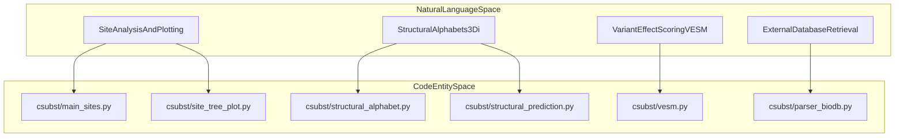
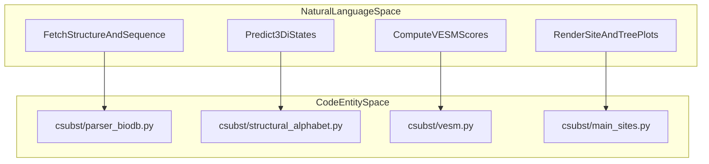

# Sites, Structures and Visualization

Relevant source files

The following files were used as context for generating this wiki page:

- [csubst/main_scan.py](csubst/main_scan.py)
- [csubst/main_sites.py](csubst/main_sites.py)
- [csubst/output_safety.py](csubst/output_safety.py)
- [csubst/resource_cache.py](csubst/resource_cache.py)
- [csubst/structural_alphabet.py](csubst/structural_alphabet.py)
- [csubst/substitution_scan.py](csubst/substitution_scan.py)
- [csubst/vesm.py](csubst/vesm.py)
- [docs/ENDPOINT_POSTERIORS.md](docs/ENDPOINT_POSTERIORS.md)
- [docs/SCAN_INFERENCE.md](docs/SCAN_INFERENCE.md)
- [tests/integration/test_scan_candidates_and_rates.py](tests/integration/test_scan_candidates_and_rates.py)
- [tests/integration/test_scan_ctmc.py](tests/integration/test_scan_ctmc.py)
- [tests/integration/test_scan_execution.py](tests/integration/test_scan_execution.py)
- [tests/unit/test_3di_state_cache.py](tests/unit/test_3di_state_cache.py)
- [tests/unit/test_structural_prediction.py](tests/unit/test_structural_prediction.py)
- [tests/unit/test_tree_core.py](tests/unit/test_tree_core.py)
- [tests/unit/test_vesm.py](tests/unit/test_vesm.py)

## Purpose and Scope
This page serves as the parent overview for site-level analysis, structural alphabets, variant effect scoring, and structural database retrieval within `csubst`. The subsystem bridges traditional codon-based phylogenetic substitution tensors with 3D structural contexts, deep learning-based structural alphabets (`3Di`), and log-likelihood ratio (LLR) variant scoring via pre-trained protein language models (VESM-35M). 

For detailed technical breakdowns, see the child pages:
- [Site Analysis and Plotting](#5.1)
- [Structural Alphabets and Prediction (3Di)](#5.2)
- [Variant Effect Scoring and Model Resources](#5.3)
- [External Databases and Structure Retrieval](#5.4)

### High-Level Subsystem Architecture

Sources: `csubst/main_sites.py:1-126](), [csubst/structural_alphabet.py:1-36](), [csubst/vesm.py:1-32](), [csubst/site_tree_plot.py:1-77]()`

---

## 5.1. Site Analysis and Plotting

The site analysis subsystem processes output tensors and tabular summaries to generate publication-grade visualizations, including lineage heatmaps, phylogenetic tree plots annotated with site states, and structural mappings. Orchestrated primarily through `[csubst/main_sites.py]()` and `[csubst/site_tree_plot.py]()`, it extracts posterior probabilities and branch distributions for specific sequence sites of interest [[csubst/main_sites.py:84-126]()].

For details, see [Site Analysis and Plotting](#5.1).

Sources: `[csubst/main_sites.py:1-126](), [csubst/site_tree_plot.py:1-77]()`

---

## 5.2. Structural Alphabets and Prediction (3Di)

To evaluate structural convergence and alignment stability beyond standard amino acids, `csubst` integrates structural alphabets such as `3Di` (derived from structural alphabet prediction models like ProstT5 and ESM-3Di). Sequences are translated into structural states using `[csubst/structural_alphabet.py]()` and `[csubst/structural_prediction.py]()`, enabling structural substitution mapping and residue-level contact weighting.

For details, see [Structural Alphabets and Prediction (3Di)](#5.2).

Sources: `[csubst/structural_alphabet.py:1-40](), [tests/unit/test_structural_prediction.py:1-50]()`

---

## 5.3. Variant Effect Scoring and Model Resources

Variant effect scoring uses deep transformer models (such as VESM-35M) to compute log-likelihood ratios (LLRs) for amino acid substitutions across sequence windows. These computations are managed via `[csubst/vesm.py]()`, utilizing thread-safe resource locking (`[csubst/resource_cache.py]()`) and model manifest resolution (`[csubst/model_resources.py]()`) to securely cache scores locally.

For details, see [Variant Effect Scoring and Model Resources](#5.3).

Sources: `[csubst/vesm.py:1-45](), [csubst/resource_cache.py:1-50]()`

---

## 5.4. External Databases and Structure Retrieval

Structure-aware workflows require fetching experimentally determined or predicted 3D coordinates from external repositories. The parser modules (`parser_biodb.py`, `parser_uniprot.py`) automate retrieval from the Protein Data Bank (PDB), SwissModel, and AlphaFold/AlphaFill databases, mapping chain IDs and residue alignments back to the phylogenetic coordinate space.

For details, see [External Databases and Structure Retrieval](#5.4).

Sources: `[csubst/main_sites.py:40-78]()`

---

### Dataflow and Execution Pipeline

Sources: `[csubst/main_sites.py:20-78](), [csubst/structural_alphabet.py:1-35](), [csubst/vesm.py:25-50]()`

---