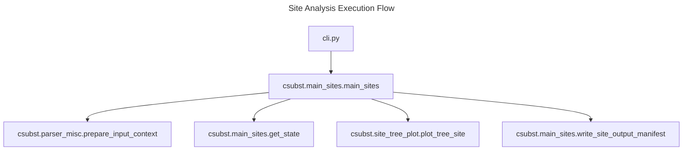
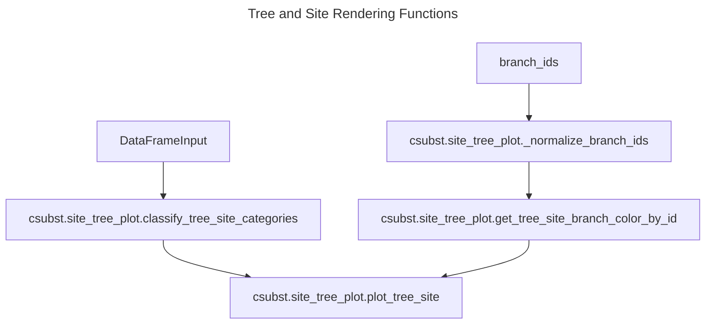

# Site Analysis and Plotting

<details>
<summary>Relevant source files</summary>

The following files were used as context for generating this wiki page:

- [csubst/main_scan.py](csubst/main_scan.py)
- [csubst/main_sites.py](csubst/main_sites.py)
- [csubst/output_stat.py](csubst/output_stat.py)
- [csubst/site_tree_plot.py](csubst/site_tree_plot.py)
- [csubst/substitution_scan.py](csubst/substitution_scan.py)
- [csubst/table.py](csubst/table.py)
- [docs/ENDPOINT_POSTERIORS.md](docs/ENDPOINT_POSTERIORS.md)
- [docs/SCAN_INFERENCE.md](docs/SCAN_INFERENCE.md)
- [tests/integration/test_scan_candidates_and_rates.py](tests/integration/test_scan_candidates_and_rates.py)
- [tests/integration/test_scan_ctmc.py](tests/integration/test_scan_ctmc.py)
- [tests/integration/test_scan_execution.py](tests/integration/test_scan_execution.py)
- [tests/unit/test_main_sites_jobs.py](tests/unit/test_main_sites_jobs.py)
- [tests/unit/test_tree_core.py](tests/unit/test_tree_core.py)

</details>


## Purpose and Scope
This page details the site-level analysis pipelines, tree/site figure rendering, and output generation workflows implemented in `csubst`. The primary orchestrator is `csubst/main_sites.py`, which coordinates state extraction, metadata parsing, and report writing. Figure rendering and layout calculations are encapsulated within `csubst/site_tree_plot.py`, while table sorting, data casting, and statistical filters are managed via `csubst/table.py` and `csubst/output_stat.py`.

---

## 1. Site Workflow Orchestration (`main_sites.py`)

The `csubst sites` subcommand is driven by `main_sites.py`, which prepares the input context, retrieves ancestral and leaf state matrices, evaluates site-specific probabilities, and delegates figure rendering.

### State Extraction and Validation
Leaf and ancestral sequence states are retrieved and converted into probability matrices via `get_state()`, which maps codon windows to input state indices using genetic code tables [csubst/main_sites.py:129-141]().

```python
def get_state(node, g):
    seq = ete.get_prop(node, 'sequence', '').upper()
    if seq == '':
        raise AssertionError('Leaf sequence not found for node "{}". Check tree/alignment labels.'.format(node.name))
    if len(seq) % 3 != 0:
        raise AssertionError('Sequence length is not multiple of 3. Node name = ' + node.name)
    state_matrix = np.zeros([g['num_input_site'], g['num_input_state']], dtype=g['float_type'])
    for s in np.arange(g['num_input_site']):
        codon = seq[(s*3):((s+1)*3)]
        codon_index = sequence.get_state_index(state=codon, input_state=g['codon_orders'], ambiguous_table=genetic_code.ambiguous_table)
        for ci in codon_index:
            state_matrix[s,ci] = 1/len(codon_index)
    return(state_matrix)
```
*Sources: [csubst/main_sites.py:129-141]()*

### Output Manifest and Metadata
Site analysis runs generate outputs tracked via an output manifest. Metadata regarding threshold probabilities, single-branch modes, and plotting formats are assembled by `_get_site_output_manifest_metadata()` and written using `write_site_output_manifest()` [csubst/main_sites.py:84-126]().


*Sources: [csubst/main_sites.py:1-126](), [csubst/site_tree_plot.py:1-77]()*

---

## 2. Tree and Site Rendering (`site_tree_plot.py`)

Figure rendering is completely decoupled from command-line orchestration and handled in `csubst/site_tree_plot.py`.

### Branch ID Normalization and Lineage Coloring
Branch identifiers passed into plotting routines are rigorously normalized into 64-bit integer numpy arrays by `_normalize_branch_ids()` [csubst/site_tree_plot.py:20-49](). Lineage branch colors are determined using oldness fractions derived from midpoint distances along the phylogeny [csubst/site_tree_plot.py:72-134]().

- `_normalize_branch_ids(branch_ids)`: Ensures scalar, list, or array inputs are cast to `np.int64` and validates against missing or malformed values [csubst/site_tree_plot.py:20-49]().
- `_get_lineage_oldness_fracs(branch_ids, g)`: Computes normalized temporal fractions along lineage paths for gradient color mapping [csubst/site_tree_plot.py:100-114]().
- `get_tree_site_branch_color_by_id(branch_ids, g, default_color)`: Returns a color dictionary mapping each branch ID to an RGB tuple or uniform color string [csubst/site_tree_plot.py:125-134]().

### Thresholds and Category Classification
Minimum probability thresholds are adjusted depending on whether the execution runs in single-branch or combinatorial mode:
- `get_min_single_prob(g)`: Defaults to `0.8` [csubst/site_tree_plot.py:159-160]().
- `get_min_combinat_prob(g)`: Defaults to `0.5` [csubst/site_tree_plot.py:163-164]().
- `get_tree_site_min_prob(g)`: Resolves the appropriate probability cutoff based on `g['mode']` and `single_branch_mode` [csubst/site_tree_plot.py:167-174]().

Sites are classified into convergent, divergent, or neutral categories using `classify_tree_site_categories()` [csubst/site_tree_plot.py:176-186]().


*Sources: [csubst/site_tree_plot.py:20-186]()*, [csubst/main_sites.py:22-77]()*

---

## 3. Tables, Sorting, and Statistics Integration

Site and combination tables undergo rigorous post-processing and sorting to ensure downstream reproducibility and clean tabular exports.

### Table Utilities (`table.py`)
- `sort_branch_ids(df)`: Sorts dataframes by branch ID columns and site index [csubst/table.py:55-66]().
- `sort_cb(cb)`: Reorders columns in combination tables (`cb`) based on distance metrics, indicator flags, omega statistics (`omegaC`), and substitution counts (`NS_sub`, `OCNany2spe`) [csubst/table.py:68-92]().
- `merge_tables(df1, df2)`: Joins separate tables on branch names, branch IDs, and site coordinates [csubst/table.py:108-117]().
- `set_substitution_dtype(df)`: Downcasts integer-compatible substitution columns to `np.int64` [csubst/table.py:119-136]().

### Cutoff Statistics (`output_stat.py`)
Statistics filters and cutoffs are parsed and validated against requested output stats:
- `parse_output_stats(value, default)`: Parses comma-separated output statistic names (e.g., `any2spe`, `spe2spe`) [csubst/output_stat.py:98-114]().
- `validate_cutoff_stat_compatibility(cutoff_stat, output_stats)`: Ensures that expressions provided via `--cutoff_stat` reference valid columns supported by `--output_stat` [csubst/output_stat.py:156-184]().

---

## 4. Structural Exports and Mapping

Site results can be mapped onto 3D structures (via PDB, SwissModel, or AlphaFold) using chain mapping routines.
- `_select_structure_chain_from_df()`: Associates alignment sites with structural residue positions [csubst/site_tree_plot.py:45]().
- `get_highest_identity_chain_name(g)`: Identifies the structural chain with the highest sequence identity to align substitution heatmaps onto protein structures [csubst/site_tree_plot.py:137-156]().

Sources:
- [csubst/main_sites.py]()
- [csubst/site_tree_plot.py]()
- [csubst/table.py]()
- [csubst/output_stat.py]()

---