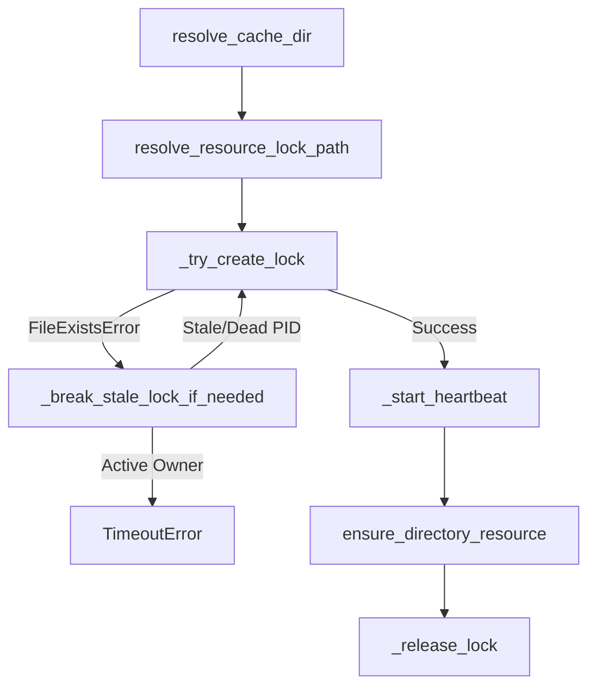
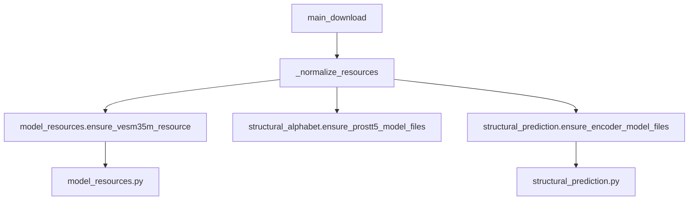

# Variant Effect Scoring and Model Resources

Relevant source files

The following files were used as context for generating this wiki page:

- [.github/scripts/documentation_check.py](.github/scripts/documentation_check.py)
- [Makefile](Makefile)
- [csubst/cli.py](csubst/cli.py)
- [csubst/cli_io.py](csubst/cli_io.py)
- [csubst/config_types.py](csubst/config_types.py)
- [csubst/main_download.py](csubst/main_download.py)
- [csubst/model_resources.py](csubst/model_resources.py)
- [csubst/output_run.py](csubst/output_run.py)
- [csubst/output_safety.py](csubst/output_safety.py)
- [csubst/resource_cache.py](csubst/resource_cache.py)
- [csubst/structural_alphabet.py](csubst/structural_alphabet.py)
- [csubst/vesm.py](csubst/vesm.py)
- [docs/CLI_SAFETY.md](docs/CLI_SAFETY.md)
- [reports/documentation_audit_20260831/README.md](reports/documentation_audit_20260831/README.md)
- [tests/cli/test_cli_validation.py](tests/cli/test_cli_validation.py)
- [tests/cli/test_output_lifecycle.py](tests/cli/test_output_lifecycle.py)
- [tests/integration/test_resource_cache.py](tests/integration/test_resource_cache.py)
- [tests/process/test_resource_cache_process.py](tests/process/test_resource_cache_process.py)
- [tests/unit/test_3di_state_cache.py](tests/unit/test_3di_state_cache.py)
- [tests/unit/test_main_download.py](tests/unit/test_main_download.py)
- [tests/unit/test_structural_prediction.py](tests/unit/test_structural_prediction.py)
- [tests/unit/test_vesm.py](tests/unit/test_vesm.py)

## Purpose and Scope
This page details the implementation of Variant Effect Scoring via the VESM-35M Log-Likelihood Ratio (LLR) scoring engine [csubst/vesm.py](), the concurrent resource caching and exclusive file-locking subsystem [csubst/resource_cache.py](), model registry and validation utilities [csubst/model_resources.py](), and the download orchestration workflow [csubst/main_download.py](). These components ensure thread-safe and process-safe management of large deep learning model weights and provide variant effect prediction pipelines.

---

## 1. VESM-35M LLR Scoring Subsystem
The Variant Effect Scoring Method (VESM-35M) provides log-likelihood ratio (LLR) scoring for evaluating sequence variants against reference models. The implementation handles tensor representations, batching, device selection (CPU/GPU), and integration with structural alphabets and alignment contexts.

Key operations include:
- Resolving model configurations and initializing weight structures from the local cache.
- Performing LLR computations across target mutations using sequence variations and state probabilities.
- Enforcing strict integrity checks and SHA-256 validations on weight files before inference execution [docs/CLI_SAFETY.md:96-110]().

Sources:
- `csubst/vesm.py`
- `docs/CLI_SAFETY.md`

---

## 2. Resource Cache Locking and Concurrency Management
The resource caching layer in `csubst/resource_cache.py` implements robust inter-process locking using exclusive file creation (`os.O_CREAT | os.O_EXCL`), metadata tracking (hostname, boot ID, process ID), background heartbeats, and stale-lock reclamation [csubst/resource_cache.py:1-207]().

*Figure 5.3.1: Inter-process resource cache locking lifecycle.*

### Key Locking and Caching Functions
- `resolve_cache_dir(cache_dir)`: Determines the effective cache directory, evaluating explicit parameters, the `CSUBST_CACHE_DIR` environment variable, XDG specifications, or default fallback locations [csubst/resource_cache.py:28-38]().
- `acquire_exclusive_lock(lock_path, ...)`: Context manager that handles locking, stale lock breaking via process liveness checks (`_is_process_alive`), and periodic timestamp updates via `_start_heartbeat` [csubst/resource_cache.py:1-542]().
- `ensure_directory_resource(resource_id, resource_dir, populate, ...)`: Atomically populates directory-based resources inside a staging directory and publishes them with a companion manifest file (`csubst-resource.json`) [csubst/resource_cache.py:158-189]().

Sources:
- `csubst/resource_cache.py`
- `tests/integration/test_resource_cache.py`

---

## 3. Model Download and Registry Orchestration
The `main_download.py` module coordinates the retrieval, normalization, and validation of model resources, including VESM-35M, ProstT5, ProstT5-CNN, and ESM-3Di variants [csubst/main_download.py:1-67]().

*Figure 5.3.2: Model download orchestration and validation dispatch.*

### Orchestration Workflow
- `_normalize_resources(value)`: Normalizes target resource strings, parsing values such as `vesm-35m`, `prostt5`, `prostt5-cnn`, `esm3di-35m`, or `all` [csubst/main_download.py:8-15]().
- `main_download(g)`: Validates download options (such as rejecting unsupported checksum requests for ProstT5) and invokes respective resource preparation workflows with configured timeout and poll durations [csubst/main_download.py:17-67]().
- `model_resources`: Implements resource verification rules, enforcing mandatory SHA-256 checks for VESM-35M and CNN weights while supporting `--no_download yes` for offline verification [docs/CLI_SAFETY.md:96-110]().

Sources:
- `csubst/main_download.py`
- `csubst/model_resources.py`
- `tests/unit/test_main_download.py`
- `docs/CLI_SAFETY.md`

---