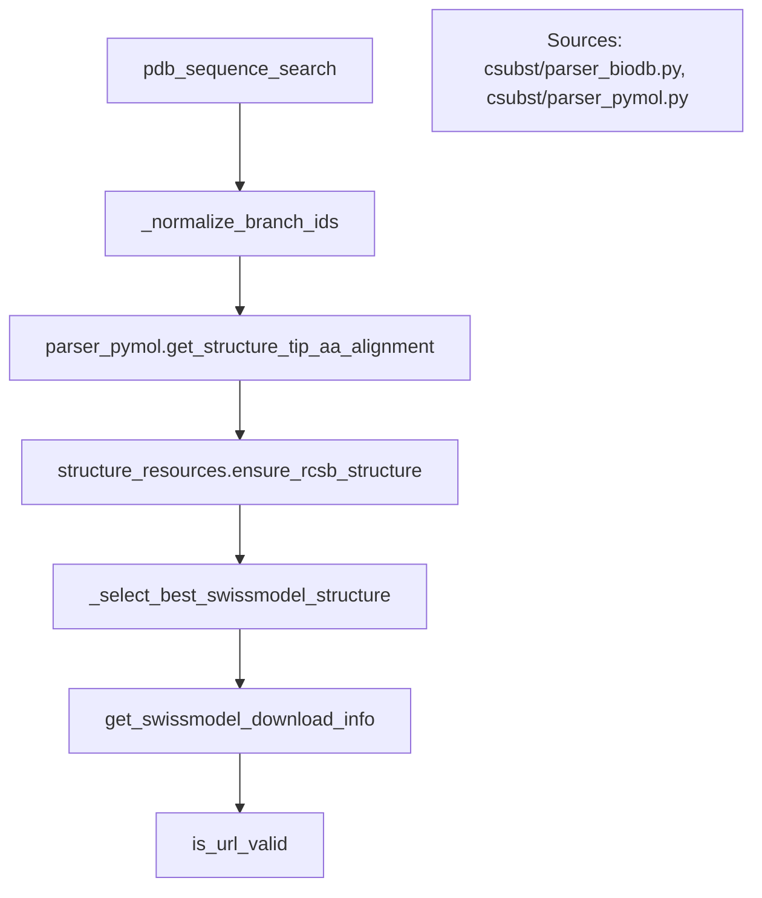
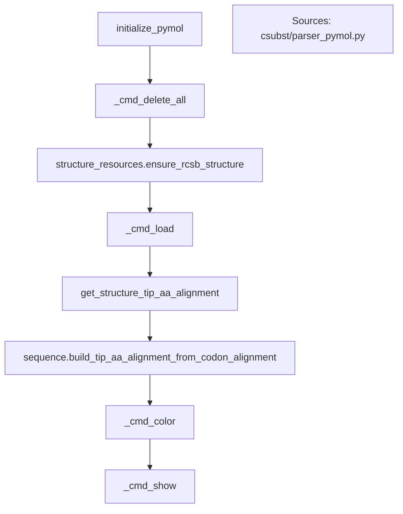

# External Databases and Structure Retrieval

Relevant source files

The following files were used as context for generating this wiki page:

- [README.md](README.md)
- [csubst/__init__.py](csubst/__init__.py)
- [csubst/main_simulate.py](csubst/main_simulate.py)
- [csubst/parser_biodb.py](csubst/parser_biodb.py)
- [csubst/parser_pymol.py](csubst/parser_pymol.py)
- [csubst/parser_uniprot.py](csubst/parser_uniprot.py)
- [setup.py](setup.py)

This page documents the subsystems responsible for querying external structural and functional databases (RCSB PDB, Swiss-Model, AlphaFold, UniProtKB), running sequence homology searches via NCBI QBLAST, and controlling PyMOL visualization sessions. These modules bridge phylogenetic substitution results with 3D structural data and functional feature annotations.

---

## 1. Structural Database Resolution and Caching

The `csubst/parser_biodb.py` module manages structural database queries, URL validation, and Swiss-Model template selection. When a user requests a PDB structure by identifier, the system checks whether the code matches standard RCSB PDB formats (`[0-9][A-Za-z0-9]{3}` or `pdb_[0-9]{5}[A-Za-z0-9]{3}`) [csubst/parser_pymol.py:139-140()]. 

For Swiss-Model integrations, `get_swissmodel_download_info()` queries the ExPASy repository JSON endpoint and delegates selection to `_select_best_swissmodel_structure()` [csubst/parser_biodb.py:131-146(), csubst/parser_biodb.py:149-152()]. This function ranks candidate models by GMQE score, QMEAN local score, sequence coverage length, and sequence identity [csubst/parser_biodb.py:138-146()].

Network validation for remote structure files is handled by `is_url_valid()`, which issues an HTTP `HEAD` request (with a fallback to `GET` for servers rejecting `HEAD` such as HTTP 403/405/501 errors) [csubst/parser_biodb.py:62-86()].

**Figure 1**: Structure and Database Resolution Data Flow (`parser_biodb.py`).

Sources: `csubst/parser_biodb.py`, `csubst/parser_pymol.py`

---

## 2. Sequence Homology and Alignment via NCBI BLAST

To map unannotated or non-standard sequence queries to known database entries, `parser_biodb.py` provides `run_qblast()` [csubst/parser_biodb.py:17-38()]. This function acts as a wrapper around NCBI QBLAST services:

- **Inputs**: Amino acid query string (`aa_query`), display count (`num_display`), E-value cutoff (`evalue_cutoff`), and timeout parameters (`timeout`) [csubst/parser_biodb.py:17-27()].
- **Execution**: Delegates to `ncbi_blast.search_blastp_swissprot()` to query UniProtKB/SwissProt [csubst/parser_biodb.py:24-28()].
- **Outputs**: Returns a list of top-hit protein accessions (`hit.accession`) after logging execution duration and titles [csubst/parser_biodb.py:29-38()].

Sources: `csubst/parser_biodb.py`

---

## 3. Functional Annotation via UniProt

The `csubst/parser_uniprot.py` module retrieves and parses UniProtKB feature annotations, enabling the mapping of structural domains, active sites, and post-translational modifications to substitution sites.

### Accession Resolution
`resolve_uniprot_accession()` extracts UniProt identifiers from sequence headers using regular expression patterns covering AlphaFold (`AF-([A-Z0-9]+)-F[0-9]+`) and standard UniProt accessions [csubst/parser_uniprot.py:49-63(), csubst/parser_uniprot.py:93-96()]. If an accession cannot be parsed directly from the sequence name, it parses the PDB chain identifier and queries the RCSB REST API endpoints (`https://data.rcsb.org/rest/v1/core/polymer_entity_instance/` and `polymer_entity/`) via `_resolve_uniprot_accession_from_rcsb()` [csubst/parser_uniprot.py:66-90(), csubst/parser_uniprot.py:97-108()].

### Feature Extraction
`get_uniprot_features()` queries `https://rest.uniprot.org/uniprotkb/{accession}.json` and extracts structural features containing valid start and end residue integers (`start <= end`) [csubst/parser_uniprot.py:111-144()]. Feature types can be filtered using `_filter_features()` and redundant features pruned using `_filter_redundant_features()` [csubst/parser_uniprot.py:147-201()].

Sources: `csubst/parser_uniprot.py`

---

## 4. PyMOL Session Control and Visualization

The `csubst/parser_pymol.py` module encapsulates PyMOL's Python API (`pymol.cmd`) to automate structure loading, color setting, atom selection, and representation adjustments.

### API Command Wrappers
To handle variations across PyMOL library installations (direct python bindings vs. string command execution via `pymol.cmd.do`), `parser_pymol.py` implements safe wrapper functions:
- `_cmd_delete_all()` [csubst/parser_pymol.py:22-26()]
- `_cmd_load(path, object_name)` [csubst/parser_pymol.py:29-37()]
- `_cmd_color(color_name, selection)` [csubst/parser_pymol.py:70-74()]
- `_cmd_count_atoms(selection)` [csubst/parser_pymol.py:77-81()]

### Initialization and Alignment
`initialize_pymol()` handles PDB code validation and downloads/loads structures into the PyMOL session [csubst/parser_pymol.py:134-160()]. `get_structure_tip_aa_alignment()` retrieves and caches tip-wise amino acid alignments derived from input codon alignments for structural mapping [csubst/parser_pymol.py:161-185()].

**Figure 2**: PyMOL Session Control and Structure Loading Pipeline (`parser_pymol.py`).

Sources: `csubst/parser_pymol.py`

---