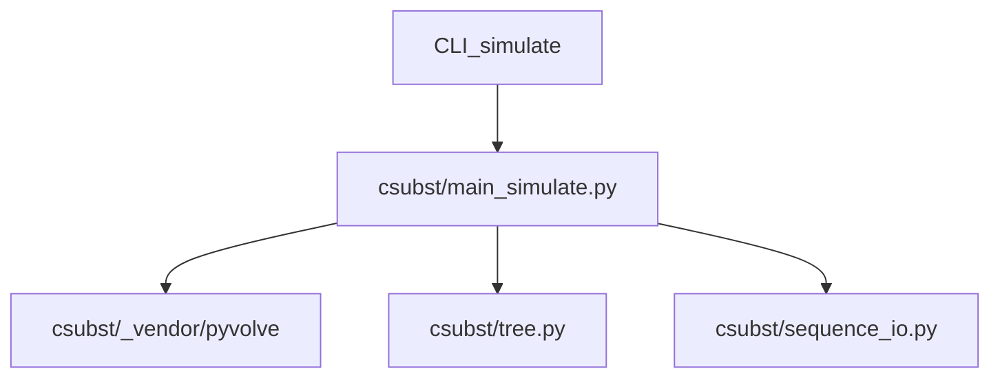
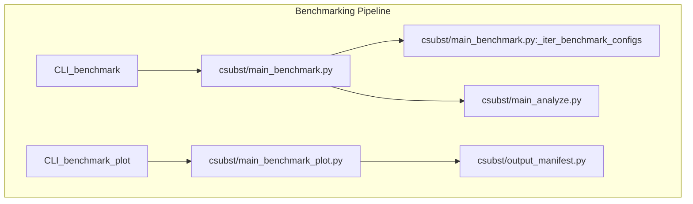

# Simulation, Benchmarking and Validation

Relevant source files

The following files were used as context for generating this wiki page:

- [README.md](README.md)
- [csubst/__init__.py](csubst/__init__.py)
- [csubst/main_benchmark.py](csubst/main_benchmark.py)
- [csubst/main_benchmark_plot.py](csubst/main_benchmark_plot.py)
- [csubst/main_simulate.py](csubst/main_simulate.py)
- [csubst/parser_biodb.py](csubst/parser_biodb.py)
- [csubst/parser_pymol.py](csubst/parser_pymol.py)
- [csubst/plotting.py](csubst/plotting.py)
- [csubst/recoding.py](csubst/recoding.py)
- [docs/ARCHITECTURE.md](docs/ARCHITECTURE.md)
- [pyproject.toml](pyproject.toml)
- [setup.py](setup.py)
- [tests/integration/test_main_benchmark.py](tests/integration/test_main_benchmark.py)
- [tests/unit/test_plotting.py](tests/unit/test_plotting.py)

## Purpose and Scope
This page provides a high-level overview of the simulation, benchmarking, and validation subsystems in **CSUBST**. These modules enable the evaluation of false-discovery rates, statistical power under synthetic convergence scenarios, performance profiling across parameter grids, and reproduction of validation reports against established null models and biological baselines. 

As a parent page, this section summarizes core modules and links to detailed child pages. For deep technical specifications, see [Sequence Simulation (csubst simulate)](#6.1), [Benchmarking Framework](#6.2), and [Validation Reports and Research Artifacts](#6.3).

---

## 6.1. Sequence Simulation (`csubst simulate`)

Codon sequence evolution under user-defined convergence scenarios is orchestrated by `csubst/main_simulate.py`. This subsystem relies on a vendored copy of `pyvolve` located under `csubst/_vendor/pyvolve` to simulate sequence alignments over phylogenetic trees with customized substitution rate matrices ($Q$ matrices), amino acid frequency biases, and specific branch rate scaling.

### Simulation Workflow Mapping
The following diagram links natural language simulation concepts to their underlying code implementations in the codebase:

**Simulation Subsystem Architecture**

Sources: [csubst/main_simulate.py:1-27](), [pyproject.toml:80-80]()

For complete details on convergence scenarios, $Q$ matrix generation, rescaling functions, and true ancestral state reconstruction (ASR) bundles, see [Sequence Simulation (csubst simulate)](#6.1).

Sources: [csubst/main_simulate.py:1-997](), [README.md:104-104]()

---

## 6.2. Benchmarking Framework

The benchmarking subsystem supports systematic grid searches across expectation methods (e.g., codon models vs. urn sampling), ASRV modes, nonsynonymous recoding schemes, structure-aware settings, and pseudocount options. Execution orchestration is handled by `csubst/main_benchmark.py`, which iterates over configuration grids using `_iter_benchmark_configs()`, executes individual run trees, and delegates summary reporting to `csubst/main_benchmark_plot.py`.

### Benchmarking and Plotting Pipeline
The following diagram connects the benchmark command interface to the core runner and summary plotting modules:

**Benchmarking Code Entities**

Sources: [csubst/main_benchmark.py:1-191](), [csubst/main_benchmark_plot.py:1-129]()

For details on parameter grid construction, run trees, and summary visualization scripts, see [Benchmarking Framework](#6.2).

Sources: [csubst/main_benchmark.py:1-685](), [csubst/main_benchmark_plot.py:1-513](), [README.md:105-106]()

---

## 6.3. Validation Reports and Research Artifacts

Validation and artifact reporting consolidate empirical null-model comparisons, parity testing against historical baselines, and issue investigations. These reports and documentation files establish error-corrected rate guarantees and verify numerical stability across releases, supported by versioned benchmarking outputs and integration testing pipelines.

For details on interpreting validation reports, null-model comparisons, and reproducing research artifacts, see [Validation Reports and Research Artifacts](#6.3).

Sources: [docs/ARCHITECTURE.md:97-106](), [pyproject.toml:52-53]()

---