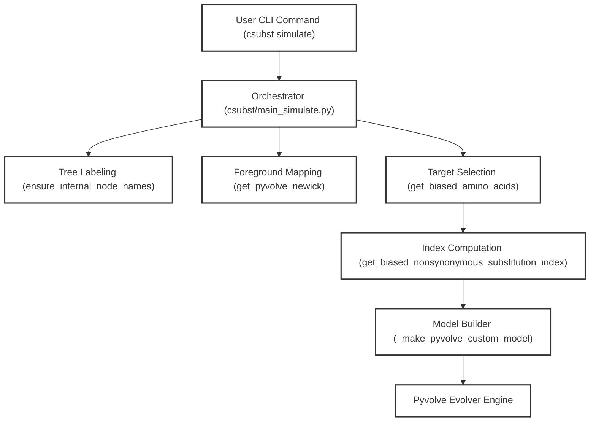
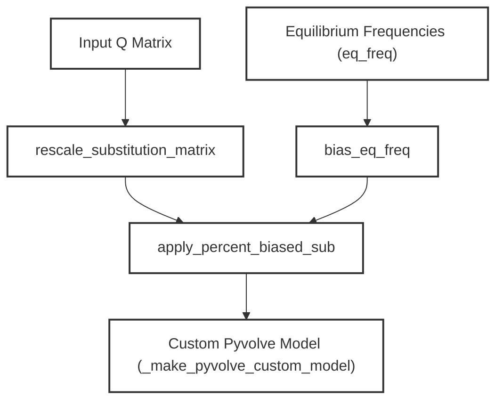

# Sequence Simulation (csubst simulate)

Relevant source files

The following files were used as context for generating this wiki page:

- [README.md](README.md)
- [THIRD_PARTY_NOTICES.md](THIRD_PARTY_NOTICES.md)
- [csubst/__init__.py](csubst/__init__.py)
- [csubst/_vendor/__init__.py](csubst/_vendor/__init__.py)
- [csubst/_vendor/pyvolve/LICENSE.txt](csubst/_vendor/pyvolve/LICENSE.txt)
- [csubst/_vendor/pyvolve/__init__.py](csubst/_vendor/pyvolve/__init__.py)
- [csubst/_vendor/pyvolve/empirical_matrices.py](csubst/_vendor/pyvolve/empirical_matrices.py)
- [csubst/_vendor/pyvolve/evolver.py](csubst/_vendor/pyvolve/evolver.py)
- [csubst/_vendor/pyvolve/genetics.py](csubst/_vendor/pyvolve/genetics.py)
- [csubst/_vendor/pyvolve/matrix_builder.py](csubst/_vendor/pyvolve/matrix_builder.py)
- [csubst/_vendor/pyvolve/model.py](csubst/_vendor/pyvolve/model.py)
- [csubst/_vendor/pyvolve/newick.py](csubst/_vendor/pyvolve/newick.py)
- [csubst/_vendor/pyvolve/state_freqs.py](csubst/_vendor/pyvolve/state_freqs.py)
- [csubst/main_dataset.py](csubst/main_dataset.py)
- [csubst/main_doctor.py](csubst/main_doctor.py)
- [csubst/main_simulate.py](csubst/main_simulate.py)
- [csubst/parser_biodb.py](csubst/parser_biodb.py)
- [csubst/parser_pymol.py](csubst/parser_pymol.py)
- [setup.py](setup.py)
- [tests/cli/test_cli_logging.py](tests/cli/test_cli_logging.py)
- [tests/integration/test_foreground_targets.py](tests/integration/test_foreground_targets.py)
- [tests/integration/test_main_dataset.py](tests/integration/test_main_dataset.py)
- [tests/parity/test_expected_sparse.py](tests/parity/test_expected_sparse.py)
- [tests/parity/test_omega_expected_state.py](tests/parity/test_omega_expected_state.py)
- [tests/parity/test_omega_expected_state_parity.py](tests/parity/test_omega_expected_state_parity.py)
- [tests/unit/test_simulate_core.py](tests/unit/test_simulate_core.py)
- [tests/unit/test_substitution_dense_tensor.py](tests/unit/test_substitution_dense_tensor.py)

## Purpose and Scope
This page details the implementation and internal architecture of the sequence simulation subsystem (`csubst simulate`), which is orchestrated primarily by `csubst/main_simulate.py` [csubst/main_simulate.py:1-171](). The simulation tool allows researchers to evolve codon sequences along phylogenetic trees under user-defined scenarios of convergent amino acid substitutions, adjusting rate matrices and equilibrium frequencies to mimic selective pressures on specific foreground lineages.

---

## 1. Simulation Orchestration and Convergence Scenarios

The simulation workflow begins by parsing the input phylogeny, assigning numerical node identifiers [csubst/main_simulate.py:98-114](), and mapping foreground lineages to specific branches using `get_pyvolve_newick()` [csubst/main_simulate.py:77-96](). 

To model convergence toward specific target amino acids, `csubst` computes biased nonsynonymous substitution indices (`get_biased_nonsynonymous_substitution_index`) [csubst/main_simulate.py:131-146]() and resolves target amino acid sets (`get_biased_amino_acids`) [csubst/main_simulate.py:148-170](), which can be explicitly provided or randomly sampled using a reproducible random number generator (`rng`).

### Diagram: Natural Language Space to Code Entity Space (Simulation Pipeline)

*Sources: [csubst/main_simulate.py:77-170](), [THIRD_PARTY_NOTICES.md:3-13]()*

---

## 2. Q Matrix Generation, Rescaling, and Equilibrium Frequencies

Codon-level instantaneous rate matrices ($Q$) are modified to reflect convergence intensity factors and background selection parameters. 

- **Rescaling Matrices**: `rescale_substitution_matrix()` adjusts transition-transversion ratios or overall substitution rates while preserving equilibrium frequency normalization [tests/unit/test_simulate_core.py:101-109]().
- **Equilibrium Frequencies**: `bias_eq_freq()` scales and re-normalizes equilibrium codon frequencies (`eq_freq`) for targeted convergent amino acids [tests/unit/test_simulate_core.py:111-116]().
- **Percent Biased Substitution**: `apply_percent_biased_sub()` controls the proportion of mutations directed toward convergent states [tests/unit/test_simulate_core.py:142-152]().

### Diagram: Code Entity Space for Matrix Modification

*Sources: [csubst/main_simulate.py:60-71](), [tests/unit/test_simulate_core.py:101-152]()*

---

## 3. Vendored Pyvolve Integration

To guarantee reproducibility and version stability without introducing strict external package dependency drift, `csubst` vendors the `pyvolve` sequence simulation library under `csubst/_vendor/pyvolve` [THIRD_PARTY_NOTICES.md:3-13]().

- **Lazy Loading**: `_require_pyvolve()` imports the vendored package dynamically on demand [csubst/main_simulate.py:20-27]().
- **Output Suppression**: `suppress_stdout_stderr` is implemented as a context manager using low-level file descriptor redirection (`os.open`, `os.dup2`, `os.devnull`) to suppress verbose printing originating from compiled C/Fortran routines inside pyvolve [csubst/main_simulate.py:29-58]().
- **Custom Models**: `_make_pyvolve_custom_model()` instantiates custom substitution models by passing user-defined matrices and optional custom frequency output paths to `pyvolve.Model` [csubst/main_simulate.py:60-71]().

### Sources:
- `csubst/main_simulate.py` [csubst/main_simulate.py:20-71]()
- `THIRD_PARTY_NOTICES.md` [THIRD_PARTY_NOTICES.md:1-13]()

---

## 4. True ASR Bundles and Output Safety

When simulating alignments alongside ancestral states, `csubst` generates **True Ancestral State Reconstruction (ASR)** bundles. 

- **Safety Guards**: `write_true_asr_bundle()` exports simulation artifacts including `.state`, `.treefile`, `.rate`, `.iqtree`, `.log`, and ancestral fasta files (`anc.fa`) [tests/unit/test_simulate_core.py:12-38]().
- **Collision Protection**: Preflight checks via `output_safety.output_context()` ensure that simulation output routines do not accidentally overwrite protected input or log files [tests/unit/test_simulate_core.py:32-37](). If an existing file is detected via direct path, symlink, or hardlink, a `ValueError` is raised [tests/unit/test_simulate_core.py:14-34]().

### Sources:
- `csubst/main_simulate.py` [csubst/main_simulate.py:1-171]()
- `tests/unit/test_simulate_core.py` [tests/unit/test_simulate_core.py:1-38]()

---