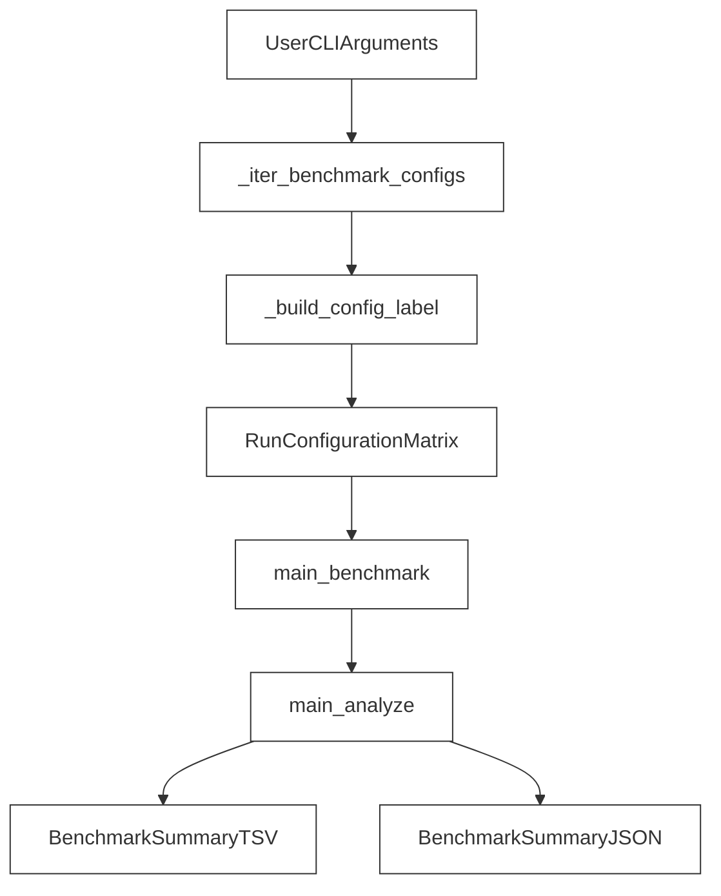
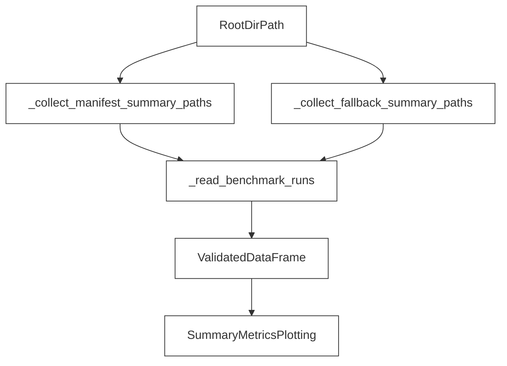

# Benchmarking Framework

Relevant source files

The following files were used as context for generating this wiki page:

- [.github/scripts/benchmark_endpoint_conditions.py](.github/scripts/benchmark_endpoint_conditions.py)
- [.github/scripts/benchmark_endpoint_scaling.py](.github/scripts/benchmark_endpoint_scaling.py)
- [csubst/fitted_model.py](csubst/fitted_model.py)
- [csubst/main_benchmark.py](csubst/main_benchmark.py)
- [csubst/main_benchmark_plot.py](csubst/main_benchmark_plot.py)
- [csubst/plotting.py](csubst/plotting.py)
- [csubst/recoding.py](csubst/recoding.py)
- [docs/ARCHITECTURE.md](docs/ARCHITECTURE.md)
- [pyproject.toml](pyproject.toml)
- [tests/integration/test_main_benchmark.py](tests/integration/test_main_benchmark.py)
- [tests/unit/test_plotting.py](tests/unit/test_plotting.py)
- [tools/bench_3di_modes.sh](tools/bench_3di_modes.sh)
- [tools/evaluate_epistasis_simulation.py](tools/evaluate_epistasis_simulation.py)
- [tools/evaluate_omega_pvalue_refine.py](tools/evaluate_omega_pvalue_refine.py)

## Purpose and Scope
The benchmarking framework provides systematic evaluation capabilities for `csubst` parameter sweeps, performance profiling, and model comparison. It orchestrates combinatorial grid searches across evolutionary models, ASRV (amino acid substitution rate variation) settings, amino acid recoding schemes, and pseudocount policies via `csubst.main_benchmark` [csubst/main_benchmark.py:126-191](). It also provides result aggregation and reporting through `csubst.main_benchmark_plot` [csubst/main_benchmark_plot.py:114-164](), alongside auxiliary shell and Python scripts in `tools/` for native scaling and operational mode evaluations.

---

## 1. Grid Search Orchestration and Parameter Sweeps (`main_benchmark.py`)
The benchmark subsystem expands high-level user options into a combinatorial grid of run configurations. The function `_iter_benchmark_configs()` parses grid parameters such as `benchmark_expectation_methods`, `benchmark_asrv_modes`, `benchmark_nonsyn_recode_modes`, `benchmark_sa_asr_modes`, and `benchmark_pseudocount_modes` [csubst/main_benchmark.py:128-156]().

Each generated configuration is assigned a sanitized label computed by `_build_config_label()`, encoding its expectation method, ASRV mode, recoding scheme, and pseudocount strategy [csubst/main_benchmark.py:56-66](). The orchestrator runs each configuration sequentially through `main_analyze.main_analyze()`, capturing execution outcomes, wall-clock times, hit counts, and score maximums into a structured summary table and output manifest [tests/integration/test_main_benchmark.py:115-160]().

*Figure 1: Natural Language Space to Code Entity Space mapping for the benchmark grid execution pipeline.*

Sources: `csubst/main_benchmark.py:56-191](), [tests/integration/test_main_benchmark.py:115-160]()`

---

## 2. Result Aggregation and Plotting (`main_benchmark_plot.py`)
To summarize large benchmark matrices, `csubst.main_benchmark_plot` discovers and reads execution artifacts. It scans target directories—recursively or flatly—for `csubst_outputs.tsv` manifest files and standalone benchmark summary outputs [csubst/main_benchmark_plot.py:114-164]().

`_collect_manifest_summary_paths()` parses output manifests to locate valid `benchmark_summary_tsv` entries [csubst/main_benchmark_plot.py:116-130](). Once discovered, `_read_benchmark_runs()` validates required columns (`label`, `expectation_method`, `asrv`, `nonsyn_recode`, `sa_asr_mode`, `pseudocount_mode`) and ensures data integrity before aggregation [csubst/main_benchmark_plot.py:173-190]().

*Figure 2: Summary aggregation flow mapping directory inputs to validated dataframes in `main_benchmark_plot`.*

Sources: `csubst/main_benchmark_plot.py:114-193]()`

---

## 3. Specialized Benchmarking and Performance Scripts (`tools/`)
In addition to the core CLI benchmark command, the codebase includes standalone benchmarking scripts in `tools/` and `.github/scripts/`:

* **`tools/bench_3di_modes.sh`**: Evaluates `csubst search` performance across unrecoded alignments, direct 3Di recoding, and translated 3Di scoring modes [tools/bench_3di_modes.sh:4-10](). It configures local path execution, invokes `/usr/bin/time -l`, and records maximum resident set size (`maxrss_bytes`) alongside wall-clock durations [tools/bench_3di_modes.sh:54-148]().
* **`tools/evaluate_omega_pvalue_refine.py`**: Benchmarks omega p-value refinement stages, measuring memory, CPU time, and convergence statistics against baselines [tools/evaluate_omega_pvalue_refine.py:52-73]().
* **`.github/scripts/benchmark_endpoint_scaling.py`**: Profiles parallel scaling (PEPC arity and thread counts) and captures native memory pools via `threadpoolctl` [.github/scripts/benchmark_endpoint_scaling.py:1-93]().

Sources: `tools/bench_3di_modes.sh:4-148](), [tools/evaluate_omega_pvalue_refine.py:52-73](), [.github/scripts/benchmark_endpoint_scaling.py:1-93]()`

---

## 4. Integration Testing and Verification (`test_main_benchmark.py`)
Integration tests ensure that the benchmark configuration generator and execution runner handle edge cases correctly. `tests/integration/test_main_benchmark.py` validates:
* Grid expansion behavior for 3Di modes and default ASRV parameters [tests/integration/test_main_benchmark.py:43-63]().
* Rejection of invalid expectation method tokens or malformed parameters [tests/integration/test_main_benchmark.py:65-82]().
* Fault tolerance and structured summary generation when individual workflow runs fail (`benchmark_keep_going=True`), confirming that both passing and failing runs are properly logged to `csubst_benchmark_summary.tsv`, JSON, and output manifests [tests/integration/test_main_benchmark.py:109-160]().

Sources: `tests/integration/test_main_benchmark.py:43-160]()`

---