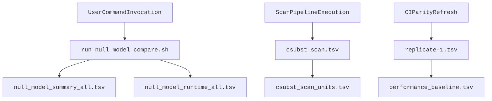
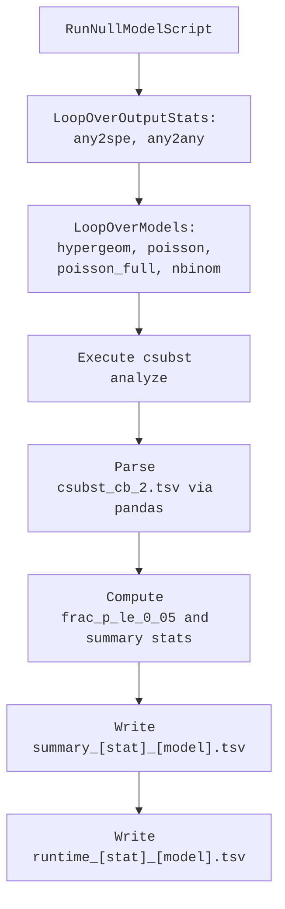

# Validation Reports and Research Artifacts

<details>
<summary>Relevant source files</summary>

The following files were used as context for generating this wiki page:

- [.github/performance_baseline.tsv](.github/performance_baseline.tsv)
- [docs/validation/ci-refresh-20260911/README.md](docs/validation/ci-refresh-20260911/README.md)
- [docs/validation/ci-refresh-20260911/replicate-1.tsv](docs/validation/ci-refresh-20260911/replicate-1.tsv)
- [docs/validation/ci-refresh-20260911/replicate-2.tsv](docs/validation/ci-refresh-20260911/replicate-2.tsv)
- [docs/validation/ci-refresh-20260911/replicate-3.tsv](docs/validation/ci-refresh-20260911/replicate-3.tsv)
- [reports/csubst_scan_method_review_20260625/README.md](reports/csubst_scan_method_review_20260625/README.md)
- [reports/csubst_scan_pepc_20260625/PEPC.foreground.independent.txt](reports/csubst_scan_pepc_20260625/PEPC.foreground.independent.txt)
- [reports/csubst_scan_pepc_20260625/README.md](reports/csubst_scan_pepc_20260625/README.md)
- [reports/csubst_scan_pepc_20260625/default/csubst_foreground_branch.txt](reports/csubst_scan_pepc_20260625/default/csubst_foreground_branch.txt)
- [reports/csubst_scan_pepc_20260625/default/csubst_scan.tsv](reports/csubst_scan_pepc_20260625/default/csubst_scan.tsv)
- [reports/csubst_scan_pepc_20260625/default/csubst_scan_units.tsv](reports/csubst_scan_pepc_20260625/default/csubst_scan_units.tsv)
- [reports/csubst_scan_pepc_20260625/independent_all/csubst_foreground_branch.txt](reports/csubst_scan_pepc_20260625/independent_all/csubst_foreground_branch.txt)
- [reports/csubst_scan_pepc_20260625/independent_all/csubst_scan.tsv](reports/csubst_scan_pepc_20260625/independent_all/csubst_scan.tsv)
- [reports/csubst_scan_pepc_20260625/independent_all/csubst_scan_units.tsv](reports/csubst_scan_pepc_20260625/independent_all/csubst_scan_units.tsv)
- [reports/csubst_scan_pepc_20260625/independent_any2spe/csubst_foreground_branch.txt](reports/csubst_scan_pepc_20260625/independent_any2spe/csubst_foreground_branch.txt)
- [reports/csubst_scan_pepc_20260625/independent_any2spe/csubst_scan.tsv](reports/csubst_scan_pepc_20260625/independent_any2spe/csubst_scan.tsv)
- [reports/csubst_scan_pepc_20260625/independent_any2spe/csubst_scan_units.tsv](reports/csubst_scan_pepc_20260625/independent_any2spe/csubst_scan_units.tsv)
- [reports/efficiency_followup_20261015/README.md](reports/efficiency_followup_20261015/README.md)
- [reports/issue46/REPORT.md](reports/issue46/REPORT.md)
- [reports/issue46/SHA256SUMS.txt](reports/issue46/SHA256SUMS.txt)
- [reports/issue46/ecs_filter_effect_before_after.png](reports/issue46/ecs_filter_effect_before_after.png)
- [reports/issue46/null_model_cdf_after_ecs_filter.png](reports/issue46/null_model_cdf_after_ecs_filter.png)
- [reports/issue46/null_model_frac_le_0_05_after_ecs_filter.png](reports/issue46/null_model_frac_le_0_05_after_ecs_filter.png)
- [reports/issue46/null_model_runtime_after_ecs_filter.png](reports/issue46/null_model_runtime_after_ecs_filter.png)
- [reports/issue46/null_model_runtime_all.tsv](reports/issue46/null_model_runtime_all.tsv)
- [reports/issue46/null_model_summary_all.tsv](reports/issue46/null_model_summary_all.tsv)
- [reports/issue46/run_null_model_compare.sh](reports/issue46/run_null_model_compare.sh)
- [reports/issue46/run_safe_guard_compare.sh](reports/issue46/run_safe_guard_compare.sh)
- [reports/issue93_truth_asr_vs_estimated_asr/pepc/README.md](reports/issue93_truth_asr_vs_estimated_asr/pepc/README.md)
- [reports/issue93_truth_asr_vs_estimated_asr/pepc/analyze_estimated_time_stderr.log](reports/issue93_truth_asr_vs_estimated_asr/pepc/analyze_estimated_time_stderr.log)
- [reports/issue93_truth_asr_vs_estimated_asr/pepc/analyze_truth_time_stderr.log](reports/issue93_truth_asr_vs_estimated_asr/pepc/analyze_truth_time_stderr.log)
- [reports/issue93_truth_asr_vs_estimated_asr/pepc/hashes.sha256](reports/issue93_truth_asr_vs_estimated_asr/pepc/hashes.sha256)
- [reports/issue93_truth_asr_vs_estimated_asr/pepc/omegaC_truth_vs_estimated_log10_panel_3x2_ocn_ge1_color_summary.tsv](reports/issue93_truth_asr_vs_estimated_asr/pepc/omegaC_truth_vs_estimated_log10_panel_3x2_ocn_ge1_color_summary.tsv)
- [reports/issue93_truth_asr_vs_estimated_asr/pepc/omegaC_truth_vs_estimated_scatter_log10_panel_3x2_ocn_ge1_color.png](reports/issue93_truth_asr_vs_estimated_asr/pepc/omegaC_truth_vs_estimated_scatter_log10_panel_3x2_ocn_ge1_color.png)
- [reports/issue93_truth_asr_vs_estimated_asr/pepc/runtime_peak_ram.tsv](reports/issue93_truth_asr_vs_estimated_asr/pepc/runtime_peak_ram.tsv)
- [reports/issue93_truth_asr_vs_estimated_asr/pepc/simulate_time_stderr.log](reports/issue93_truth_asr_vs_estimated_asr/pepc/simulate_time_stderr.log)

</details>


## Purpose and Scope

This page documents the structure, interpretation, and reproduction workflows for validation reports, historical research artifacts, and continuous integration (CI) parity refreshes maintained under the `reports/` and `docs/validation/` directories. These directories house empirical benchmarks, method reviews, null-model statistical comparisons (such as `issue46`), and case studies (such as the PEPC `csubst scan` analysis) that ensure numerical stability, statistical rigor, and backward compatibility across releases.

Sources: [docs/validation/ci-refresh-20260911/README.md:1-56](), [reports/csubst_scan_pepc_20260625/README.md:1-127]()

---

## 1. Artifact Directory Organization and Structure

The repository organizes historical analyses and validation suites into isolated subdirectories. Each artifact directory typically contains command-line invocation scripts, configuration files, raw tab-separated output tables (`.tsv`), summary logs, and markdown reports explaining the findings.

```
reports/
├── csubst_scan_pepc_20260625/          # PEPC dataset scan reports and foreground configurations
│   ├── default/                        # Default single-lineage foreground run outputs
│   ├── independent_any2spe/            # Independent clade foreground with 'any2spe' matching
│   └── independent_all/                # Independent clade foreground with all match classes
├── issue46/                            # Statistical null-model comparison and runtime benchmarks
│   ├── run_null_model_compare.sh       # Shell automation for hypergeom, poisson, nbinom
│   ├── run_safe_guard_compare.sh       # Guard rails and safety check comparisons
│   └── SHA256SUMS.txt                  # Cryptographic hashes of output artifacts
docs/validation/
└── ci-refresh-20260911/                # CI source-artifact refresh, native/fallback parity
    ├── README.md                       # Documentation of parity lanes and numerical checks
    ├── replicate-1.tsv                 # Installed-wheel benchmark replicate 1
    ├── replicate-2.tsv                 # Installed-wheel benchmark replicate 2
    └── replicate-3.tsv                 # Installed-wheel benchmark replicate 3
```

Sources: [docs/validation/ci-refresh-20260911/README.md:1-37](), [reports/csubst_scan_pepc_20260625/README.md:1-75](), [reports/issue46/run_null_model_compare.sh:1-65]()

### Diagram: Artifact Generation and Validation Mapping


Sources: [reports/issue46/run_null_model_compare.sh:1-65](), [reports/csubst_scan_pepc_20260625/independent_all/csubst_scan.tsv:1-10](), [.github/performance_baseline.tsv:1-3]()

---

## 2. Statistical Null-Model Comparisons and Issue 46

Issue 46 investigates the behavior of different null models and long-tail calibration parameters when calculating $\omega_C$ p-values (`pomegaC`). The comparison script `reports/issue46/run_null_model_compare.sh` automates the execution of `csubst analyze` across multiple statistical distributions and output statistics.

### Executed Null Models and Parameters
The script evaluates four primary null distribution models:
1. `hypergeom`: Hypergeometric expectation model.
2. `poisson`: Poisson expectation model.
3. `poisson_full`: Full Poisson model accounting for site-specific rate variation.
4. `nbinom`: Negative binomial model with auto alpha parameter estimation (`--omega_pvalue_nbinom_alpha auto`).

The command execution pattern from `reports/issue46/run_null_model_compare.sh` is structured as follows:

```bash
python -m csubst analyze \
  --alignment_file simulate.fa \
  --rooted_tree_file tree.nwk \
  --foreground foreground.txt \
  --expectation_method urn \
  --output_stat "$stat" \
  --calc_omega_pvalue yes \
  --omega_pvalue_null_model "$model" \
  --omega_pvalue_nbinom_alpha auto \
  --omega_pvalue_niter 1000 \
  --omega_pvalue_rounding round \
  --calibrate_longtail yes \
  --epistasis_site_metric auto \
  --epistasis_beta 0 \
  --threads 1 \
  --branch_dist no --b no --s no --cs no --bs no --cbs no --cb yes
```
Sources: [reports/issue46/run_null_model_compare.sh:1-25]()

### Automated Summary Processing
Post-execution, inline Python blocks parse the generated `csubst_cb_2_*.tsv` tables to compute the fraction of p-values $\le 0.05$ (`frac_p_le_0_05`), mean p-value, and median p-value for both uncalibrated (`nocalib`) and calibrated (`calib`) metrics [reports/issue46/run_null_model_compare.sh:28-41](). Simultaneously, system runtime and peak memory usage are logged via `/usr/bin/time -l -p` and stored in runtime summary tables [reports/issue46/run_null_model_compare.sh:42-52]().

### Diagram: Null Model Evaluation Flow


Sources: [reports/issue46/run_null_model_compare.sh:1-65]()

---

## 3. Substitution Scan Case Studies (PEPC Report)

The `reports/csubst_scan_pepc_20260625/` artifact evaluates the `csubst scan` subcommand using the bundled Phosphoenolpyruvate carboxylase (`PEPC`) dataset.

### Foreground Configuration Strategies
The analysis contrasts two foreground specifications:
1. **Default Foreground (`PEPC.foreground.txt`)**: Encodes all C4 taxa under a single lineage value [reports/csubst_scan_pepc_20260625/README.md:12-13](). Because `--scan_min_support 2` requires shared substitutions across multiple foreground units, a single aggregated unit yields 0 candidate matches [reports/csubst_scan_pepc_20260625/README.md:12-13]().
2. **Independent Foreground (`PEPC.foreground.independent.txt`)**: Assigns individual C4 leaves as independent units while grouping the `Setaria`/`Zea`/`Sorghum` clade as unit 8 [reports/csubst_scan_pepc_20260625/README.md:33]().

```text
1	Alternanthera_pungens_AY950665
2	Amaranthus_hypochondriacus_Z68125
3	Bienertia_sinuspersici_DQ538352
4	Cyperus_sanguinolentus_FM208046
5	Eleocharis_vivipara_AB085948
6	Fimbristylis_littoralis_FM208037
7	Flaveria_australasica_Z25853
8	Setaria_italica_AF495586
8	Sorghum_bicolor_X17379
9	Suaeda_aralocaspica_DQ538353
10	Suaeda_eltonica_DQ538354
8	Zea_mays_X15239
```
Sources: [reports/csubst_scan_pepc_20260625/PEPC.foreground.independent.txt:1-12]()

### Output Table Schema and Metrics
The scan output files (`csubst_scan.tsv`) record detailed statistics for each identified candidate substitution. Key columns include:

| Column Name | Description |
| :--- | :--- |
| `scan_id` | Unique numeric identifier for the candidate substitution row. |
| `site` | Codon or structural alignment site index. |
| `scan_match` | Pattern match class (e.g., `any2spe`, `any2any`, `spe2spe`). |
| `support_unit_count` | Number of foreground units supporting the substitution. |
| `support_fraction` | Fraction of total foreground units supporting the candidate. |
| `target_event_count` | Posterior event mass sum across target foreground branches. |
| `target_exposure` | Branch length adjusted by parent-state opportunity and Q matrix. |
| `p_rate_enrichment` | Poisson LRT p-value testing rate enrichment in target vs. other branches. |
| `site_rate_quantile` | Quantile of the site rate derived from IQ-TREE posterior-mean rates. |

Sources: [reports/csubst_scan_pepc_20260625/independent_all/csubst_scan.tsv:1-10](), [reports/csubst_scan_pepc_20260625/independent_any2spe/csubst_scan.tsv:1-10]()

---

## 4. Parity Refreshes and CI Artifact Management

Continuous integration validation relies on parity checks comparing compiled extension execution against pure-Python fallback execution, as documented in `docs/validation/ci-refresh-20260911/README.md`.

### Parity Lanes and Numerical Checks
- **Parity Lanes**: Numerical agreement is verified across `native.tsv` (Cython C extensions enabled via `CSUBST_STRICT_EXTENSIONS=1`) and `fallback.tsv` (Pure-Python execution via `CSUBST_DISABLE_EXTENSIONS=1`) [docs/validation/ci-refresh-20260911/README.md:14-23]().
- **Inference Defaults**: Modern versions default to joint substitution posteriors and retain invariant tip sites, superseding legacy marginal posteriors (`--substitution_posterior marginal --drop_invariant_tip_sites tip_invariant`) [docs/validation/ci-refresh-20260911/README.md:8-11]().

### Performance Baselines
Performance tracking jobs (`record-parity-baseline`) record median wall times and peak resident set size (RSS) across replicate runs on Linux hosted runners [.github/performance_baseline.tsv:1-3]().

| Dataset | Analyze Median (s) | Analyze Peak RSS (KiB) | Sites Median (s) | Sites Peak RSS (KiB) |
| :--- | ---: | ---: | ---: | ---: |
| PGK | 2.62 | 214,116 | 7.11 | 371,364 |
| PEPC | 7.28 | 358,772 | 17.17 | 908,180 |

Sources: [docs/validation/ci-refresh-20260911/README.md:37-50](), [.github/performance_baseline.tsv:1-3]()

---

## 5. Interpreting and Reproducing Research Artifacts

To reproduce or audit historical validation artifacts:
1. **Environment Setup**: Ensure the installed package matches the targeted git commit (e.g., commit `6963896` or later) with appropriate extension flags set [docs/validation/ci-refresh-20260911/README.md:18]().
2. **Executing Parity Tests**: Run the automated parity test script via `.github/scripts/sites_parity_check.py` with the `--installed --numerical-only` flags [docs/validation/ci-refresh-20260911/README.md:19-20]().
3. **Inspecting Scan Results**: Load `csubst_scan.tsv` and `csubst_scan_units.tsv` into analysis environments using standard tab-separated parsers, noting that scan P-values operate as screening metrics rather than fully confirmatory adaptive tests [reports/csubst_scan_pepc_20260625/README.md:3-4]().

Sources: [docs/validation/ci-refresh-20260911/README.md:18-23](), [reports/csubst_scan_pepc_20260625/README.md:1-8]()

---