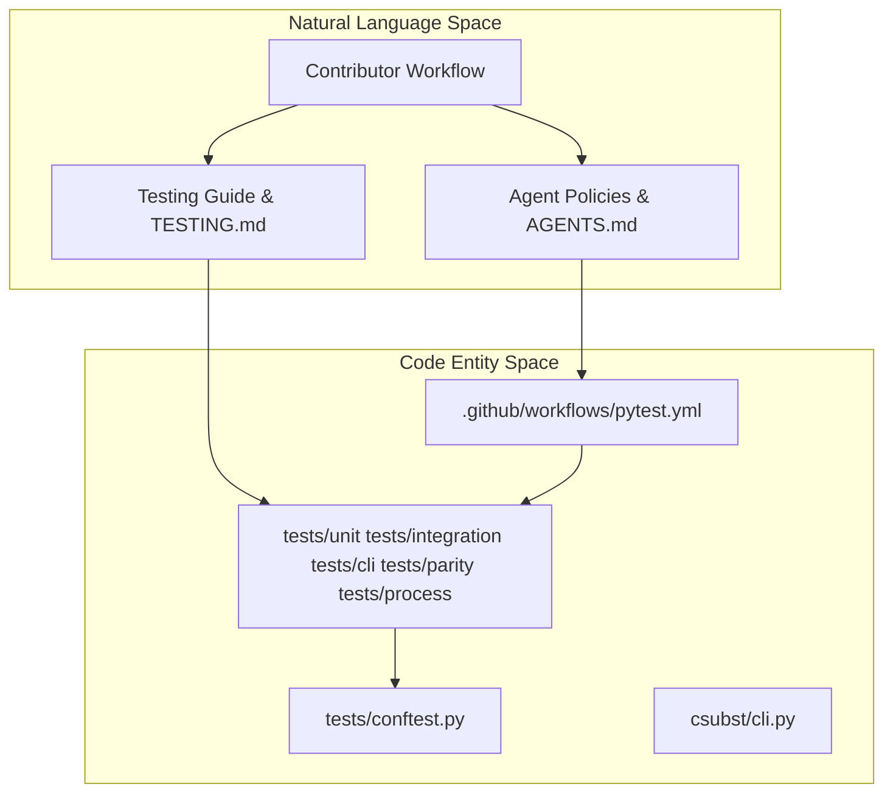
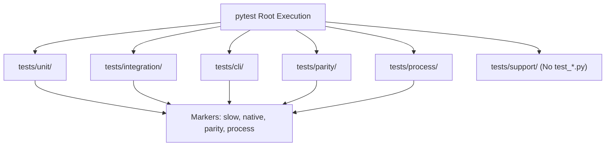

# Development, Testing and CI

Relevant source files

The following files were used as context for generating this wiki page:

- [.agents/skills/benchmark-performance/.kf-agent-policy.json](.agents/skills/benchmark-performance/.kf-agent-policy.json)
- [.agents/skills/benchmark-performance/SKILL.md](.agents/skills/benchmark-performance/SKILL.md)
- [.agents/skills/optimize-github-actions/.kf-agent-policy.json](.agents/skills/optimize-github-actions/.kf-agent-policy.json)
- [.agents/skills/optimize-github-actions/SKILL.md](.agents/skills/optimize-github-actions/SKILL.md)
- [.agents/skills/prepare-github-push/.kf-agent-policy.json](.agents/skills/prepare-github-push/.kf-agent-policy.json)
- [.agents/skills/prepare-github-push/SKILL.md](.agents/skills/prepare-github-push/SKILL.md)
- [.github/scripts/run_sdist_tests.py](.github/scripts/run_sdist_tests.py)
- [.github/workflows/pytest.yml](.github/workflows/pytest.yml)
- [AGENTS.md](AGENTS.md)
- [TESTING.md](TESTING.md)
- [reports/test_suite_speed_20261009.json](reports/test_suite_speed_20261009.json)
- [tests/conftest.py](tests/conftest.py)
- [tests/integration/test_scan_permutations.py](tests/integration/test_scan_permutations.py)
- [tests/support/scan_fixtures.py](tests/support/scan_fixtures.py)
- [tests/unit/test_sparse_reducers.py](tests/unit/test_sparse_reducers.py)

### Purpose and Scope

This page provides a high-level overview of the contributor workflow, test taxonomy, CI automation, packaging pipelines, and agent policies for `csubst`. As a PARENT wiki page, it summarizes core concepts and links to detailed child pages for test structures, CI workflows, and contribution guidelines.

Sources: [AGENTS.md:38-73](), [TESTING.md:1-15]()

---

## 1. Contributor Workflow and Test Overview

The development lifecycle for `csubst` balances rigorous numerical validation, performance regression tracking, and cross-platform wheel packaging. Contributors interact with the repository through standard python environments, make targets, pytest suites, and agent policies.

*Figure 1: Bridge from natural language contributor guidelines and testing documentation to code execution structures.*

Sources: [AGENTS.md:1-47](), [.github/workflows/pytest.yml:1-30](), [TESTING.md:1-25]()

---

## 2. Test Suite Structure

For details, see [Test Suite Structure](#7.1).

The `tests/` directory is organized into distinct subdirectories based on the nature of the feedback each test provides. The test runner uses `tests/conftest.py` to configure pytest hooks, apply taxonomy markers from directory paths, and manage test isolation [tests/conftest.py:51-96]().

- `tests/unit/`: Focused tests for numerical calculations, parsers, validation, and rendering helpers [TESTING.md:5-6]().
- `tests/integration/`: Orchestration checks across modules, files, processes, caches, and command implementations [TESTING.md:7-8]().
- `tests/cli/`: Command-line parser and executable entry-point subprocess checks [TESTING.md:9-10]().
- `tests/parity/`: Numerical comparisons against independent implementations and execution backends [TESTING.md:11-11]().
- `tests/process/`: Integration tests running worker processes in a separate serial lane [TESTING.md:12-13]().
- `tests/support/`: Reusable factories and fakes without the `test_*.py` naming pattern [TESTING.md:14-15]().

*Figure 2: Test suite taxonomy and directory structure.*

Sources: [TESTING.md:1-16](), [tests/conftest.py:79-96]()

---

## 3. CI Workflows and Packaging

For details, see [CI Workflows and Packaging](#7.2).

Continuous Integration is governed by GitHub Actions workflows defined in `.github/workflows/pytest.yml`. The pipeline manages scoping, fast unit tests across multiple Python versions, packaging checks, full test suites against installed wheels, and pure-Python fallback validation.

- **Scope Job:** Evaluates conditional runs and validation coverage using `.github/scripts/ci_scope.py` [.github/workflows/pytest.yml:24-37]().
- **Fast Tests:** Runs unit and CLI tests across Python versions (`3.10`, `3.11`, `3.13`, `3.14`) with strict native extension validation [.github/workflows/pytest.yml:38-75]().
- **Packaging:** Builds source distributions (`.tar.gz`), rebuilds wheels from generated C code (`CSUBST_USE_CYTHON=0`), and verifies package metadata via `twine` [.github/workflows/pytest.yml:76-120]().
- **Full Test Suite:** Installs built wheels in an isolated environment and runs parallel-safe tests alongside nested-process tests [.github/workflows/pytest.yml:121-171]().
- **Pure-Python Fallback:** Disables Cython extensions (`CSUBST_SKIP_EXTENSIONS=1`, `CSUBST_DISABLE_EXTENSIONS=1`) to verify fallback correctness [.github/workflows/pytest.yml:172-194]().

Sources: [.github/workflows/pytest.yml:1-194]()

---

## 4. Contributing and Agent Policies

For details, see [Contributing and Agent Policies](#7.3).

Contributor workflows and autonomous agent operations are regulated by `AGENTS.md` and repository-specific skill policies under `.agents/skills/`. Key policies include:

- **Scientific Default Preservation:** Never change default null models, filtering thresholds, pseudocounts, or calibration routines without documented scientific justification [AGENTS.md:56-62]().
- **API and Output Stability:** Preserve CLI argument names, output schemas, alias support, and saved-data compatibility [AGENTS.md:63-65]().
- **Verification Routine:** Always run appropriate check entrypoints (`make test-fast`, `make lint`, `make typecheck`) before reporting completion [AGENTS.md:48-55]().

Sources: [AGENTS.md:1-73]()

---