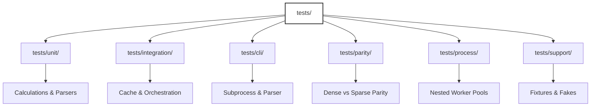
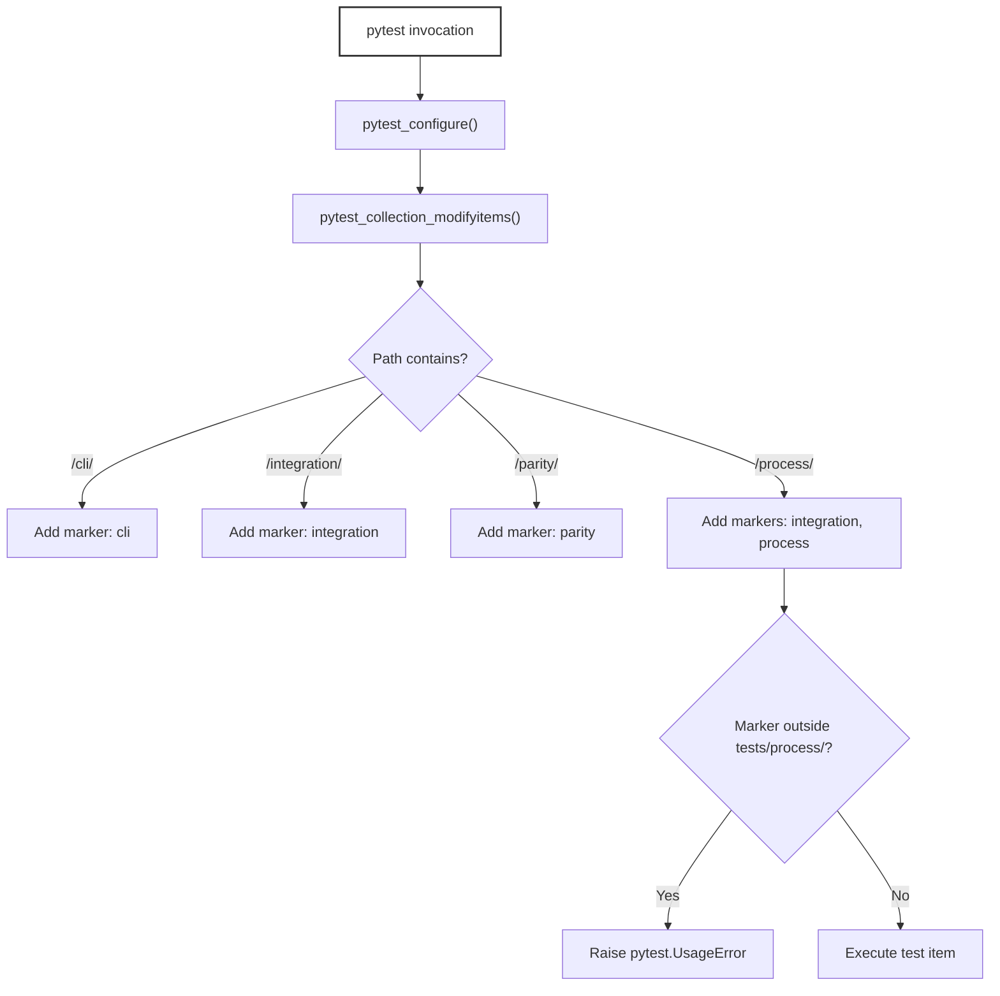
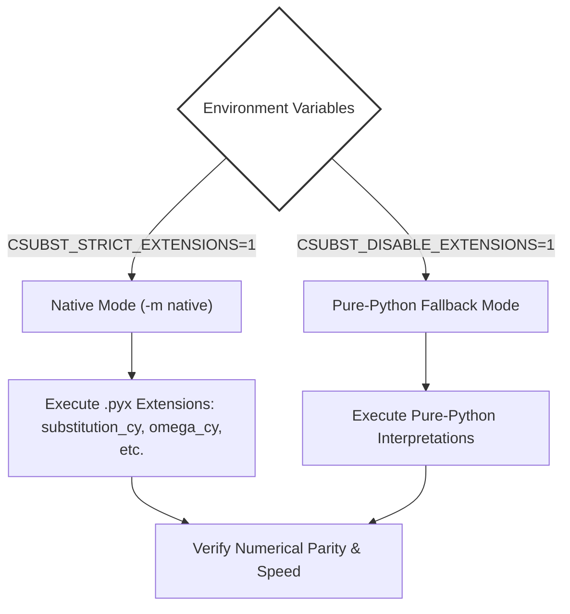

# Test Suite Structure

Relevant source files

The following files were used as context for generating this wiki page:

- [.github/scripts/run_sdist_tests.py](.github/scripts/run_sdist_tests.py)
- [.github/workflows/pytest.yml](.github/workflows/pytest.yml)
- [TESTING.md](TESTING.md)
- [pytest.ini](pytest.ini)
- [reports/test_suite_speed_20261009.json](reports/test_suite_speed_20261009.json)
- [tests/conftest.py](tests/conftest.py)
- [tests/integration/test_main_benchmark_plot.py](tests/integration/test_main_benchmark_plot.py)
- [tests/integration/test_scan_permutations.py](tests/integration/test_scan_permutations.py)
- [tests/support/scan_fixtures.py](tests/support/scan_fixtures.py)
- [tests/unit/test_integer_identifiers.py](tests/unit/test_integer_identifiers.py)
- [tests/unit/test_recoding_outputs.py](tests/unit/test_recoding_outputs.py)
- [tests/unit/test_sequence_parallel_utility.py](tests/unit/test_sequence_parallel_utility.py)
- [tests/unit/test_sparse_reducers.py](tests/unit/test_sparse_reducers.py)
- [tests/unit/test_table_operations.py](tests/unit/test_table_operations.py)

### Purpose and Scope
This page details the structural organization, taxonomy, configuration, and execution modes of the `csubst` test suite. The test suite is engineered to provide fast feedback for individual module changes while rigorously validating cross-module integration, command-line interfaces, numerical parity across dense/sparse representations, and compiled Cython versus pure-Python fallback code paths.

Sources: `TESTING.md:1-16](), `[pytest.ini:1-12]()

---

## 1. Test Directory Taxonomy

The `tests/` directory is partitioned by the scope and nature of feedback each suite provides, preventing slow or side-effect-heavy tests from burdening the inner development loop [TESTING.md:1-16]().

*   `tests/unit/`: Contains focused, isolated tests for mathematical calculations, sequence parsers, schema validation, table operations, and rendering helpers [TESTING.md:5-6]().
*   `tests/integration/`: Covers orchestration across multiple modules, file systems, disk caches, and command implementations [TESTING.md:7-8]().
*   `tests/cli/`: Validates command-line argument parsing (`_build_parser`) and executes a focused set of end-to-end subprocess CLI checks [TESTING.md:9-10]().
*   `tests/parity/`: Compares independent implementation pathways, numerical backends (dense tensor vs. packed CSR sparse representation), and execution modes [TESTING.md:11]().
*   `tests/process/`: Houses integration tests that spawn nested worker processes (multiprocessing pools) and must run serially outside `pytest-xdist` to avoid scheduling contention [TESTING.md:12-13]().
*   `tests/support/`: Provides reusable factories, fixtures, and fakes (e.g., `scan_fixtures.py`, `pymol_fakes.py`). Files here deliberately omit the `test_*.py` naming pattern so `pytest` does not treat them as test cases [TESTING.md:14-15]().

Sources: `TESTING.md:1-16](), `[tests/conftest.py:79-96]()

---

## 2. Pytest Configuration, Markers, and Fixtures

The behavior of `pytest` is governed by `pytest.ini` [pytest.ini:1-12]() and `tests/conftest.py` [tests/conftest.py:1-96](). `pytest.ini` enforces strict configuration and strict marker declarations [pytest.ini:4]().

### Custom Markers
`tests/conftest.py` uses `pytest_collection_modifyitems` to automatically assign suite markers based on the file path taxonomy [tests/conftest.py:79-96](). Explicit `process` markers placed outside `tests/process/` trigger a `pytest.UsageError` during collection [tests/conftest.py:92-96]().

| Marker | Description | Invocation Selector |
| :--- | :--- | :--- |
| `cli` | Exercises command-line parsing or executable entry points [pytest.ini:6]() | `pytest -q tests/cli` |
| `integration` | Exercises coordination across modules, files, or processes [pytest.ini:7]() | `pytest -q tests/integration` |
| `slow` | Takes materially longer than ordinary unit tests [pytest.ini:8]() | `pytest -q -m slow` |
| `process` | Starts nested worker processes; runs in serial lane [pytest.ini:9]() | `pytest -q tests/process` |
| `parity` | Compares independent implementations or execution backends [pytest.ini:10]() | `pytest -q -m parity` |
| `requires_cython` | Requires compiled Cython extension modules [pytest.ini:11]() | `pytest -q -m requires_cython` |
| `native` | Validates real compiled accelerator paths (Memmaps/NumPy/Pandas) [pytest.ini:12]() | `pytest -q -m native` |

### Conftest Environment and Concurrency
*   **Path Routing**: `tests/conftest.py` inspects `CSUBST_TEST_INSTALLED`. When unset, it routes imports directly to the local checkout [tests/conftest.py:10-22](). When set to `1`, it enforces testing against the installed site-packages distribution [tests/conftest.py:14-18]().
*   **Matplotlib Cache Isolation**: To prevent font cache rebuild bottlenecks across parallel workers, `MPLCONFIGDIR` is dynamically redirected to `.pytest_cache/matplotlib/` [tests/conftest.py:40-48]().
*   **Worker Capping**: `pytest_xdist_auto_num_workers` caps automatic parallel execution at four workers to avoid collection overhead, excessive memory pressure, and scheduling contention on constrained runners [tests/conftest.py:57-63]().

Sources: `tests/conftest.py:1-97](), `[pytest.ini:1-12]()

---

## 3. Execution Modes: Native Acceleration vs. Pure-Python Fallback

`csubst` supports both high-performance compiled Cython extensions and pure-Python fallbacks. The test suite verifies both code paths through environment variable controls.

### Native Execution Mode
*   **Trigger**: Setting `CSUBST_STRICT_EXTENSIONS=1` combined with the `-m native` pytest filter [TESTING.md:79-89]().
*   **Behavior**: Validates that operations strictly execute through compiled Cython modules (`substitution_cy`, `substitution_sparse_cy`, `omega_cy`, `combination_cy`, `recoding_cy`, `parser_iqtree_cy`) without silently falling back to pure-Python routines [.github/workflows/pytest.yml:66](). Tests verify read-only NumPy arrays, memmaps, and pandas-backed structures [TESTING.md:79-80]().

### Pure-Python Fallback Mode
*   **Trigger**: Setting environment variables `CSUBST_SKIP_EXTENSIONS=1` and `CSUBST_DISABLE_EXTENSIONS=1` during installation and test execution [.github/workflows/pytest.yml:178-179](), [TESTING.md:47-50]().
*   **Behavior**: Simulates environments where Cython binaries are absent or disabled, ensuring that core scientific calculations yield identical numerical results via pure-Python fallback implementations.

Sources: `.github/workflows/pytest.yml:66-179](), `[TESTING.md:44-90]()

---