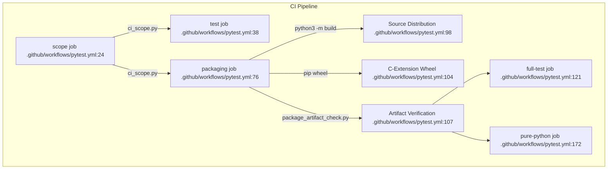
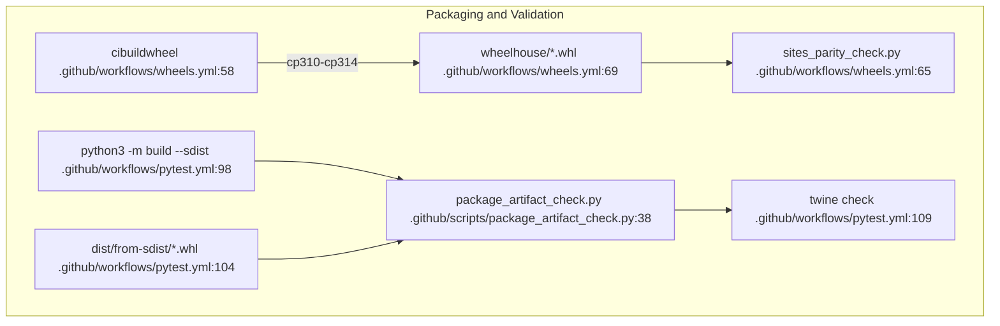
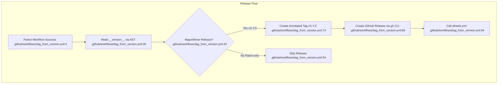

# CI Workflows and Packaging

Relevant source files

The following files were used as context for generating this wiki page:

- [.github/dependabot.yml](.github/dependabot.yml)
- [.github/scripts/_safe_workdir.py](.github/scripts/_safe_workdir.py)
- [.github/scripts/package_artifact_check.py](.github/scripts/package_artifact_check.py)
- [.github/scripts/repository_hygiene_check.py](.github/scripts/repository_hygiene_check.py)
- [.github/scripts/run_sdist_tests.py](.github/scripts/run_sdist_tests.py)
- [.github/scripts/sites_parity_check.py](.github/scripts/sites_parity_check.py)
- [.github/workflows/dependabot-ci-notify.yml](.github/workflows/dependabot-ci-notify.yml)
- [.github/workflows/dependency-audit.yml](.github/workflows/dependency-audit.yml)
- [.github/workflows/pytest.yml](.github/workflows/pytest.yml)
- [.github/workflows/tag_from_version.yml](.github/workflows/tag_from_version.yml)
- [.github/workflows/wheels.yml](.github/workflows/wheels.yml)
- [MANIFEST.in](MANIFEST.in)
- [RELEASING.md](RELEASING.md)
- [TESTING.md](TESTING.md)
- [docs/validation/ci-refresh-20260911/fallback.tsv](docs/validation/ci-refresh-20260911/fallback.tsv)
- [docs/validation/ci-refresh-20260911/legacy.tsv](docs/validation/ci-refresh-20260911/legacy.tsv)
- [docs/validation/ci-refresh-20260911/native.tsv](docs/validation/ci-refresh-20260911/native.tsv)
- [reports/test_suite_speed_20261009.json](reports/test_suite_speed_20261009.json)
- [tests/conftest.py](tests/conftest.py)
- [tests/integration/test_scan_permutations.py](tests/integration/test_scan_permutations.py)
- [tests/support/scan_fixtures.py](tests/support/scan_fixtures.py)
- [tests/unit/test_sparse_reducers.py](tests/unit/test_sparse_reducers.py)

## Purpose and Scope

This page documents the continuous integration (CI) pipelines, packaging specifications, release automation, and artifact verification checks for `csubst`. The infrastructure ensures cross-platform compatibility, strict numerical parity, robust wheel and source distribution layouts, dependency auditing, and automated semantic releases driven by package version metadata.

Sources: [.github/workflows/pytest.yml:1-194](), [.github/workflows/wheels.yml:1-76](), [.github/workflows/tag_from_version.yml:1-96]()

---

## GitHub Actions Pytest Orchestration (`pytest.yml`)

The primary continuous integration suite is orchestrated via `.github/workflows/pytest.yml`. The workflow executes across multiple jobs triggered on pushes to `master`, pull requests, scheduled cron runs, and manual dispatches.

*Diagram 1: Overview of the GitHub Actions CI pipeline flow from scope evaluation to packaging and testing.*

Sources: [.github/workflows/pytest.yml:24-194]()

### Job Architecture

1. **`scope`**: Evaluates whether numerical validation or comparison history checks need to run using `.github/scripts/ci_scope.py` [.github/workflows/pytest.yml:24-36]().
2. **`test`**: Runs fast unit and CLI tests across a matrix of Python versions (`3.10`, `3.11`, `3.13`, `3.14`) with `CSUBST_STRICT_EXTENSIONS="1"` enforcing native extension usage [.github/workflows/pytest.yml:38-75]().
3. **`packaging`**: Builds the source distribution (`--sdist`), rebuilds wheels from generated C files in the sdist (`CSUBST_USE_CYTHON="0"`), runs `.github/scripts/package_artifact_check.py`, validates metadata via `twine check`, and uploads artifacts [.github/workflows/pytest.yml:76-120]().
4. **`full-test`**: Installs the generated wheel in an isolated environment (`.github/scripts/install_test_artifact.py`), smoke-tests the CLI outside the repository checkout, and executes parallel-safe and process-isolated test suites with coverage tracking (`--cov=csubst`) [.github/workflows/pytest.yml:121-171]().
5. **`pure-python`**: Validates pure-Python execution fallbacks by setting `CSUBST_SKIP_EXTENSIONS="1"` and `CSUBST_DISABLE_EXTENSIONS="1"` [.github/workflows/pytest.yml:172-194]().

Sources: [.github/workflows/pytest.yml:24-194]()

---

## Packaging, Wheel Building, and Artifact Validation

Packaging configuration is defined in `pyproject.toml`, `setup.py`, and `MANIFEST.in`. Binary wheel generation across platforms and architectures is handled by `.github/workflows/wheels.yml` using `cibuildwheel`.

*Diagram 2: Wheel compilation, sdist generation, and artifact validation flow.*

Sources: [.github/workflows/wheels.yml:58-70](), [.github/workflows/pytest.yml:98-109](), [.github/scripts/package_artifact_check.py:38-110]()

### Artifact Inspection (`package_artifact_check.py`)

The script `[.github/scripts/package_artifact_check.py]()` enforces strict constraints on distribution contents and metadata:
- **Cython Source Inclusion**: Requires `.pyx` sources for `combination_cy`, `omega_cy`, `parser_iqtree_cy`, `recoding_cy`, `substitution_cy`, and `substitution_sparse_cy` in source distributions (`.tar.gz`), while forbidding precompiled `.c` and `.pyx` files inside binary wheels [.github/scripts/package_artifact_check.py:9-15](), [.github/scripts/package_artifact_check.py:40](), [.github/scripts/package_artifact_check.py:90-95]().
- **Notices and Licenses**: Verifies inclusion of `LICENSE`, `THIRD_PARTY_NOTICES.md`, Biopython license extracts, and Pyvolve licenses [.github/scripts/package_artifact_check.py:41-46]().
- **Dependency Audit**: Inspects `Requires-Dist` metadata to ensure dependencies (`numpy`, `scipy`, `pandas`, `matplotlib`, `defusedxml`, `requests`, `ete4`) are present, confirms Biopython is excluded, and verifies the optional structure extra dependency on `pymol-open-source` (`>=3.2.0a0`, `<3.3`) [.github/scripts/package_artifact_check.py:103-129]().
- **Console Entry Point**: Validates that `csubst = csubst.cli:main` is correctly registered in `.dist-info/entry_points.txt` [.github/scripts/package_artifact_check.py:114-119]().

Sources: [.github/scripts/package_artifact_check.py:1-138]()

---

## Parity and Performance Regression Gates

To prevent numerical drift and performance regressions, `csubst` runs scientific parity benchmarks on precomputed datasets (`PGK` and `PEPC`) via `[.github/scripts/sites_parity_check.py]()`.

- **Measurement Wrapper**: Wraps execution using `/usr/bin/time -v` (GNU time) on Linux or `-l` on macOS to capture wall-clock time and maximum resident set size (RSS in kilobytes) `[.github/scripts/sites_parity_check.py:133-157]()`.
- **Thresholds**: Compares execution metrics against `PERFORMANCE_LIMITS` and versioned baselines (`[.github/performance_baseline.tsv]()`), failing builds if order-of-magnitude memory leaks or severe speed regressions occur `[.github/scripts/sites_parity_check.py:45-60]()`.

Sources: [.github/scripts/sites_parity_check.py:1-157]()

---

## Release Automation and Tag-from-Version Flow

Releases are fully automated via `[.github/workflows/tag_from_version.yml]()`, which triggers upon successful completion of the `Pytest` workflow on the `master` branch or via manual dispatch `[.github/workflows/tag_from_version.yml:4-7]()`.

*Diagram 3: Automated release decision tree driven by package version metadata.*

Sources: [.github/workflows/tag_from_version.yml:1-96]()

### Version Classification Logic

1. **AST Extraction**: Extracts `__version__` from `[csubst/__init__.py]()` using Python's `ast` module without importing the package during workflow evaluation `[.github/workflows/tag_from_version.yml:36]`.
2. **Semantic Filtering**: Evaluates whether the patch component is `0` (`MAJOR.MINOR.0`). Only major and minor releases trigger automated annotated git tags (`vX.Y.0`) and GitHub Releases; patch-only versions skip tagging `[.github/workflows/tag_from_version.yml:42-55]`.
3. **Workflow Chaining**: Triggers `[.github/workflows/wheels.yml]()` with the newly created release tag ref to compile binary wheels for all target platforms `[.github/workflows/wheels.yml:10-15]`, `[.github/workflows/tag_from_version.yml:89-97]`.

Sources: [.github/workflows/tag_from_version.yml:32-96]()

---

## Test Environment Isolation and Cython Extension Controls

Test execution behavior is governed by environment variables and fixtures defined in `[tests/conftest.py]()` and `[TESTING.md]()`.

- **`CSUBST_TEST_INSTALLED`**: When set to `"1"`, `[tests/conftest.py]()` removes the repository root from `sys.path` and forces tests to run against the globally installed package artifact rather than the local source tree `[tests/conftest.py:10-18]()`.
- **Cython Acceleration Switches**:
  - `CSUBST_STRICT_EXTENSIONS="1"`: Forces tests marked with `@pytest.mark.native` to fail if Cython extensions are missing or fall back to Python `[TESTING.md:79-89]()`.
  - `CSUBST_SKIP_EXTENSIONS="1"` / `CSUBST_DISABLE_EXTENSIONS="1"`: Bypasses C extensions to validate pure-Python reference fallback calculations `[.github/workflows/pytest.yml:178-179]`, `[TESTING.md:44-50]`.
- **Worker Concurrency**: `[tests/conftest.py]()` implements `pytest_xdist_auto_num_workers` to cap parallel workers at `4` to prevent memory contention and collection overhead on hosted runners `[tests/conftest.py:57-63]()`.

Sources: [tests/conftest.py:1-96](), [TESTING.md:1-143](), [.github/workflows/pytest.yml:172-194]()

---