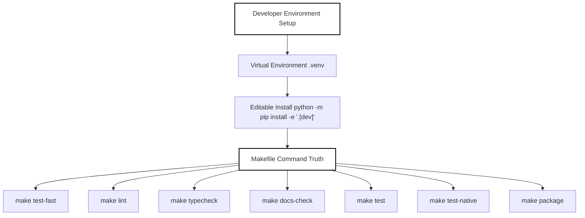
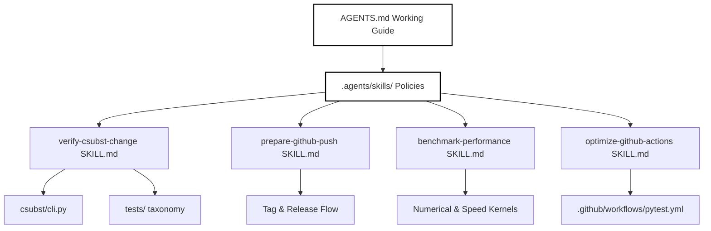

# Contributing and Agent Policies

<details>
<summary>Relevant source files</summary>

The following files were used as context for generating this wiki page:

- [.agents/skills/benchmark-performance/.kf-agent-policy.json](.agents/skills/benchmark-performance/.kf-agent-policy.json)
- [.agents/skills/benchmark-performance/SKILL.md](.agents/skills/benchmark-performance/SKILL.md)
- [.agents/skills/optimize-github-actions/.kf-agent-policy.json](.agents/skills/optimize-github-actions/.kf-agent-policy.json)
- [.agents/skills/optimize-github-actions/SKILL.md](.agents/skills/optimize-github-actions/SKILL.md)
- [.agents/skills/prepare-github-push/.kf-agent-policy.json](.agents/skills/prepare-github-push/.kf-agent-policy.json)
- [.agents/skills/prepare-github-push/SKILL.md](.agents/skills/prepare-github-push/SKILL.md)
- [.agents/skills/verify-csubst-change/SKILL.md](.agents/skills/verify-csubst-change/SKILL.md)
- [.gitignore](.gitignore)
- [AGENTS.md](AGENTS.md)
- [CONTRIBUTING.md](CONTRIBUTING.md)
- [LICENSE](LICENSE)

</details>


## Purpose and Scope

This page details the development workflows, contributor guidelines, automated agent policies, verification skills, and scientific-default preservation rules for the `csubst` repository. It provides technical specifications for setting up the development environment, invoking Makefile targets, running targeted verification regression checks, managing Cython extensions, and maintaining numerical and scientific parity across releases [CONTRIBUTING.md:1-51](), [AGENTS.md:38-73]().

Sources: [CONTRIBUTING.md:1-51](), [AGENTS.md:38-73]()

---

## Contribution Workflow and Environment Setup

The development workflow requires Python 3.12 for complete local verification lanes while preserving compatibility across Python 3.10–3.14 [CONTRIBUTING.md:3-4](). Developers initialize an isolated virtual environment and install the package in editable mode with development dependencies:

```bash
python3.12 -m venv .venv
source .venv/bin/activate
python -m pip install -e '.[dev]'
```

The native compilation requires a C compiler for optional Cython modules, whereas IQ-TREE is managed independently for phylogenetic tree and ancestral state reconstruction fits [CONTRIBUTING.md:12-14](). Common tasks are governed by the `Makefile` [CONTRIBUTING.md:19-35]() which serves as the command source of truth [CONTRIBUTING.md:37-38]():

* `make test-fast`: Executes quick unit test suites.
* `make lint`: Validates static code style and checks documentation validity without network access [CONTRIBUTING.md:56-57]().
* `make typecheck`: Runs static type analysis using `mypy`.
* `make docs-check`: Verifies Wiki syntax, local links, and internal document structures [CONTRIBUTING.md:59-65]().
* `make test`: Runs the standard test suite.
* `make test-native`: Executes tests exercising native C/Cython extensions.
* `make package`: Builds source distributions and binary wheels.

The environment variable `PYTHON=/path/to/python` can be passed to target alternative interpreters [CONTRIBUTING.md:33-34]().



*Figure 1: Contributor command and verification pipeline mapping Makefile targets to the development workflow.*

Sources: [CONTRIBUTING.md:3-38]()

---

## Agent Policies and Working Guides

Automated agents and human contributors alike operate under a shared governance model defined in `AGENTS.md` and repo-specific policies [AGENTS.md:1-4]`[AGENTS.md:38-40]()`. 

### Core Agent Directive Rules
1. **Scope and Preservation**: Complete tasks through verification without unauthorized changes to unrelated modules [AGENTS.md:6-10](). Preserve existing public APIs, file formats, and saved-data compatibility [AGENTS.md:18-20]().
2. **Branch Management**: Never create or switch branches solely for commits, pushes, releases, or pull requests unless explicitly instructed [AGENTS.md:12-14]().
3. **Root Cause Analysis**: Fix verified root causes rather than concealing failures with weaker checks or fallback logic [AGENTS.md:21-22]().
4. **Library Metadata**: Keep reproducibility locks separate from library requirement pins; avoid arbitrary upper bounds without demonstrated incompatibility [AGENTS.md:26-27]().

### Repository Working Rules for CSUBST
* **Code Paths**: CLI parsing starts in `csubst/cli.py`; command orchestration occurs in `main_*` routines; parameter validation resides in `param.py`; numerical kernels execute inside `substitution*`, `omega*`, and `scan_*` modules [AGENTS.md:44-47]().
* **Temporary Data**: Run analyses in fresh temporary directories (`/tmp/` or pytest fixtures) and avoid modifying bundled datasets under `csubst/dataset/` [AGENTS.md:66-68]().
* **Diff Verification**: Review changes with `git diff --check` and verify execution outcomes across native and fallback modes [AGENTS.md:51-52](), [AGENTS.md:71-72]().

Sources: [AGENTS.md:1-73]()

---

## `.agents/skills/` Policies and Specialized Workflows

Specialized execution tasks use self-contained skills located in `.agents/skills/`. Each skill provides structured guidance for high-risk or repetitive operational flows.



*Figure 2: Agent skill dispatch network associating operational skills with internal code entity spaces.*

### Skill Definitions and Technical Scope
* **`verify-csubst-change`**: Selects and runs focused regression tests based on changed paths and diffs, avoiding unnecessary large-scale downloads or benchmarks [`.agents/skills/verify-csubst-change/SKILL.md:1-42`]().
* **`prepare-github-push`**: Oversees remote push preparation, commit verification, version scheme compliance, and delivery check entrypoints [`.agents/skills/prepare-github-push/SKILL.md:6-21`]().
* **`benchmark-performance`**: Governs runtime, throughput, and memory benchmarking, requiring comparable baselines and measured bottlenecks before code optimization [`.agents/skills/benchmark-performance/SKILL.md:6-15`]().
* **`optimize-github-actions`**: Reviews CI workflows in `.github/workflows/` (such as `pytest.yml`), removing redundant validation while protecting required test coverage [`.agents/skills/optimize-github-actions/SKILL.md:8-15`]().

Sources: [`.agents/skills/verify-csubst-change/SKILL.md:1-42`](), [`.agents/skills/prepare-github-push/SKILL.md:6-21`](), [`.agents/skills/benchmark-performance/SKILL.md:6-15`](), [`.agents/skills/optimize-github-actions/SKILL.md:8-15`]()

---

## Code Architecture, Accelerators, and Safety Contracts

Contributors must maintain strict modular boundaries and respect accelerator fallback contracts:
* **Separation of Concerns**: Command orchestration remains isolated in `csubst/cli.py`, pure I/O in input parsers, and numerical kernels behind compact Python/Cython contracts [CONTRIBUTING.md:40-41]().
* **Cython Fallback Contract**: Any new or modified Cython module (`.pyx`) must maintain an equivalent, fully tested pure-Python implementation [CONTRIBUTING.md:41-42]().
* **Environment Controls**:
  * `CSUBST_DISABLE_EXTENSIONS=1`: Forces execution of the pure-Python fallback code paths to verify correctness [CONTRIBUTING.md:42-43]().
  * `CSUBST_STRICT_EXTENSIONS=1`: Elevates an accelerator compilation or import failure into a hard runtime error rather than issuing a warning and falling back [CONTRIBUTING.md:43-44]().
* **CLI and Output Safety**: CLI argument aliases, output file naming schemas (e.g., `csubst.outputs.tsv`), cache compatibility, and collision checks must be preserved as outlined in `docs/CLI_SAFETY.md` [AGENTS.md:63-65]().

Sources: [CONTRIBUTING.md:40-44](), [AGENTS.md:63-65]()

---

## Scientific-Default Preservation Rules

Preserving numerical rigor and biological validity is a strict requirement for all contributions:
* **Estimator Distinction**: Joint endpoint posteriors and legacy marginal ancestral state estimators are distinct statistical models; code changes must not conflate them [AGENTS.md:57-59]().
* **Null Models and Calibration**: Do not alter null models, substitution rate matrices, pseudocount strategies, ASRV handling, or $d_{SC}$ long-tail calibration thresholds without comprehensive methodological justification [AGENTS.md:59-61]().
* **Tolerances**: Relaxing test assertions or regenerating reference baseline files merely to make a failing integration test pass is prohibited [AGENTS.md:61-62]().

Sources: [AGENTS.md:56-62]()

---

## Documentation, Testing, and Wiki Verification

Documentation integrity is enforced through static checks and specialized local validation loops. 

### Wiki Verification Process
When modifying documentation or drafting Wiki pages, contributors must execute a local wiki validation pass using `docs-check` [CONTRIBUTING.md:59-65]():

```bash
CSUBST_WIKI_DIR="$(mktemp -d)"
git clone https://github.com/kfuku52/csubst.wiki.git "$CSUBST_WIKI_DIR"
make docs-check WIKI_DIR="$CSUBST_WIKI_DIR"
```

The validation harness parses command syntax, heading references, and internal file/image links without requiring external network access [CONTRIBUTING.md:56-57](), [CONTRIBUTING.md:68-69](). 

### Basic Integration Smoke Test
Before committing command-line updates, contributors run a basic smoke test against bundled sample datasets:

```bash
csubst dataset --name PGK
csubst sites --alignment alignment.fa.gz --tree tree.nwk --branch_ids 23,51
```

This generates output manifests at `csubst_sites/csubst.branch_id23,51/csubst.outputs.tsv`, verifying that command-line options, parsing logic, and output schemas remain fully aligned [CONTRIBUTING.md:70-74]().

Sources: [CONTRIBUTING.md:56-74]()

---